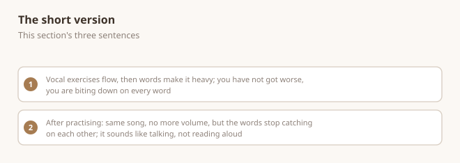
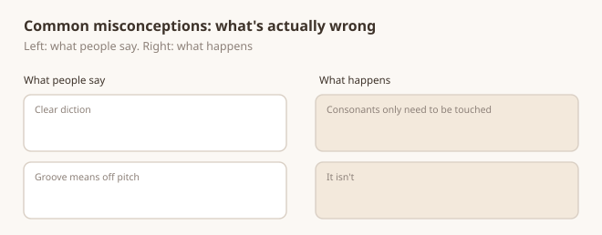
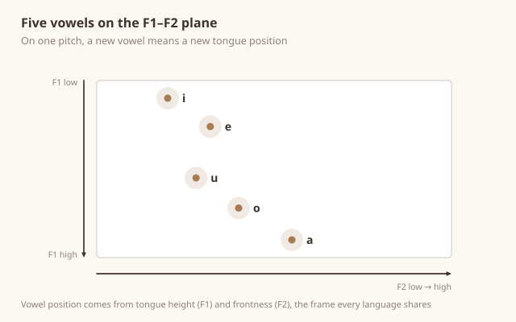
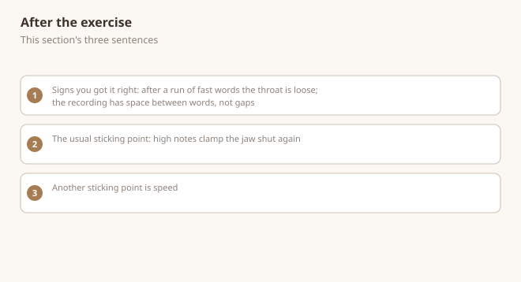

# Chapter 33: The Acoustics of Vowels and Consonants: Making Diction Part of the Groove

## The short version

If your exercises flow and then turn clumsy the moment the words arrive, you usually have not gone backwards; you are biting down on every syllable. Consonants carry the rhythm, vowels carry the sound. Short consonants and long vowels, and the line starts to move.

What you will find after practising: on the same song, without singing any louder, the syllables stop jamming against each other and it sounds like talking, not like reciting a text.

## Common misconceptions

Many people think clear diction means biting every syllable through to the end. A consonant only has to touch. The longer you hold it, the more finely the airflow is chopped up, the more tired the throat gets, and the line comes out in blocks.

Another misconception is that groove means being out of tune. It does not. Groove is this: you know exactly where the beat is, and the consonant arrives a little early while the vowel lands on the beat. The beat has not gone anywhere; you simply reached it a step ahead.

Others assume unclear singing means a tongue that is not nimble enough. Most of the time the jaw is too busy and the consonants are too long, and the tongue is taking the blame for both.

## How it works

Most consonants are unvoiced. In P, T and K the airflow is briefly blocked by the lips, the tip of the tongue or the back of the tongue; these are plosives. In S the airflow is not blocked but forced through a narrow gap in the teeth, making friction noise; this is a fricative. With all of these the vocal folds stop vibrating for a moment. If every consonant is heavy and long, the folds have to restart over and over, and of course the throat gets tired.

Vowels are the opposite. On "ah", "ee" and "oo" the vocal folds vibrate continuously and the air flows straight through, and that is the line the listener actually hears. The real difference between vowels is where the formants sit: change the shape of the mouth and pharynx and the amplified frequencies change with it (Vurma, 2022). So changing vowel means changing vocal tract shape, not swapping in another "resonance chamber" (Aura et al., 2022).

Consonants have one more job: they decide where the beat lands. Let the lips or the tongue tip touch the position first, and save the moment of actual sound for the vowel, and the line gains spring. This is not jumping the beat; it is separating "contact" from "sound".

Mandarin has one more thing that is easy to miss: many syllables end in a nasal, for example tian ("sky"), xiang ("think"), ting ("hear"). Cut the nasal too early and the sound is short and flat; too late and it drags into the next syllable. Treat the nasal as part of the vowel, fill out its length, and then move on to the next syllable.

Where you place the diction also affects pitch. On the same note, the more the mouth opens, the more easily the throat loosens; the flatter the mouth, the more focused the sound. So you do not need a separate technique for every syllable; keep one resonance placement and let the lips and tongue make small movements on top of it. That is why semi-occluded exercises such as humming and lip trills work so well: the resistance holds that continuous airstream for you (Titze, 2006).

## An analogy

**A drum and a long tone.** The drum hit decides where the beat falls; the long tone decides what colour the music is. A drum is over the moment it is struck, while a string can be drawn out indefinitely. Your mouth has only one set of organs, so it is not a division of labour but a proportion: the consonant is the instant the drumhead is hit, the vowel is the ring afterwards. Where it breaks down: the drum and the long tone are two instruments, while your mouth has only one set.

**Stamping a seal.** A consonant is the moment the seal touches the paper, and the vowel is the ink it prints. You do not need to press the seal into the desk; touch and lift gives the cleanest image. Press too long and the paper tears, and that is a sore throat.

**Dribbling a ball.** The hand touches the floor for an instant, and the ball spends far longer in the air. The rhythm you hear is the touch; the music you hear is the ball flying. Groove in a song works like that: the consonant gives you the beat, the vowel gives you the arc.

## Try it now

### Exercise 1: Consonants only, no voice

1. Turn the voice off and use only air on "P, T, K, S".
2. Lips, tongue tip and back of the tongue are drumsticks: touch and bounce off at once, and do not drag them into "puh" and "tuh".
3. Ten times.

What you should feel: the centre of the lips, the front edge of the tongue and the back of the tongue are moving, while the jaw barely moves at all. If you get it wrong: if the jaw opens and closes along with them, the throat will tighten quickly. Stop, hold the jaw still with your hand, and move only the lips.

### Exercise 2: Drop consonants into a vowel

1. Make a focused long "ee" and hold it for three seconds.
2. On the same pitch, flick a "t" into it with the tongue tip: ee—tee—ee—tee—ee.
3. Four breath cycles.

What you should feel: the bright "ee" is there the whole time and the t merely passes through. If you get it wrong: if the sound drops back into the throat after the t and the resonance disappears, the consonant is too long. Halve it and try again.

### Exercise 3: Sing only the vowels of a line

1. Pick a line from a slow song; three syllables are enough. Strip all the consonants out and sing only the vowels: "o—ah—ee".
2. Do not break the air anywhere in the line.
3. Three times.

What you should feel: one continuous line, with only the mouth shape changing between syllables. If you get it wrong: if you stop between every vowel, slow right down, make sure the air never breaks, then come back to the original speed.

### Exercise 4: Set the consonant down in advance

1. Practise the two syllables "tian kong" (sky).
2. Before the beat arrives, put the tip of the tongue lightly in the "t" position.
3. Only when the downbeat lands do you open into "-ian".

What you should feel: the syllable is caught by the beat rather than crashing into it. If you get it wrong: if the consonant and the vowel hit the beat together, it sounds like a nursery rhyme. Move the consonant a little earlier.

### Exercise 5: Fill out the nasal ending

1. Pick a line whose syllables end in a nasal: "xiang" (think), "ting" (hear), "tian" (sky).
2. Give each nasal its full length before moving to the next syllable.
3. Record it and listen once.

What you should feel: the line rounds out without smearing. If you get it wrong: if the nasals are heavy and sound like a cold, the mouth is not open. Open the mouth shape wider and let the nasal cavity and the mouth work together.

## After the exercise

Signs you got it right: after a run of fast syllables the throat is loose; in the recording there is space between the syllables, but no gap.

The usual sticking point is biting down again the moment you go high. High notes need lighter consonants, because the throat is already busy up there. Sing the vowels first, then put the consonants back in.

Another is speed. Once the lyrics get dense, you feel there is no time for any syllable. That is the moment not to speed the tongue up but to cut down how far it travels: touch and go on the consonant, hold the vowel in one mouth shape, and do not re-open the mouth for every syllable.

The next chapter takes the movements of the mouth apart in finer detail: when it is too fast to articulate, which part should move and which part should not move at all.

## Further reading

- **Vurma, A. (2022).** Amplitude Effects of Vocal Tract Resonance Adjustments When Singing Louder. *Journal of Voice.* Adjusting vocal tract resonance is a real action, visible in the spectrum and in the volume; changing vowel means changing that set of adjustments. PMID 32624371.
- **Aura, M., Geneid, A., & Bjørkøy, K. (2022).** A Nasoendoscopic Study of "Head Resonance" and "Imposto" in Classical Singing. *Journal of Voice.* What the endoscope shows as "resonance placement" is a change of vocal tract shape, not sound getting into some cavity. PMID 32513553.
- **Titze, I. R. (2006).** Voice training and therapy with a semi-occluded vocal tract: rationale and scientific underpinnings. *Journal of Speech, Language, and Hearing Research, 49*(2), 448–459. Why semi-occluded work (humming, lip trills) helps you keep a continuous airstream: resistance behind the mouth lets the vocal folds work at lower pressure. PMID 16671856.
