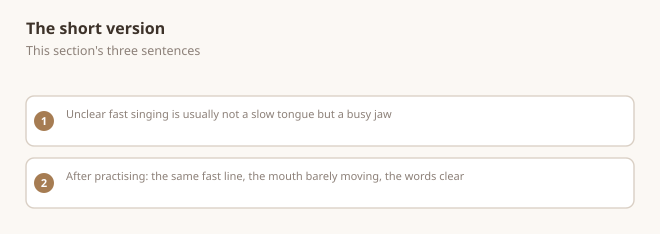
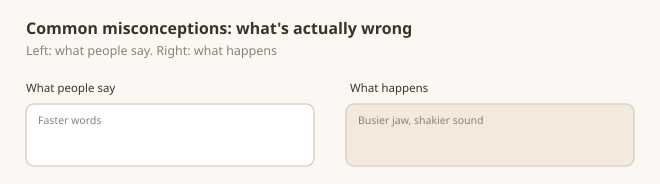
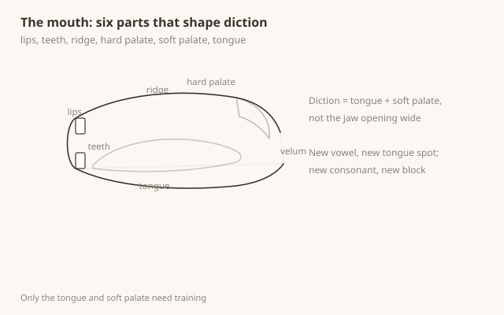
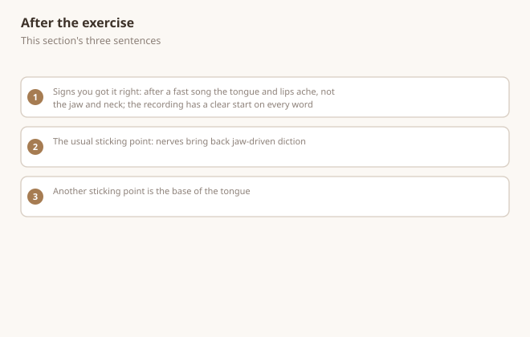

# Chapter 34: Lips, Teeth and Tongue in Fine Coordination: Fast Phrases and Complex Diction

## The short version

Not being understood on an up-tempo song is usually not a tongue that is too slow; it is a jaw that moves too much. The jaw is a heavy bone, and when it moves fast the larynx rocks with it, and the sound cracks and the beat drags. Fast diction is the tongue tip's and the lips' job; the jaw only has to hold the space open steadily.

What you will find after practising: on the same fast run of words, the mouth barely seems to move, and the syllables come out clearer.

## Common misconceptions

Many people think the faster the syllables go, the faster the jaw has to open and close. In fact the busier the jaw, the less steady the sound. Try singing the same fast run in front of a mirror, once with a loose jaw and once with the jaw working hard, and the difference is obvious.

Others think mumbling means a tongue that is too slow. More often the back of the tongue lifts along with the tip and blocks the throat. The front of the tongue moves while the back pulls backward with it, and the sound goes dull.

## How it works

The jaw, the mandible, is large and heavy, and it is linked to the larynx by muscle. Open and close it quickly and the larynx bobs up and down, and vocal fold closure becomes unsteady. At speed there is no time to correct the bobbing, and the result is a dragging beat, a cracked note and a tight throat. Compensation in the neck and shoulders runs along the same path: the harder you work, the more the neck and shoulders take over by themselves (Pettersen et al., 2005).

The tip of the tongue, by contrast, is one of the most agile parts of the body. It is light and the path is short; it can make several precise contacts in a second. The lips are the same: a real bilabial needs only the wet inner edge of the lips to touch, not the whole mouth to work.

So the principle for fast diction is this: the jaw supplies steady space, the tongue tip and lips do the cutting. The jaw is like the leg of a table, the tongue and lips like a pen tip tapping quickly on its surface. Where it breaks down: a table leg does not move at all, while your jaw still opens and closes slightly; the point is that it does not set the speed.

How far the tongue travels matters just as much. For the same note, moving the tip from behind the front teeth to the front edge of the hard palate may be only a few millimetres. The shorter the distance, the faster it goes, and the less it drags the back of the tongue along. Many people articulate slowly not because the tongue is slow but because every syllable makes a wasted movement: the tip pulls too far back, or the jaw opens with it.

One more point: the faster the phrase, the more it has to be decided in advance. You cannot wait until the syllable arrives and then think about how the mouth should move; while the previous syllable is still sounding, the tongue has already moved to the next position. Slow songs can be reacted to on the spot; fast ones can only be planned. Part of this comes from practice and part from bodily sensation: the sense of where a syllable sits is kinaesthetic memory you train, not something you guess by ear (Mürbe et al., 2002).

## An analogy

**The table leg and the pen tip.** If the table is unsteady, your writing on it will be crooked. The jaw is that table leg; it only has to be steady, not to move with the strokes. How fast you write depends on the pen tip, not the leg.

**A sewing machine.** The needle goes up and down extremely fast while the machine itself sits solidly on the table. You work the pedal to supply the power and take no part in the needle's rhythm. The jaw is the machine body and the tongue tip is the needle: wobble the body and the seam goes crooked; steady the body and the needle can go as fast as it likes and still look neat.

**Typing.** The fingers fly while the wrists hardly move. The people who really mistype are often the ones lifting the whole hand along with each finger. Singing fast works the same way: the front third of the tongue moves, and the back of the tongue should be flat.

## Try it now

### Exercise 1: Tell the jaw to keep quiet

1. Bend your thumb and index finger to about a knuckle's width and lay them gently between your upper and lower front teeth. The jaw is now held, and can only open slightly.
2. In that position, read a fast run of lyrics, at seventy per cent of your usual speed to start with.
3. Let the tongue tip make larger movements, and let the lips finish the B, P and M.

What you should feel: the mouth feels propped open and the tongue suddenly seems very busy. If you get it wrong: if you bite down on your fingers and your cheeks ache, you are propping the jaw up with force. Relax; the fingers only hold it, nothing more.

### Exercise 2: Take the fingers away and keep the "suspended" feeling

1. Take the fingers out, keep the jaw slightly open and feeling suspended, and read it again.
2. Check in the mirror whether the jaw's range of movement has got smaller.

What you should feel: the space in the mouth is bigger, and the syllables are clearer, not less. If you get it wrong: if the jaw goes straight back to working hard, return to exercise 1 and rebuild the feeling that you can talk without moving the jaw.

### Exercise 3: The four tongue-tip brothers

1. With a metronome, start slow and practise "Da-Ta-Na-La", four beats to a group, four syllables to a beat.
2. Move only the front third of the tongue.

What you should feel: the back of the tongue lies flat, like a plain. If you get it wrong: if the front of the neck bulges and the throat tickles, the back of the tongue is helping. Slow it down further, or practise only "Na-La" to begin with.

### Exercise 4: Move only a small patch of lip

1. Inside a long "oo", sing "Bu-Bu-Bu-Bu" quickly with the edge of the lips.
2. Watch in the mirror: only a small patch in the middle of the lips moves, while the cheeks and jaw stay still.

What you should feel: like a fish mouth opening and closing quickly. If you get it wrong: if the whole mouth pouts and the cheeks hollow, the force is in the wrong place. Relax the corners of the mouth and try again, moving only the middle.

### Exercise 5: Slow motion, enlarged, then back to speed

1. Take the hardest line and sing it at half speed three times.
2. Enlarge the contact point of every consonant, as if in slow motion.
3. Then go back to the original speed.

What you should feel: the original speed suddenly becomes easy. If you get it wrong: if it is already mushy at slow speed, do not speed up yet; break the lyrics into groups of two or three syllables and practise those.

## After the exercise

Signs you got it right: after a fast song it is the tongue and lips that ache, not the jaw and neck; in the recording the syllables have clear starting points.

The usual sticking point is going straight back to articulating with the jaw the moment you get nervous. Checking the jaw's range in a mirror during practice catches the problem faster than listening does.

Another is the back of the tongue. Once the tip gets fast, the back lifts with it and the throat tightens. The test is easy: after a fast run, if the front of the neck aches rather than the tongue, the back of the tongue has been helping. Go back to "Da-Ta-Na-La" at half speed and confirm that the back of the tongue is flat.

Aching in the tongue is normal; rest a moment and it passes. Pain in the throat means the method is wrong: stop and re-check the jaw and the back of the tongue. That difference in pain is more honest than any recording.

The next chapter deals with a sense of time: the syllables are all correct, so why does the whole line still sound like a metronome, with no groove.

## Further reading

- **Pettersen, V., Bjørkøy, K., & Torp, H. (2005).** Neck and shoulder muscle activity and thorax movement in singing and speaking tasks with variation in vocal loudness and pitch. *Journal of Voice.* As volume and pitch rise, the activity of the neck, shoulders and trunk changes with them; when you articulate with force, the compensation shows up in the neck first. PMID 16301107.
- **Mürbe, D., Pabst, F., & Hofmann, G. (2002).** Significance of auditory and kinesthetic feedback to singers' pitch control. *Journal of Voice.* Singing control relies on hearing and on bodily sensation at the same time; the sense of where a syllable sits is the same kind of kinaesthetic memory. PMID 12002886.
- **Peultier-Celli, L., Audouin, M., & Beyaert, C. (2022).** Postural Control in Lyric Singers. *Journal of Voice.* Postural control and balance strategy while singing affect the stability of the upper body; the stability of the jaw and neck is not independent of the rest of the body. PMID 32456837.
