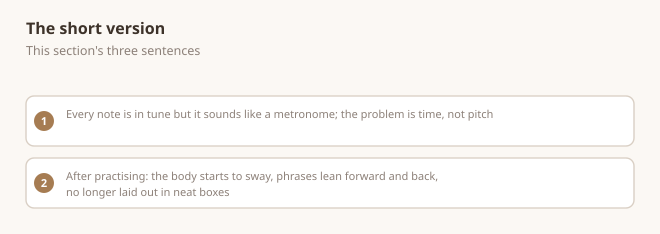
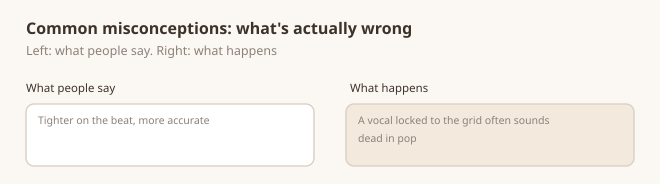
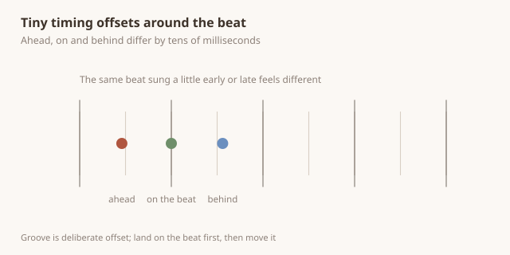
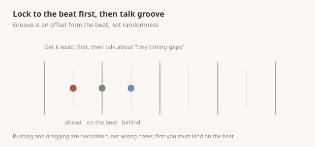
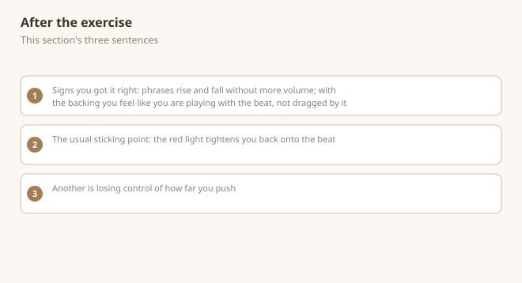

# Chapter 35: Groove in Pop Music: Getting Off the Metronome and Feeling the Tiny Timing Differences

## The short version

The notes are all in tune and it still sounds like a metronome. The problem is usually not pitch, it's time. Groove in pop comes from this: you know exactly where the beat is, and then you deliberately put some syllables a little early and some a little late. The differences are small, on the order of tens of milliseconds, and the ear can hear them.

After practising you'll find: your body starts wanting to sway, the phrase has a front and a back, and it is no longer lined up box by box.

## Common misconceptions

Many people think the closer you sit on the beat the better your sense of rhythm. In fact singing locked to the grid often sounds dead in pop. Accuracy is the floor, not the style.

Another misconception is "singing behind the beat means you can't keep up". No. Someone who can't keep up doesn't know where the beat is; someone who lays back knows, and simply chooses to arrive later — the difference is whether the time gets given back afterwards.

Others treat groove as talent. Half of it is a listening habit: are you listening to the bass and drums, or only to the lead singer?

## How it works

The beat provides a grid, and the human voice never lands exactly on the line. Every consonant and every breath has a natural deviation. It is on the order of tens of milliseconds, and it is exactly where the feel of groove comes from.

Sing early and it sounds like a push, like urgency; sing late and it sounds relaxed, with weight. The same lyric line with a different placement is a different emotion. This is not a wrong beat, it is placement.

One more thing: in pop the accent usually falls on beats two and four. Let the body sink gently on two and four and the delivery gets springy by itself; follow only one and three and it sounds like a march. Be careful with this, though — not every style accents two and four. Ballads, waltzes and some electronic music put the accent elsewhere. Listen first for where the snare or the snap lands in the backing, then decide which beat your body follows.

Groove does not mean every line is off either. Lay back across the whole song and it becomes a fixed delay, and it sounds flat instead. Good groove is contrast: one line tight, one line relaxed, and the gap is what you hear.

The last point is about control: how do you know how far off you are? Through hearing plus the body's sense of the beat (Mürbe et al., 2002). But if you are wearing headphones with the backing loud, those two fight each other; when the feedback level is too high, pitch accuracy actually gets worse (Bottalico et al., 2017). So when you practise groove, set the backing so you can hear yourself. The beat has to be in your head before your mouth dares to leave it (Reed et al., 2024).

## An analogy

**Walking.** Most steps are the same length; occasionally one is quicker, one is slower, and that is how other people notice you are walking rather than moving. You don't measure every step, but you don't walk into a wall either — because you have a line in your head. Groove is that line still being there while the steps vary.

**Throwing a pass.** You have to get the ball to a teammate who is about to hit the next strong beat. Throw too late and he can't reach it; throw too early and he isn't there yet. The best pass leaves your hand slightly early and arrives exactly as he gets there. Singing ahead is that pass: you are not running wild, you have set off early and you get caught on the beat.

**Following a car.** Following a car is not locking the accelerator; it is constant small adjustment. The car in front slows so you ease off, it speeds up so you close the gap, and you stay inside that distance the whole time. The borrow-and-repay of groove is the same: you drift out, then come back.

## Try it now

### Exercise 1: Find the body's sink first

1. Play a pop song you know. Don't sing, just find the snare or the snap.
2. Tap beats two and four with your foot and let the body sink gently on each one. Do it for a minute.
3. Listen again and check that your foot lands in the same place as the snare.

What you should feel: as if the beat is pressing you down. If you get it wrong: if you are tapping one and three, the whole body turns prim and proper. Count it again.

### Exercise 2: Lock it first, then loosen it

1. Turn on a metronome at a slow tempo you can sing comfortably. First sing "da" along with every beat and check that you are on it.
2. On the same line, deliberately delay a little: late enough that you can hear it, not so late that it falls apart.
3. Record it and listen to the difference between the two.

If you get it wrong: if you keep getting slower after the delay and can't catch up, you are not counting the beat in your head. Go back to singing along with the beat first, count a full four bars, then try again.

### Exercise 3: Give the time back

1. On the same line, sing the first two or three syllables a little early, as if setting off ahead of the beat.
2. Come back to the beat at the end of the line, and land the first syllable of the next line exactly on the beat.
3. Use it on one line only, not the whole song.

What you should feel: the phrase has a forward push and then gets caught. If you get it wrong: if every line is early the whole song sounds rushed; if the next line starts early too, you haven't paid it back, so sing the syllables in the middle a little faster to make it up.

### Exercise 4: A pause is groove too

1. Pick a lyric line and stop for half a beat after one word in the middle, with no sound at all.
2. Sing on after the pause.

What you should feel: the syllables after it suddenly get heavier. If you get it wrong: if the air collapses during the pause and you can't get into the next line, shorten the pause first, or hold it for just one breath.

### Exercise 5: Three versions, eyes closed

1. Make three versions of the same lyric line: fully on the beat, all slightly laid back, and early at the front then pushing at the back.
2. Record them and listen with your eyes closed to which one sounds most like someone talking.

What you should feel: usually the third. If you get it wrong: if all three sound the same, the timing gap is too small. Make it bigger, and once you have the feel, bring it back to a sensible amount.

## After the exercise

Signs you got it right: you don't need to sing louder and the phrase still has shape; singing with the backing feels like playing with the beat rather than being dragged along by it.

The usual sticking point is tensing up the moment you record, and singing everything back on the beat. Don't record at first: stand and sway with the song for a minute, let the body memorise that sink, then open your mouth.

Another is losing control of the size. When you first practise laying back it is easy to drag it into half a beat, and it sounds like you forgot the words. Start at a size where "you can hear it and your friends can't", and enlarge it once it is steady. The ear is very sensitive to this gap; you don't need much.

Next chapter takes pushing and laying back apart: which emotion should come early, which should come late, and how to give the time back at the end of a phrase.

## Further reading

- **Mürbe, D., Pabst, F., & Hofmann, G. (2002).** Significance of auditory and kinesthetic feedback to singers' pitch control. *Journal of Voice.* Singing control depends on hearing and on body sensation at the same time; with headphones on, or the backing too loud, the two interfere with each other. PMID 12002886.
- **Bottalico, P., Graetzer, S., & Hunter, E. J. (2017).** Effect of Training and Level of External Auditory Feedback on the Singing Voice: Pitch Inaccuracy. *Journal of Voice.* When the external feedback is too loud, pitch accuracy actually gets worse — so when you practise groove, the volume of the backing is itself a variable. PMID 26948385.
- **Reed, C. N., Pearce, M., & McPherson, A. (2024).** Auditory imagery ability influences accuracy when singing with altered auditory feedback. *Music & Science.* Hear it inside first and it comes out in tune; the sense of the beat is the same ability to imagine ahead. PMID 39219861.
