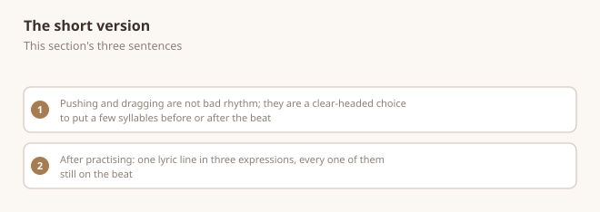
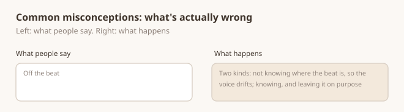
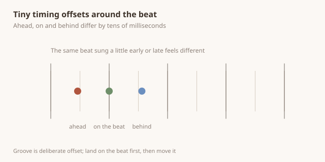
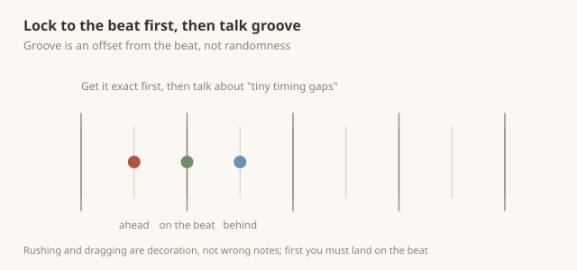
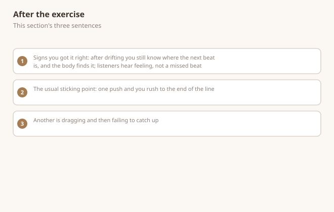

# Chapter 36: Micro-Control of Rhythm: Pushing, Laying Back, and the Elastic Time of Soul

## The short version

Pushing and laying back are not bad rhythm; they are you, knowing exactly where the beat is, choosing to put certain syllables before it or after it. Used well, the phrase has emotion; used at random, the listener gets uneasy. There is only one dividing line: whether you give the time back afterwards.

After practising you'll find: the same lyric line carries three expressions, and every one of them is still on the beat.

## Common misconceptions

Many people think "not on the beat" means bad rhythm. There are two kinds to keep apart: one is not knowing where the beat is, with the sound drifting; the other is knowing where the beat is and deliberately leaving it, then coming back to the track on the next strong beat. The first sounds chaotic, the second sounds tense.

Another misconception is that the more you drag, the more flavour it has. Drag until the listener starts getting nervous on your behalf and it isn't style any more, it's loss of control. The gap is usually on the order of tens of milliseconds: audible, but not alarming.

## How it works

The beat in music is a continuous grid, and attention expects the next strong beat to arrive. Sing before the strong beat and you satisfy that expectation early: it sounds urgent, with drive. Sing after it and you let the expectation fall through for a moment: it sounds loose, with weight. The sense of time across a whole song is the sum of these small gaps.

Elastic time means treating a whole phrase as one block: the start and the end of the phrase are still clear, while inside you stretch some syllables and compress others. You can borrow a little time at the front, but you have to pay it back later. As long as borrowing and repayment balance, the listener only feels the pull, not that you are lost.

The rubber-band metaphor needs a pause here: a rubber band doesn't snap, a voice does. If you drag until the air runs out and you can't get ready for the next line, the tension becomes a mistake. How support is distributed matters here, and support is not a single action anyway: different singers reach the same result with different strategies through the trunk (Thorpe et al., 2001). Your method doesn't have to match anyone else's, but it has to be repeatable. The same goes for the role of the lower abdomen and the pelvic floor in breathing: it is stability, not bracing (Emerich Gordon & Reed, 2020).

One more practical test: the deviation usually falls inside the phrase, not on the first syllable or the last. Deviate at the start and the listener thinks you missed the entrance; deviate at the end and the last syllable trails and smears. Deviate in the middle and it sounds like delivery.

Last: before you leave, you need a line in your head. You hear the beat inside first, and only then do you dare to leave it (Reed et al., 2024). Deviation without an internal beat is just going off.

## An analogy

**Borrowing money.** You can borrow two hundred from a friend, but you have to pay it back next time. Borrow smoothly and the relationship has some give; borrow and never repay and it is debt. Borrowing at the start of a phrase and repaying at the end is the same thing.

**A spring.** You push a spring in and it springs back when you let go. The deeper you press, the stronger the rebound — but you have to let go first. Many people enjoy the push so much they forget to let go, and the phrase runs forward all the way to the end.

**Straightening the wheel.** Drifting out is not the problem; the problem is whether you straighten up. People on long drives correct the wheel constantly and the passengers don't get carsick; only the ones who drift out and never correct make people grab the handrail.

## Try it now

### Exercise 1: Measure the baseline first

1. Take the first line of a chorus and sing it to the beat, every syllable on the beat. Record it once.
2. Listen once with your eyes closed and check that you really are on the line.

What you should feel: safe, flat. If you get it wrong: if you can't even keep up with this, don't practise micro-control yet. Go back to speaking the lyrics against a metronome.

### Exercise 2: Three in front, one behind

1. On the same line, sing the first two or three syllables a little early, like a burst of machine-gun fire.
2. Land the last accented syllable exactly on the next strong beat and hold it long.

What you should feel: the front shoots out and the back gets pinned down. If you get it wrong: if the last syllable is early as well, the whole line rushes. Slow down and think about one thing only: the last syllable has to be exact.

### Exercise 3: Come in late, but come back

1. Take the first verse line of a slow song. Don't open your mouth on the first beat at all: let the backing go first.
2. At the moment when "if I don't sing now it's too late", slide in with a looser sound.
3. At the end of the line, check that the next syllable lands on the beat.

What you should feel: like being pulled along by the beat. If you get it wrong: if every syllable drags after you come in, the whole next line will be late. Sing the connecting syllables in the middle faster and make the time back.

### Exercise 4: Fixed at both ends, liquid in the middle

1. Choose a four-beat phrase and deliberately stretch the first beat, squeezing the two syllables in the middle.
2. Bring the last syllable back on the beat. Use a metronome, no backing.
3. Do it three times.

What you should feel: the inside of the phrase is liquid and the ends are solid. If you get it wrong: if the last syllable runs off too, you are only looking after the front. Practise only "the last beat has to be exact" first, then deal with the middle.

### Exercise 5: Three body temperatures

1. Record exercises 2, 3 and 4 once each.
2. Listen with your eyes closed and ask yourself: which one sounds like "talking until you get worked up", and which sounds like "a lazy answer"?

If you get it wrong: if you can't hear the difference, make the gap bigger until even you find it obvious, then shrink it back.

## After the exercise

Signs you got it right: after the deviation you know in your body where the next beat is and it goes back by itself; the listener hears emotion, not a dropped beat.

The usual sticking point is pushing and then rushing all the way to the end of the line. The fix is to find the landing point first and practise only that syllable, singing everything before and after it on the beat.

Another is not being able to get in after laying back. The line you laid back on is usually shorter, because you started late. The answer is not to sing faster by force but to decide in advance which syllables in the middle can be glossed over, and save the time for the accented syllable. The accented syllables have to be exact; the others can hurry.

One more discipline: use it once per phrase. Twice or more and the listener starts noticing your timing instead of your words.

Next chapter practises ornaments: runs, glissando, vibrato. Get the beat steady first, or the ornaments become a way of blurring over things.

## Further reading

- **Thorpe, C. W., Cala, S. J., & Chapman, J. (2001).** Patterns of breath support in projection of the singing voice. *Journal of Voice.* Support is not a single action; different singers reach the same result with different trunk strategies. When you borrow and repay time, the support has to be distributed to match. PMID 12269638.
- **Emerich Gordon, K., & Reed, O. (2020).** The Role of the Pelvic Floor in Respiration: A Multidisciplinary Literature Review. *Journal of Voice.* The role of the lower abdomen and the pelvic floor in breathing is often mistaken for bracing; in fact stability matters more than force. PMID 30447797.
- **Reed, C. N., Pearce, M., & McPherson, A. (2024).** Auditory imagery ability influences accuracy when singing with altered auditory feedback. *Music & Science.* Hear it inside first and it comes out steady; before you leave the beat, the internal beat has to exist. PMID 39219861.
