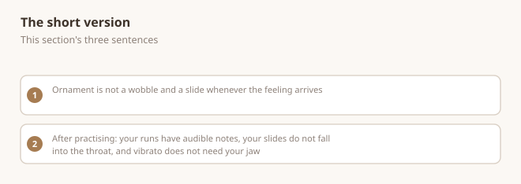
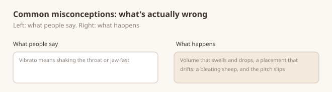
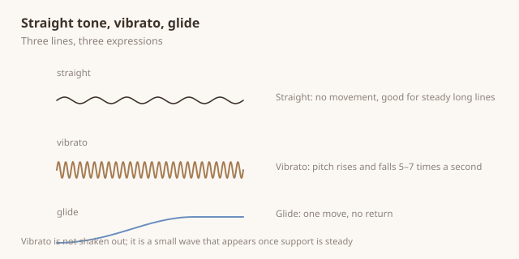
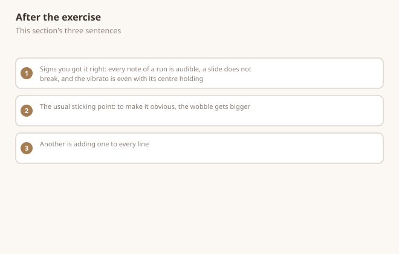

# Chapter 37: The Art of Ornament: A Technical Breakdown of Runs, Glissando and Vibrato

## The short version

An ornament is not a wobble or a slide that happens when the emotion arrives. It is a very small, controllable change on a steady airflow. A run is a staircase, a glissando is a continuous line, vibrato is a regular back-and-forth of pitch. The three use different muscles, and they are practised differently.

After practising you'll find: you can hear each note in a run, your glissando doesn't fall into the throat, and your vibrato doesn't need the jaw to shake.

## Common misconceptions

Many people think vibrato means shaking the throat or the jaw quickly. What that produces is volume going loud and soft, placement running around, a sound like a bleating sheep, and the pitch goes off as well.

Another misconception is that "a run just means sliding across quickly". Slide across and it turns into a blur and you can't hear the scale. Every note in a run needs a landing point, like walking downstairs, not going down a slide.

One more: thinking vibrato is inborn, that you either have it or you don't. Both rate and extent can be changed through training, only slowly (Mitchell & Kenny, 2010).

## How it works

First, tell the three apart.

**A run** is a string of short notes alternating quickly. The vocal folds stay closed; the tension is adjusted quickly on each note to switch pitch, and it sounds step by step. **Glissando** is one pitch moving continuously to another with no break in between, the fold tension changing smoothly. **Vibrato** is the pitch moving regularly up and down in a small range, for most singers somewhere around five to seven times a second (Nix et al., 2016), brought out by the balance between airflow and vocal fold tension.

Vibrato is the one most easily got wrong: it is a periodic change in pitch, not in volume. A periodic change in volume is called tremolo, which is a different thing. The test is simple: rest a finger lightly on your Adam's apple. With correct vibrato it barely moves while the pitch goes gently back and forth; if the Adam's apple rises and falls visibly, you are pushing with your hand or your throat.

One more key point: an ornament has to grow out of a steady straight tone. If the straight tone isn't standing, the ornament becomes a cover-up — you think you are adding feeling, but you are covering up instability. So all the exercises below practise the straight tone first, then add the ornament.

Another point about runs is the scale. The same five notes, just wandered up and down, sound vague; know where each note lands and it sounds like a string of beads. Runs in pop usually use the pentatonic scale or the major and minor scales, not a random wander. So practising runs is also practising your ear.

## An analogy

**Stairs and a slide.** A run is walking down stairs, every step has to be stood on; a glissando is a slide, no stopping in between. You can't walk down stairs the way you go down a slide — if your foot never lands, there are no steps. The other way round, where a slide is called for, forcing it step by step sounds stiff.

**Bending a guitar string.** A guitarist makes the note go slightly up and down not by shaking the wrist but by changing the string's tension back and forth with the fingers. Same string, same note, only the tension moving. Vibrato is the vocal folds bending the string: what moves is the tension, not the position of the throat.

**A pendulum.** Push it once and it swings by itself; hold on to it and it swings unevenly. Vibrato is the same: let go and it evens out. That is also why "shake harder" sounds faker.

## Try it now

### Exercise 1: Walk the stairs clearly

1. Choose a short five-note descending figure, for example La-Sol-Mi-Re-Do, on "ah".
2. Slow it to a third of your normal speed, sing each note separately, with a pause between notes.
3. Do it three times.

What you should feel: like striking a xylophone five times, each one separate. If you get it wrong: if the notes stick together and you can't hear the stairs, slow down further, or sing only three notes first.

### Exercise 2: String them on one airflow

1. Sing those five notes on a single airflow, with no pause between them.
2. On each change, let the belly give a small push, like a very quiet "ha".

What you should feel: each note has a tiny starting point. If you get it wrong: if the "ha" is too loud and turns into breathy noise, shrink it until you can't hear it yourself, leaving only the belly movement.

### Exercise 3: Don't break the glissando

1. From a low note to a high one, slide up on "oo", then slide back down.
2. Keep the belly supporting; don't let go halfway.
3. Do it three times.

What you should feel: the sound is an elastic line being stretched and let back. If you get it wrong: if it goes weak halfway and falls back into the throat, you gave up support at the top. Shrink the interval and slide only a third.

### Exercise 4: Let the vibrato happen

1. Using a piano app, find two adjacent semitones and sing back and forth on "oo", slowly at first, like a pendulum.
2. Check in the mirror that the jaw isn't moving. Gradually speed up, until it is a little faster than you can follow.
3. At that moment of "almost can't keep up", let go of the effort in the throat while the belly keeps the air steady.

What you should feel: the sound starts going back and forth evenly on its own, without you making it. If you get it wrong: if it goes loud and soft, fast and slow, that is volume shaking, not pitch. Go back to the straight tone and get the long note flat first. If the long note isn't steady, the vibrato won't be steady either.

### Exercise 5: Only release it at the end

1. Take the end of a ballad line and hold a straight tone for a while first.
2. Let the vibrato come out naturally near the end.
3. Record and listen.

What you should feel: settled first, then loosened. If you get it wrong: if it wobbles from the start the whole line seems unsteady; stretch the straight tone a little longer before releasing. Semi-occluded exercises (lip trills, a straw) help you keep the airflow while staying relaxed, and are a useful warm-up when practising the straight tone (Titze, 2006).

## After the exercise

Signs you got it right: you can hear every note in the run, the glissando doesn't break in the middle, the vibrato is even and its pitch centre doesn't drift.

The usual sticking point is that to make the ornament more obvious, people shake bigger and bigger. A good ornament is small; it is clear because it is steady, not because it is loud.

Another is adding one to every line. Ornaments are like punctuation: used sparingly they work. In a line usually only the end needs one, and the verse often doesn't need one at all. When practising, pick just three line endings and sing the rest as a straight tone; the contrast will make those three stand out.

There is a practical point as well: the rate won't be fixed. The same person sings a slow song and a fast song with different vibrato rates; when recording, don't correct it to be identical in every line just to keep it tidy, or it will sound like a machine. You only need to check that it is steady and that the centre pitch doesn't wander.

Next chapter steps back to look at the whole song: how these ornaments, levels and tone add up into one emotional line with rises and falls.

## Further reading

- **Nix, J., Perna, N., & James, K. (2016).** Vibrato Rate and Extent in College Music Majors: A Multicenter Study. *Journal of Voice.* For most singers vibrato rate falls around five to seven times a second; rate and extent are two independent parameters. PMID 26564579.
- **Mitchell, H. F., & Kenny, D. T. (2010).** Change in vibrato rate and extent during tertiary training in classical singing students. *Journal of Voice.* With training, both vibrato rate and extent change — it is not a fixed gift. PMID 19850446.
- **Titze, I. R. (2006).** Voice training and therapy with a semi-occluded vocal tract: rationale and scientific underpinnings. *Journal of Speech, Language, and Hearing Research, 49*(2), 448–459. Why lip trills, humming and straw phonation let the vocal folds work at lower pressure; this is the basis for practising the straight tone and a steady airflow. PMID 16671856.
