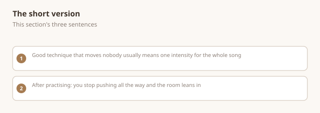
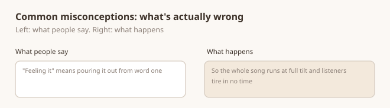
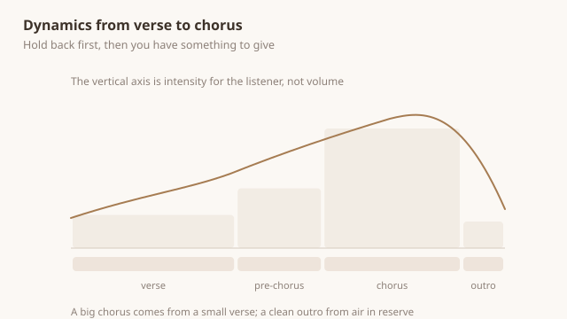
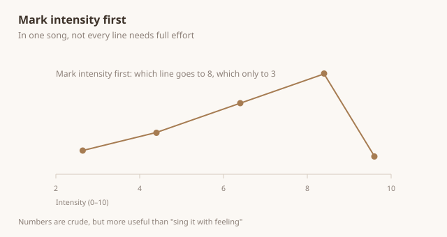
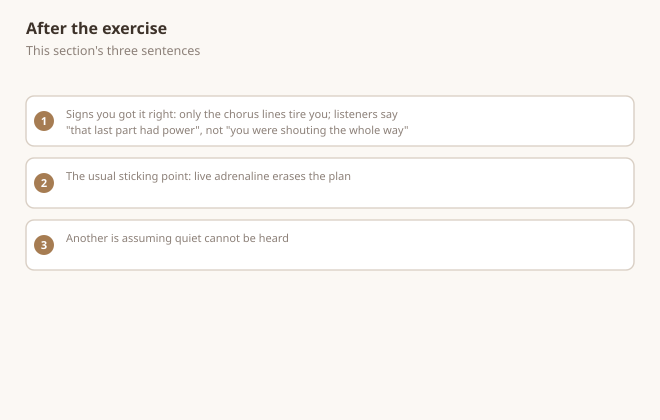

# Chapter 38: Planning the Emotional Line in Depth: Distributing Tension Between Verse and Chorus

## The short version

The technique is all in place and it still doesn't move anyone. Usually it isn't that there isn't enough feeling; it's that the whole song is at one intensity. Emotion isn't built by piling on volume, it's built by contrast. Push the verse small enough and the chorus will seem big. You have to decide how many points each section gets before you open your mouth.

After practising you'll find: you don't have to keep pushing, and the listener is more attentive.

## Common misconceptions

Many people think "having feeling" means pouring your heart out from the first syllable. The result is a whole song at full, and the listener is tired within a minute. With a stimulus that never changes, people quickly file it as background.

Another misconception is that "the chorus has to go for a high note". What matters in a chorus is relative size, not absolute height. If the verse is very small, a chorus at medium volume can still be powerful.

One more: treating "big" as a single switch. In fact loud is several parameters changing together — level, the proportion of breathiness, the density of the diction, the amount of support. A professional belt sounds thick because of the combination of these features, not because the volume knob was turned up (Lebowitz & Baken, 2011).

## How it works

People adapt quickly to a stimulus that doesn't change. Hear the same level for long enough and the ear files it as background. So what actually raises goosebumps is change: suddenly bigger after very small, or suddenly pulled back after very full.

Increasing volume is not just "pushing harder" either. When you sing louder, the adjustment of vocal tract resonance is a concrete, measurable action, not merely a sensation (Vurma, 2022); the distribution of support changes with it, and different singers reach the same result with different strategies (Thorpe et al., 2001). That means you have a choice: use more air, use more focused resonance, or use denser diction to drive a chorus. The three sound different.

Think of a song as drawing a bow: the verse pulls the string back slowly, the pre-chorus takes aim, the chorus releases the arrow. If you shoot in the verse there is nothing left for later. Where the metaphor breaks: drawing a bow happens once, while a song can rise and fall several times, and the second verse usually has to be a little more than the first.

The distribution of levels doesn't have to be precise to a number, but you do need to write it down. Singing by feel, people under pressure sing everything at the same size.

One more contrast that is easy to overlook: it isn't only loud and soft, it's dry and wet. The verse can have more breathiness, as if by your ear; the chorus less, so the sound gets solid. The change from mist to solid is finer than simply getting louder, and it suits pop sung close to the microphone.

## An analogy

**Lighting.** With every light in the room on you can't tell what matters; leave one lamp on the table and the table becomes the subject. The chorus is that lamp. The problem usually isn't that the lamp is too dim, it's that the other lights weren't switched off.

**Drawing a bow.** The fuller the draw, the further the arrow flies. But you can't hold a full draw for the whole song — your hand shakes and the arrow goes crooked. The verse is those seconds of drawing; what the listener hears is not the arrow but the sound of a string getting tighter.

**Talking.** Telling one person a secret: small voice, lots of breath, syllables running together. Shouting to someone across the road: loud voice, long vowels, very clear consonants. The same sentence sounds completely different in the two situations. The sections of a song are situations, not a volume knob.

## Try it now

This is not a vocal exercise. It is a sheet of paper, a pen, and three recordings.

### Exercise 1: Write the energy first

1. Print the lyrics and write an energy number from one to ten beside each section.
2. The verse is usually two or three, the pre-chorus four to six, the chorus eight or nine. The last verse can be one more than the first, and the outro comes back to one or two.

What you should feel: when you're done you'll notice there were sections you had planned to sing at the same size. If you get it wrong: if you write eight for every section, you aren't planning yet, you are just singing.

### Exercise 2: Mark three signs

1. On the lyrics mark where breathy, where solid, where big.
2. Breathy is usually in the verse, solid in the pre-chorus, big in the chorus.

What you should feel: the switch points become concrete. If you get it wrong: if one line is both breathy and big, split it in half and give one job to each half.

### Exercise 3: Sing the numbers, then listen

1. With no backing, only a metronome, sing through following your numbers and record it.
2. Listen with your eyes closed against the numbers you wrote.

What you should feel: in some places you'll think "this is too small, the audience won't hear it". If you get it wrong: if you can't resist turning it up, listen to the recording first; usually what you thought was small is about right on tape. If the quiet version sounds weak and unsupported, it isn't too small, the support has gone. Reduce the volume but keep the belly working.

### Exercise 4: Design an amplifier

1. Before the first syllable of the chorus, place a turn: an audible breath, a pause, or the previous line suddenly pulled small.
2. Record it and check the turn is audible.

What you should feel: the chorus seems to be pushed up rather than appearing out of nowhere. If you get it wrong: if the turn isn't audible, make the small before it smaller.

### Exercise 5: Find the lowest point

1. Find the lowest point of the whole song, usually the last verse, or the line before the bridge.
2. After the lowest point, plan a clear climb: level, diction density and support, all three together.

What you should feel: the listener knows "it's coming". If you get it wrong: if every section is climbing there is no lowest point; let one section really come down.

## After the exercise

Signs you got it right: at the end of the song only the chorus lines were tiring; the listener says "that last part was powerful" rather than "you were shouting the whole way through".

The usual sticking point is forgetting the plan once you get excited on stage. Put the numbers in a phone note and glance at it before you go on; it is more reliable than going by feel at the last minute.

Another is "if it's quiet nobody will hear it". A quiet verse is not weak: it is both level and breathiness pulled back, with the support still there. Record a section and play it on a phone speaker to check the words are still clear in the quiet parts. If they aren't, you don't need to get louder, you need to bring the sound forward.

One more thing about order: practise "small" well before you practise "big". Most people's problem is not that they can't sing big, it's that they can't sing small.

Next chapter moves the camera in: if the verse is that small, how do you make it small with detail? Through those delivery tools, cry, sigh and vocal fry.

## Further reading

- **Lebowitz, A., & Baken, R. J. (2011).** Correlates of the belt voice: a broader examination. *Journal of Voice.* Belt is not a single parameter but a combination of features; "singing big" is not the same as turning the volume up. PMID 20236798.
- **Vurma, A. (2022).** Amplitude Effects of Vocal Tract Resonance Adjustments When Singing Louder. *Journal of Voice.* When the volume increases, the adjustment of vocal tract resonance is a measurable action, not only a subjective sensation. PMID 32624371.
- **Thorpe, C. W., Cala, S. J., & Chapman, J. (2001).** Patterns of breath support in projection of the singing voice. *Journal of Voice.* Support is not a single action, and different singers reach the same result with different trunk strategies. That is also why there can be several ways to drive a chorus. PMID 12269638.
