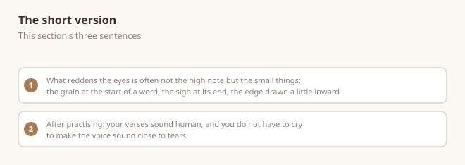
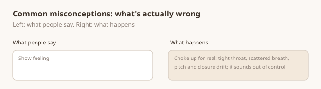
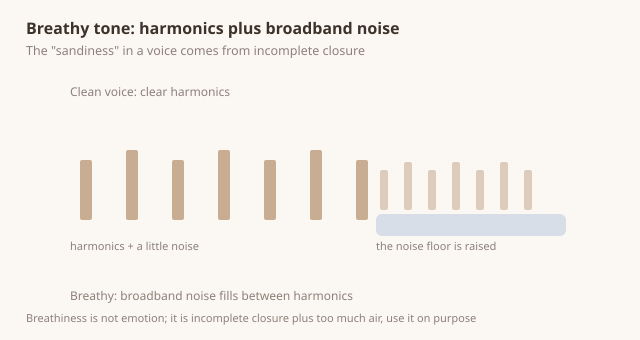
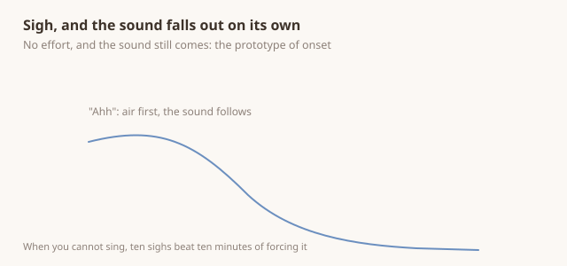
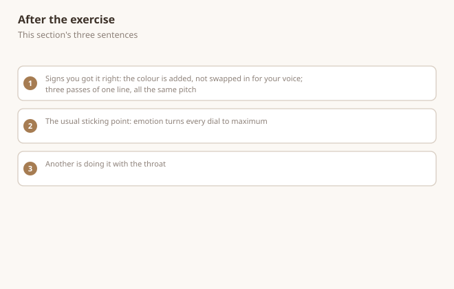
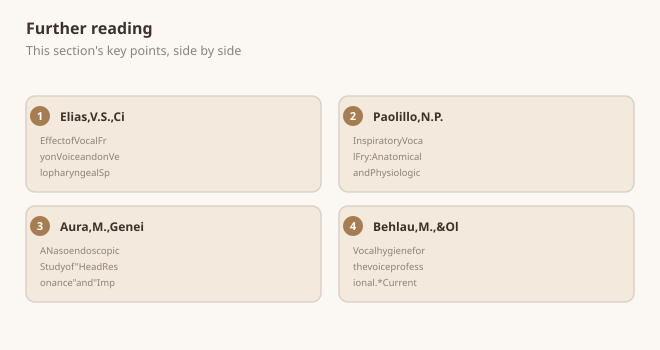

# Chapter 39: The Micro-World of Delivery: Cry, Sigh and the Friction at the Edge of the Voice

## The short version

What really brings tears to someone's eyes in a song is often not the high note but the very small things: the grain at the start of a word, the sigh at the end of one, a touch of grievance as the edge of the sound draws inward. All three can be practised; they don't have to depend on feeling you were born with.

After practising you'll find: your verse starts to sound like a person, and you don't have to actually cry to make the voice sound close to crying.

## Common misconceptions

Many people think feeling means making yourself genuinely sad. In fact, when you really choke up the throat is tight, the breath is a mess, and both pitch and closure go off; what comes out is loss of control, not something moving. Emotion is designed, not lost to.

Another misconception is "the more vocal fry the more flavour". Vocal fry is like chilli: a touch lifts the taste, a whole pot ruins it. It is vibration at the lowest tension, and only used sparingly does it carry meaning (Elias et al., 2016).

## How it works

These three correspond to three different states of the vocal folds and the vocal tract.

**Cry** is mainly the larynx lifting slightly with more vocal fold closure, a shorter vocal tract and resonance tilted forward and up, sounding like a wail with a sob in it. It is not the throat working hard, it is a fine adjustment of larynx height and vocal tract shape (Aura et al., 2022). So your throat shouldn't be sore afterwards.

**Sigh** is the vocal folds suddenly relaxing while the airflow continues. The vibration that was making the sound stops and only air is left, and it sounds like the voice dissolving. The key is "the folds release first, the air doesn't stop".

**Vocal fry** is the folds very relaxed, the airflow passing at very low pressure, producing very low frequency, regular, fine-grained vibration, like the crackle of vinyl. It runs in two directions, expiratory and inspiratory, and both are used in therapy and in teaching (Paolillo et al., 2021). Everyday singing mostly uses the expiratory one, at the start of a word.

All three follow the same rule: small. Too big and the cry turns nasal, the sigh turns into leaking air, and the fry turns into a hiccup.

Placement matters too. Cry is often on an emotional turn or a high note, but that is only a style preference; it works at any pitch. Sigh is at the end of a line, because that is where the effort is let go. Fry is at the start of a word, because that is where the sound hasn't fully come out yet. Putting them in the wrong place is odd: fry on every word ending, for example, sounds like you are constantly clearing your throat.

One more thing: these three are timbre, not volume. When you add delivery the volume barely changes; what changes is the edge of the sound and the proportion of air. If adding cry makes you louder, you are pushing, not adjusting timbre.

## An analogy

**Chilli.** A teaspoon of chilli oil in a bowl of noodles makes you notice the aroma; add half a can and all you taste is heat. Fry is the chilli oil: a drop is enough. The test isn't "can I feel it", it's "would I miss it if it were taken away".

**Blowing out a candle.** You blow, the flame goes out, but the smoke drifts for a moment before it disperses. A sigh is that smoke: the vibration has stopped, the airflow is still moving. Many people fail because they stop the air at the same time, the flame and the smoke vanish together, and it sounds cut off with a knife.

**Lifting the brush.** In brush calligraphy the last stroke doesn't leave the paper straight away; you lift the brush and draw the tip to a point. Lift too fast and the edge frays, lift too slowly and the ink pools. A sigh is that lift: let some pressure go and the line thins naturally.

## Try it now

### Exercise 1: Find the aggrieved "oo"

1. Mouth closed, make a rather high "oo", imagining a put-upon little dog begging for food.
2. Hold it for three seconds, repeat three times.

What you should feel: the sound is focused but its edge is soft, with a slight downward pull just above the Adam's apple. If you get it wrong: if your throat aches and the sound squeezes, you are pressing with the throat rather than moving the larynx. Halve the volume and look again.

### Exercise 2: Open the mouth without losing the grievance

1. Keep the state you just had and slowly open the mouth, turning "oo" into "ah".
2. Keep the pitch the same.

What you should feel: the "ah" is not open and free, it is drawn in a little, as if swallowing a sentence halfway through. If you get it wrong: if it turns into a cheerful "ah", the grievance is gone. Make the mouth shape smaller and try again.

### Exercise 3: Sigh to finish

1. Sing a three-second long "ai—", the vowel of "eye".
2. At the third second, relax the vocal folds and leave only the airflow, so it ends on a breath.

What you should feel: the sound disperses like smoke, not cut off with a knife. If you get it wrong: if it cuts off abruptly, you stopped the air as well. Keep the belly sending air and release only the folds.

### Exercise 4: Grain at the start of a word

1. Take the first syllable of a verse line.
2. Before the sound, let the folds leak an extremely short grain of air, a crackle, then slide into the solid tone.

What you should feel: the word is squeezed out of tiredness. If you get it wrong: if you add it to every line it sounds like hiccups. Limit it to two or three times in a song, in the quietest places.

### Exercise 5: Four syllables, three layers

1. Find four syllables, for example "I don't get it".
2. Lay them out: fry on the first, cry on the second, a sigh to finish on the last.
3. Record and listen.

What you should feel: three layers of emotion in four syllables. If you get it wrong: if it sounds affected, take one out and use one kind of delivery at a time.

### Exercise 6: Check it against the pitch

1. Play the recording back twice: the first time listen for emotion, the second time only for pitch.

What you should feel: good delivery doesn't let the pitch go off. If you get it wrong: if the second listen finds the pitch drifting, one of the three was done too big. Shrink it.

## After the exercise

Signs you got it right: the delivery is added on, not a replacement for the original sound; sing the same line three times and the pitch is the same each time.

The usual sticking point is opening everything to maximum the moment you get into it. Remember all three are fine adjustments; small is the point. When practising, err on the small side, and enlarge it on stage.

Another is doing it with the throat. Cry and fry are both easily mistaken for throat effort, and you end up with an itchy throat afterwards. Done right the throat is loose, and what changes is closure and the proportion of air. If it hurts, stop first, go back to a plain long note, check that the sound is relaxed, then add the delivery back a little at a time.

One health note as well: fry is low-load vibration, but singing a whole song pressed very low and very loose eventually makes the voice feel like it "won't come up". It is seasoning, not the main dish. When the vocal folds are uncomfortable, hydrate first, cut down on clearing your throat, then come back to practise (Behlau & Oliveira, 2009).

Next chapter deals with breathing: a breath is not something to be sneaked in; it can be part of the emotion itself.

## Further reading

- **Elias, V. S., Cielo, C. A., & Jotz, G. P. (2016).** Effect of Vocal Fry on Voice and on Velopharyngeal Sphincter. *International Archives of Otorhinolaryngology.* Vocal fry is low-tension, low-frequency vibration, with a measurable effect on the voice and on resonance. PMID 27096021.
- **Paolillo, N. P., Carrozza, L., & Osio, M. (2021).** Inspiratory Vocal Fry: Anatomical and Physiological Aspects, Application in Speech Therapy, Voice Therapy and Singing Pedagogy. *Journal of Voice.* Vocal fry runs in two directions, expiratory and inspiratory, and both have uses in therapy and in singing teaching. PMID 31708370.
- **Aura, M., Geneid, A., & Bjørkøy, K. (2022).** A Nasoendoscopic Study of "Head Resonance" and "Imposto" in Classical Singing. *Journal of Voice.* What is called resonance placement is in fact a change in the shape of the vocal tract; the forward-and-up tilt of the cry is the same kind of adjustment. PMID 32513553.
- **Behlau, M., & Oliveira, G. (2009).** Vocal hygiene for the voice professional. *Current Opinion in Otolaryngology & Head and Neck Surgery.* Hydration, avoiding throat clearing and scheduling voice rest are the basics for anyone who uses their voice professionally. PMID 19342952.

