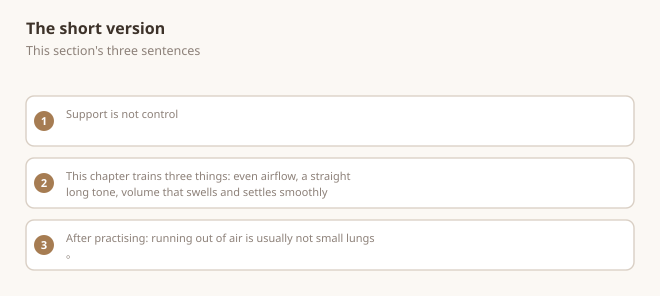
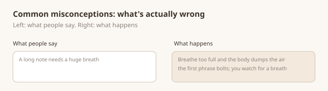
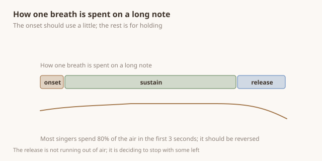
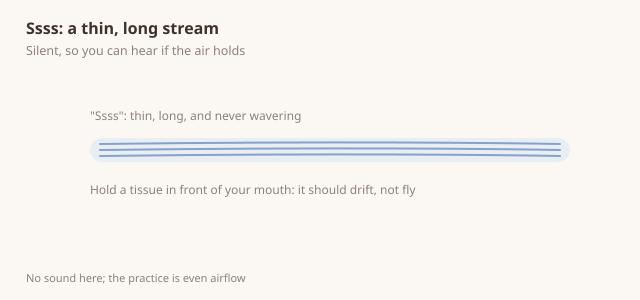
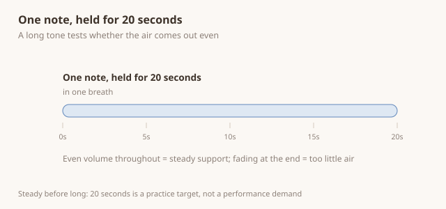
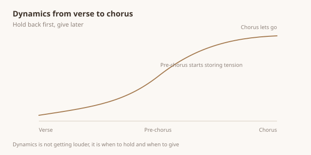
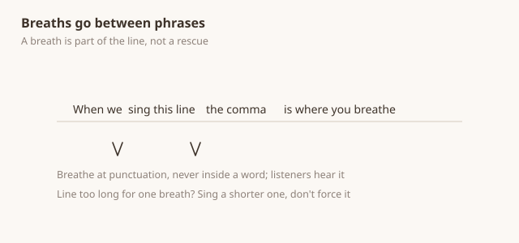
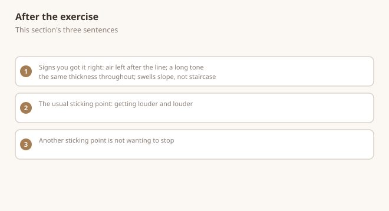

# Chapter 4: Steady Breath Control (Tissue-Blow Training, Long Tones and Distributing the Air Through the Dynamics)

## The short version

Having breath support is not the same as being in control. Many people spend all their air on the first line and then push through the rest; or the air goes loud-quiet-loud and the sound shakes with it.

This chapter trains three things: an even airflow, a straight long tone, and a volume that can swell and settle smoothly.

After the exercise you will find that running out of air in a line is usually not small lungs. It is using the air too fast at the start.

## Common misconceptions

Many people think a long note needs a huge breath first. Fill up too much and the body is in a hurry to get rid of it, so the first line is more likely to blast, and you spend the whole time wondering when you are allowed to breathe. Seven or eight tenths full, with the shoulders still, works much better.

Others think not enough air means pushing harder. Not enough air is a question of distribution, not of supply. Hold a little back at the start of the phrase and you have it at the end. Push, and the sound tightens and the air goes faster.

## How it works

Steady airflow makes a steady sound. The vocal folds vibrate because air passes them, so when the airflow changes, the volume and the pitch change with it. A shaking sound is therefore usually not a problem with the vocal folds. It is uneven air. What you are singing is air; what the listener hears is how the air got chopped up.

Volume works the same way, but it is not stacked up out of airflow alone. Singing loud does use more air, but the loudness you hear also depends on resonance and on how firmly the folds close. Simply turning the airflow up often just becomes noisy leaking.

What controls the airflow is the speed of the exhale. The lower belly and the abdominal muscles draw in steadily and slowly, resisting the diaphragm as it rises, and the air comes out gradually. Let the lower belly snap all the way in the moment you start and the air is gone in a few seconds, leaving a hollow sound at the end of the phrase. Support differs slightly from person to person; you don't have to copy one set of trunk moves, only deliver the same amount from beginning to end (Thorpe et al., 2001).

Changing volume is the same thing again. A crescendo is the lower belly giving a little more pressure while the closure rises slightly to match. A diminuendo is the two letting go slowly together. It is not opening or closing the throat. Controlling volume with the throat means pressing directly on the vocal folds.

There is one more way to save effort: do the "oo", or the long tone, through a straw, or with the mouth semi-occluded (lips drawn slightly together). The extra resistance behind the mouth lets the vocal folds keep vibrating at lower pressure, and the air is less likely to run out all at once (Titze, 2006). This is not a special effect. It is a tool for checking whether you are running on airflow rather than on your throat.

## An analogy

**One long line of paint.** Draw a long stroke with a watercolour brush. Too heavy at the start and the paint piles up while the rest runs dry; a wobble in the hand and the line goes furry. What you want is a steady hand, not more paint. Where it breaks: a bad drawing can be done again, but an uncomfortable voice has to rest, so err on the quiet side and the short side.

**Watering plants.** Tip a whole bucket over from the rim and it drills a hole in the soil and all the water runs off. Walk round with a watering can instead and every inch of soil gets some. Same bucket, different distribution.

**A slope, not a staircase.** A crescendo should feel like pushing a cart up a ramp, all the way. Controlling volume with the throat is taking the stairs, one step at a time, and it sounds like "clunk, clunk".

## Try it now

### Exercise 1: Blow a tissue

1. Tear off a single ply of tissue and lay it flat against a wall or mirror at the height of your mouth.
2. Stand tall, with your mouth ten to fifteen centimetres from the tissue.
3. Hold the top edge of the tissue lightly with your fingers, breathe in, purse your lips and blow at the centre.
4. When you feel the airflow pinning the tissue in place, let go with your fingers.
5. Keep it against the wall for twelve to fifteen seconds.

What you should feel: only a slight flutter along the bottom edge. If you get it wrong: if it falls straight away, the airflow is too weak or it keeps stopping; the lower belly has to keep drawing in. If the bottom edge flaps noisily, you are blowing too hard. Halve the air. In singing, blowing too hard is leaking air.

### Exercise 2: A steady "oo"

1. On the low-to-mid note that is most comfortable in speech, make an "oo—".
2. Hold it for fifteen seconds with the pitch and the volume both unchanged.
3. Hand on the lower belly; feel it draw in slowly.
4. Three times. If you have a straw, do the fourth "oo" through the straw and compare how much effort each one takes.

What you should feel: the sound is a straight line. If you get it wrong: if it starts to shake in the last five seconds, don't clamp with the throat. Leave a little more support in the lower belly, or cut the length to ten seconds. Build the straight line first.

### Exercise 3: The rugby ball (quiet, loud, quiet)

1. Breathe in and make an "oo—" at very low volume.
2. Over three seconds, swell smoothly to full, without cracking.
3. Stay there for one or two seconds.
4. Then fade smoothly over three seconds until it is only airflow. Don't cut it off.
5. Three times.

What you should feel: shoulders and jaw still the whole time; only the pressure in the lower belly changes. If you get it wrong: if the chin comes forward and the shoulders lift on the crescendo, you are using the upper body in place of the lower belly. Lower the ceiling of the volume. Smoothness first.

### Exercise 4: Sharing out one line

1. Pick a line you always run out of air on.
2. Sing it the way you normally do and notice which word goes dry.
3. The second time, halve the air at the start of the phrase and share it evenly across the words.
4. The third time, leave a little air at the end. Don't sing until you are empty.

What you should feel: there is still air at the end and the sound hasn't got smaller. If you get it wrong: if the sound goes hollow because you are saving air, that is too little air, not a distribution problem. Go back to exercise 2 and confirm the airflow itself is steady.

## After the exercise

Signs you got it right: after one line there is still air left; the long tone is the same thickness all the way through; the swell and the fade sound like a slope, not a staircase.

The usual sticking point is getting louder and louder. Emotion rises, the volume rises with it, and the air goes faster. Practising without a microphone and deliberately quietly is so you can hear the airflow clearly. It is not because quiet sounds nicer.

Another is not wanting to stop. Push on when the air is nearly gone and the body tops it up with the throat. The right move is to breathe earlier, or cut the phrase shorter. Singing is not a breath-holding contest, and forcing your way through a line usually buys you a hoarse patch. If you keep at these for more than twenty minutes, drink water and rest the voice in between; that is more use than two more rounds (Behlau & Oliveira, 2009).

Next chapter takes on resonance. With the airflow steady, the next job is letting the sound be amplified in the right space instead of being propped up with volume.

## Further reading

- **Titze, I. R. (2006).** Voice training and therapy with a semi-occluded vocal tract: rationale and scientific underpinnings. *Journal of Speech, Language, and Hearing Research, 49*(2), 448–459. Why a long tone through a straw, or with the mouth half closed, costs less effort: the extra resistance behind the mouth lets the vocal folds vibrate at lower pressure. PMID 16671856.
- **Thorpe, C. W., Cala, S. J., & Chapman, J. (2001).** Patterns of breath support in projection of the singing voice. *Journal of Voice.* Support is not a single action; different singers use different trunk strategies. What matters is steady delivery, not looking like someone in particular. PMID 12269638.
- **Behlau, M., & Oliveira, G. (2009).** Vocal hygiene for the voice professional. *Current Opinion in Otolaryngology & Head and Neck Surgery.* Advice on drinking water and resting the voice during long stretches of use: with this much airflow practice, care matters more than pushing. PMID 19342952.
