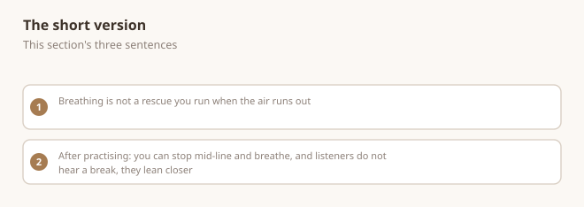
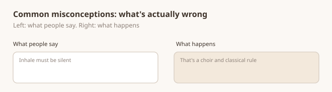
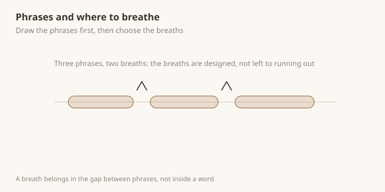
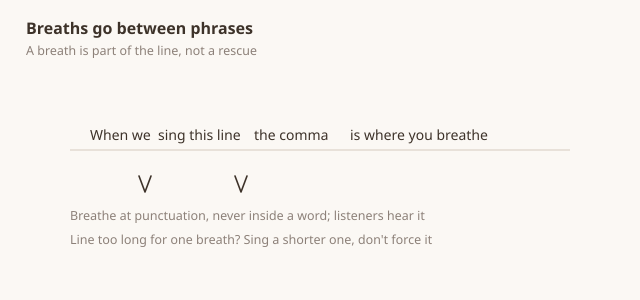
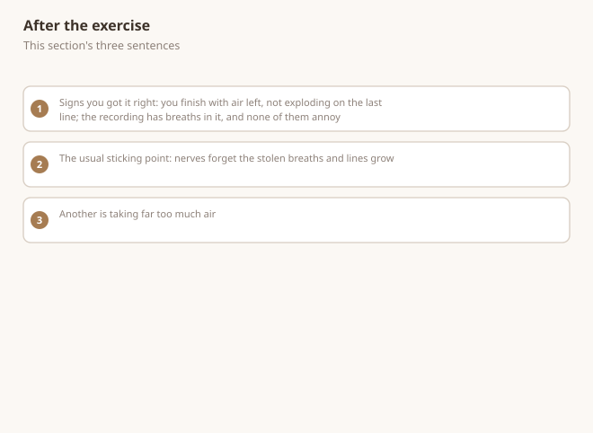
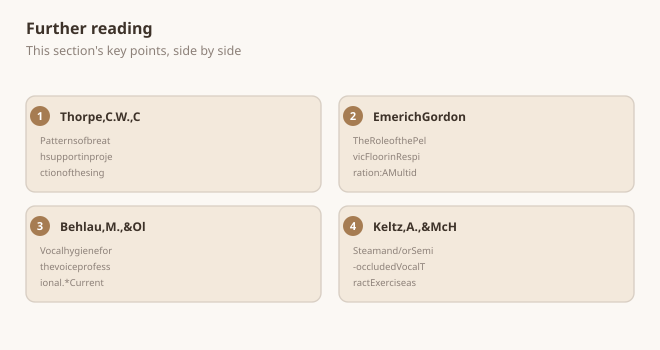

# Chapter 40: Designing the Breath Points of a Phrase: Making Breathing Part of the Emotional Tension

## The short version

Breathing is not a rescue you perform once the air runs out. In pop the sound of the breath can itself be part of the performance: it can be obvious, or completely inaudible, depending on what you want to express. The point is that you design it, not that it interrupts you.

After practising you'll find: you can stop in the middle of a line to breathe in, and the listener doesn't feel you broke off — they listen harder.

## Common misconceptions

Many people think the inhale must be silent, that the audience must never notice. That is the rule in choirs and in classical singing. Pop sung right next to the ear, a completely silent breath sometimes sounds like a machine.

Another misconception is "the fuller the lungs the better". Fill until the shoulders lift and the chest locks and the first line gets stiff, and the lines after it go messy too. Enough is enough.

One more: treating the breath as the end of the phrase. A breath point can sit in the middle of a line and create a suspension; that is delivery, not a mistake.

## How it works

When you inhale quietly the vocal folds are open and the air passes without friction. To give the inhale emotion, bring the folds a little closer so the airflow makes a friction noise. This is the same thing as the sharp intake of breath you take when you get worked up while speaking.

The speed of the inhale changes the feeling too. A quick inhale with friction sounds like longing or nerves; a slow, silent inhale sounds like suppression or calm. Same line, a different inhale, and the whole line has a different temperature.

The position of the breath carries expression as well. Breathing at the full stop is normal speech; breathing between a noun and a verb creates a suspension, and the listener wants to know what comes next. This effect is strong once; used often it makes people think you don't have enough air.

One point that is often overlooked: the exhale is part of breathing too. If you always empty all the air at the end of a line, the inhale for the next line will be rushed. Leave a little air in the body and the inhale can be quiet, quick and effortless. So breathing is not "empty, then fill", it is "leave a little, then top up".

Support deserves a clear word here as well: support is not a fixed action, and different singers reach the same result with different trunk strategies (Thorpe et al., 2001); the lower abdomen and the pelvic floor are stability during breathing, not bracing (Emerich Gordon & Reed, 2020). What you are looking for is the version you can repeat in your own body, not a copy of someone else's posture.

## An analogy

**Filling the tank.** Nobody drives until the tank is dry, and nobody fills until it overflows. You top up while there is still fuel, to enough. Breathing is like that: small and often beats big and rare. Filling to the brim is overfilling the tank, and the first line gets spluttered.

**Punctuation.** A full stop is a normal breath, a comma is a sneaked breath, a dash is a suspension. If you paused for three seconds at every comma in a piece of writing, it would fall apart. Lyrics are the same: breath points are punctuation, not paragraphs.

**Drawing a bow.** Can you pull a bow further once it is at the end of its travel? No. Leave a little room and the next stroke draws smoothly. Emptying all the air at the end of a line is pulling the bow to the limit; the next line can only be wrenched.

## Try it now

### Exercise 1: Listen to a fricative inhale first

1. Open the mouth slightly, pretend you have seen something shocking, and gasp. Listen to the sound.
2. Do it three times and check that each one makes a sound.

What you should feel: the air scraping deep in the throat, slightly cool. If you get it wrong: if it becomes a "sss" from the mouth with the shoulders lifting, relax the shoulders first and let the friction come only from the throat.

### Exercise 2: The inhale as a fuse

1. Use the inhale you just made and go into the opening of a chorus you know.
2. Don't stop after the inhale; turn the air straight into sound.

What you should feel: the inhale is the fuse, the sound is the explosion. If you get it wrong: if you wait a beat after breathing in, the tension breaks. Shorten the inhale and put it right before the beat.

### Exercise 3: The silent stolen breath

1. Breathe in quickly through nose and mouth at the same time, as if startled, but make no sound; take in only a fraction of a second.
2. Find a dense lyric line and slip this short inhale between two syllables, topping up just a little: enough for the next three syllables.

What you should feel: the air drops to the belly and the chest and shoulders don't move; the line isn't broken but you have new air. If you get it wrong: if the chest puffs up and the shoulders rise, you are breathing into the upper chest. Empty the air first, then take air in through the nose and the corners of the mouth at once. If the inhale is loud enough to be heard, find a different gap between syllables.

### Exercise 4: A different position, a different expression

1. Take a lyric line — a long one, say eleven syllables — and first breathe at the end of the sentence where the grammar wants it. Sing it once.
2. Now instead stop after the eighth syllable, take one inhale with friction, and speak the last three.
3. Record both and compare.

What you should feel: the second version has an extra suspension. If you get it wrong: if it just sounds like you forgot the words, the pause is too long. Shorten it to about half a beat.

### Exercise 5: Mark up the lyrics

1. Mark an audible inhale with a V, a silent stolen breath with a small comma.
2. Plan only one V per song, in the place that most needs the burst.

What you should feel: breathing becomes part of the arrangement. If you get it wrong: if there is a V everywhere the whole song sounds out of breath. Leave only one to start with.

### Exercise 6: Record both, voiced and silent

1. Do a "voiced inhale" and a "silent inhale" version of the same line, recording each once.
2. Listen with your eyes closed: which sounds more like talking, which more like performing?

If you get it wrong: if you can't hear the difference, make the voiced one a little bigger, check that you can tell the two apart, then bring it back to a sensible level.

## After the exercise

Signs you got it right: you finish with enough air rather than blowing up on the last line; there is breathing in the recording but it doesn't get in the way.

The usual sticking point is forgetting to steal breaths when you're nervous and letting the lines get longer and longer. Write the breath points onto the lyrics and memorise them along with the words.

Another is taking too much in. Top up only with what you need: if you are short of air for three syllables, take in three syllables' worth. Small and often beats big and rare.

Maintenance while we are here: when the mouth is dry the friction of the inhale gets louder and the voice goes hoarse easily. Drinking water before and after practising is more use than constantly clearing your throat (Behlau & Oliveira, 2009). In the morning, a few minutes of steam or a semi-occluded warm-up before practising breathing is more comfortable than forcing the voice open (Keltz & McHenry, 2022).

If you start to feel dizzy or your hands go numb while breathing, stop and breathe normally. That is not "the air getting through"; it is usually hyperventilation.

Next chapter is about something more abstract: how to actually get into the picture and the situation of a song, rather than only doing delivery.

## Further reading

- **Thorpe, C. W., Cala, S. J., & Chapman, J. (2001).** Patterns of breath support in projection of the singing voice. *Journal of Voice.* Support is not a single action, and different singers reach the same result with different trunk strategies; the way you breathe can be the same, you don't have to copy anyone wholesale. PMID 12269638.
- **Emerich Gordon, K., & Reed, O. (2020).** The Role of the Pelvic Floor in Respiration: A Multidisciplinary Literature Review. *Journal of Voice.* The role of the lower abdomen and the pelvic floor in breathing; a small inhale lets the air drop here instead of stopping in the chest. PMID 30447797.
- **Behlau, M., & Oliveira, G. (2009).** Vocal hygiene for the voice professional. *Current Opinion in Otolaryngology & Head and Neck Surgery.* Evidence-based advice on hydration, avoiding throat clearing and scheduling voice rest. PMID 19342952.
- **Keltz, A., & McHenry, M. (2022).** Steam and/or Semi-occluded Vocal Tract Exercise as Morning Vocal Warm-up Strategy. *Journal of Voice.* Steam and semi-occluded exercises work as a morning warm-up; steam is soothing, not a treatment. PMID 32988703.

