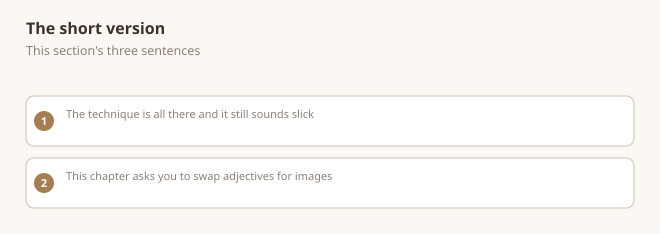
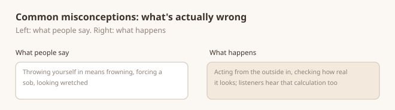
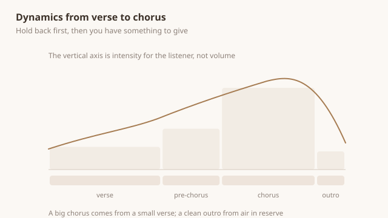
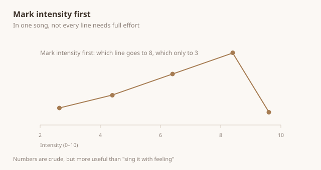
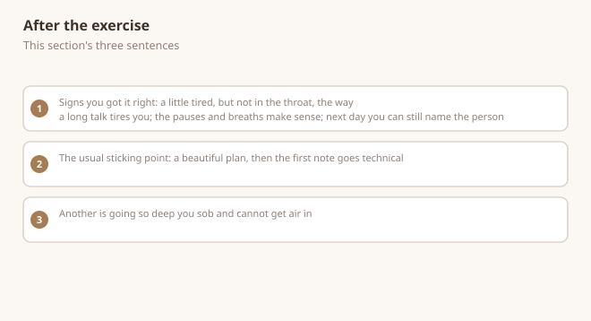

# Chapter 41: Immersive Performance: Mental Preparation that Joins Imagery with Self-Projection

## The short version

The technique is all there, and it comes out a little slick. Usually it isn't that there isn't enough feeling; it's that the instruction in your head is "put some feeling in here". Emotion is abstract. The brain can't execute "give me eight out of ten sadness", but it can execute "you see him turn away, the coffee in his hand is still hot".

This chapter wants you to swap adjectives for images. Afterwards you won't need to remind yourself to be sad; the voice changes by itself.

## Common misconceptions

Many people think getting into the feeling means frowning, squeezing out a cry, making yourself look wretched. That is acting from the outside in: while you sing you are still checking whether you look convincing, and the listener can hear the calculation too.

Another misconception is "I've never been through that, so I can't sing it". You don't need the same plot; you only need to find an emotion of the same texture.

## How it works

The body responds to images. When you really recall something, your breathing gets shallower, your throat tightens, your eyes get hot. Those changes directly alter the degree of vocal fold closure and the shape of the vocal tract, more finely than any deliberate technique.

The other way round, if you only issue the word "sad", the body doesn't know what to do, so it brings out the sad posture it remembers and performs that, and it sounds generic.

So the method is to swap the adjective for sensory detail: light, temperature, distance, smell. The more specific the detail, the truer the body's response. There is a limit here: it is not about actually falling apart. Falling apart makes the breathing messy and the voice go out of control; you want "like", not "is".

One more thing: the image has to be repeatable. You can't rely on the mood of the moment each time; moods are unstable. So write the setting down and read it once before you sing. On stage you rely not on the emotion of the moment but on a method you can call up whenever you need it.

## An analogy

**You are the lighting technician, not the actor.** You don't have to really cry on stage; you have to put the light in the right place. Same room, change one bulb, change one angle, and the whole space feels different. The lights you are adjusting are these ones: light, temperature, distance. Not your own tears. Back to the mechanism: what really changes the voice is the depth of breathing, the looseness of the throat and the shape of the vocal tract, and those three are moved by concrete sensory detail, not by adjectives.

**Two ways of saying the same line.** "You're back" — said to family just home from work, and said to someone you haven't seen for three years: the same words, a completely different voice. You haven't changed your acting; you have changed who you are speaking to and where. Change the setting and the air, the stress and the tail of the same lyric line shift by themselves.

**A satnav needs an address, not "somewhere nice".** Give the brain "very lonely" and it doesn't know which way to turn; give it "the convenience store at eleven at night, and you're the only one there" and it has a route. Where the metaphor breaks: a satnav works out the shortest path, and your body doesn't. It only gives you a rough direction, and you fine-tune the rest yourself each time.

## Try it now

This chapter is paperwork plus one experiment, not a vocal exercise.

1. Pick a song you want to sing and don't sing it yet. On a sheet of paper answer three questions: what time of day is this section, and what light? Is the air cold or hot, and what are you holding in your hand? How big is the space you are in, and who are you speaking to? Write it as one sentence, for example "a kitchen at dawn in winter, me in socks, facing a ring that hasn't been turned off". Don't write "very sad". What you should feel: the lyric suddenly has a scene and you see a room in your head. If you get it wrong: if what you wrote is an adjective, write it again until a specific room or street comes up in your mind.

2. Read the setting you just wrote aloud to yourself, then sing the first verse. Record it. What you should feel: the voice is smaller than usual, slower than usual, and the gaps between phrases get longer. If you get it wrong: if it sounds exactly as usual, the setting hasn't reached the body; close your eyes, read it again, and don't open your mouth until you feel something.

3. Change to a completely opposite setting: turn "winter night, small room" into "midsummer, by the sea". Sing the same verse and record it. What you should feel: the voice brightens and opens by itself, the vowels get wider. If you get it wrong: if the two sound the same, change just one element first, the light for instance, and leave the rest alone.

4. Find a lyric line you feel you "can't sing because I haven't been through it" and write down its core emotion, for example "losing something you can never get back". Then write something of your own with the same texture: a pet, failing an exam, a move to another city. Think of that while you sing, not of the character in the lyric. What you should feel: the lyric becomes your own sentence. If you get it wrong: if thinking of it makes you unable to sing, pick something more distant, at a lower concentration. Singing until you lose control is not the goal.

5. Set the distance of your gaze: in the verse look thirty centimetres in front of you, as if murmuring to one person; in the chorus look to the far end of the room, as if calling out. Sing the same line twice, changing only where your eyes look. Record it. What you should feel: the body adjusts volume and support by itself, without you giving instructions. If you get it wrong: if the eyes changed but the voice didn't, turn your head a little as well, so the neck and the chest come in too.

6. Record a version where you "just speak the lyrics", no melody, talking to the setting; then record the full song. Compare whether the delivery in the two is the same thing. What you should feel: if they match, the image has really come in. If you get it wrong: you don't need to re-record everything; find the line where "speaking" and "singing" differ most and redo only that one.

7. Write the setting that worked best at the top of the lyrics. Every time you sing this song from now on, read it once before you open your mouth.

## After the exercise

Signs you got it right: you are a little tired at the end, but not in the throat — it feels like finishing a long talk; the pauses and breaths in the recording now make sense; sing the same song the next day and you can still call the image up.

The usual sticking point is writing a beautiful setting and then going straight back into technique mode on the first note. The fix is to let the image sit in your head for three seconds before making a sound, rather than thinking about the image and "that high note later" at the same time.

Another is going too deep into the part, until you are choking and can't breathe in. That is not commitment, it is loss of control. You want "like", and you can always turn the concentration down a notch.

Next chapter moves to equipment: you can already sing with your body, and now you need to let the microphone work for you.

## Further reading

- **Reed, C. N., Pearce, M., & McPherson, A. (2024).** Auditory imagery ability influences accuracy when singing with altered auditory feedback. *Music & Science.* The ability to hear and imagine inside first actually affects how accurately you sing; "it happens in the head first" is not mysticism, it is a skill that can be measured. PMID 39219861.
- **Mürbe, D., Pabst, F., & Hofmann, G. (2002).** Significance of auditory and kinesthetic feedback to singers' pitch control. *Journal of Voice.* Pitch depends on the ear and on body sensation at the same time; this also explains why control gets coarse when you only go by "feel" and give no concrete image. PMID 12002886.
- **Peultier-Celli, L., Audouin, M., & Beyaert, C. (2022).** Postural Control in Lyric Singers. *Journal of Voice.* Postural control and balance strategies in singing: the state of the body directly affects phonation; it isn't only "mood" affecting the voice. PMID 32456837.
