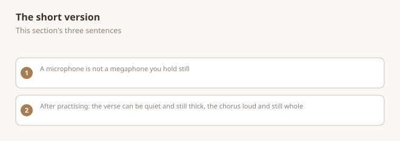
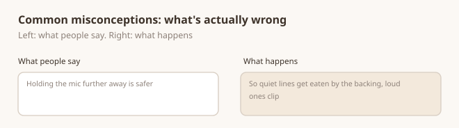
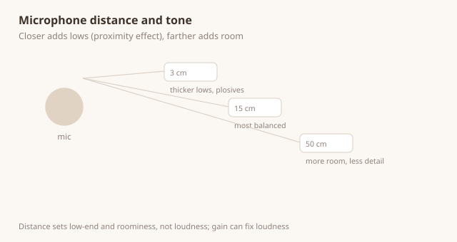
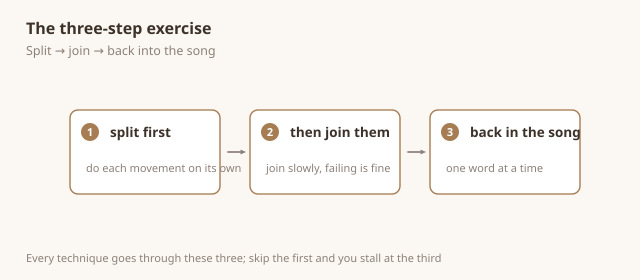
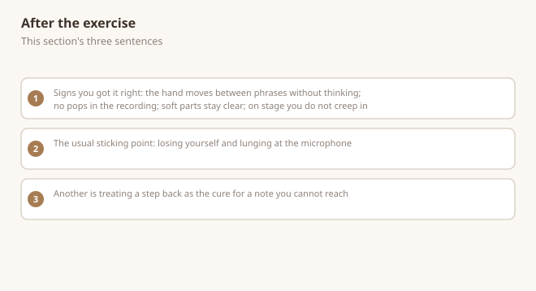

# Chapter 42: The Acoustics and Aesthetics of the Microphone: Professional Control of Distance (Proximity Effect) and Angle

## The short version

A microphone is not an amplifier you hold still. How close you are and from what angle you sing directly changes the timbre and the dynamics. Close to a single-directional microphone and the low end increases; back off a little and it gets clean; off axis a little and the top end softens. Learn to control it with distance and angle and you won't have to fight every line with your throat.

After practising you'll find: the verse can be very quiet and still thick, the chorus very loud and still not breaking up.

## Common misconceptions

Many people think holding the microphone further away is safer, so they keep it at the same distance the whole way through. The result is that the quiet parts get eaten by the backing and the loud parts blow up.

Another misconception is "popping means the microphone is broken". Most of the time the airflow is hitting the capsule directly, and changing the angle fixes it.

## How it works

Start with the proximity effect. On single-directional microphones such as cardioid and supercardioid, the closer you are to the source, the more low end there is, relatively. This is physics, not the microphone adding colour: when the source is very close, the pressure difference between the front and the back of the microphone gets bigger and the circuit counts it as more. So sing close and the sound is thick, warm, with weight; back off and there is less low end, the sound gets clean and the diction gets clear. Omnidirectional microphones don't do this, so check which kind you are holding before you sing.

Next, directionality. A cardioid picks up most strongly straight in front and least behind. That means you can put the stage speakers behind it and feedback is much less likely. But it is not a soundproof wall; it still picks up at the sides, so don't treat "back to the speakers" as foolproof. You still have to control the level.

Angle makes a difference too. Straight on axis the top end is brightest and sibilants (s, sh) are sharpest; slightly off axis the top end softens and the sound rounds out. Popping (the plosive burst of P and B) is dodged the same way, with angle: let the air pass by the microphone instead of hitting it head-on.

The last thing that is often misunderstood is compression. A compressor's job is to reduce the difference in level, so that the quiet is audible and the loud doesn't blow up, at the cost of less dynamics — and as it lifts the quiet, it lifts the noise floor with it. So "singing evenly" sounds better than "flattening it afterwards".

Distance isn't fixed either. Experienced singers adjust within a single line: close for a breathy phrase, back off for an accent, sometimes within one word. The movement is small, the audience barely sees it, and on a recording it is very clear.

## An analogy

**Headlights, far and near.** Close to the microphone is like putting the light right in front of your face: more detail, deeper shadows, thicker low end. Backing off is like throwing the light further: the whole thing is visible, but it has less texture. The same song needs both lights, so your hand has to move. Back to the mechanism: what you are adjusting is the proportion of low end set by distance and the brightness of the top end set by axis, not a volume knob.

**An umbrella keeps off rain, not wind.** Singing at an angle is like tilting the umbrella to one side: the popping airflow is directed away and the sound is still picked up. But tilt the umbrella too far and you get wet yourself. Off axis too much and the sound goes dull and small.

**Shot sizes.** Close in the verse is a close-up, backing off in the chorus is a wide shot; the lens hasn't changed, the shot size has. Where the metaphor breaks: backing off the microphone doesn't actually make you quieter, the level at the PA is fixed; what changes is the timbre and the dynamics. Get this wrong and you will back further and further off, and push harder and harder.

## Try it now

1. Find a microphone (or use your fist if you don't have one), hold it two or three centimetres from your lips and sing a line on a very light breath; then move back to a hand's width and sing the same line. Record each once. What you should feel: close, the low end is clearly stronger and the sound thicker; far, it is cleaner and the diction clearer. If you get it wrong: if the two sound the same, it may be an omnidirectional microphone, or you didn't move back far enough.

2. At the same volume, angle the microphone a little to the left and sing again. What you should feel: fewer sibilants, a rounder sound. If you get it wrong: if you angle it too much the sound goes dull and small; a little is enough, you don't have to tilt the whole thing.

3. Practise "pull and push": move in for the quiet singing, push the microphone outward before a loud phrase. First practise with your mouth making a "p" sound, tilting your head slightly before the sound. What you should feel: the air passes beside the microphone instead of hitting it. If you get it wrong: if there is still a "pop", the angle isn't enough or you are too close.

4. Put on a song with a big chorus and lip-sync along. Hold your fist close to your lips in the verse and push it out before the chorus. Repeat five times. What you should feel: the hand gets ready earlier than the throat. If you get it wrong: if you always push after the sound comes out, you will always be half a beat late; push a beat early.

5. Sing five vowels at the same volume: ah, ee, oo, ay, oh, and record to look at the waveform. What you should feel: the "ah" waveform is fuller, the "ee" thinner and denser. If you get it wrong: if one vowel is clearly louder or quieter than the others, adjust the mouth shape and the support so the five are close in loudness; mixing gets much easier.

6. Take a section with changes in level and practise "changing distance twice in one line": close for the quiet, back off for the loud, close again on the way back to quiet. Practise the hand position in front of a mirror. What you should feel: the hand moves before the voice. If you get it wrong: if the hand moves too late the loud moment still blows up; move half a beat early.

## After the exercise

Signs you got it right: the hand moves between phrases by itself, without thinking; there is no popping in the recording and the quiet parts are still clear; on stage you don't get closer and closer.

The usual sticking point is forgetting the microphone once you get into it and lunging forward. Treat "distance" as part of the arrangement and memorise it with the lyrics: close on the third line, back off in the chorus, written on the set list.

Another is treating "backing off" as the answer to not being able to reach a note. Backing off only cleans up the timbre; the problem of not reaching the note still comes back to support, which was covered in the chapters on breath and the change of register.

Next chapter goes into the studio: once you put headphones on, the voice you hear changes a great deal.

## Further reading

- **Bottalico, P., Graetzer, S., & Hunter, E. J. (2017).** Effect of Training and Level of External Auditory Feedback on the Singing Voice: Pitch Inaccuracy. *Journal of Voice.* When the external feedback is too loud, pitch accuracy actually gets worse; having the monitors or headphones too loud on stage is a common cause of going out of tune. PMID 26948385.
- **Mürbe, D., Pabst, F., & Hofmann, G. (2002).** Significance of auditory and kinesthetic feedback to singers' pitch control. *Journal of Voice.* Pitch relies on hearing and on body sensation at the same time; the microphone changes the proportions you hear, so you have to recalibrate. PMID 12002886.
- **Vurma, A. (2022).** Amplitude Effects of Vocal Tract Resonance Adjustments When Singing Louder. *Journal of Voice.* When you sing louder, the resonance adjustment of the vocal tract is a measurable action; this also shows that "singing close" and "singing hard" are not the same thing. PMID 32624371.
