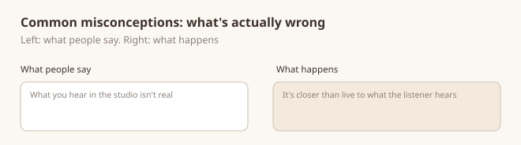
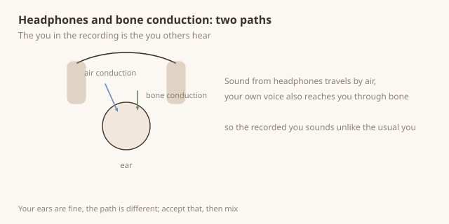
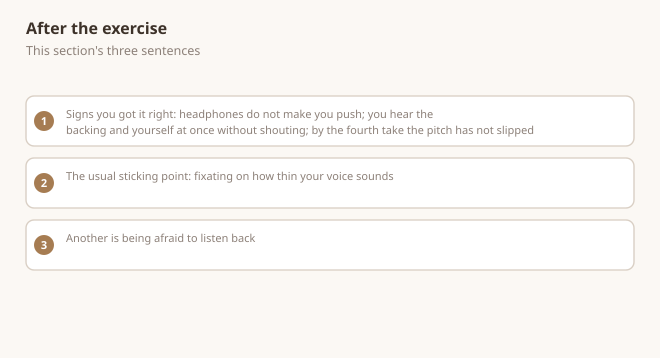

# Chapter 43: Studio Sessions, Part 1: Adapting to Headphone Monitoring and Rebuilding Your Outer-Ear Hearing

## The short version

People who sing well live often feel, the moment they walk into a studio, that they have forgotten how. The reason is simple. You normally judge your sound from air conduction and the reflections of the room. Put headphones on and the headphone signal covers up air conduction and the room reflections disappear. Bone conduction never goes away; it just mixes in with the headphone signal, and the brain cannot line the two up for a while. Monitor headphones do not flatter you. They magnify detail.

This chapter asks you to sing steadily in a state where everything is too clear. Afterwards you will notice that the sound in the headphones no longer frightens you.

## Common misconceptions

Many people think what you hear in a studio is not real, so you should not trust it. In fact it is closer to what the listener finally hears than a live room is.

Another misconception is "I can't hear myself in the headphones, so I have to sing louder". That is the most common trap in a studio: the less you hear, the harder you push, and by the end of the session your voice is hoarse.

## How it works

When you sing normally you hear two things at once: sound arriving through the air, and vibration travelling through the skull to the inner ear. The second is what makes your own voice feel thick and big. Put headphones on and the outside sound is covered up. Bone conduction is still there, but it is mixed with the electronic signal in the headphones and the brain cannot line them up for a while. With the ear canal plugged, vibration inside the body also has trouble escaping, so the low end feels unusually heavy. The "you" you hear is a different version from the usual one.

Monitor headphones are designed to be as flat as possible, with no boost to the lows or the highs. That is not there to make listening pleasant; it is there to let you hear problems. Unsteady air, mushy diction, pitch a little off — all of it becomes obvious. The first listen is uncomfortable, because you have never heard yourself this clearly.

One more thing: there is usually very little reverb in the headphones, so the sound seems dry. You have not got worse. The room is no longer helping.

Monitoring level matters too. Too quiet and you push in order to hear yourself; too loud and the ears tire quickly, so pitch gets worse and worse towards the end of the session (Bottalico et al., 2017). Find a level that is clear without being harsh. Your ears should not be ringing after one song.

A last misunderstanding: dry in the headphones does not mean dry in the finished record. Studios usually add space afterwards; that is post-production work. You do not have to make your voice sound wet while singing. Just record the pitch, the rhythm and the feeling.

## An analogy

**Swimming with earplugs in.** You have not forgotten how to swim; you cannot hear the water or your own breathing, so your rhythm falls apart. Take one plug out and the body finds its coordination again straight away. The mechanism lines up: what you lost was not ability but a feedback channel. Give part of the air conduction back and the movement comes back.

**Checking a wall with a torch.** Monitor headphones are a torch held close to the wall: every speck of dust, every patch of filler shows. A live show is the room light on: you can see whether it looks good, but not the detail. The torch does not dirty the wall; it just lets you see it properly for the first time. Where the analogy breaks: you decide where the torch points, but the headphones deliver everything at once. You will be flooded with detail, so you have to choose actively what you are listening for this time.

**Driving by the rear-view mirror.** The you in the headphones is the rear-view mirror: true, immediate, but a narrow field, and left and right are reversed, so it sounds flatter and thinner. You cannot drive staring at the mirror, but you cannot drive without it either. What you are practising is glancing and coming back, not staring.

## Try it now

1. Find a pair of headphones and play a song you know well with one side on only. What you should feel: the other ear can still hear the room. If you get it wrong: if you put both sides on and feel shut inside a box, take one side off, let the body relax, and start again.
2. Set the balance inside the headphones: you need to hear the drums and the bass in the backing, and your own voice only slightly above the backing. What you should feel: you can stay on the beat and still hear your own pitch. If you get it wrong: if your voice is so loud that it covers the backing, you will sing louder and louder to stay above it. Turn yourself down.
3. Sing a section with one side of the headphones on. The ear that is covered listens to the backing; the ear that is open listens to the air conduction of your own voice and the room. What you should feel: the sound becomes more natural, less like singing in a vacuum. If you get it wrong: if you feel unbalanced left and right and cannot hold the pitch, sing a slow song first and speed up once you are used to it.
4. Record a section and play it back on headphones, pretending it is someone else singing. Listen to three things only: whether it is on the beat, whether the pitch drifts, whether the words are mushy. What you should feel: like inspecting, not like enjoying. If you get it wrong: if you start criticising the timbre and thinking it sounds bad, pull your attention back to the beat and the pitch. Timbre is the last thing you deal with.
5. Listen to the same recording again, and this time only to the breathing points. What you should feel: the breaths are much more obvious than you thought. If you get it wrong: if the breaths are so loud that they cover the words, do not rush to change how you sing. That is the material for the next chapter.
6. Sing the same line with the monitoring level low, then sing it again with it high. What you should feel: at low level you lean forward and want to push; at high level the whole body backs off. If you get it wrong: if the two levels produce very different singing, the headphone volume is leading you. Fix one level and practise at it several times, building the memory of "however loud the headphones are, this is how I sing".

## After the exercise

Signs you got it right: you do not immediately push when the headphones go on; you can hear the backing and yourself at the same time without shouting; you record three takes in a row and the fourth is no worse in pitch.

The usual sticking point is spending the first session thinking "why is my voice so thin". That is the missing boost from room reflections and air conduction. Bone conduction has not decreased, and your voice has not changed. Record a few more times and the ears recalibrate.

Another is being afraid to listen to your own takes. Many people record and then never want to play it back. Start with one section at a time, and listen for one element per pass, not everything at once. After a while you move from grading yourself to observing.

Next chapter takes segmented recording: a song is not sung in one go but assembled from many short pieces, and the question is how to make it sound like one breath.

## Further reading

- **Bottalico, P., Graetzer, S., & Hunter, E. J. (2017).** Effect of Training and Level of External Auditory Feedback on the Singing Voice: Pitch Inaccuracy. *Journal of Voice.* When external feedback is too loud, pitch gets worse — turning the monitor up does not make you sing more in tune, it makes you sing less in tune. PMID 26948385.
- **Mürbe, D., Pabst, F., & Hofmann, G. (2002).** Significance of auditory and kinesthetic feedback to singers' pitch control. *Journal of Voice.* Pitch depends on hearing and on body sensation at the same time; headphones put those two channels in conflict, which is why you can hear the note and still sing it wrong. PMID 12002886.
- **Reed, C. N., Pearce, M., & McPherson, A. (2024).** Auditory imagery ability influences accuracy when singing with altered auditory feedback. *Music & Science.* When feedback is altered, people who can hear the target note in their mind first do better — and that imagining beforehand is exactly what a studio demands. PMID 39219861.
