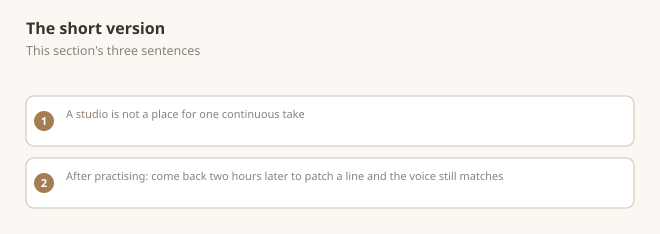
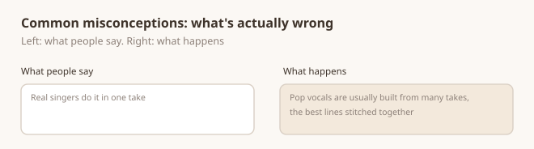
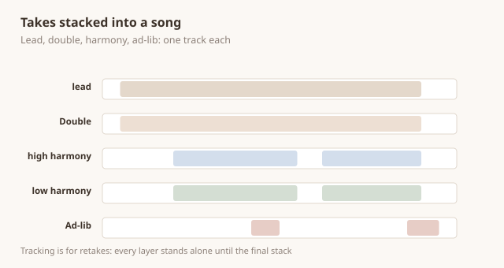
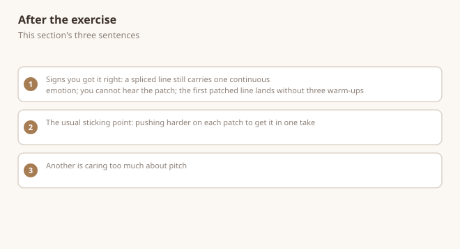

# Chapter 44: Studio Sessions, Part 2: Breaking the Recording into Tracks, and Keeping the Feeling Continuous Across Segments

## The short version

A studio is not a place where you sing a song in one go. The producer records line by line, sometimes patching a single word. The problem is that the joins are often audible: one line is intense, the next is suddenly calm. What you have to learn is keeping one emotional thread across the pieces.

Afterwards you will notice that you can come back two hours later to patch one line and the voice still connects.

## Common misconceptions

Many people think a real singer sings the whole thing in one take, and that editing means your ability is not up to it. In fact a pop vocal track is usually assembled from the best lines out of many takes. That is not cheating; it is how this medium works.

Another misconception is "punching in means starting from that line". Without the run-up, the voice comes out stiff.

## How it works

When you sing, the body remembers the state of the previous line: how wide the throat is open, how much air is being used, where the resonance sits. That momentum is what makes one line join the next naturally. Start suddenly in the middle of a line and the body has not entered that state yet, so the voice "starts up" and sounds cut in.

So the key to a punch-in is the run-up: before you actually record, sing along with the lines before it and let the body get back into that state. Recording software usually lets you start playback a few seconds before the line you are recording, and that is exactly what it is for.

The second key is anchors. People cannot remember a feeling, but they can remember a posture, an expression, a distance. The same line, sung leaning forward with your brows drawn and three centimetres from the mic, has a different timbre. Put those physical conditions back and the sound usually comes back on its own.

One more thing that gets overlooked: breathing. Between the end of one line and the start of the next there is one continuous breath. Recording in segments cuts that breath in two, and the join sounds like a different person. So when you punch in, record the tail of the previous line and the breath into this one together.

Segmented recording has a side effect too: you keep hearing your best line, and then every other line seems not good enough, and you get tighter and tighter. That is normal. The answer is not to redo the same line over and over: record it three times, move to the next line, and come back at the end. The ears need a rest.

## An analogy

**The changeover zone in a relay.** Segmented recording is not four people each running their own leg. Each one is already running in the changeover zone with a hand held back before the baton arrives. That "already running" is the run-up; the hand held back is the posture and the distance. Without those two the baton always drops.

**Joining a motorway.** Coming up the slip road you do not floor it and you do not stop and wait. You accelerate to the speed of the traffic and then merge. A punch-in is the same: bring yourself up to speed with the lines before, and then open your mouth. Where the analogy breaks: the traffic is outside you, but the "speed" here is a state of your own body, so you have to call it back deliberately.

**Continuity on a film set.** Films are not shot in order. The actor shoots the ending at noon and the opening in the afternoon, and what holds it together is identical costume, props and blocking. Your anchors are the costume and the blocking: where your weight is, whether your brows are loose or tight, how far you are from the mic. Put the conditions back and the feeling follows.

## Try it now

1. Play a song and pause on the second syllable of a random line. Do not start from the beginning; carry straight on and finish that line. Five times. What you should feel: the first two attempts stick, then the body finds the place by itself. If you get it wrong: if you can only ever sing from the top, you are relying on the order of the words, not on a state. Practise starting after listening to a short stretch.
2. Listen to a verse you recorded yourself and notice the body in that line: leaning forward or leaning back? Brows loose or tight? How far from the mic? Write those three down. What you should feel: you are starting to remember things with the body, not with a mood. If you get it wrong: if you cannot write them down, have someone watch you during the next recording, or just film it.
3. Go and do something else for five minutes. Come back and sing the same line with those three conditions from the page, record it once, and compare it with the original. What you should feel: the timbre comes out much closer. If you get it wrong: if it still sounds different, it is usually the last item, the mic distance, that has drifted. Check the distance with your eyes first.
4. Practise stitching the breath: when you record a line, capture the breath at its tail and the inhale the next line needs; when you punch in the next line, take that breath at the start as well. Join the two and the breath becomes a bridge. What you should feel: the join is covered by one breath. If you get it wrong: if the two inhales are very different in level, it sounds like two people. Inhale with the same force.
5. Split a long line into two halves, record them separately, join them, and listen to the join. What you should feel: if you cannot hear it, your run-up and anchors were right. If you get it wrong: if the join is obvious, check first that the level matches, then that the resonance placement matches.
6. Record a verse and note three things: where your weight sits, whether your brows are loose or tight, how far you are from the mic. Leave for ten minutes. Come back, read only the notes, not the lyrics, and record it again. What you should feel: the second take sounds like the same person. If you get it wrong: if it is very different, the posture usually changed. Stand back in the original position and try again.

## After the exercise

Signs you got it right: the assembled lines carry one continuous feeling; you cannot tell which line was patched; on a punch-in the first take lands, and you don't need three warm-ups.

The usual sticking point is pushing harder and harder on a punch-in, because you want it right first time. If the state is right, one take is enough, and pushing is what makes the timbre jump.

Another is caring too much about pitch. Listen to a segment long enough and every note starts to seem a little off, and you sing more and more cautiously. Confirm the beat is steady first; pitch usually steadies with it. Fix what is genuinely off, but don't grade yourself while you sing.

Next chapter records harmony: the lead vocal is already there, and you have to learn how to support it from the side instead of competing with it.

## Further reading

- **Thorpe, C. W., Cala, S. J., & Chapman, J. (2001).** Patterns of breath support in projection of the singing voice. *Journal of Voice.* Support is not a single action; different singers reach the same result with different torso strategies — so on a punch-in you copy your own set, not someone else's. PMID 12269638.
- **Peultier-Celli, L., Audouin, M., & Beyaert, C. (2022).** Postural Control in Lyric Singers. *Journal of Voice.* Postural control and balance strategies in singing: posture is an anchor you can repeat, a feeling is not. PMID 32456837.
- **Mürbe, D., Pabst, F., & Hofmann, G. (2002).** Significance of auditory and kinesthetic feedback to singers' pitch control. *Journal of Voice.* Pitch relies on hearing and on body sensation at once; on a punch-in you have to rebuild both, and rebuilding only one leaves a join. PMID 12002886.
