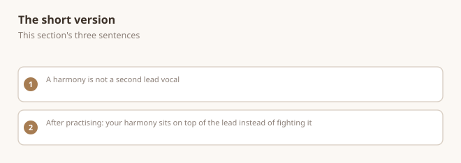
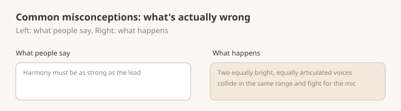
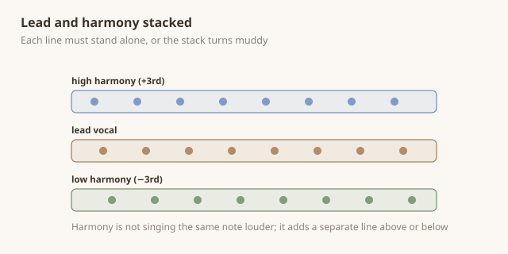
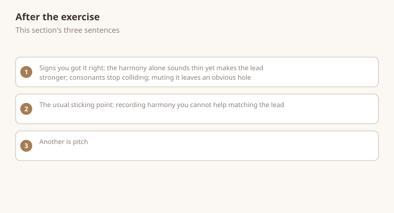

# Chapter 45: Studio Sessions, Part 3: The Foundations of Arranging and Recording Harmony Vocals

## The short version

A harmony vocal is not a second lead. It hides behind the lead, and normally you barely notice it, but switch it off and the whole song suddenly goes thin. The first thing in recording harmony is learning to put your own voice away: less metallic edge, fewer sharp consonants, more air.

Afterwards you will notice that your harmony finally sits on top of the lead instead of fighting it.

## Common misconceptions

Many people think a harmony has to be as strong as the lead to be heard. In fact two voices of the same brightness and the same diction land in the same frequency band and collide, so it sounds like two people grabbing at one microphone and the lead is the one that gets buried.

Another misconception is "the more layers the better". Stacking is not addition; stack it badly and you only get mush.

## How it works

The lead stays clear because of mid-to-high frequency cut and clean consonants. If the harmony uses the same brightness and the same diction, the two overlap in the same frequency band and mask each other, and in the end neither is clear. The difference is not level; it is whether the two are competing for the same place.

So the harmony's job is to give way: less sharp high end, more breath, slightly blurred diction. On its own it seems weak. Stacked, it wraps around the lead exactly.

Why does stacking two takes make it wide? Because a person is not a machine: the timing and the pitch of two takes differ very slightly. Two voices that are almost the same and not quite the same, placed together, produce a solid sense of fusion. The timing difference causes comb filtering; the pitch difference causes slight beating; those components interfere with each other and the sound fills out. Too much difference and it turns into two people singing, so it has to be "alike, but not identical". By the way, the natural vibrato of the human voice at five to seven cycles a second is one reason harmony vocals fuse so easily (Nix et al., 2016).

Writing harmony has its own basic logic. The commonest is harmony in thirds: a third above or below the lead, following the same chord progression. It sounds natural because a third inside the same chord is usually consonant. When you are not sure which note to sing, follow the root or the third of the chord; that is safer than grabbing at a high note.

## An analogy

**Key light and fill light.** The lead is the key light, the harmony is the fill. The fill is never brighter than the key; its job is to take away shadows so the key looks more three-dimensional. Turn the fill up to the same strength as the key and the picture goes flat, and nobody can see the shape. The mechanism lines up: what gets filled is the dip in the frequency response and the gap in the dynamics, not the level.

**Two coats of paint.** The first coat is there to cover the wall; the second is only there to even it out. Brush the second as thick as the first and it runs. The harmony is that thin, even second coat.

**Two electric fans at almost the same speed.** With two fans at almost the same speed you hear a regular "wum— wum—" rising and falling. That is beating. Stacking two vocal takes is the same: a small difference fuses, too big a difference turns into two voices fighting. Where the analogy breaks: a fan's beating is a fixed frequency, while the difference between two vocal takes is never the same twice, so every track sounds slightly different.

## Try it now

1. Sing one line with the force you normally use on a chorus, and record it. Then sing the same line as a sigh: more air, a softer edge to the sound, and record that. Listen to the two together. What you should feel: on its own the second version sounds weak. If you get it wrong: if the second version is still bright and strong, you have not really let go. Sing only breath first.
2. Play a song. The singer sings the whole line; you sing along, but only the vowels, with every consonant removed. For example, a three-syllable line becomes three long vowels. What you should feel: your voice becomes continuous, with no corners. If you get it wrong: if your mouth cannot resist biting out the consonants, go quieter until you cannot hear the consonants.
3. Take a line with words that begin with a hard consonant, a t or a p. Sing the words complete, then sing it again with only the vowels, and compare. What you should feel: with only the vowels the line becomes a single thread. If you get it wrong: if you can no longer tell which word it was once the consonants are gone, that is normal. Harmony relies on the lead to supply the consonants anyway.
4. Record the same line twice, as identical as you can, but without trying to line them up to the millisecond. Stack the two tracks and listen. What you should feel: the sound gets thicker and wider. If you get it wrong: if it sounds like two people singing, the pitch or the diction differed too much between takes. Record it again, closer.
5. Put the two tracks from step 4 left and right, with the lead in the middle, and listen on headphones. What you should feel: the harmony wraps in from both sides. If you get it wrong: if one side sounds louder, check that the two takes are at the same level, or that one of them did not record badly.
6. Mute the harmony track, then unmute it. What you should feel: with it off the whole song suddenly goes thin, and that is the proof the harmony is doing something. If you get it wrong: if switching it off makes no difference, the harmony is too loud or too bright and is covering the lead. Turn it down and take the edge off.
7. Record a short section with no lead at all: you sing the lead yourself, then the harmony. Play both tracks and listen for whether the harmony is holding the lead up. What you should feel: some things are only audible once they are stacked. If you get it wrong: if stacking the two makes it busier rather than fuller, bring the harmony track down until it is only a bed underneath.

## After the exercise

Signs you got it right: the harmony is a little weak on its own, yet stacking it makes the lead stronger; the consonants no longer collide; switching the harmony off leaves an obvious hole.

The usual sticking point is singing the harmony as strongly as the lead the moment you record it. Remember that your job is to support, not to be heard.

Another is pitch. A harmony is easily dragged off by the lead, especially a third. In practice, mute the lead first and sing your note against the backing alone; open the lead only once you are sure. If you keep following the lead, turn the lead down.

Next chapter works backwards from post-production: what kind of singing makes the mixing engineer's job easier.

## Further reading

- **Nix, J., Perna, N., & James, K. (2016).** Vibrato Rate and Extent in College Music Majors: A Multicenter Study. *Journal of Voice.* Ordinary singers' vibrato rate lands around five to seven cycles a second; that is the physiological background to why vocal layers fuse easily. PMID 26564579.
- **Sundberg, J., & Thalén, M. (2015).** Respiratory and Acoustical Differences Between Belt and Neutral Style of Singing. *Journal of Voice.* Belt and neutral styles differ in sound pressure, air pressure and formant strategy; a harmony wants the parameters on the neutral side. PMID 25819162.
- **Lee, Y., Oya, M., & Kaburagi, T. (2023).** Differences Among Mixed, Chest, and Falsetto Registers: A Multiparametric Study. *Journal of Voice.* Chest, mixed and falsetto registers can be told apart acoustically, but the boundaries are continuous — and a harmony usually sits in the middle stretch. PMID 33518476.
