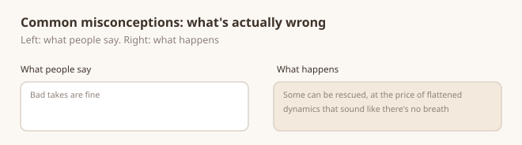
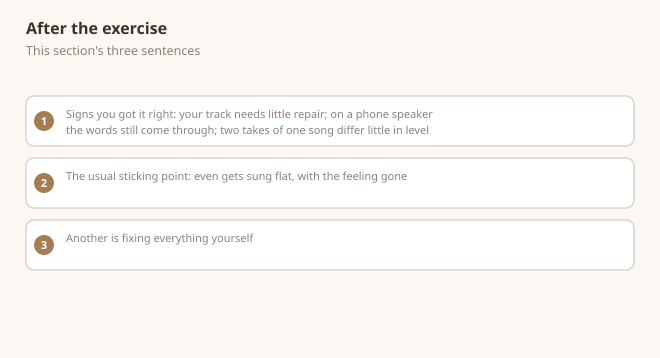

# Chapter 46: Singing for Vocal Mixing: Vocal Strategies That Make Post-Production Easier

## The short version

Mixing is makeup, not plastic surgery. If what you recorded has too much dynamic range, too much muddy low end and too much biting sibilance, post-production can only force it with compression and EQ, and the sound goes flat in the process. The other way round: if you make the voice easy to mix while you are singing it, post-production only needs a little.

Afterwards you will notice that your tracks sound more even, and the mixing engineer stops asking you for another take.

## Common misconceptions

Many people think it doesn't matter if the singing is bad, because the mix can save it. It can save part of it, at the price of squashing the dynamics until the voice sounds like it never breathes.

Another misconception is "the thicker the better", so people press the larynx down on purpose to manufacture low end. That low end then collides with the bass guitar and the kick drum, the mixing engineer has to cut it out, and your voice ends up thinner than before.

## How it works

A voice's cut comes mainly from the mid-to-high frequencies. The band around the singer's formant — a cluster of energy roughly between 2.8 and 3.2 kHz — is what lets the voice through the backing (Lee et al., 2008). The low end is already crowded with the backing, so adding more of it only makes the whole mix muddy. Rather than pressing the voice down low, make it clear in the mid-to-high range.

Dynamics are the same story. A compressor narrows the gap between the loudest and the quietest, so the quiet parts can be heard, but at the same time it lifts the noise floor of those quiet parts. The less even your singing, the harder the compressor has to work, and the less rise and fall the voice has left.

Sibilance is a separate matter. Fricatives like "s" and "ts" concentrate their energy in the high frequencies and sound sharp. Post-production has tools for exactly this, but squash them too hard and the "s" turns into "sh" and you sound like you have a lisp. The best answer is to soften it while you sing: don't clamp the teeth shut, and let the airstream widen.

One more common misunderstanding: taking "loud" for "dynamic". Dynamics are the gap between the loudest and the quietest, not how loud the loudest is. A song that is loud from beginning to end actually has very little dynamic range. It is the singer who can go small as well as big who has wide dynamics, and that is also easier to work with afterwards.

Finally, when the volume rises, adjusting vocal tract resonance is a necessary action, not just a feeling (Vurma, 2022). So if the voice turns sharp and flat when you sing loud, the resonance usually has not been adjusted along with it. It is not the microphone's fault.

## An analogy

**A photograph's latitude.** A correctly exposed photograph holds detail in both the highlights and the shadows, so a little work in post brings it out. An overexposed photograph has highlights burnt to pure white, and no amount of work makes them anything but white. The dynamics you record are your latitude: leave enough and the mixing engineer has something to work with; blow it all out at the start and he is left with a sheet of white.

**Packing boxes before the movers come.** The mixing engineer is not there to pick your things up off the floor. Sort it and box it — even levels, similar vowels, no biting sibilance — and he unpacks and puts it in place. Pile it all on the floor and he can still move it, but a few things will get broken. The mechanism lines up: "tidy" for a track means each line is close in loudness and timbre, not that you sing flatly.

**Filler on a wall.** Filler is for small dents in a wall, not for closing off a partition that was never built properly. Mixing is the same: fixing pitch, fixing sibilance, smoothing small bumps is all fine; rescuing a chorus that has been shouted at full force from start to finish is not, because however thick the filler goes on, it cracks.

## Try it now

These exercises need recording. A phone is enough.

1. Sing "ah, ee, oo, eh, oh" at the same level, two seconds each. Record it and look at the waveform; the five should be about the same width. What you should feel: "ah" comes out too fat and "ee" too thin. If you get it wrong: if the gap is big, round the mouth a little more on "ah", and add a little more support and place the sound forward on "ee".
2. Sing a line full of sibilants — s and ts sounds. Do it the way you normally would, then sing it again with the jaw relaxed and a small gap between the teeth, and compare the recordings. What you should feel: the second "s" becomes a kind of soft rustle rather than a sharp hiss. If you get it wrong: if the words stop being clear once you relax, relax only a little. You are not letting the whole mouth go slack.
3. Record a verse that sounds muffled to you. On the second take, keep the corners of the mouth slightly lifted, as if smiling, and compare. What you should feel: the mid-to-high frequencies come up and the voice brightens. If you get it wrong: if the smile turns into a grin and the voice goes flat, lifting only the corners of the eyes and the cheeks is enough.
4. Sing a chorus with real rise and fall, and deliberately do not use the same force on every line: small in the verse, medium in the pre-chorus, big in the chorus, with every "big" still inside what you can control. Record it. What you should feel: the waveform rises and falls without any spike blowing out. If you get it wrong: if the waveform looks like a row of columns all the same height, you are filling in every word. Pull the verse back further.
5. Play the recording from step 4 next to an older recording where you "pushed on every line". What you should feel: the even version actually carries more feeling. If you get it wrong: if you cannot hear the difference, compare only the level of the first word of the chorus.
6. Sing a stretch of lyrics at the same level, deliberately making every word muddy, then sing it again keeping the sound clean and focused. Record both and notice which one is clear on a phone speaker. What you should feel: the clean version does not need to be loud for the words to come through. If you get it wrong: if the clean version sounds thin, the problem is not the cleanness, it is that the support has gone. Keep the level the same and place the sound a little further forward.

## After the exercise

Signs you got it right: your tracks need very little fixing once recorded; the words are still clear on a phone speaker; two takes of the same song come out at very similar levels.

The usual sticking point is singing flat and expressionless the moment someone says "even". Even refers to level, not to expression. Keep the level steady and the tone of voice can still change a great deal.

Another is fixing everything yourself. Some problems come from the recording space — a low-frequency standing wave in the room, the mic too close. Those are not solved by how you sing. Work out whether the problem is in the singing or in the room before you decide to change anything.

Next chapter leaves the studio: live performance, where every condition gets worse, and you have to learn to stay steady in the middle of the mess.

## Further reading

- **Lee, S. H., Kwon, H. J., & Choi, H. J. (2008).** The singer's formant and speaker's ring resonance: a long-term average spectrum analysis. *Clinical and Experimental Otorhinolaryngology.* The singer's formant — the cluster of energy around 2.8–3.2 kHz — can be measured, and that is the physical basis for a voice cutting through a backing. PMID 19434279.
- **Vurma, A. (2022).** Amplitude Effects of Vocal Tract Resonance Adjustments When Singing Louder. *Journal of Voice.* As the volume rises, the resonance adjustment is a measurable action; a voice that turns sharp when sung loud usually has not made that adjustment. PMID 32624371.
- **Lee, Y., Oya, M., & Kaburagi, T. (2023).** Differences Among Mixed, Chest, and Falsetto Registers: A Multiparametric Study. *Journal of Voice.* The three registers can be told apart acoustically and aerodynamically, and the boundaries are continuous; which one you pick decides how easy that track is to mix. PMID 33518476.
