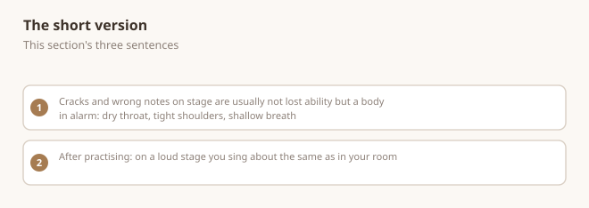
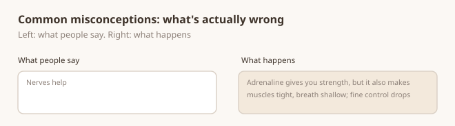
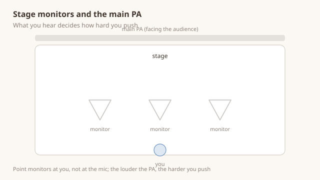
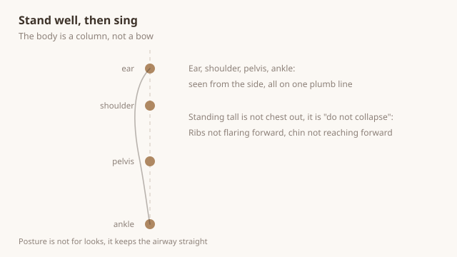
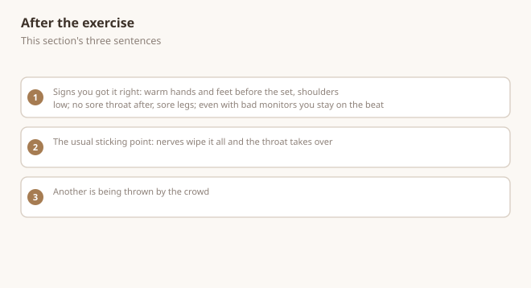

# Chapter 47: Live Performance: Overcoming Muscle Tension and Adapting to the Acoustics of the Room

## The short version

Cracking or going out of tune on stage usually does not mean you have suddenly lost the ability to sing. The body has gone into a state of tension: dry throat, tight shoulders, shallow breathing. Add the room's reverb, the monitor speakers and the audience, and it is nothing like the room you practise in. This chapter trains staying steady inside the interference.

Afterwards you will notice that you can sing on a loud stage much the way you sing in a room.

## Common misconceptions

Many people think adrenaline will carry them up to the high notes. Adrenaline does give you strength, but it also tightens muscles and makes the breathing shallow, so fine control gets worse. The higher the note, the more relaxation it needs, and relaxation is exactly what you have just switched off.

Another misconception is "on stage you have to sing harder to hear yourself". The harder you push, the tighter the throat, the more the pitch drifts, and the neck and shoulders start compensating along with it (Pettersen et al., 2005).

## How it works

Under stress the body gets ready to run: less saliva, a dry throat, tight shoulders and jaw, breathing up in the chest. Those responses are useful in an emergency, but when you sing they lock up exactly the places that most need to stay loose. Neck and shoulder muscles become more active the higher and the louder you sing. That is compensation, not strength.

What you hear on stage is different too. You are hearing not only yourself but the monitors, the instruments coming from behind you, and the reverb that hits the back of the room and bounces back. That reverb usually arrives a little after your voice; follow it and the whole song gets slower and slower.

So live work has two tasks: pull the body back out of tension before you go on, and on stage listen only to what you should be listening to, without being dragged along by the reverb.

One more thing: being ready does not mean the nerves have vanished completely. A moderate amount of nerves is what makes you concentrate. What you are doing is not destroying it, it is stopping it from taking over your breathing and your jaw.

Monitoring level is a variable as well. If the external feedback is too loud, pitch actually gets worse (Bottalico et al., 2017). So "I can't hear, turn it up" is the wrong answer: turn it up until it is clear and stop there, and let the body's remembered sensation do the rest.

## An analogy

**Warming up the car before a drive.** You do not start the engine and go straight onto the motorway. You idle for a minute and press the accelerator gently so the oil reaches everywhere. Bending over, sighing, shifting your weight from side to side before you go on is that warm-up: not to relax you into a nice mood, but to bring the airflow and the muscles back to working temperature. The mechanism lines up: what is being warmed is the breathing muscles and the larynx, not your feelings.

**Writing in a moving car.** Down in the audience there are people, reverb and lights, and the car is swaying. You cannot stop the car, but you can hold the pen steady and press the paper down. Holding the pen steady is the three things — feet on the floor, shoulders low, jaw loose; pressing the paper down is "listen only to the drums and the bass". Where the analogy breaks: writing can stop and start again, a live show cannot, so all you have is the three anchors you practised beforehand.

**Reverb is the conversation at the next table.** Someone beside you repeats what you say half a sentence late. Follow them and you stammer. The right thing is to keep talking and let their voice fall behind. On stage it is the same: sing with the beat, and do not wait for the reverb.

## Try it now

1. Ten minutes before you go on, find a corner and bend over so the upper body hangs down like a rag doll. Rock the jaw gently from side to side to confirm it is loose. What you should feel: the weight of the shoulders dropping. If you get it wrong: if bending over makes you dizzy, sit down and just drop your head instead.
2. Breathe in through the nose and the corners of the mouth at the same time, sending the air into the sides of the waist and the lower back, then let out a very loose, long "haa—". Three times. What you should feel: the ribs open to the sides, and after the exhale the shoulders sit lower than before. If you get it wrong: if the shoulders rise as you breathe in, empty the air completely first, then breathe in.
3. Stand up with the knees slightly bent, not locked, and shift your weight from side to side. What you should feel: the thighs working a little, as if standing on ground that gives slightly. If you get it wrong: if the knees lock and the whole body leans back, you will get dizzy easily and the breath will float up with it.
4. In the practice room, put a song on with headphones and deliberately add an obvious delay so your own voice comes back half a beat late. Sing a section with the backing without being dragged off by the delay. What you should feel: you badly want to wait for that voice, but you have to trust the beat. If you get it wrong: if you get slower and slower, switch the delay off and practise steadiness by singing to a metronome first.
5. March on the spot while singing an upbeat song. The marching has to be steady and the voice must not sway with it. What you should feel: the lower body is moving while the upper body and the breath stay steady. If you get it wrong: if the voice shakes with every step, march without singing first, and open your mouth once the steps are steady.
6. Design an "instrumental-break move": over a few bars with no vocal, turn your head, let out air, drop the jaw, or do a three-second lip buzz. Actually do it on stage. What you should feel: the throat gets reset in the gap. If you get it wrong: if turning your head interferes with the breath for the next line, just let out air and relax the shoulders instead.
7. Find the highest line of the song and practise "pressing down": as you sing that note, press the front foot into the floor and sink slightly, without lifting the head or coming up on the toes. What you should feel: the strength comes up from the soles of the feet and the neck is loose. If you get it wrong: if you lift your head and float upward as you go for the high note, the sound will jam in the throat. Practise the movement on its own first, without singing.
8. Do one "noise rehearsal": play the backing louder than usual, and have someone talk or make noise beside you while you sing a section through it. What you should feel: you notice yourself starting to lock onto the drums and the bass only. If you get it wrong: if you cannot hear the backing at all and fall apart, turn the backing down a little. Steadiness first, then noise tolerance.

## After the exercise

Signs you got it right: hands and feet are warm before you go on and the shoulders are low; your throat does not hurt afterwards and it is your legs that ache; even with a bad monitor mix you still sing on the same beat.

The usual sticking point is forgetting all of it the moment the nerves hit and going back to singing from the throat. Write "knees soft, shoulders relaxed, jaw loose" on the set list and glance at it before you go on.

Another is being thrown by the audience. See someone looking down, someone talking, and you start doubting yourself. Put your attention back into the body: feet planted, shoulders low, jaw loose. You cannot control the audience; you can control those three places.

Next chapter changes style: the same pair of vocal folds singing folk, ballad and light rock, and how the parameters have to be set.

## Further reading

- **Pettersen, V., Bjørkøy, K., & Torp, H. (2005).** Neck and shoulder muscle activity and thorax movement in singing and speaking tasks with variation in vocal loudness and pitch. *Journal of Voice.* The louder and the higher you go, the more neck and shoulder muscle activity shows — that is compensation, not support. PMID 16301107.
- **Bottalico, P., Graetzer, S., & Hunter, E. J. (2017).** Effect of Training and Level of External Auditory Feedback on the Singing Voice: Pitch Inaccuracy. *Journal of Voice.* When external feedback is too loud, pitch accuracy gets worse; cranking the monitor on stage is a common source of going out of tune. PMID 26948385.
- **Peultier-Celli, L., Audouin, M., & Beyaert, C. (2022).** Postural Control in Lyric Singers. *Journal of Voice.* Postural control and balance strategies in singing: soft knees and a weight that can shift are concrete variables you can use against nerves. PMID 32456837.
