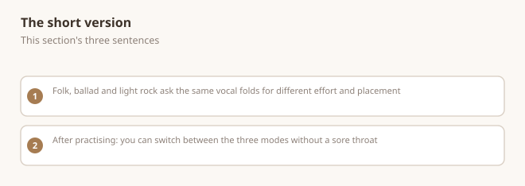
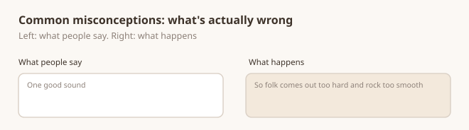
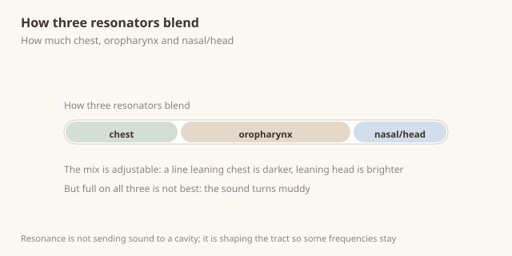
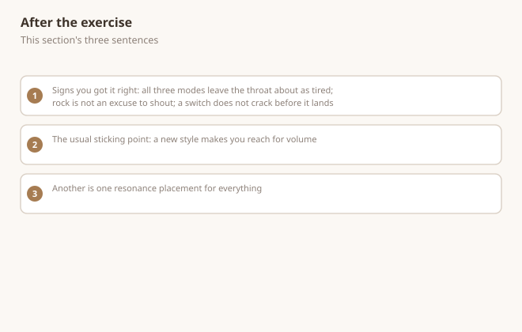

# Chapter 48: Fine-Tuning the Voice Across Styles: Moving Between Ballad, Folk and Light Rock

## The short version

The same pair of vocal folds singing folk, ballad and light rock needs different amounts of force in different places. No style is superior; the occasion differs. Folk has to stay loose and close to speech; a ballad needs big contrasts and a connected line; light rock needs density and has to cut through the instruments. Get the mode wrong and the voice is either swallowed by the backing or sticks out.

Afterwards you will notice that you can switch between the three modes without your throat hurting.

## Common misconceptions

Many people think there is only one standard for a good-sounding voice, so they sing everything the same way. The result is folk sung too hard and rock sung too round.

Another misconception is "rock means shouting". Shouting is forcing things through the throat and it does damage. Light rock wants tighter vocal fold closure and a more focused sound, not more volume.

## How it works

The difference between the three styles can be pictured as three knobs: how much breath, how dense the vocal fold closure is, and where the resonance sits.

Folk: more breath, looser closure, sound close to the mouth, so it sounds like talking. Ballad: loose in the verse, dense in the chorus, a big drop between them, and the vowels have to connect. Light rock: dense closure, little breath, sound focused forward, which is the only way to cut through drums and electric guitar. This is not mysticism: compare belt with a neutral style and the sound pressure, the air pressure and the formant strategy all measure differently (Sundberg & Thalén, 2015).

Where the analogy breaks: real singing is not three knobs but a continuous range. You also switch within one song — a folk-like verse, a rock-like chorus. So what you are practising is not three fixed settings but the ability to move between them.

One more point: whichever style it is, the throat should not hurt. If it hurts afterwards, that is not the style, that is the method. Belt is not a single action either; it is a combination of features, and forcing any one of them on its own damages the vocal folds (Lebowitz & Baken, 2011).

The three styles also ask different things of diction. Folk can stay loose, with a little blur between one word and the next; a ballad has to be clear, because the words are the point; light rock wants words short and hard, because the attack of the consonants is itself part of the rhythm. So the same line in a different style needs different diction, not just a different volume.

## An analogy

**Three ways of wearing the same shirt.** The shirt does not change; what changes is whether it is tucked in, how many buttons are done up, how far the sleeves are rolled. Folk is everything let out, ballad is only the middle button done, rock is all the buttons and tucked in. The mechanism lines up: what changes is how much air leaks, how dense the closure is and how far forward the sound sits. The shirt itself — your vocal folds — has not changed.

**Three gears in a car.** First gear has power but no speed; third gear is economical but weak on a hill. You would not drive a motorway in first, or climb a hill in third. The style is the road; the gear is your proportion of effort. Staying in first for a long drive overheats the engine, and that is a sore throat after singing.

**Three focal lengths.** Folk is a wide angle: it takes in a bit of everything, the person inside the background. Ballad is a standard lens: the subject is clear without being pushed at you. Rock is a telephoto: it cuts the subject out of the background. Where the analogy breaks: a lens has a fixed focal length, while the shape of your vocal tract is being adjusted in every line.

## Try it now

1. Take a stretch of folk lyrics. Speak it once at your normal speaking volume and tone, then sing it, keeping the talking feel as far as you can. You can use more breath, and let the ends of words scatter naturally. What you should feel: like talking to one person, not like performing. If you get it wrong: if the singing is much harder than the speaking, turn the volume down until the two are close.
2. Same stretch: try adding a small sigh at the end of each phrase. What you should feel: the line has a sense of being let go. If you get it wrong: if every word ends in a sigh it sounds exhausting. Once per line is enough.
3. Take the chorus of a ballad and sing only "ah", connecting the vowels of each word without a break in between. What you should feel: one thread, with only the shape of the mouth changing from word to word. If you get it wrong: if it keeps breaking, slow down and confirm the air is not stopping.
4. Same chorus: practise "straight first, then vibrato". Hold a straight note through the phrase and only let the vibrato in near the end. Record it. What you should feel: settled at the front, loose at the back. If you get it wrong: if it is already wobbling at the start, the whole line will be unsteady. Make the straight part longer.
5. Take the chorus of a light rock song and sing it with tighter closure than usual: less breath, more focus, but no more volume. What you should feel: the sound gets solid like a ball rather than a patch of mist. If you get it wrong: if the throat starts to hurt and the voice goes husky, you are squeezing with the throat. Halve the volume and practise only the focus, not the size.
6. Record ten seconds each of the folk from step 1, the ballad from step 3 and the rock from step 5, and listen to them one after another. What you should feel: the three have different body temperatures. If you get it wrong: if they all sound alike, change one knob only, the proportion of breath for instance, and add the rest slowly.
7. Pick a song, do the verse in the folk way and the chorus in the rock way, without jumping between them: make the change gradually across the pre-chorus. What you should feel: like walking from indoors to outdoors. If you get it wrong: if the voice cracks at the switch, stretch the pre-chorus out so the body has time to adjust.
8. Take the same line and sing it once in each of the three styles, recording three files. Listen the next day without looking at the file names, and try to guess which is which. What you should feel: if you can guess your own, the three modes are far enough apart. If you get it wrong: if two sound the same, separate them first by the proportion of breath and then widen the rest.

## After the exercise

Signs you got it right: after singing all three modes your throat is about equally tired; you do not use "rock" as an excuse for shouting; the voice does not crack before it settles at a switch.

The usual sticking point is wanting to change the volume when you change style. Most of the time what changes is the proportion, not the size.

Another is using one resonance placement for everything. Folk can be loose and forward; a ballad needs more space; rock needs focus. Change the placement and the timbre changes, and the load on the throat changes with it. When you switch, think "where is the sound placed" before you think "how hard do I push".

There is one more: treating one teaching system's mode names as rules. CVT, for instance, divides the voice into four modes — neutral, curbing, overdrive and belting. That is a useful classification, not the universe's only correct answer (McGlashan et al., 2023). Classification is for communicating, not for passing exams.

Next chapter deals with something everyone meets: you practise to a certain point and then suddenly feel you cannot sing at all.

## Further reading

- **Sundberg, J., & Thalén, M. (2015).** Respiratory and Acoustical Differences Between Belt and Neutral Style of Singing. *Journal of Voice.* Belt and neutral styles differ in sound pressure, air pressure and formant strategy: the difference between styles has a physical basis, not just a feel. PMID 25819162.
- **Lebowitz, A., & Baken, R. J. (2011).** Correlates of the belt voice: a broader examination. *Journal of Voice.* Belt is not a single parameter but a combination of features; grabbing one of them and forcing it tends to cause injury. PMID 20236798.
- **McGlashan, J., Aaen, M., & White, A. (2023).** A mixed-method feasibility study of the use of the Complete Vocal Technique (CVT), a pedagogic method to improve the singing voice. *Pilot and Feasibility Studies.* CVT's four modes and its teaching outcomes: a useful classification, not the only correct answer. PMID 37226281.
- **Lee, Y., Oya, M., & Kaburagi, T. (2023).** Differences Among Mixed, Chest, and Falsetto Registers: A Multiparametric Study. *Journal of Voice.* The three registers can be told apart acoustically, but the boundaries are continuous — so what you practise is sliding, not three switches. PMID 33518476.

