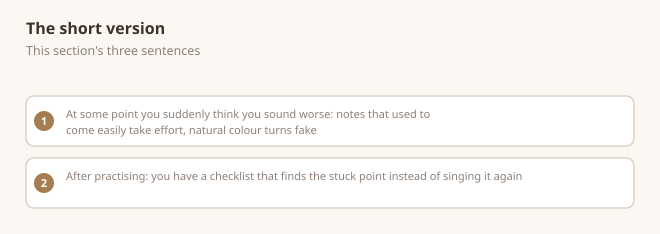
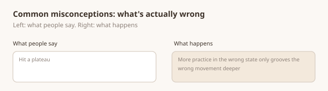
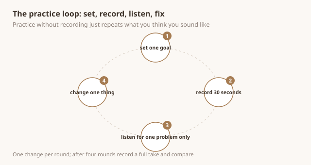
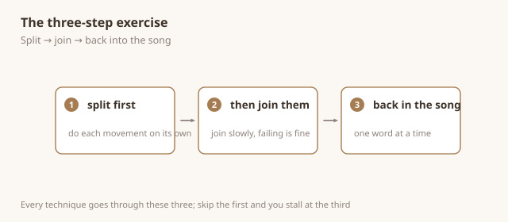
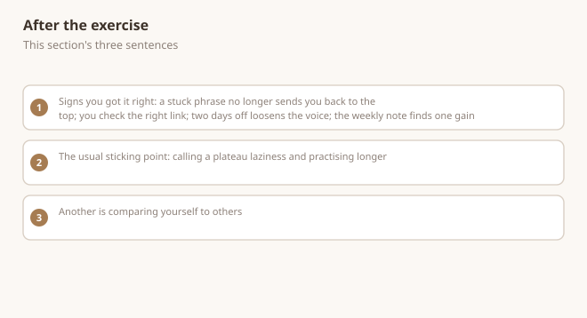

# Chapter 49: Breaking Through a Plateau: A Self-Check and Reset Checklist for When Practice Loses Direction

## The short version

At some stage of practising you suddenly feel you have got worse: notes you used to reach are a struggle, a tone of voice that used to be natural sounds put on. This is usually not a step backwards; it is the old habits fighting the new ability. The worst thing to do at that moment is to double the practice.

Afterwards you will have a checking routine, so you know where you are stuck instead of singing it over and over.

## Common misconceptions

Many people think a plateau is something more effort will get them through. In fact practising more in the wrong state only makes the wrong movement more practised.

Another misconception is "resting is laziness". When the voice is not right, stopping for two days is often more use than forcing two weeks.

## How it works

Singing runs on muscle memory. When you learn a new technique the old compensatory movement does not disappear at once; the two sets of movements exist side by side. The voice is unstable during this time, because the body is not yet sure which one to use. That is the plateau.

Increase the practice load at this point and the body picks the more familiar set, which is usually the old, wrong one, because it costs less. So the more you practise, the more firmly the mistake settles.

Rest is not idling. Its job is to give the body time to write the new movement in and to let tired muscles recover. And instead of just singing, change the way you practise: slower, smaller, one variable at a time.

There is another cause that is easily overlooked: if you can hear the problem, your ear has improved and your body has not caught up. The voice has not actually got worse; you can finally hear the roughness that was always there. Knowing that removes a lot of anxiety.

Finally, training leaves traces. Take vibrato: after a period of training both its rate and its extent change, and rate and extent are two independent parameters (Mitchell & Kenny, 2010). What that means is that progress often shows up somewhere you were not watching, and only a recording will reveal it.

## An analogy

**Halfway through moving house.** The new furniture has arrived, the old has not gone out, and the hallway is full of boxes, so of course you walk slower than usual. You cannot respond by carrying all the old furniture back in, and you cannot just stand there either. What you do is clear one corner a day. The mechanism lines up: the old compensatory movements are those boxes, and the voice is bound to be unsteady while two sets exist at once. That is a transition, not a failure.

**Writing with the other hand.** Write with the hand you are not used to and for the first few days it is uglier and more tiring. Switch back because it is ugly and you never learn. But write eight hours a day with it and you end up too sore to write anything well. So: short, slow, once a day, rather than going at it with all your might.

**Upgrading the ears first.** Buy a good pair of headphones and you suddenly find that your old recordings are full of noise. The noise was not new; you can finally hear it. Where the analogy breaks: headphones can be returned, ears cannot, so you have to accept the lag between hearing the problem and being able to fix it.

## Try it now

1. Start with a "three-day record". Practise as usual for three days, but record the same phrase every day, listen at night, and write down only three things: where it is tight, where it is unsteady, where it does not sound like what you wanted. What you should feel: the problems keep landing in the same one or two places. If you get it wrong: if every day you write "all of it is bad", the scope is too wide. Listen to one note or one line instead.
2. If the voice is wrong for three days running, stop singing for two. No voice exercises, no humming, and no whispering either, because whispering wears the vocal folds more than normal speech. Drink water, go to bed early (Behlau & Oliveira, 2009). What you should feel: there may be a slight strange sensation in the throat during the rest, which is normal. If you get it wrong: if it still hurts after two days off, this is not a plateau. Go and see a doctor.
3. When you come back, make only one "oo" at the speaking pitch that feels most comfortable, and hold it for five seconds. While you hold it, check: is the jaw loose? Is the base of the tongue soft? Are the shoulders up? If any one place is tight, stop, shake it loose, and try again. What you should feel: like restarting the system. If you get it wrong: if the first thing you want to do is go for a high note, hold off. Do only this for the first ten minutes.
4. Take the line that sticks most and break it down three times. First time, drop the words and sing the melody on a lip trill; second time, sing it on "oo"; only the third time add the words. What you should feel: usually the first pass is the easiest and the sticking starts when the words go in. If you get it wrong: if the lip trill sticks too, the problem is in the breath or the pitch, not the diction. Slow down before you sing it.
5. Make a five-point checklist and put it in your phone's notes: is the airflow steady; is the effort in the belly or in the throat; is the larynx riding up; is the mouth opening too wide on the high notes; am I telling a story or showing off a technique. Every time you get stuck, ask the five in order instead of singing it again. What you should feel: you move from "keep trying" to "find the cause". If you get it wrong: if you have checked all five and it still sticks, move to another line. Do not spend half an hour on one.
6. Before you practise each day, sing a simple children's song in the loosest state you have, the way a child talks. What you should feel: back to zero-load phonation. If you get it wrong: if even the children's song comes out tight, do only relaxation today and no technique.
7. Every week write three lines of review: which line got better this week, which line is still stuck, which single thing you will practise next week. What you should feel: progress becomes visible. If you get it wrong: if you cannot write down anything that improved, go back two weeks in your recordings and you will hear the difference.
8. Find a song you have not sung for a long time, one that used to go smoothly, and sing it once. What you should feel: usually you find it has become easier, because your baseline has risen. If you get it wrong: if it still sticks, split it into melody and words and sing the melody alone first.

## After the exercise

Signs you got it right: you no longer start again from the top the moment you get stuck, but know which link to check first; after two days off the voice is usually looser than before; the weekly review produces at least one thing that improved.

The usual sticking point is reading a plateau as "not trying hard enough" and practising longer. A plateau needs less volume, more breaking down and a different method, not more.

Another is comparing yourself with other people. You will see someone improving fast and decide there is no hope for you. Everyone starts somewhere different and practises differently; the only fair comparison is with yourself last month. Keep the old recordings; that is the most honest progress chart there is.

Next chapter is the last one: when technique is no longer the problem, what you have to deal with is who your voice sounds like.

## Further reading

- **Behlau, M., & Oliveira, G. (2009).** Vocal hygiene for the voice professional. *Current Opinion in Otolaryngology & Head and Neck Surgery.* Evidence-based advice on hydration, avoiding throat clearing and voice rest; rest is not a mood, it has concrete actions. PMID 19342952.
- **Mitchell, H. F., & Kenny, D. T. (2010).** Change in vibrato rate and extent during tertiary training in classical singing students. *Journal of Voice.* Training changes both the rate and the extent of vibrato, and the two are independent parameters — progress often happens where you were not looking. PMID 19850446.
- **Masson, M. L. V., Fabbron, E. M. G., & Loiola-Barreiro, C. M. (2019).** Vocal warm-up and cool-down in teachers: a quasi-experimental controlled study. *CoDAS.* The effect of warm-up and cool-down on people who use their voice for long stretches; the cool-down after singing matters as much as the warm-up before. PMID 31531555.
