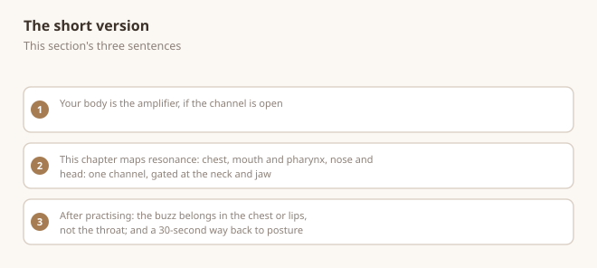
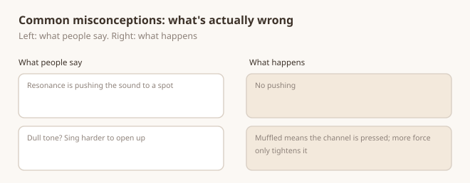
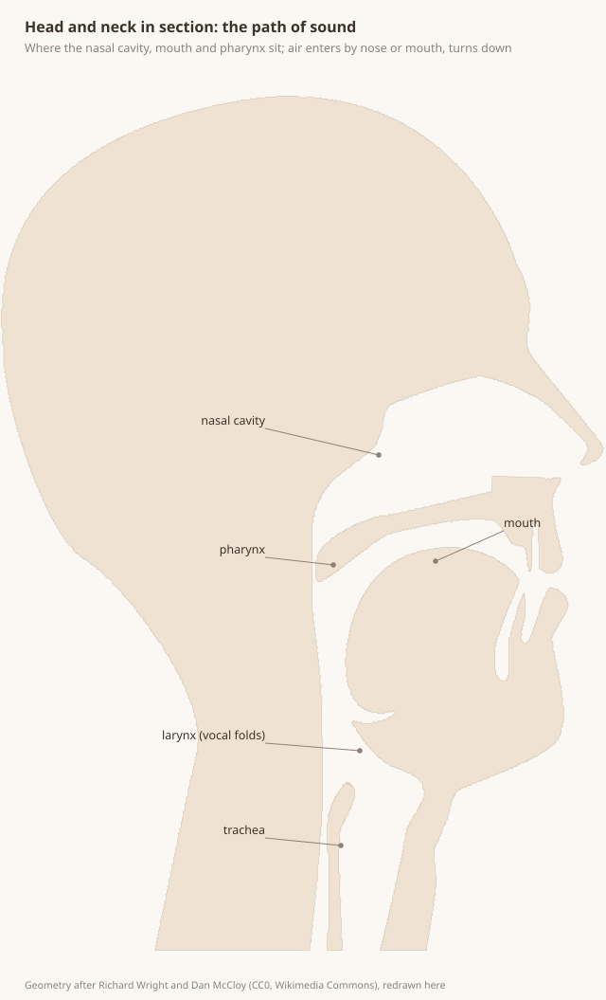
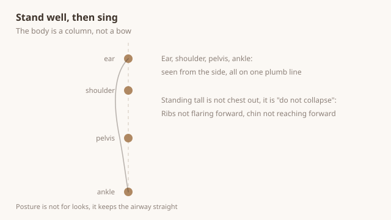
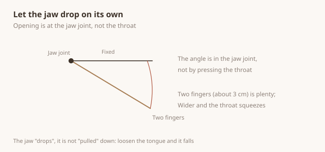
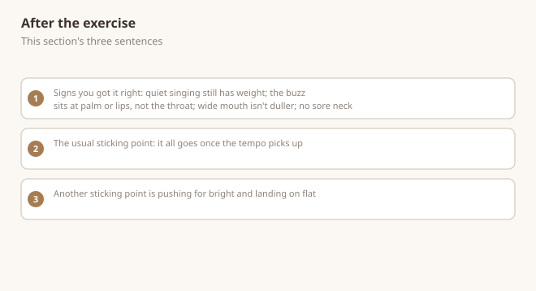

# Chapter 5: A Resonance Map of the Body: Releasing the Tension in Neck, Shoulders and Jaw (Posture and Relaxation for Singing)

## The short version

Your body is the amplifier for the voice, on one condition: the channel has to be open. Shrug the shoulders and clamp the jaw and the amplifier turns into a mute.

This chapter draws the resonance map: chest, mouth and pharynx, nose and head. Three regions, joined by one channel, with the gate in the neck and the jaw. With the gate shut you can't reach any of the three.

After the exercise you will know that the vibration belongs in the chest or the lips, not stuck in the throat, and you will have a way to get back into the right posture in thirty seconds.

## Common misconceptions

Many people think resonance means pushing the sound towards a particular place. You can't push it. A resonance chamber doesn't get bigger because you push; it joins in passively when the channel opens. The harder you try to send the sound up, the tighter the throat gets.

Another misconception is that a dull sound means you should sing harder to open it up. Dull usually means the channel is pressed shut, and pushing only presses it shut harder. There is a related confusion too: a wide open mouth is not an open throat. Some people open the mouth very wide for a high note while the root of the tongue pulls back, and the channel ends up narrower than before.

## How it works

The raw sound the vocal folds make is small. It has to be shaped and amplified by the vocal tract and the spaces of the body. The three main regions are:

- **Chest**: the area below the collarbones. On low notes the trachea and the chest wall produce a vibration you can feel with your hand. Teaching calls it chest resonance, but the lungs are not a resonance chamber; the vibration is mainly tactile.
- **Mouth and pharynx**: from the mouth back to the throat. This one carries diction and the midrange, which makes it the main battlefield of pop, and it is the most adjustable stretch of the three: the height of the larynx and the tension of the root of the tongue both change its size.
- **Nasal cavity and the spaces of the head**: between the eyes, behind the bridge of the nose. The nasal cavity adds a little low-frequency colour and shapes the upper-mid harmonics; the real brightness comes mainly from a cluster of high-frequency energy produced when the channel above the larynx narrows (Lee et al., 2008).

The three regions do not work separately. Their proportions change with pitch and with vowel. What connects them is one channel: the throat, the root of the tongue and the jaw. Tighten those and the sound can neither go up nor come down.

While we are here, one common phrase needs clearing up: what people call head resonance is not the skull vibrating. Endoscopic studies show that what classical singing calls head voice, and "imposto", corresponds to a change in the shape of the vocal tract, not to sound actually travelling into cavities in the skull (Aura et al., 2022). The vibration you feel comes mainly from the nasal cavity and the vocal tract. Teaching can go on using the old phrase, but don't treat it as an empty speaker cabinet.

The key to posture is the axis. Head directly above the shoulders, shoulders sunk, rib cage opening naturally: then the trachea is straight and the diaphragm has room to descend. You don't need to lift the chest, and you don't need to pull the belly in. Lifting the chest locks the upper chest and the ribs; pulling the belly in limits the diaphragm. Neither lets the breath go deep. Strategies for standing steady differ from singer to singer, so don't force one posture on yourself (Peultier-Celli et al., 2022).

## An analogy

**Three rooms and one door.** The three spaces are joined by one corridor, and the door is at the neck and the jaw. With the door half shut you can't hear anything from any of the rooms. What you do is not turn the speaker up; you go and open the door.

**Driving by the dashboard.** "Put the sound forward", "aim it at the mask" — those instructions are like telling you to judge the engine by the noise it makes. A hand on the chest and a hand on the bridge of the nose are the dashboard. Where the vibration is, that is the reading.

**Windows wide open, curtains still drawn.** A wide open mouth that still sounds muffled is exactly this picture. The real opening is behind the mouth, where you can't see it, so you have to judge by sound and by the feel of vibration.

Where the analogies break: doors and curtains are moved by hand, and half of the body's channel is reflex. So it is not about pulling something open. It is about not closing it.

## Try it now

### Exercise 1: The marionette

1. Feet shoulder-width apart, knees slightly bent.
2. Imagine a string at the top of your head pulling you upward, the back of the neck lengthening.
3. Let the shoulders sink with gravity and the chest open naturally. Don't lift the chest on purpose.
4. Chin slightly in, eyes level, hold for five breaths.

What you should feel: the top of the head going up and the shoulders going down, both at the same time. If you get it wrong: if the chest juts out and your lower back aches, that is lifting the chest, not lengthening. Put the ribs back where they were and lengthen only the back of the neck.

### Exercise 2: Release the chewing muscles

1. Put your index and middle fingers in front of the ears, open and close the mouth, and find the joint that slides.
2. Make small circles on the joint and on the chewing muscles at both sides of the jaw for one or two minutes.
3. Drop your hands and let the jaw hang as if you were dozing off.
4. Make a lazy "aah—" for five seconds, twice.

What you should feel: the sound gets wider and thicker and nothing is caught in the throat. If you get it wrong: if the sound goes dull once the jaw drops, the tongue has pulled back. Touch the tip of the tongue to the inside of the lower front teeth and keep it forward.

### Exercise 3: The humming scan

1. Lips closed, teeth slightly apart, tongue flat, make an "mmm—".
2. Hand on the breastbone. Hum low and hunt for the pitch where the chest vibration is clearest.
3. Take the pitch up a little and hum around speaking height. Notice the lips itching and buzzing.
4. Three of each.

What you should feel: the low note buzzing in the chest, the middle note buzzing in the lips. If you get it wrong: if the vibration is stuck in the throat and your neck aches, the neck and shoulders or the jaw are working again. Stop, go back to the posture in exercise 1, and hum again.

### Exercise 4: Sing a line with the map

1. Pick a line of a song you know.
2. Hum the melody first and confirm the vibration is in the chest or the lips.
3. Then sing it on vowels, keeping the same placement.
4. Check whether the throat is loose afterwards.

What you should feel: the sound comes out of the body rather than scraping out of the throat. If you get it wrong: if it all jams back into the throat as soon as there are words, halve the speed and check the placement one syllable at a time.

## After the exercise

Signs you got it right: quiet singing still has thickness; the vibration shows up under the palm or on the lips, not in the throat; opening the mouth wide doesn't make the sound duller; your neck isn't sore afterwards.

The usual sticking point is forgetting the moment it gets fast. Break the sentence into short pieces first. Better slow than letting the old habit back in. Thirty seconds setting up the posture before each session is more use than fixing it after the singing.

Another is turning bright into flat. To push the sound forward, people flatten the mouth shape and push the chin out, and it ends up sounding like a cold. Brightness comes from the vocal tract and high-frequency energy, not from squeezing the sound out through the nose.

Next chapter goes back to the source: how the vocal folds close, why air leaks, and why the voice cracks.

## Further reading

- **Aura, M., Geneid, A., & Bjørkøy, K. (2022).** A Nasoendoscopic Study of "Head Resonance" and "Imposto" in Classical Singing. *Journal of Voice.* Endoscopic observation shows that "head resonance" corresponds to a change in vocal tract shape, not to sound being amplified inside the skull. PMID 32513553.
- **Lee, S. H., Kwon, H. J., & Choi, H. J. (2008).** The singer's formant and speaker's ring resonance: a long-term average spectrum analysis. *Clinical and Experimental Otorhinolaryngology.* The singer's formant (a cluster of energy around 2.8–3.2 kHz) can be measured, and it is one source of brightness. PMID 19434279.
- **Peultier-Celli, L., Audouin, M., & Beyaert, C. (2022).** Postural Control in Lyric Singers. *Journal of Voice.* Lyric singers use different postural control strategies; the point is finding your own version of standing steady and still breathing. PMID 32456837.
