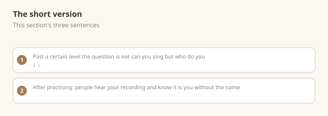
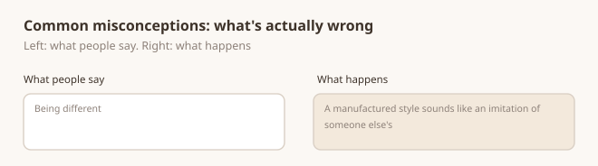
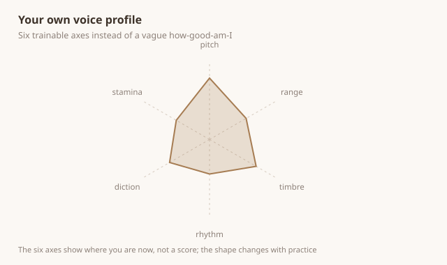
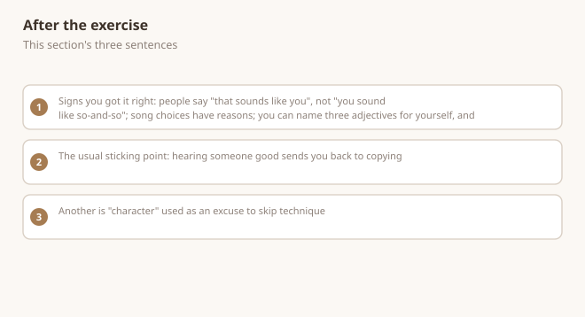

# Chapter 50: Building a Personal Vocal Brand: Refining Your Own Vocal Fingerprint Instead of Copying

## The short version

Once technique reaches a certain point, the remaining question is not "can you sing" but "who do you sound like". If every song you sing sounds like the original singer, what the listener remembers is the original, not you. A vocal brand is not making yourself strange; it is picking out the qualities you already have, fixing on them, and using them again.

Afterwards you will notice that people hear your recording and know it is you without looking at the name.

## Common misconceptions

Many people think being distinctive means being different from everyone else, so they force a rasp, put on a languid manner, add a lot of runs. Distinctiveness manufactured on purpose sounds like an imitation of some style.

Another misconception is "singing it like the original means singing it well". While you are learning, that is right. Stay there and your voice is only ever a copy.

## How it works

A human voice already has a fingerprint: the length and thickness of the vocal folds, the shape of the resonance cavities, the habits of speech. Together those make every voice different. The problem is that most people, while learning to sing, treat those qualities as faults and fix them away, and in the end everyone sings very correctly and very alike.

A brand is built on three things: what songs you choose, where you put the effort, and what you repeat. One small habit used once is an accident; use it repeatedly and the accident becomes your signature.

There is one condition: the quality must not damage the vocal folds. A rasp produced by squeezing will break down sooner or later; a vibration that the vocal folds already have can be used. This is not a moral argument but mechanics: a timbre bought with squeezing is bought with mucosa.

One tool that gets overlooked: draw your range. A voice range profile is an objective measurement, not a feeling that "I can reach that" (Berger et al., 2022). Draw it once and you know where your sweet spot is and which notes are held up by force, so choosing songs and keys has a basis instead of depending on a trial run each time.

## An analogy

**Handwriting.** Everyone writes the same character differently, and nobody is deliberately writing badly. Your writing is recognisable because the turns of the strokes, the size and the speed are fixed. A vocal brand is the same: you are not inventing a new letter shape, you are fixing the turn you already have and using it in every letter. The mechanism lines up: what gets fixed is your diction habits, the way you end a phrase, the resonance placement — not the timbre itself.

**A restaurant's signature dish.** A restaurant does not need every dish to be a surprise; it needs one dish people make the trip for. That dish is usually not complicated, but it tastes the same every time. What you practise is making the same choice every time you sing that line.

**A fingerprint does not change when you wash your hands.** You can train technique, change style, change diction, but the set of vocal folds and cavities underneath does not become someone else's. Where the analogy breaks: a fingerprint cannot change at all, while a voice can change in part — the habits can change, the structure cannot. Work out which is which, and you will not spend ten years chasing a timbre that is not yours.

## Try it now

This chapter is three lists and one experiment. No voice exercises.

1. Find three recent recordings of yours in different styles and listen with your eyes closed, pretending it is someone else singing. Write down: which part of the range sounds the most comfortable and the least effortful? That is your sweet spot. From now on, when you choose a song or a key, check first whether it sits there. What you should feel: you notice you have been avoiding one particular area. If you get it wrong: if you cannot hear anything in common across the three, listen only for the span from your lowest note to your highest and draw it with a pen.
2. Write your timbre in three adjectives, for example "clean, thin, a little nasal". Do not write words like "nice" or "full of feeling", which everyone can claim and which tell you nothing. What you should feel: you will be a little embarrassed by it, which is normal. If you get it wrong: if you cannot write any, play it to an honest friend, ask for three words, and filter them yourself.
3. Find one small habit you cannot get rid of: air escaping at the ends of words, a few vowels sitting flat, phrases dropping at the end. First confirm it does not hurt and does not make you hoarse. Then pick a song and use it deliberately in a fixed place, the last word of each verse, for instance. Record it. What you should feel: once the same habit keeps appearing, it stops sounding like a mistake and starts sounding like a deliberate choice. If you get it wrong: if you use it in a different place each time, it will still sound like a mistake. Fix on one position first.
4. Write down the "role" you sing in: are you the person telling stories in a late-night bar, or the person sitting by a window in the afternoon keeping someone company while they stare into space? Write it in one sentence. Then check your current songs for the ones that do not fit that role. What you should feel: there are some songs you should not really be singing. If you get it wrong: if you want every role at once, pick one, practise three songs, then change.
5. Take a simple song everyone knows, "Happy Birthday" for instance, and sing it at a completely different tempo, in a different tone of voice, with different resonance: first the standard version, then a slow, held-back, conversational one. Record both and compare. What you should feel: the same song can become yours. If you get it wrong: if the changed version only sounds like "sung wrong", the change was not big enough. Change the tempo first, then the volume, one at a time.
6. Write the three adjectives from step 2 on a note beside the microphone. Glance at them before every recording and ask yourself afterwards whether you did it this time. What you should feel: you have a reference point before you open your mouth. If you get it wrong: if it comes out different every time, cut the adjectives down to two.
7. Every month pick the song you recorded best and listen to three places only: whether the sweet spot got used, whether that small habit showed up, whether the overall dynamics are what you wanted. Only keep it if all three are right. What you should feel: you have started producing your own voice, not just singing it. If you get it wrong: if you are never satisfied, lower the standard and ask for one condition only.

## After the exercise

Signs you got it right: someone hears your recording and says "that sounds like you" rather than "you sound like so-and-so"; your song choices start having reasons; you can name your three adjectives and other people agree with them.

The usual sticking point is going back to imitation the moment you hear someone good. Imitation can teach you technique, but do not stop at the result of the imitation. Learn it and put it down, and go back to your three adjectives.

Another is using "being distinctive" as an excuse not to train technique. Distinctiveness is a bonus, not a substitute. If the pitch is unsteady and the air runs out, no listener will call that personality.

And that is the end of this advanced course. There is no new list of techniques after this, only three things: keep recording, keep listening, keep choosing. Your vocal brand is not thought up; it is sung.

## Further reading

- **Berger, T., Fuchs, M., & Dippold, S. (2022).** Standardization and Feasibility of Voice Range Profile Measurements in Epidemiological Studies. *Journal of Voice.* A voice range profile is an objective measurement rather than a feeling; draw it once and you know where your sweet spot is. PMID 32402662.
- **Behlau, M., & Oliveira, G. (2009).** Vocal hygiene for the voice professional. *Current Opinion in Otolaryngology & Head and Neck Surgery.* Evidence-based advice on hydration, avoiding throat clearing and voice rest; distinctiveness cannot be built on a movement that wears the vocal folds every day. PMID 19342952.
- **Mitchell, H. F., & Kenny, D. T. (2010).** Change in vibrato rate and extent during tertiary training in classical singing students. *Journal of Voice.* Vibrato rate and extent are independent parameters that training can change — part of what you think of as your natural timbre is really habit. PMID 19850446.
