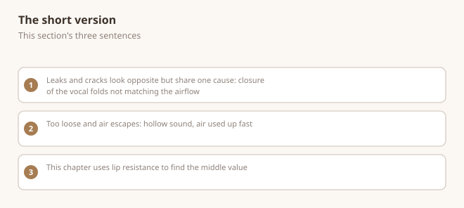
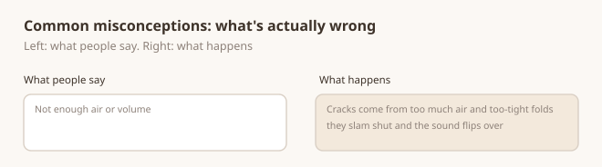
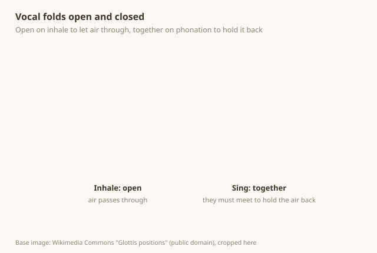
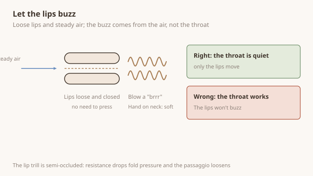
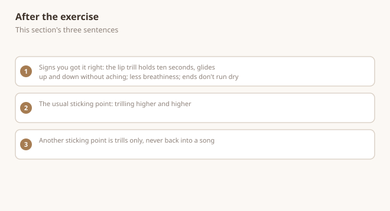

# Chapter 6: Where the Voice Comes From: A Simple Look at Vocal Fold Closure (Why It Cracks or Leaks Air, and Basic Lip Trills)

## The short version

Leaking air and cracking look like opposite problems. They have the same cause: the closure of the vocal folds and the airflow are not matched.

If the closure is too loose, air escapes through the gap, the sound is hollow and the air runs out fast. If the closure is clamped from outside, one push of air and it flips over, and the sound breaks off.

This chapter uses the resistance of the lips to help the vocal folds find the value in between. The lip trill is not a warm-up ritual. It trains, directly, how the airflow and the closure work together.

## Common misconceptions

Many people think a crack means not enough air and not enough volume, so every crack makes them push harder. A crack is often too much air against too tight a closure: the two collide head-on and the sound flips over.

Others think leaking air means the vocal folds are damaged. Most of the time the closure is simply too loose and not all the air is being turned into vibration. Bring the closure up slightly and the sound focuses and the air goes further.

## How it works

The vocal folds are two V-shaped folds of tissue in the larynx. In breathing they open and air passes between them; in sound they come together, the airflow pushes them apart and they are drawn back again, opening and closing very fast. That is vibration. Sound needs two things at once: the folds coming together, and a steady airflow.

Leaking air: the folds do not come together completely and a gap is left in the middle, so air goes straight out. What you hear is breathiness, and the folds are not being set into vibration efficiently. Because the air goes so fast you feel short of breath. You aren't.

Cracking: it usually happens when the pitch changes. As the pitch goes up the folds have to go from thick to thin. If the muscles outside clamp the larynx and the airflow is strong, the folds don't have time to make the change smoothly, and the sound suddenly flips over. Research describes that flip as a two-state switch in the way the folds close. With the same pair of folds, what changes is where they come together and how the effort is shared out, not which folds you are using (Titze et al., 2014). So a crack is not the vocal folds disobeying. The adjustment and the airflow failed to meet.

While we are here, one common confusion: breathiness does not mean tenderness. A little breathiness can be an expressive choice; a whole song of leaking air is something else. It keeps the vocal folds sitting in the airflow, and it gets tiring to sing that way.

Why does the lip trill help? The vibrating lips put a little resistance on the airflow, like a small air cushion, and the airflow evens out. With more resistance behind the mouth, the vocal folds can keep vibrating at lower pressure (Titze, 2006). With the airflow steady, the folds can close without being clamped, and the body finds the middle value by itself. Straw phonation works on the same principle; it trains the coordination between the vocal tract and the glottis, not a mouth shape (Guzman et al., 2013).

## An analogy

**The valve on a balloon.** Pinch too loosely and all the air leaks away; pinch too hard and it bursts the moment you let go. The middle setting, resistance without a lock, is the target. Where it breaks: you don't work the vocal folds with your fingers. You let the airflow and relaxation do the coordinating.

**Skipping.** Turn the rope too fast and your feet can't keep up and you trip; turn it too slowly and the rope hits the ground. A crack is the hands and the feet out of time, not a broken rope.

**Blowing bubbles.** The wand has a fixed opening. Blow too fast and the bubble pops; blow too slowly and nothing comes out. Same opening, and the only difference is how fast the air is going.

## Try it now

### Exercise 1: Get the lips vibrating first

1. Put your index and middle fingers at the corners of your mouth and push gently inwards and upward so the lips pout.
2. Breathe in, shoulders still.
3. Only breathe out, letting the lips make a "brrr—". No voice yet.
4. Hold it for five seconds, three times.

What you should feel: the lips carried into a flutter by the air, with the cheeks not stiff. If you get it wrong: if the lips don't move at all, they are either too tight or the air is too weak. Let the fingers help a little more and gather the air slightly, but don't blow hard.

### Exercise 2: Add the voice

1. Same mouth shape, breathe in.
2. While the lips go "brrr—", make a relaxed "oo", like a motorbike idling.
3. Hold for ten to fifteen seconds.
4. Three times.

What you should feel: the lips buzzing and the sound present at the same time, with nothing squeezed in the throat. If you get it wrong: if there is only wind and no sound, the closure hasn't come up. Make a short "uh" to find the feeling of the folds coming together, then go back to the trill.

### Exercise 3: A motorbike that turns corners

1. Start the lip trill on a comfortable low-to-mid note.
2. Without breaking the air, let the pitch slide slowly upward, like a siren.
3. Don't linger at the top. Slide back down smoothly.
4. Five times.

What you should feel: the lips keep buzzing and the pitch keeps moving. If you get it wrong: if the lips stop halfway, the throat has tightened. Lower the top note, narrow the range, and aim for no break first.

### Exercise 4: Finish with one line of a song

1. Pick a line that leaks air or cracks when you sing it.
2. Run the melody on a lip trill first.
3. Then sing the same melody on "oo".
4. Only after that put the words back.

What you should feel: with the words back, the throat is about where it was during the trill. If you get it wrong: if it tightens the moment the words arrive, the diction is using the jaw. Go back to the "oo" state and let the words pass lightly at first.

## After the exercise

Signs you got it right: the trill holds for more than ten seconds without breaking; the throat doesn't ache as the glide goes up and down; when you sing there is less breathiness, and the ends of phrases don't suddenly run out of air.

The usual sticking point is trilling higher and higher. As the pitch rises people add force, and the lips stop and the throat tightens. The trill trains looseness and evenness. It is not a range contest.

Another is doing only trills and never taking them back into a song. The trill is a tool, and you have to take it into a real line to know whether it worked. If the leaking comes back once you do, it is usually not that the closure has got worse. It is that you have already given too much air by that point in the line.

Next chapter takes on diction. With the closure steady, the next job is clear words without biting the channel shut.

## Further reading

- **Titze, I. R. (2006).** Voice training and therapy with a semi-occluded vocal tract: rationale and scientific underpinnings. *Journal of Speech, Language, and Hearing Research, 49*(2), 448–459. Why lip trills, humming and straws work: the extra resistance behind the mouth lets the vocal folds vibrate at lower pressure. PMID 16671856.
- **Titze, I. R., et al. (2014).** Bi-stable vocal fold adduction: a mechanism of modal–falsetto register shifts and mixed registration. *Journal of the Acoustical Society of America.* The "flip" when the pitch changes is a switch in the way the folds close, not a different pair of folds. PMID 25235006.
- **Guzman, M., Laukkanen, A. M., & Krupa, P. (2013).** Vocal tract and glottal function during and after vocal exercising with resonance tube and straw. *Journal of Voice.* What straws and resonance tubes do to vocal tract and glottal function; this is the same family of exercise as the lip trill. PMID 23683806.
