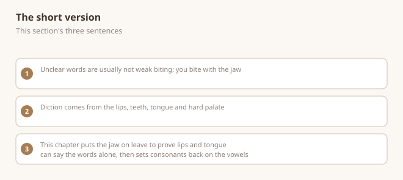
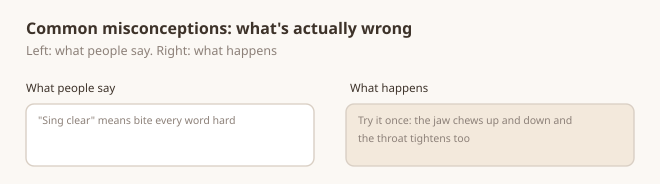
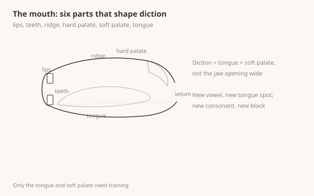
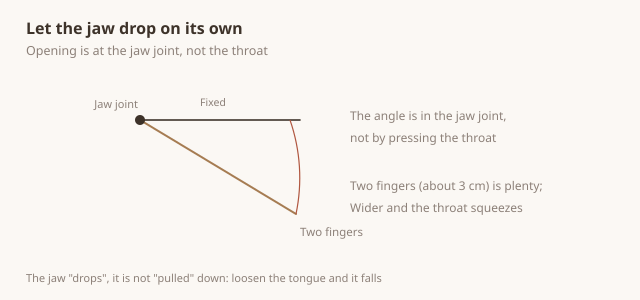
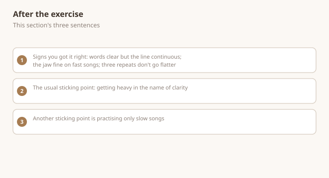

# Chapter 7: Diction and Pronunciation: The First Step in Getting the Lyrics Across (Coordinating Lips, Teeth and Tongue Without Biting the Words Shut)

## The short version

Unclear words are usually not a case of biting too weakly. You are biting with the jaw. The jaw opens and closes, the channel opens and shuts with it, the airflow gets cut up, and the sound goes flat and tiring.

What actually makes diction is the lips, the teeth, the tongue and the hard palate. The jaw has one job: keep the channel open.

This chapter puts the jaw on strike for a while, to confirm that the lips and tongue can say the words by themselves, and then puts the consonants back onto the vowels lightly.

## Common misconceptions

Many people think singing clearly means biting every word hard, one word at a time, like arguing with someone. Try it once and you will know: read like that and the jaw chews up and down, and the throat tightens along with it.

In fact a consonant only needs a very short touch. Clarity comes from the right place and the right timing, not from force. Consonants that are too heavy chop the sound into separate lumps and break the line of the melody.

Another misconception is that mushy words mean the mouth isn't open enough. Sometimes the opposite is true: the mouth is too wide, the jaw drops too far, and the tongue has no time to get into position, so the words come out worse.

## How it works

A Chinese syllable splits into two parts: an initial consonant at the front, and a vowel after it that can be stretched. A syllable like xiang is ㄒ plus ㄧㄤ. A syllable like ai has no initial consonant and starts straight from ㄞ.

Consonants are brief: lips closing, the tip of the tongue pressing, air rubbing past, and it is over. Vowels are open: the shape of the mouth is held and the air can keep coming. That is why, when you hold a long note, it is always the vowel that rings; a consonant lasts an instant. It is also why a hard phrase usually flows at once if you take the consonants out and sing only the vowels.

There is one more role that gets overlooked: the medials ㄧ, ㄨ and ㄩ. They are the start of the final, a slide from the consonant towards the main vowel, like a transition. They should not be bitten as though they were heavy consonants.

Vowels cannot be sung just any way you like, because change the shape of the mouth and the spectrum changes with it. A study measuring vocal tract resonance adjustments as singing volume changes found that the adjustments are real, measurable actions, not just a feeling. In other words, what you are changing is the shape of the mouth and the pharynx, not how hard you push (Vurma, 2022). The shape of the vowel also decides how the high-frequency energy is spread, which is why the same note sounds so much brighter on "ah" than on "ee" (Lee et al., 2008).

Why can't the jaw take part? Because it is joined to the temporomandibular joint, and when it moves the whole back of the mouth moves with it. Every word you bite into, the channel narrows; across a few words the airflow is cut into segments and the sound loses its continuous line.

## An analogy

**A river and a leaf.** The vowel is the river and the consonant is a leaf on the surface. The leaf touches the water and is gone; it doesn't dam the river. Take a knife to the river and it splashes and the river breaks. Where it breaks: a leaf is completely passive, and a consonant needs precise movement. What you want is light and exact, not doing nothing at all.

**A rubber stamp.** A clear stamp comes from the right position, the right amount of pressure, and lifting straight off. Roll it around and press it flat on the paper and the print blurs.

**A drumstick.** The stick touches the drumhead and leaves; the sound is the drumhead's own. A consonant is that touch, and what rings is the vowel after it. Hold the stick against the drumhead and the drum stops sounding.

## Try it now

### Exercise 1: The jaw goes on strike

1. Rest your index finger under the point of the chin, like a security camera.
2. Open the mouth about a finger and a half and keep it there.
3. With that mouth shape, read one line of a song slowly. Seven syllables is a good length.
4. Read it twice.

What you should feel: at first it sounds like a tongue-tied child and the words are a little mushy, but the lips and tongue are busy. If you get it wrong: if the jaw is still moving up and down, press it gently with the finger and make the mouth shape smaller. Don't let the jaw back in just to be clear.

### Exercise 2: Vowels only

1. Strip the line back to its vowels: drop every consonant and keep only the vowel of each syllable, including the medial.
2. Sing that string of vowels on the melody with a steady airflow.
3. Slide from one vowel to the next. There should be no breaks.
4. Sing it three times. If you have a straw, do the same string of vowels through it; the moment the line breaks you will hear it (Guzman et al., 2013).

What you should feel: the sound is one continuous line with no dots in it. If you get it wrong: if every vowel starts again with a click, the vocal folds snapped shut before the airflow was steady, which makes a hard onset. Let the airflow start before the folds, and change only the shape of the mouth.

### Exercise 3: Put the consonants back

1. Keep the continuous vowels you just had.
2. In front of each vowel, touch a consonant lightly with the lips or the tip of the tongue.
3. Come straight back to the vowel. Don't stop.
4. Sing it three times.

What you should feel: the words are clearer and the line hasn't broken. If you get it wrong: if the jaw starts chewing the moment the consonants arrive, go back to exercise 1, check where the jaw is, and make the consonants lighter.

### Exercise 4: Use it on your own song

1. Pick a chorus where the words sound mushy or feel awkward to sing.
2. Sing only the vowels, once.
3. Put the consonants back lightly and sing it once more.
4. Compare the jaw and the throat between the two.

What you should feel: the second one should be clearer than the first, but not tighter. If you get it wrong: if it tightens once the words are back, the consonants are still too heavy. Halve them again.

## After the exercise

Signs you got it right: the words are clear, but the line is continuous; your jaw doesn't ache on fast songs; singing the same line three times doesn't make it flatter each time.

The usual sticking point is getting heavier in the name of clarity. Clear and heavy are two different things. You can be quiet and still clear, and you can be loud and still impossible to understand. It comes down to where the consonant sits and when.

Another is practising only slow songs. A slow song gives you time to do every word; a fast song is the test. Use the same river-of-vowels method on fast phrases and the change is more obvious.

Next chapter moves into resonance. Words placed in the right space are easier to understand than words bitten harder.

## Further reading

- **Vurma, A. (2022).** Amplitude Effects of Vocal Tract Resonance Adjustments When Singing Louder. *Journal of Voice.* When the volume rises, vocal tract resonance adjustments are measurable actions, not just a feeling; you change the shape, not the force. PMID 32624371.
- **Lee, S. H., Kwon, H. J., & Choi, H. J. (2008).** The singer's formant and speaker's ring resonance: a long-term average spectrum analysis. *Clinical and Experimental Otorhinolaryngology.* Vowels and vocal tract shape change the high-frequency energy cluster (the singer's formant sits around 2.8–3.2 kHz). PMID 19434279.
- **Guzman, M., Laukkanen, A. M., & Krupa, P. (2013).** Vocal tract and glottal function during and after vocal exercising with resonance tube and straw. *Journal of Voice.* What straw phonation does to the vocal tract and the glottis; it is a very useful way to check whether the vowel line is breaking. PMID 23683806.
