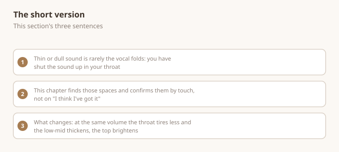
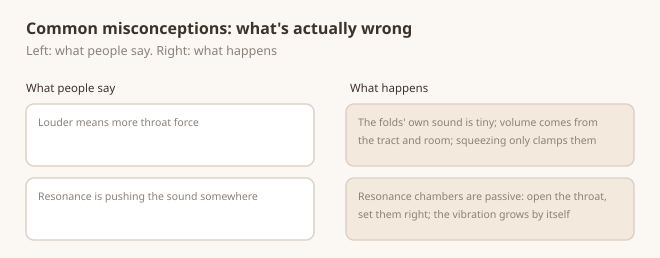
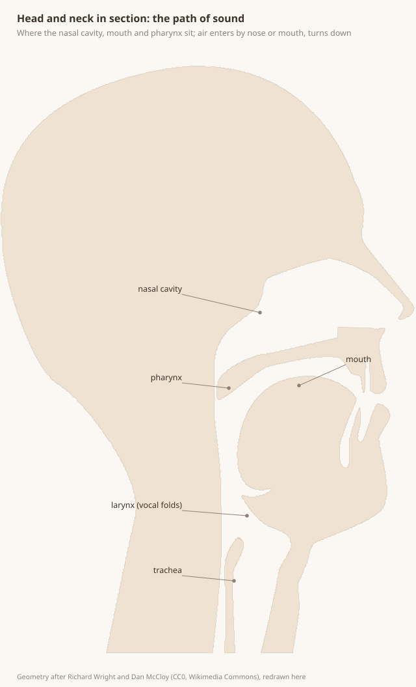
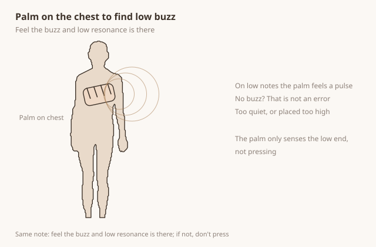
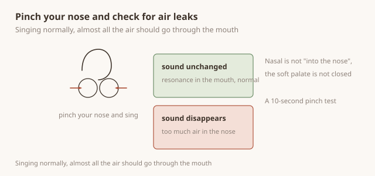
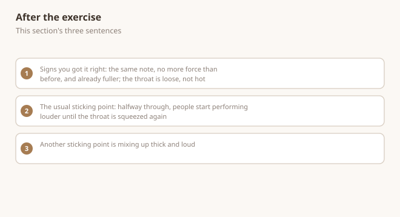

# Chapter 8: Finding the Body's Built-In Speaker: What Is Resonance?

## The short version

If your voice is thin or dull, it is usually not the vocal folds. You have shut the sound up in your throat. The body has several areas that can add to the sound, and with them in the right place the same effort sounds much bigger.

This chapter shows you how to find those spaces and confirm with touch that you have them, rather than going on "I think I've got it".

What should change after the exercise: at the same volume the throat tires less, the low-to-mid range gets thicker and the high notes get brighter.

## Common misconceptions

Many people think a bigger sound means a harder-working throat, so the moment a note won't come they start squeezing.

It is the other way round. The sound the vocal folds make on their own is very small, like a string hanging in mid-air given one pluck: a single "ting". The volume you hear is that faint vibration after the vocal tract and several spaces in the body have shaped it. Squeezing the throat does not make the channel bigger; it traps the vocal folds.

Another misconception is that resonance means pushing the sound towards some place. You can't push it. The resonance chambers are passive: open the throat and put things in the right place and the vibration is amplified there by itself; put them in the wrong place and it shrinks back.

## How it works

The sound is shaped in three regions, each weighting a slightly different band:

- **Chest**: on low notes, the vibration of the vocal folds travels up the trachea and through the chest wall and your palm can feel it. Teaching calls it chest resonance, but the lungs are not a resonance chamber; the vibration is mainly tactile, not a cavity amplifying.
- **Pharynx**: the stretch between the vocal folds and the mouth. This is the most adjustable one. The height of the larynx and the tension of the root of the tongue both change its size, which gives it the biggest effect on timbre.
- **Nasal cavity and the spaces of the head**: between the eyes, above the hard palate, around the nasopharynx. The nasal cavity adds a little low-frequency colour and also shapes the upper-mid harmonics.

The three regions don't work separately. They all take part at once, only in different proportions. On low-to-mid notes there is more vibration in the chest; on high notes there is more in the face. The way to control the proportions is not to send the sound somewhere with force; it is to adjust the channel: loosen the throat, change the shape of the mouth, lift or lower the soft palate.

Where does that brightness come from? A large part of it comes from the short stretch of channel narrowing above the larynx, around the epiglottis. Make the tube smaller and get the shape right, and the high-frequency energy gathers into a cluster. In measurement that is the singer's formant (Lee et al., 2008). Changing the shape of the epilaryngeal tube in a computer model does concentrate that energy further (Vampola et al., 2024). So brightness is not squeezed out. It comes from getting the shape of the channel right.

One thing to be careful about here: head resonance is not really the sound being amplified inside the skull. The skull is not a guitar body, and the sinuses inside it amplify very little. Endoscopic studies show that what classical singing calls head voice corresponds to a change in vocal tract shape (Aura et al., 2022). The feeling of "the sound is up in my head" is a sensation of vibration, not a cavity at work.

## An analogy

**A guitar body.** A string stretched in mid-air and plucked is quiet; put it in a wooden box and the same vibration is much louder. The difference is not the string, it is the box. Where it breaks: a guitar's box is fixed, and the human vocal tract changes shape all the time, with swallowing, pitch and vowel.

**A lampshade.** The same bulb behind a shade is no brighter, but the light is gathered where you need it. That is what resonance does: it changes how the energy is distributed. It doesn't create energy out of nothing.

**Pinching the end of a hose.** Fingers narrowing the outlet make the jet thinner, but it travels further. Narrowing the pharynx is that move, except that what you narrow is the shape of the channel, not the force in your throat.

## Try it now

### Exercise 1: First, show that resonance beats force

1. Mouth slightly open, at your normal speaking volume, make an "ah" and keep the throat loose.
2. Make it again at the same volume and the same pitch, but this time open the mouth wide and let the jaw drop, like the beginning of a yawn.
3. Compare the two. The second should be about as loud, but clearly thicker and more open.

If you get it wrong: if the second one is propped up by the throat, the sound tightens and the throat itches. Stop, do only the mouth movement, and add no force.

### Exercise 2: Find the chest vibration

1. Palm flat on the centre of your chest.
2. Mouth closed, hum an "mmm" a little lower than your speaking pitch.
3. Take the pitch down slowly until the palm feels a clear vibration.
4. Remember that pitch. It is where your chest vibrates most clearly.

If you get it wrong: if you squeeze to get lower and your neck thickens, you have gone below the point where you can sing relaxed. Come up half a step and try again.

### Exercise 3: Find the nasal vibration

1. Rest one hand lightly on both sides of the bridge of your nose. Don't pinch, just rest it there.
2. Make a long "mmm—", like a small child whining.
3. You should feel the bridge of the nose tingling and buzzing.
4. Keep that feeling and open the mouth into "mmee—" at the same pitch, then drop the hand. The feeling should still be there.

If you get it wrong: if the nasality is so heavy that it sounds like a cold, the mouth is barely open. Open wider and let the nasal cavity and the mouth work together, or it stays muffled.

### Exercise 4: Join the two regions

1. Start from the low "mmm" of exercise 2, placed in the chest.
2. Glide slowly upward while the mouth opens from closed into "ah".
3. Feel the vibration travel from the chest up into the face.
4. Stop at the top note, then glide back down.

If you get it wrong: if there is a click and a break on the way, the throat locked somewhere in the middle. Don't speed through it. Stop on that pitch and glide back and forth with very light air until it gets used to it.

## After the exercise

Signs you got it right: on the same note you need no more force than before and it already sounds fuller; your throat is loose afterwards, not hot.

The usual sticking point: many people start performing halfway through, get louder and louder, and end up squeezing the throat again. Practising quietly on purpose is to keep your attention on where the vibration is, not on the volume.

Another is mixing up thick and loud. Thickness is low-frequency content plus steady airflow; volume is a separate matter. You can sing thick at conversational volume, and you can be loud and still thin.

Next chapter takes chest resonance itself: how to make the low-to-mid range stand up and have weight instead of sounding hollow.

## Further reading

- **Lee, S. H., Kwon, H. J., & Choi, H. J. (2008).** The singer's formant and speaker's ring resonance: a long-term average spectrum analysis. *Clinical and Experimental Otorhinolaryngology.* The singer's formant (a cluster of energy around 2.8–3.2 kHz) can be measured with a long-term average spectrum. PMID 19434279.
- **Vampola, T., Horáček, J., & Laukkanen, A. M. (2024).** Three-Dimensional Finite Element Modeling of the Singer's Formant Cluster Optimization by Epilaryngeal Tube Shaping. *Journal of Voice.* A computer model showing that the shape of the epilaryngeal section decides whether the high-frequency energy cluster stays concentrated. PMID 39218756.
- **Aura, M., Geneid, A., & Bjørkøy, K. (2022).** A Nasoendoscopic Study of "Head Resonance" and "Imposto" in Classical Singing. *Journal of Voice.* Endoscopic observation shows that "head resonance" is a change in vocal tract shape, not sound being amplified inside the skull. PMID 32513553.
