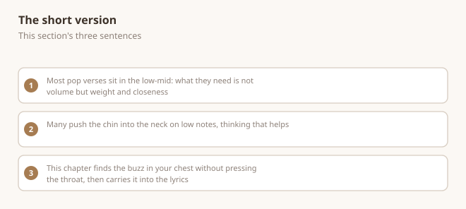
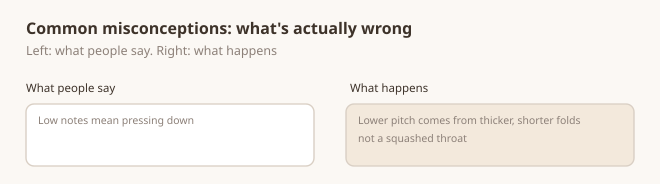
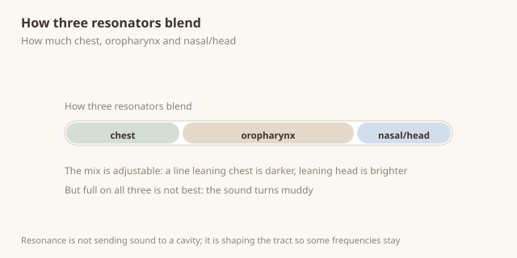
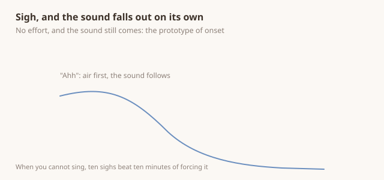
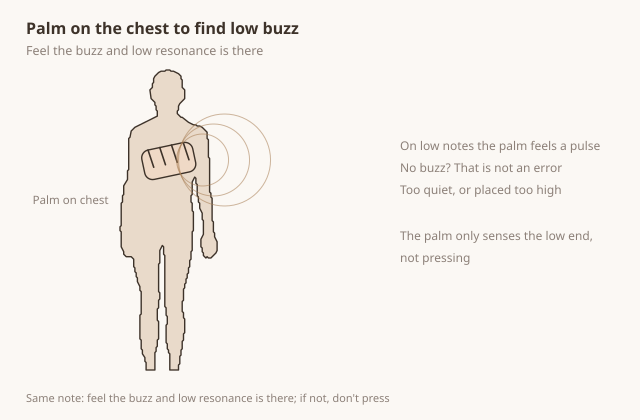
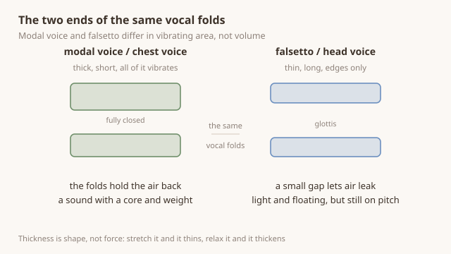
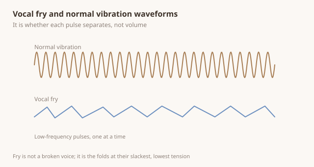
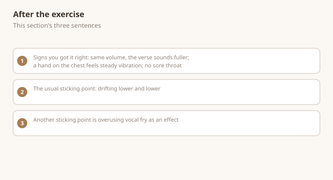

# Chapter 9: The Foundation of Pop Singing: A First Look at Warm Chest Resonance (How to Sing a Full, Comforting Low-to-Mid Range)

## The short version

Most pop verses sit in the low-to-mid range. What they need is not volume; it's weight and closeness.

Many people push the chin down into the neck when they sing low notes, thinking that makes the sound lower. The channel gets flattened, the sound turns dull and hard, and the pitch never actually goes down.

This chapter gets you to find the vibration in your chest without pressing the throat, then carry it into the lyrics.

## Common misconceptions

Many people think a low note means pressing the sound down. Pitch goes lower because the vocal folds get thicker and shorter and vibrate more slowly. It does not go lower because the throat is squeezed flat. The harder you press, the less elastic the vocal folds become, and the low note will not come out at all. It hurts, too.

Others think chest resonance means throwing the sound at your chest. A resonance chamber cannot be hit; it is passive. You relax and open the channel, the low-frequency components stop being swallowed, and only then can your palm feel the vibration.

## How it works

The vibration of the vocal folds produces a whole row of frequency components: a fundamental plus its harmonics. The lower the fundamental, the more densely the harmonics are packed, and the more of them fall inside the band the human ear is sensitive to. That is what makes the sound feel full. It is the first reason a low note sounds like it has something in it, and it has nothing to do with volume.

The second reason is where the formants sit. Changing the shape of the mouth and pharynx raises the energy in some bands and lowers it in others, and this can be measured even when the volume changes (Vurma, 2022). A full low-to-mid note comes from a channel shape that keeps the low-frequency components alive. It does not come from pushing.

One more time: the chest is not a true resonance chamber. What your palm feels is mostly the vocal fold vibration conducted along the trachea and through the tissue of the chest wall. That is a tactile sensation, not a cavity amplifying sound. The sensation is useful. It is a dashboard. Do not treat it as a separate speaker cabinet.

Weight and volume are two different things as well. You can sing a full sound at conversational volume. The difference lies in where the vibration sits and how steady the airflow is, not in how loud you are.

There is also a microphone effect. Sing a low note close to the mic and it picks up a little extra low end. That is the proximity effect, and it makes the voice sound closer and fuller. It is help from the recording end, and it cannot replace resonance. Put the other way: if your low notes are only full because of the microphone, moving away from it will expose that.

Posture is still the precondition. With the head directly above the shoulders and the chin not pulled in, the trachea stays straight. Fold the neck and the vocal tract is flattened; no amount of wanting will keep the low-frequency components alive.

## An analogy

**A bass drum and a snare.** A large, loosely tensioned drumhead gives a low sound; a small, tightly tensioned one gives a high sound. On the same drum you don't hit harder to go lower. You need a different head. Thicker, shorter vocal folds are a change of head.

**A denser staircase.** With a low fundamental the harmonics are like steps spaced closer together, so more steps fit into the same stretch of height. The more densely the ear's sensitive band gets filled, the fuller the sound.

**Speaking right into your ear.** The same person saying the same sentence sounds fuller and closer when they say it next to your ear. That is exactly what the proximity effect does. But real-world weight still has to come from your own vocal tract.

Where the analogy breaks: a drumhead does not adjust itself, and the vocal folds do. So you cannot pick one shape and sing the whole song in it. You adjust with the pitch and the vowel.

## Try it now

### Exercise 1: Start on a sigh

1. Stand tall, one hand flat on the centre of your breastbone.
2. Breathe in, then make a "haa—" a little lower than your speaking pitch.
3. Don't push. Let the air come out on its own, the way it does in a sigh.
4. Do it five times, four seconds each.

What you should feel: a slight buzz in the palm, no squeezing in the throat. If you get it wrong: if you drop the chin and the neck thickens in order to go lower, you have gone below the point where you can stay relaxed. Come up half a step and try again.

### Exercise 2: The cow's "moo"

1. Lips closed, teeth slightly apart, jaw loose.
2. Make a low "moo—", like a quiet old cow.
3. Put a hand on your chest and hunt for the pitch where the vibration is clearest.
4. Do it five times.

What you should feel: a tingle in the chest, no effort in the sound. If you get it wrong: if the "moo" turns into a squeeze in the throat, halve the volume first. If you cannot find the vibration, move your hand a little higher up the breastbone and try a semitone lower.

### Exercise 3: Radio DJ reading

1. Pick a verse you usually sing thin and floaty.
2. Hand on your chest. Read it slowly, in the voice of a late-night radio host.
3. Every word has to put a little vibration in the chest.
4. Read it twice.

What it should feel like: like talking, but with weight behind it. If you get it wrong: if the vibration disappears halfway through, the sound has floated back up into the throat. Slow down, shorten the sentence, read half of it first.

### Exercise 4: Add the melody

1. Keep the chest vibration you just found.
2. Sing the melody, stretching the vowels and passing lightly through the consonants.
3. Tell yourself: this is speech with high and low in it, not a performance.
4. Sing it twice.

What you should feel: the low notes cost nothing and the phrase holds together. If you get it wrong: if adding the melody tightens everything, reduce the melody to two or three notes, check the vibration is still there, then go back to the real melody.

### Exercise 5: Vocal fry as a garnish

1. Relax the jaw and make a very quiet, very low "ah".
2. Cut the airflow down until the sound breaks into separate pops: "ah, ah, ah, ah".
3. Hold it for three seconds, three times.

What you should feel: the vocal folds are loose, like a motorbike idling. If you get it wrong: if your throat starts to itch or you want to cough, the airflow is too strong or the pitch too low. Reduce the air further, or move up a little. If it is uncomfortable, stop.

In teaching, vocal fry is often used as a low-effort warm-up: it lets the vocal folds vibrate gently under very low pressure (Elias et al., 2016). Inspiratory vocal fry has also been used in voice therapy and in teaching (Paolillo et al., 2021). To use it in a song, touch it lightly on the first syllable of a phrase and slide straight into your normal sound. Do not use it for a whole line.

## After the exercise

Signs you got it right: at the same volume the verse sounds fuller; a hand on your chest feels a steady vibration; after the low notes your throat is not sore.

The usual sticking point is drifting lower and lower. Chasing weight, the pitch slides down without your noticing until there is no sound left. Practise with the backing track or a keyboard note to check your pitch against. Don't go by feel alone.

Another is overusing vocal fry as an effect. An occasional touch at the start of a phrase works. All the way through a song it muddies the tone and makes the airflow unsteady.

Next chapter goes upward: the nasal and head resonance that high notes need.

## Further reading

- **Elias, V. S., Cielo, C. A., & Jotz, G. P. (2016).** Effect of Vocal Fry on Voice and on Velopharyngeal Sphincter. *International Archives of Otorhinolaryngology.* The immediate effect of vocal fry on the voice and on resonance: a direct measurement of low-effort vibration. PMID 27096021.
- **Paolillo, N. P., Carrozza, L., & Osio, M. (2021).** Inspiratory Vocal Fry: Anatomical and Physiological Aspects, Application in Speech Therapy, Voice Therapy and Singing Pedagogy. *Journal of Voice.* Vocal fry runs in two directions, expiratory and inspiratory, and the two are used differently in therapy and in singing teaching. PMID 31708370.
- **Vurma, A. (2022).** Amplitude Effects of Vocal Tract Resonance Adjustments When Singing Louder. *Journal of Voice.* Adjusting vocal tract resonance is a measurable action; weight comes from shape and energy distribution, not from force. PMID 32624371.
