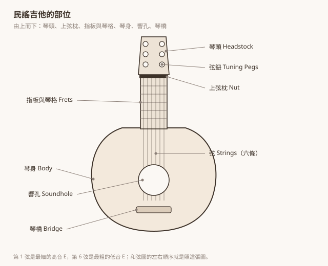

# 第 1 章｜挑一把好彈的吉他與必備小物

> **本課學習目標**
> 1. 認識民謠吉他（鋼弦木吉他）的各部位名稱與基本發聲原理。
> 2. 了解常見吉他「桶型」差異，挑選出最適合自己體型與曲風的琴身。
> 3. 掌握決定「好不好按」的關鍵指標——**弦距（Action）**與琴弦粗細。
> 4. 備齊彈唱必備的五大實用配件，不花冤枉錢。

---

## 1-1 認識你的音樂夥伴：民謠吉他構造全圖解

走進樂器行或打開購物網站，你會發現「木吉他」其實分為好幾種。在流行歌曲彈唱的世界裡，我們使用的是**「民謠吉他（Acoustic Guitar / Steel-string Guitar）」**，也就是裝有**金屬鋼弦**、琴身較大、音色清亮且富有顆粒感的吉他（不同於演奏古典樂、使用尼龍弦、指板較寬的古典吉他）。

在開始彈奏之前，我們先花三分鐘認識吉他身上的各個重要部位。知道它們的名字，未來在看譜、調音或與樂器行技師溝通時，你就能精準表達需求：

### 關鍵部位功能速查表

| 部位名稱 | 英文對照 | 核心功能與新手注意事項 |
| :--- | :--- | :--- |
| **弦鈕** | Tuning Pegs | 透過齒輪微調琴弦鬆緊度以改變音高。轉緊（音變高）、轉鬆（音變低）。 |
| **上弦枕 / 下弦枕** | Nut / Saddle | 支撐琴弦兩端的關鍵支點，兩者之間的距離稱為「有效弦長」，也是決定**弦距高低**的核心零件。 |
| **琴衍（銅條）** | Fret Wire | 鑲嵌在指板上的金屬細條。**重要觀念**：按弦時是按在「兩根銅條之間的木頭格子裡」，並靠近右側銅條，而不是直接壓在銅條正上方。 |
| **指板記號點** | Inlay Dots | 通常標記在第 **3、5、7、9、12（雙點）、15、17** 格，幫助我們在彈奏時快速定位把位，不用每次都從第一格開始數。 |
| **面板** | Top / Soundboard | 吉他發聲的心臟！常見木材有**雲杉（Spruce，音色清亮顆粒感強）**與**桃花心木（Mahogany，音色溫暖中頻厚實）**。 |

---

## 1-2 桶型怎麼選？挑一把抱起來最舒服的吉他

很多新手買第一把吉他時，常犯的錯誤是「只看外觀顏色」，結果買回家才發現琴身太大，右手手臂架在琴身上肩膀酸痛不堪。

民謠吉他的琴身大小與形狀稱為**「桶型（Body Shape）」**。桶身越大，共鳴箱體積越大，低音越渾厚、音量越大；桶身較小或腰身較細，則抱起來更貼合身體，中高頻更集中清晰。

### 常見四大民謠吉他桶型比較表

| 桶型名稱 | 簡稱 | 外觀特徵 | 音色特質 | 適合族群與曲風建議 |
| :--- | :--- | :--- | :--- | :--- |
| **Dreadnought 桶** | **D 桶** | 琴身寬大、腰身較不明顯，傳統標準民謠吉他外型。 | 低頻渾厚、音量宏亮、共鳴飽滿。 | 適合身高 165cm 以上、喜歡大力刷奏、搖滾或民謠彈唱的學習者。 |
| **Grand Auditorium** | **GA 桶** | 琴身略小於 D 桶，腰身曲線明顯（沙漏型）。 | 高中低頻極度均衡，刷奏與指法皆宜。 | **全能型首選！** 適合各種體型，想兼顧指法細膩度與刷奏力道的新手。 |
| **Orchestra Model** | **OM 桶** | 琴身較薄、腰身纖細，整體比 GA 桶更輕巧。 | 中高頻清晰甜美、顆粒感強，延音佳。 | 適合身形較嬌小者、女性玩家，或偏愛溫柔指法伴奏（Fingerstyle）的讀者。 |
| **旅行吉他** | **Travel / GS Mini** | 尺寸約為標準吉他的 3/4 或 7/8（常見 36 吋）。 | 音色集中清脆，低音共鳴略少於標準桶。 | 適合兒童、身材嬌小者，或經常需要攜帶吉他外出露營、通勤的族群。 |

> **💡 選購小知識：什麼是「缺角（Cutaway）」設計？**
> 你常看到有些吉他在琴身右上方（靠近琴頸處）挖掉一塊弧度，這叫做「缺角設計」。它的功能是讓左手在彈奏第 12 格以後的**高把位單音**時不會被琴身擋住。對於以「前五格開放和弦彈唱」為主的新手來說，**圓角（無缺角）**或**缺角**皆可；圓角通常共鳴箱體積較完整、價格也更親民。

---

## 1-3 決定「好不好按」的頭號關鍵：弦距與琴弦規格

如果你曾經借過朋友的吉他來試按，覺得「弦硬得像鋼筋、手指按一下就痛到想放棄」，先別懷疑自己的手指力氣太小——那把吉他極有可能**「弦距太高」**了！

### 什麼是「弦距（Action）」？
弦距指的是**「琴弦底部」到「第 12 格銅條（Fret）頂端」之間的垂直距離**。
*   **弦距過高**：手指必須把弦往下壓很深的距離才能碰到銅條，不僅極度費力、容易起水泡，還會因為琴弦被過度拉扯而導致**按出來的音準偏高**。
*   **弦距過低**：琴弦離銅條太近，稍微用力撥弦時，震動的琴弦會撞擊到前方的銅條，發出「滋滋滋」的雜音，這在吉他術語中稱為**「打弦（Fret Buzz）」**。

### 民謠吉他理想弦距與琴弦規格對照表

| 檢測與規格項目 | 民謠吉他標準建議值 | 新手友善調整建議 |
| :--- | :--- | :--- |
| **第 12 格第 6 弦（最粗低音弦）弦距** | `2.2 mm ～ 2.5 mm` | 建議調整在 **`2.0 mm ～ 2.3 mm`** 左右，按起來會明顯省力許多。 |
| **第 12 格第 1 弦（最細高音弦）弦距** | `1.5 mm ～ 2.0 mm` | 建議調整在 **`1.5 mm ～ 1.8 mm`** 左右，兼顧手感與不打弦。 |
| **琴弦粗細規格（String Gauge）** | 標準出廠多為 `.012 - .053`（Light） | 新手強烈建議換裝 **`.011 - .052`（Custom Light）** 或 **`.010 - .047`（Extra Light）**，弦張力較小，手指痛感大幅降低！ |

> **🛠️ 購琴避坑行動指南**
> 在樂器行購買第一把吉他時，請務必請店員或技師幫你測量第 12 格弦距，並提供**「基礎手感調整（Set-up）」**服務（透過打磨下弦枕高度與調整琴頸曲度，將弦距設定在理想範圍）。一把經過妥善調整的入門琴，手感甚至會勝過一把沒調整過的昂貴高階琴！

---

## 1-4 彈唱必備的五大實用配件清單

買好吉他後，你還需要幾樣體積小卻不可或缺的「神隊友」。以下為你整理出零基礎入門必備的五大配件，以及挑選時該注意的規格細節：

| 配件名稱 | 核心用途 | 新手挑選規格建議 | 預算參考（台幣） |
| :--- | :--- | :--- | :--- |
| **1. 夾式調音器 (Clip-on Tuner)** | 夾在琴頭上，透過感應木頭震動來調音，不受環境吵雜影響。 | 選擇螢幕清晰、支援「十二平均律（Chromatic / C 模式）」的款式。 | 200 ～ 500 元 |
| **2. 移調夾 (Capo)** | 夾在指板特定格子上，瞬間改變整把吉他的音高（升降 Key），配合男女生嗓音。 | 選擇「彈簧夾式」且矽膠墊厚實、受力均勻的款式，避免夾傷琴頸或導致走音。 | 250 ～ 600 元 |
| **3. 彈片 (Pick)** | 用於右手刷奏和弦或彈奏單音，能讓音色更清脆集中。 | 建議同時買 **0.60mm（偏薄，刷奏清脆有彈性）** 與 **0.73mm（適中，兼顧刷奏與單音）** 各兩片試手感。 | 15 ～ 40 元 / 片 |
| **4. 備用民謠吉他弦** | 琴弦屬於消耗品，受潮氧化生鏽會變難按、音色變悶，甚至斷弦。 | 選擇 `.011 - .052` 規格，若預算允許，可選購有**防鏽塗層（Coated Strings）**的琴弦，壽命可延長 3 倍以上。 | 200 ～ 550 元 / 套 |
| **5. 吉他架 / 加厚琴袋** | 讓吉他隨時放在伸手可及的地方，增加練習頻率；外出時提供防撞保護。 | 居家強烈建議買一個**A字型吉他架**（把琴架在看得到的地方，練琴率提升 3 倍！）；琴袋選擇厚度 10mm 以上海綿夾層。 | 300 ～ 1,200 元 |

---

## 1-5 本章重點檢核與課後行動

在進入第二章正式持琴調音之前，請確認你已經完成了以下準備工作：

- [ ] **認識構造**：能指出吉他的「琴頭、弦鈕、上弦枕、琴衍（銅條）、響孔、下弦枕」位置。
- [ ] **確認手感**：檢查手邊吉他的第 12 格弦距是否過高，並確認琴弦沒有嚴重生鏽。
- [ ] **備齊裝備**：手邊已經準備好**調音器**、**Pick（0.60mm～0.73mm）**，並將吉他放在家裡最容易拿取的地方。

準備好了嗎？下一章，我們將拿起吉他，學習最符合人體工學的抱琴姿勢，並親手把六根琴弦調出精準和諧的第一聲！
