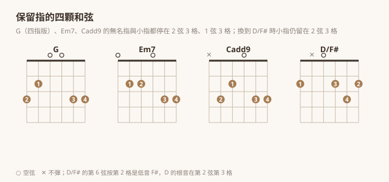
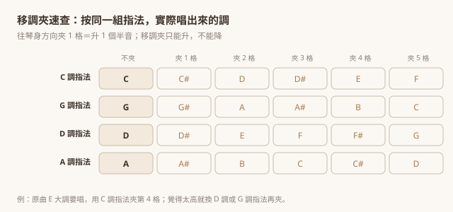
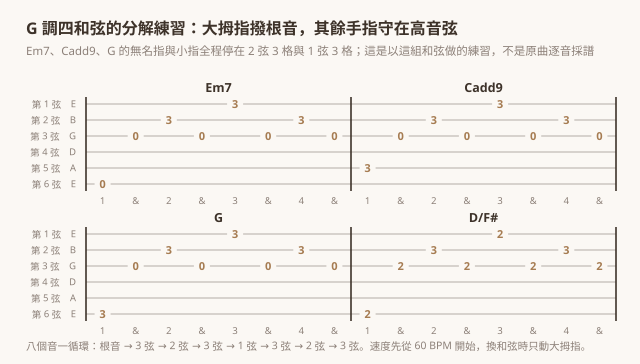

# 第 10 章｜唱不上去怎麼辦？移調夾（Capo）與 G 調家族

> **本課學習目標**
> 1. 學會吉他手第二組最愛用的開放和弦：**G 大調家族（`G`、`Em7`、`Cadd9`、`D/F#`）**。
> 2. 徹底搞懂**移調夾（Capo）**的半音升降原理，不再害怕看到譜上寫 `Capo: 4` 或 `Play: G`。
> 3. 學會根據自己的嗓音音域，自由調整 Capo 格數，唱出最輕鬆好聽的 Key。
> 4. 拆解周杰倫經典國民神曲〈晴天〉的前奏與 G 調家族和弦進行。

---

## 10-1 解鎖第二組萬用和弦：現代感十足的「G 調家族」

在華語流行歌中，除了 C 大調之外，**G 大調（G Major）**是吉他創作最常使用的調性。更棒的是，G 調家族有一套超級省力的「保留指和弦群」——**你的無名指（3）與小指（4）幾乎全程黏在「第 2 弦第 3 格」與「第 1 弦第 3 格」不動**，只需要移動食指與中指，就能彈出充滿現代流行質感的高級和弦！

*(註：`D/F#` 也可簡化用標準 `D` 和弦替代，但加上食指按 6 弦 2 格的 `F#` 低音，能彈出極具代表性的下行 Bass 線條！)*

---

## 10-2 移調夾（Capo）的秘密：一秒變換歌曲音高

男生唱女生的歌太高音、女生唱男生的歌太低沉怎麼辦？先分清楚方向：**移調夾只能升、不能降**——「太低」直接夾 Capo 往上移；「太高」要改用降 Key 的指法組（例如 C 調譜改彈 G 調指法＝低 5 個半音）再夾 Capo 微調，不是把夾子往回夾。
原理非常簡單：**吉他指板每往琴身方向移動 1 格，音高就升高「半音」（半個 Key）**。當你把 Capo 夾在第 2 格時，原本的 `C` 和弦指法就會變成 `D` 大調的聲音；原本的 `G` 和弦指法就會變成 `A` 大調的聲音！

### 常用移調夾（Capo）調性換算速查表

| 譜面標示彈奏指法（Play） | 不夾（Capo 0） | 夾第 1 格 | 夾第 2 格 | 夾第 3 格 | 夾第 4 格 | 夾第 5 格 |
| :--- | :--- | :--- | :--- | :--- | :--- | :--- |
| **彈 `C` 調指法** | **C 調** | C# / Db 調 | **D 調** | Eb 調 | **E 調** | **F 調** |
| **彈 `G` 調指法** | **G 調** | Ab 調 | **A 調** | Bb 調 | **B 調** | **C 調** |

> **🛠️ 夾移調夾的正確位置與防走音秘訣**
> 請將 Capo 夾在該琴格**「靠近右側銅條（Fret）約 2～3mm」**的地方（跟手指按弦的位置一樣！），並且確認六根琴弦都被垂直壓緊沒有被推歪。夾好後，務必再用調音器檢查一次空弦音準！

---

## 10-3 把這組和弦用進歌裡：〈晴天〉的 G 調循環

〈晴天〉原曲是 G 大調、不用夾 Capo，主歌就是 `Em7 - Cadd9 - G - D/F#` 這組循環。**這裡不採原曲的前奏**（每個人抓的版本都不一樣，也沒有可靠譜例可以對），改成用這四個和弦做一段固定的八音分解——把它彈順了，再回頭聽原曲，你自己就會聽出哪幾個音在哪裡。

### 怎麼練

1. **先只動大拇指**：左手把 `Em7` 按好不要放，右手只撥第 6 弦第 1 拍，確認低音清楚。
2. **加上第 3 弦**：第 3 弦空弦是這組進行的共同音，整段都用得到。
3. **換和弦**：換到 `Cadd9` 時大拇指改撥第 5 弦；`D/F#` 時第 3 弦要從空弦變成第 2 格，這是四個和弦裡唯一要動到左手無名指的地方。

*(練習提示：無名指與小指全程按住 2 弦 3 格與 1 弦 3 格不放，只移動大拇指撥的根音與第 3 弦那根手指。)*

---

## 10-4 本章過關檢核表

- [ ] **G 調保留指**：能在 `G`、`Em7`、`Cadd9`、`D/F#` 之間切換時，保持無名指與小指穩穩留在第 3 格。
- [ ] **Capo 換算**：知道當譜上寫 `Play: G, Capo: 2` 時，實際彈出來的音高是 **A 大調**，並能夾準位置不走音。
- [ ] **經典前奏**：能跟著 `68 BPM` 節拍器，流暢彈出〈晴天〉前奏的分解旋律。