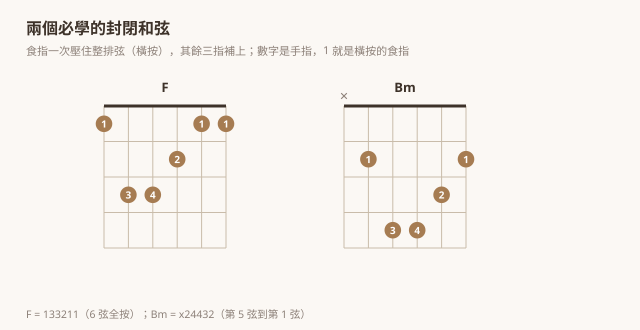

# 第 12 章｜告別替代和弦：大橫按 F 與 Bm 的無痛突破法

> **本課學習目標**
> 1. 破解大橫按（Barre Chords）按不響的三大物理盲點，告別蠻力硬壓。
> 2. 掌握**「食指側面發力」**與**「右手手肘槓桿借力法」**，輕鬆按響 `F` 與 `Bm` 和弦。
> 3. 理解封閉和弦的「指型平移邏輯」，學會一指型推算全指板和弦。
> 4. 完成田馥甄〈小幸運〉的大橫按和弦轉換實戰。

---

## 12-1 為什麼你按不響 F 和弦？破解三大物理盲點

歡迎來到吉他學習史上最著名的分水嶺——**「大橫按（Barre Chords，又稱封閉和弦）」**！它的原理是用左手食指像「人體移調夾」一樣，一次橫跨壓住六根琴弦，再用中指、無名指與小指按出其他音。

90% 的新手按不響 `F` 和弦，並不是因為「手指力氣不夠」，而是因為用錯了物理施力方式：

| 新手常見錯誤動作 | 導致按不響的物理原因 | 正確無痛修正方法 |
| :--- | :--- | :--- |
| **盲點一：用食指正面最軟的肉墊壓弦** | 食指正面關節處有凹陷肉墊，琴弦剛好卡在關節縫隙裡導致悶音。 | 將食指微微**向琴頭方向（左側）側轉約 15～20 度**，用食指側面較硬的骨頭邊緣壓弦！ |
| **盲點二：食指壓在琴格正中央** | 離右側銅條太遠，需要兩倍以上的握力才能把弦壓到銅條上。 | 讓食指緊貼**第 1 格右側銅條（Fret）的邊緣**，最省力且聲音最清脆。 |
| **盲點三：單靠左手虎口死命對夾** | 左手拇指與食指用力捏緊，30 秒虎口就會抽筋痠痛。 | **運用槓桿原理**：右手前臂輕壓琴身右下緣往內收，讓琴頸自然往左手食指方向靠過來借力！ |

---

## 12-2 兩大必學封閉和弦指型：`F`（E型大橫按）與 `Bm`（A型大橫按）



```text
【大橫按兩大核心指型（數字為左手手指編號）】

           F 和弦 (第 1 格大橫按)                   Bm 和弦 (第 2 格大橫按)
        ╔═══╤═══╤═══╤═══╤═══╗                    ✕ ╔═══╤═══╤═══╤═══╤═══╗
第 1 格 ║(1)│(1)│(1)│(1)│(1)║ <── 食指橫按全六弦     ║   │   │   │   │   ║
        ╟───┼───┼───┼───┼───╢                      ╟───┼───┼───┼───┼───╢
第 2 格 ║   │   │   │(2)│   ║ <── 中指按 3 弦      ║   │(1)│(1)│(1)│(1)║ <── 食指橫按 1～5 弦
        ╟───┼───┼───┼───┼───╢                      ╟───┼───┼───┼───┼───╢
第 3 格 ║   │(3)│(4)│   │   ║ <── 無名指5弦、小指4弦 ║   │   │   │(2)│   ║ <── 中指按 2 弦 3 格
        ╟───┼───┼───┼───┼───╢                      ╟───┼───┼───┼───┼───╢
第 4 格 ║   │   │   │   │   ║                      ║   │   │(3)│(4)│   ║ <── 無名指4弦、小指3弦
        ╚═══╧═══╧═══╧═══╧═══╝                      ╚═══╧═══╧═══╧═══╧═══╝
         6   5   4   3   2   1                        6   5   4   3   2   1
```

> **🚀 指型平移魔法**：學會 `F` 和弦後，把整個手型原封不動往琴身方向滑動 2 格（食指橫按第 3 格），它就變成了 **`G` 和弦**；滑到第 5 格就是 **`A` 和弦**！同樣地，`Bm`（第 2 格）往後滑 1 格到第 3 格，就是 **`Cm` 和弦**；滑到第 5 格就是 **`Dm` 和弦**！

---

## 12-3 大橫按實戰：田馥甄〈小幸運〉副歌挑戰

〈小幸運〉原曲為 F 大調，副歌用到 `F` 與 `Bm` 兩顆封閉和弦。下面的譜是**C 調練習版**（用你已經會的 C 調指法，不必一開始就面對 F 調的 `Bm`）；要跟唱片同調，第 5 格夾 Capo，或直接練 F 調版：`F – B♭ – C – Dm`。想單獨把 `Bm` 練順，先循環 `Bm – G – D – A` 四次，每次換和弦留一拍。

```text
【〈小幸運〉副歌大橫按轉換練習譜】
拍號：4/4 拍 ｜ 速度：72 BPM ｜ 刷法：↓ - ↓↑ - ↑↓↑

| F                       | G                       | Em7                     | Am                      |
  ↓   -   ↓   ↑   -   ↑   ↓   ↑   ↓   -   ↓   ↑   -   ↑   ↓   ↑   ↓   -   ↓   ↑   -   ↑   ↓   ↑   ↓   -   ↓   ↑   -   ↑   ↓   ↑
  原  來  你  是  我  最  想  留  住  的  幸  運 (空)

| Dm7                     | G                       | C                       | C7                      |
  ↓   -   ↓   ↑   -   ↑   ↓   ↑   ↓   -   ↓   ↑   -   ↑   ↓   ↑   ↓   -   ↓   ↑   -   ↑   ↓   ↑   ↓   -   ↓   ↑   -   ↑   ↓   ↑
  原  來  我  們  和  愛  情  曾  經  靠  得  那  麼  近 (空)

| F                       | G                       | Em7                     | Am                      |
  ↓   -   ↓   ↑   -   ↑   ↓   ↑   ↓   -   ↓   ↑   -   ↑   ↓   ↑   ↓   -   ↓   ↑   -   ↑   ↓   ↑   ↓   -   ↓   ↑   -   ↑   ↓   ↑
  那  為  我  對  抗  世  界  的  決  定 (空)    那  陪  我  淋  的  雨 (空)

| Dm7                     | G                       | C                       |
  ↓   -   ↓   ↑   -   ↑   ↓   ↑   ↓   -   ↓   ↑   -   ↑   ↓   ↑   ↓   -   -   -
  一  幕  幕  都  是  你  (空)    一  塵  不  染  的  真  心
```

---

## 12-4 本章過關檢核表

- [ ] **單音爬音測試**：按住 `F` 和弦時，從第 6 弦到第 1 弦逐根撥響，六根弦皆能發出清脆音色。
- [ ] **無痛槓桿**：按壓大橫按 1 分鐘後，左手虎口不會感到劇烈痠痛，能善用右手前臂向內微壓借力。
- [ ] **流暢切換**：能在 `F → G` 與 `Bm → Em` 之間在 1 拍內完成乾淨轉換。