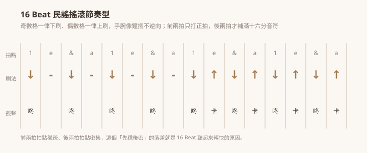

# 第 13 章｜輕快歌曲的秘密：16 Beat 刷法與民謠搖滾

> **本課學習目標**
> 1. 學會將每 1 拍細分為四等份的 **16 分音符數拍口訣（`1 e & a`）**。
> 2. 調整右手手腕擺動幅度（縮小振幅、提升頻率），彈出顆粒感十足的 **16 Beat 律動**。
> 3. 掌握「重音強調（Accent）」技巧，讓刷奏聽起來有爵士鼓般的律動推進力。
> 4. 完成青春熱血代表作〈那些年〉的 16 Beat 副歌實戰。

---

## 13-1 認識 16 分音符：一拍刷四下的細膩顆粒感

當我們聽見一首青春洋溢、節奏明快的中快板流行歌（如〈那些年〉、〈小情歌〉副歌）時，右手其實已經從「一拍上下擺動 1 次（8 Beat）」升級為**「一拍上下擺動 2 次（16 Beat）」**，也就是每 1 拍總共包含四個十六分音符！

### 16 分音符國際通用數拍與方向對照表

| 拍點細分位置 | 第 1 個音（正拍） | 第 2 個音 | 第 3 個音（反拍） | 第 4 個音 |
| :--- | :--- | :--- | :--- | :--- |
| **英文數拍口訣** | **`1`** (One) | **`e`** (ee) | **`&`** (and) | **`a`** (uh) |
| **中文擬聲口訣** | **答** | **卡** | **答** | **卡** |
| **右手刷弦方向** | **下刷 (`↓`)** | **上刷 (`↑`)** | **下刷 (`↓`)** | **上刷 (`↑`)** |
| **重音與力道配置** | **強音（刷全弦）** | 弱音（輕帶高音弦） | 次強音（中音區） | 弱音（輕帶高音弦） |

> **⚡ 手腕縮小振幅秘訣**：因為手腕擺動速度變快了一倍，千萬不要像 8 Beat 時擺動那麼大！想像你的右手腕**只在一枚 50 元硬幣的直徑範圍內**輕快抖動，只刷過最下面的 **3～4 根弦**，遇到重音拍時才稍微加大一點幅度刷到低音根音弦。

---

## 13-2 經典 16 Beat 流行民謠搖滾節奏型

下面這組節奏型結合了「8 分音符的穩重」與「16 分音符的推進感」，是華語流行搖滾副歌最常使用的黃金刷法：

---

## 13-3 青春熱血實戰：胡夏〈那些年〉副歌刷奏

〈那些年〉主歌溫柔如水（可用第 6 章分散指法），進入副歌瞬間切換為充滿爆發力的 16 Beat 刷奏，情緒反差極具感染力！

| 和弦進行 | 歌詞 |
| :--- | :--- |
| `F` → `G` → `Em` → `Am` | 這些年錯過的大雨(空)這些年錯過的愛情(空) |
| `Dm` → `G` → `C` → `C7` | 好想擁抱你(空)擁抱錯過的勇氣(空) |

---

## 13-4 本章過關檢核表

- [ ] **口訣精準**：能跟著 `65 BPM` 節拍器，均勻唸出 `1 e & a 2 e & a 3 e & a 4 e & a` 並同步上下刷弦。
- [ ] **大小聲層次**：刷奏 16 Beat 時不會每一拍都一樣大聲，能明顯聽出正拍重音與高音弦輕刷的動態起伏。
- [ ] **情緒張力**：能以飽滿穩定的 16 Beat 刷奏完整伴奏〈那些年〉副歌段落。