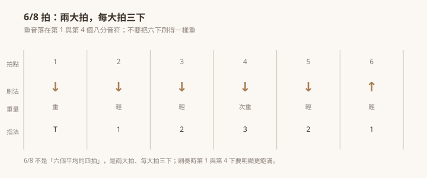
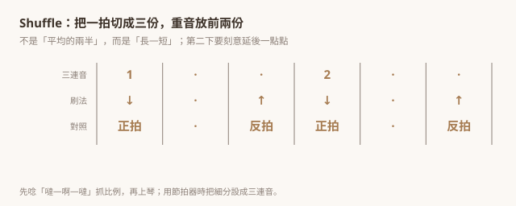
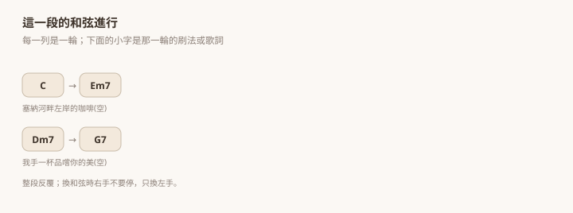

# 第 14 章｜搖擺與三連音：6/8 拍與 Shuffle 律動

> **本課學習目標**
> 1. 跳脫 4/4 拍框架，掌握浪漫深情的 **6/8 拍（八六拍）**「強、弱、弱、次強、弱、弱」搖曳律動。
> 2. 認識**三連音（Triplet）**與俏皮跳躍的 **Shuffle（搖擺節奏）**「長—短、長—短」律動感。
> 3. 完成周杰倫浪漫金曲〈告白氣球〉的搖擺節奏伴奏。

---

## 14-1 浪漫如海浪搖曳：6/8 拍指法與刷奏

不少抒情歌的段落（尤其是三拍子感的副歌或 12/8 藍調）採用的是 **6/8 拍（以八分音符為一拍，每小節有 6 拍）**。它的節奏重心落在**第 1 拍（強）**與**第 4 拍（次強）**，聽起來就像華爾滋或海浪規律拍打沙灘一樣浪漫搖曳：

---

## 14-2 讓人忍不住點頭的跳躍感：Shuffle 搖擺律動

另一種在輕快 R&B 與流行情歌中極受歡迎的律動，叫做 **Shuffle（搖擺節奏）**。它的秘密在於把每一拍切成**三等份（三連音：`1 - 2 - 3`）**，然後把中間的第 2 顆音省略不彈，形成**「前長（佔 2/3 拍）、後短（佔 1/3 拍）」**的跛腳跳躍感（口訣：`咚—卡、咚—卡`）！

### 平直節奏（Straight）vs. 搖擺節奏（Shuffle）對照表

| 比較維度 | 一般平直 8 Beat（Straight） | 搖擺節奏（Shuffle / Swing） |
| :--- | :--- | :--- |
| **每拍時間分配** | 均等兩半（`50%` ＋ `50%`） | **前長後短三連音比例（`67%` ＋ `33%`）** |
| **擬聲念法感受** | 像機器人走路：`答—答—答—答` | 像輕快小跑步：`答～卡、答～卡、答～卡` |
| **適用曲風代表** | 校園民謠、流行搖滾（如〈擁抱〉） | 輕快 R&B、爵士流行、浪漫情歌（如〈告白氣球〉） |

---

## 14-3 浪漫搖擺實戰：周杰倫〈告白氣球〉主歌律動

〈告白氣球〉是輕快 Shuffle 搖擺律動的標準範例。我們把每拍的短音（上刷）放在三連音的第 3 個位置——也就是拍長的三分之二處，不是正後半拍，整首歌就多了那種輕快的擺動感：

| 和弦進行 | 歌詞 |
| :--- | :--- |
| `C` → `Em7` | 塞納河畔左岸的咖啡(空) |
| `Dm7` → `G7` | 我手一杯品嚐你的美(空) |

---

## 14-4 本章過關檢核表

- [ ] **6/8 拍重心**：彈奏 6/8 拍時，能明顯做出第 1 拍與第 4 拍的重音，不會彈成平淡的六下。
- [ ] **搖擺彈性**：能分辨平直刷法與 Shuffle 搖擺刷法的差異，彈出「長～短、長～短」的跳躍律動。
