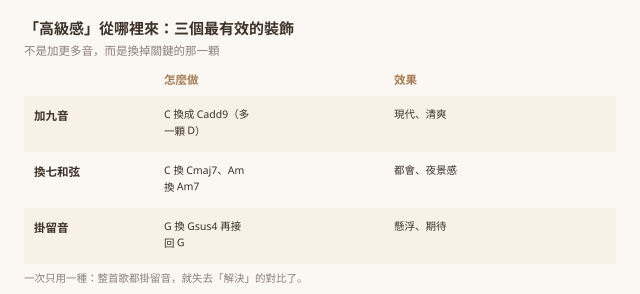
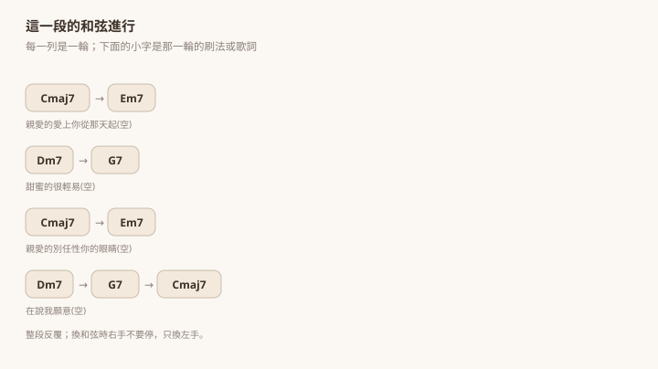

# 第 15 章｜幫和弦加點調味料：Sus 掛留和弦與七和弦

> **本課學習目標**
> 1. 不用死背音程樂理，直接從聽覺認識 **`sus2`、`sus4` 掛留和弦**的懸浮延伸色彩。
> 2. 掌握現代流行與 R&B 必備的**七和弦家族（`Maj7`、`m7`、`7`）**指法。
> 3. 學會「只需動一兩根手指」就把普通三和弦升級成高級色彩和弦的替換技巧。
> 4. 為〈告白氣球〉換上色彩和弦外衣，體驗瞬間升級的編曲質感！

---

## 15-1 為什麼高手的伴奏聽起來特別「高級」？

你是否好奇過，為什麼同樣是彈 `C - Am - Dm - G`，有些人彈起來像營火晚會兒歌，有些人彈起來卻像唱片裡的都市 R&B 情歌？秘密就在於他們幫單純的三和弦加上了**「掛留音（Suspended）」**與**「七度音（7th）」**！

### 常用色彩和弦聽覺與指法變化速查表

| 色彩和弦代號 | 聽覺情緒畫面 | 與原基礎和弦的「一指微調」按法差異 | 實戰替換時機建議 |
| :--- | :--- | :--- | :--- |
| **`Csus2` / `Dsus2`** | 遼闊、清澈、未完待續的懸浮感 | `Dsus2`：按住 `D` 和弦後，**放開第 1 弦的中指**（讓第 1 弦彈空弦 `0`）。 | 適合放在歌曲前奏、尾奏或抒情主歌製造空間感。 |
| **`Csus4` / `Dsus4`** | 充滿期待、渴望解決的張力 | `Dsus4`：按住 `D` 和弦後，**用小指（4）加按第 1 弦第 3 格**。 | 常接在原和弦前面（如 `Dsus4 → D`），創造好聽的旋律起伏。 |
| **`Cmaj7` / `Fmaj7`** | 夢幻、文青、溫暖微醺 | `Cmaj7`：按住 `C` 和弦後，**放開第 2 弦的食指**（只需按 5 弦 3 格與 4 弦 2 格，比 C 更好按！）。 | 可直接替換大部分抒情歌裡的 `C` 與 `F` 大三和弦。 |
| **`Am7` / `Em7` / `Dm7`** | 柔和、都會感、減少悲傷銳利度 | `Am7`：按住 `Am` 後**放開無名指**；`Dm7`：食指同時橫按 1、2 弦第 1 格＋中指按 3 弦 2 格。 | R&B、日系流行與現代華語情歌的標準配備。 |
| **`G7` / `C7`** | 強烈想要回到主和弦的推進張力 | `G7`：1 指按 1 弦 1 格、2 指按 5 弦 2 格、3 指按 6 弦 3 格。 | 最適合放在「副歌前最後一小節」或「轉調橋樑處」。 |

---

## 15-2 色彩和弦升級實戰：〈告白氣球〉R&B 質感版

將普通的 `C - Em - Dm - G` 全部升級為七和弦 `Cmaj7 - Em7 - Dm7 - G7`，聽聽看和聲是不是立刻充滿了現代感：

| 和弦進行 | 歌詞 |
| :--- | :--- |
| `Cmaj7` → `Em7` | 親愛的愛上你從那天起(空) |
| `Dm7` → `G7` | 甜蜜的很輕易(空) |
| `Cmaj7` → `Em7` | 親愛的別任性你的眼睛(空) |
| `Dm7` → `G7` → `Cmaj7` | 在說我願意(空) |

---

## 15-3 本章過關檢核表

- [ ] **一指變身**：能不看和弦圖，直接從 `C` 放開食指變成 `Cmaj7`、從 `Am` 放開無名指變成 `Am7`、從 `D` 加小指變成 `Dsus4`。
- [ ] **聽覺辨識**：能聽出 `Dsus4 → D` 之間那種「從懸浮回到穩定」的色彩變化。

## 練習設定

- **慢練**：用你能「完全彈對」的速度再降 20%，連續兩遍不錯再加快。
- **份量**：每天 10–15 分鐘，中途休息 1 分鐘；寧可短而準，不要長而散。
- **驗收**：跟著節拍器彈完一整段、中途不停、和弦不悶音，才算過關。
