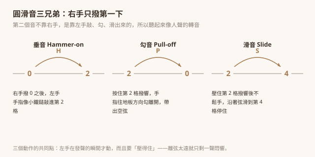
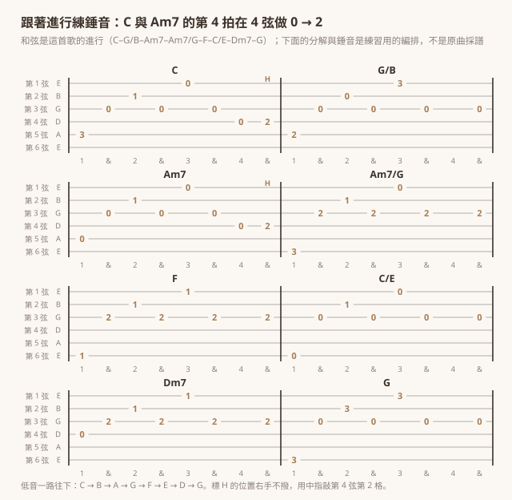

# 第 16 章｜左手的小表情：垂音、勾音與滑音基礎

> **本課學習目標**
> 1. 學會左手的三大圓滑音技巧：**垂音（Hammer-on, `H`）**、**勾音（Pull-off, `P`）**與**滑音（Slide, `S`）**。
> 2. 掌握在「按住和弦的同時」加入這些小裝飾音，讓靜態伴奏出現歌唱般的旋律線。
> 3. 拆解五月天〈突然好想你〉最具代表性的和弦裝飾音段落。

---

## 16-1 讓吉他像人聲一樣歌唱：圓滑音三兄弟

人聲唱歌時，音與音之間並不是生硬地跳躍，而是帶有滑順的轉音與氣息連接。在吉他上，我們透過左手的**「圓滑音技巧（Legato）」**——也就是**右手只撥響第一個音，第二個音完全靠左手手指敲擊、勾動或滑動琴弦發聲**——來創造如人聲般細膩的表情。

### 圓滑音三兄弟譜面符號與操作要領對照表

| 技巧名稱 | 英文與譜面符號 | 左手具體發力動作要領 | 新手最常犯的錯誤與修正 |
| :--- | :--- | :--- | :--- |
| **垂音** (擊弦) | **Hammer-on (`H`)** 如：`0 H 2` | 右手撥響空弦 `0` 後，左手手指像**「小鐵鎚」一樣快速垂直敲擊**第 2 格並按緊不放，靠敲擊動能發出第二個音。 | 動作太慢像輕輕放上去，會把震動悶掉；**出手要快、準、狠，指尖要立起來！** |
| **勾音** | **Pull-off (`P`)** 如：`2 P 0` | 手指先按緊第 2 格，右手撥響後，左手手指**向地板方向微微往下勾撥琴弦**後離開，帶出空弦音。 | 只是垂直把手指「抬起來」，第二個音會太小聲；必須要有一個**輕微向下勾弦**的動作。 |
| **滑音** | **Slide (`S` 或 `/`)** 如：`2 S 4` | 按緊第 2 格撥響後，**保持按壓力量不鬆開**，整根手指沿著琴弦平滑移動到第 4 格停住。 | 滑動途中手指放鬆力道，導致滑到一半聲音就斷掉了。 |

---

## 16-2 把裝飾音放進和弦裡：〈突然好想你〉的進行

在按壓 `C` 與 `Am7` 時，利用空出來的手指在第 4 弦做**垂音（`0 H 2`，D→E）**，是流行民謠最常見的裝飾手法。這首歌的進行是 `C - G/B - Am7 - Am7/G - F - C/E - Dm7 - G`，低音一路往下走（C→B→A→G→F→E→D→G），剛好留了很多空位可以塞垂音。

下面的分解與垂音位置是**練習用的編排，不是原曲採譜**；原曲的實際彈法每個吉他手都不一樣，重要的是「在空拍處敲一下」這個動作。

### 怎麼練

1. **先不垂音**：八個音全部用右手撥，確認每個和弦的低音都對。
2. **加上垂音**：`C` 與 `Am7` 這兩小節的第 4 拍反拍（最後一個八分音符），右手不撥，改用中指敲第 4 弦第 2 格。音量要跟撥出來的音一樣大，否則會像掉了一拍。
3. **放進歌裡**：整段循環四次，每次換和弦留一拍；熟練之後再把速度拉到 66 BPM 跟原曲對。

---

## 16-3 本章過關檢核表

- [ ] **清脆垂音**：不靠右手再撥一次，單靠左手食指與中指敲擊 `0 H 2`，就能發出音量清晰的兩個音。
- [ ] **勾音練習**：能流暢做出 `2 P 0` 與 `3 P 0` 的勾音動作，高音弦不會被無名指勾歪。
- [ ] **裝飾音融入**：能在彈奏 `C` 與 `Am` 分散和弦時，自然加入 `0 H 2` 垂音裝飾。