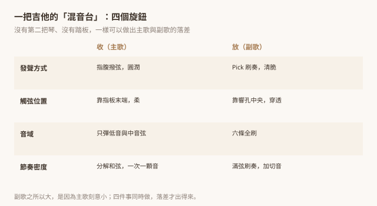
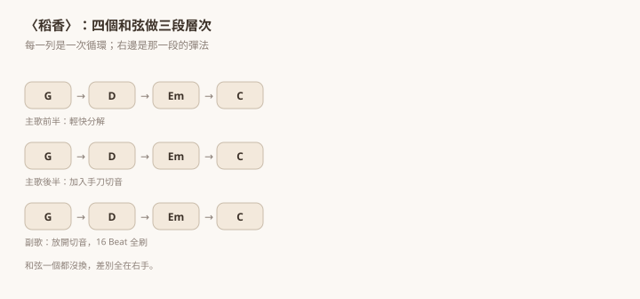

# 第 18 章｜設計一首歌的起伏：主歌與副歌的動態切換

> **本課學習目標**
> 1. 具備音樂製作人的「編曲思維」，告別從頭到尾同一種伴奏模式的呆板彈唱。
> 2. 掌握控制一把吉他音量的四大物理旋鈕：**撥弦工具、觸弦位置、和弦音域、節奏密度**。
> 3. 學會利用「悶音（Palm Mute）」在導歌段落製造令人期待的緊張鋪陳感。
> 4. 以周杰倫〈稻香〉為例，演練「四和弦貫穿全曲卻充滿豐富層次」的編曲示範。

---

## 18-1 一把吉他的混音台：控制動態層次的四大旋鈕

在專業錄音室編曲中，製作人會透過增減樂器（主歌只有鋼琴、副歌加入爵士鼓與電吉他）來創造歌曲的起伏。當你只有一把木吉他自彈自唱時，你可以透過以下四個「身體旋鈕」達到完全相同的編曲效果：

| 動態控制旋鈕 | 輕柔安靜設定（適合主歌 Verse） | 飽滿爆發設定（適合副歌 Chorus） |
| :--- | :--- | :--- |
| **1. 右手發聲方式** | 使用**手指指腹撥弦**（音色圓潤溫暖）。 | 使用 **Pick 刷奏**（音色清脆亮麗、音量大）。 |
| **2. 右手觸弦位置** | 靠近**指板末端（響孔左側）**撥弦，泛音少、聲音柔和。 | 靠近**響孔中央或略偏右側**刷弦，中頻顆粒感強、穿透力高。 |
| **3. 節奏密度與音域** | **分散和弦**（一次只響 1 顆音）或只彈低音與中音弦。 | **滿弦刷奏**（六根弦同時共鳴），加入切音與 16 分音符律動。 |
| **4. 導歌過渡神技** | 在副歌前 4 小節使用**「右手手掌悶音（Palm Mute）」**——手刀輕靠在下弦枕前方琴弦上，只用 Pick 往下悶刷低音弦，發出「咚、咚、咚、咚」如心跳加速的鋪陳感，接著在副歌第一拍瞬間放開全刷！ |

---

## 18-2 四和弦編曲魔法示範：周杰倫〈稻香〉

〈稻香〉全曲從頭到尾幾乎只用了 **`A - E - F#m - D`**（若夾 Capo 2 彈 G 調指法，即為 **`G - D - Em - C`**）四個和弦循環到底，卻一點也不讓人覺得單調，秘密就在於每個段落的節奏層次變化：

**核心循環**：`G` → `D` → `Em` → `C`（Capo 2，彈 G 調指法）

| 段落 | 歌詞起頭 | 這裡的伴奏配置 |
| :--- | :--- | :--- |
| **前奏與主歌前半** | 對這個世界如果你有太多的抱怨… | 輕快分散指法（`T 1 2 3`），只撥響乾淨的顆粒感 |
| **主歌後半（Rap 律動段）** | 所謂的那快樂，赤腳在田裡追蜻蜓追到累了… | 加入右手手刀切音（`↓ - ✕ ↑ - ↑ ✕ ↑`），把律動切出來 |
| **副歌爆發段** | 還記得你說家是唯一的城堡… | 放開切音限制，改成開闊飽滿的 16 Beat 全刷奏 |

三段用的是同一組四個和弦。真正讓它聽起來像三首歌的，是**右手**：撥弦的方式、切音的密度、刷弦的力道。

---

## 18-3 本章過關檢核表

- [ ] **悶音鋪陳**：能做出「手刀靠在下弦枕旁向下悶刷」的沉穩心跳聲，並在下一小節瞬間切換回清脆全刷。
- [ ] **四和弦層次**：能用同一組 `G - D - Em - C` 和弦，分別彈出「分散指法」、「切音刷法」與「飽滿全刷」三種截然不同的情緒張力。

## 練習設定

- **慢練**：用你能「完全彈對」的速度再降 20%，連續兩遍不錯再加快。
- **份量**：每天 10–15 分鐘，中途休息 1 分鐘；寧可短而準，不要長而散。
- **驗收**：跟著節拍器彈完一整段、中途不停、和弦不悶音，才算過關。
