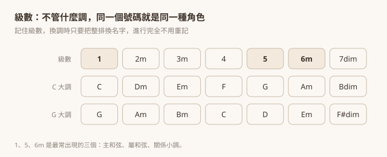

# 第 19 章｜聽懂流行歌的密碼：認識基礎數字級數

> **本課學習目標**
> 1. 用最白話的「相對位置」概念，徹底理解音樂製作人都在講的**數字級數（`1` 到 `7` 級）**。
> 2. 背下華語流行歌最常用的**四大「黃金和弦進行公式」**。
> 3. 學會看級數譜直接轉換調性（例如把 C 調的歌一秒變成 G 調彈）。
> 4. 培養「聽音辨和弦」的基礎耳力，開始擺脫死背六線譜的依賴。

---

## 19-1 什麼是「級數」？一分鐘看懂音樂的相對座標

你一定聽過樂團樂手在練團前說：「這首歌副歌就是走 **`4 - 5 - 3 - 6`** 啊！」這串神秘的數字就是**「級數（Scale Degrees / Nashville Number System）」**。

級數的原理超級簡單：**把某一個大調音階的七個音（`Do Re Mi Fa Sol La Si`），依序編號為 `1、2、3、4、5、6、7` 級**！其中 **`1、4、5` 級是大三和弦**（大寫羅馬數字 `I、IV、V`），**`2、3、6` 級是小三和弦**（小寫羅馬數字 `ii、iii、vi`），**`7` 級是減三和弦**（`vii°`）；`5` 級常再加一個降七度變成屬七 `V7`。

### C 大調與 G 大調常用級數對照表（吉他手必存！）

| 級數代號 | **`1` 級 (`I`)** | **`2` 級 (`ii`)** | **`3` 級 (`iii`)** | **`4` 級 (`IV`)** | **`5` 級 (`V`)** | **`6` 級 (`vi`)** |
| :--- | :--- | :--- | :--- | :--- | :--- | :--- |
| **和弦性質** | 大三和弦（穩定主音） | 小三和弦（柔和過渡） | 小三和弦（細膩橋樑） | 大三和弦（開闊推高） | 大三和弦（強烈回歸感） | 小三和弦（深情抒情） |
| **C 大調對應和弦** | **`C`** | **`Dm`** | **`Em`** | **`F` (Fmaj7)** | **`G`** | **`Am`** |
| **G 大調對應和弦** | **`G`** | **`Am`** | **`Bm`** | **`C` (Cadd9)** | **`D`** | **`Em`** |

---

## 19-2 華語流行樂壇四大「黃金和弦進行公式」

記住這四組級數公式後，未來你聽到任何一首新歌，都會驚訝地發現它們竟然都是由這幾組密碼排列組合而成的：

| 公式名稱 | 數字級數進行 | C 大調實際和弦 | 聽覺情緒特徵與經典代表歌曲 |
| :--- | :--- | :--- | :--- |
| **1. 流行萬用循環** | **`1 - 6 - 4 - 5`** | `C - Am - F - G` | 最經典穩定的流行進行，明暗交替自然（如〈小薇〉）。 |
| **2. 華語催淚進行** | **`4 - 5 - 3 - 6`** | `F - G - Em - Am` | 華語情歌副歌首選！從 4 級直接推高，充滿深情張力（如〈小幸運〉、〈突然好想你〉）。 |
| **3. 卡農經典進行** | **`1 - 5 - 6 - 3 - 4 - 1 - 4 - 5`** | `C - G - Am - Em - F - C - F - G` | 擁有優美的下行低音線條，史詩般流暢感（如〈突然好想你〉；〈稻香〉屬於上面的 `1-5-6-4`）。 |
| **4. 溫暖民謠進行** | **`1 - 3 - 6 - 5`** | `C - Em - Am - G` | 從明亮的 1 級直接滑入憂傷的 3 級，極具文青敘事感（如〈擁抱〉）。 |

---

## 19-3 級數實戰應用：一秒移調練習

學會級數最大的好處就是**「再也不怕不會轉調」**！試著將上面表格中〈稻香〉的 G 大調進行 **`G - D - Em - C`**，對照表格換算成級數，你會發現它就是 **`1 - 5 - 6 - 4`**；如果今天你想改用 C 大調指法彈唱，對照 C 調欄位就立刻得出 **`C - G - Am - F`**！

---

## 19-4 本章過關檢核表

- [ ] **級數反射**：聽到 `C` 調的 `4 - 5 - 3 - 6` 時，能立刻說出對應的和弦是 `F - G - Em - Am`。
- [ ] **聽力連結**：能用耳朵分辨歌曲段落是停留在穩定的「1 級主和弦」，還是帶有強烈懸浮期待感的「5 級屬和弦」。

## 練習設定

- **慢練**：用你能「完全彈對」的速度再降 20%，連續兩遍不錯再加快。
- **份量**：每天 10–15 分鐘，中途休息 1 分鐘；寧可短而準，不要長而散。
- **驗收**：跟著節拍器彈完一整段、中途不停、和弦不悶音，才算過關。
