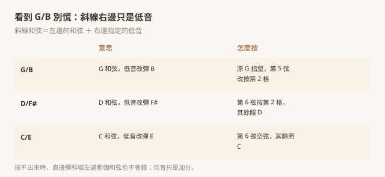
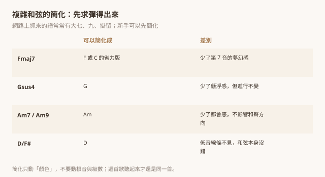

# 第 23 章｜讀懂網路吉他譜：面對複雜和弦的「簡化生存術」

> **本課學習目標**
> 1. 學會拆解網路吉他譜中常見的**「分數和弦（Slash Chords，如 `G/B`、`C/E`）」**結構。
> 2. 掌握**「去蕪存菁簡化法則」**：看懂複雜和弦背後的骨幹三和弦，不被長串英文代號嚇跑。
> 3. 擁有一張隨手可查的**「新手複雜和弦簡化對照表」**，從此自由彈奏網路上任何一首新歌！

---

## 23-1 看到 `G/B` 或 `F#m7-5` 別慌張！拆解複雜代號的結構

當你開始自己上網搜尋最新流行歌的吉他譜時，常會看到像 `G/B`、`Cadd9`、`Dsus4`、`F#m7-5` 這類令人眼花撩亂的和弦名稱。其實，這些長串代號大多只是**「基礎和弦 ＋ 裝飾音或指定低音」**而已！

### 必學觀念：什麼是「分數和弦（Slash Chords）」？
看到中間有一條斜線的和弦（例如 **`G/B`** 或 **`Am7/G`**）：

*   **斜線左邊（`G`）**：代表**左手原本要按的和弦名稱**。
*   **斜線右邊（`B`）**：代表**這顆和弦的最低音（bass）要換成 `B`**——`G/B` 的根音仍然是 `G`，只是最低音換人做（按住 `G` 和弦，不彈第 6 弦，改從第 5 弦第 2 格的 `B` 音開始刷）。
*   **新手緊急簡化法**：如果在快速轉換時來不及按斜線右邊的低音，可以直接彈斜線左邊的基礎和弦（例如把 `G/B` 彈成 `G`）。這在「不和諧」的層面是安全的，但低音會從 B 跳回 G，原本 `C–G/B–Am7–Am7/G` 那條下行低音線就斷了——能用，但不是等於。

---

## 23-2 新手必備「複雜和弦簡化生存對照表」

這張表是你未來自學網路吉他譜的護身符。當一首歌速度太快或某顆和弦太難按時，請直接套用右欄的簡化替代方案：

| 網路譜上看到的複雜和弦 | 拆解核心骨幹 | 新手友善簡化替代和弦 | 聽覺差異與實務說明 |
| :--- | :--- | :--- | :--- |
| **`Cmaj7`**、**`Cadd9`** | 都是 `C` 加上裝飾音 | 直接彈 **`C`** | 去掉延伸音，和聲仍然是 C 大三和弦。 |
| **`Csus4`** | 三度被換成四度（C–F–G） | 彈 **`C`** | 它本身沒有三度音，不是大三和弦；簡化成 C 是把掛留音解掉。 |
| **`Fmaj7`**、**`Fadd9`** | `F` 加上裝飾音 | 彈 **`Fmaj7`**（不必大橫按） | `Fmaj7` 只壓 1–4 弦，是第 5 章就教過的版本。 |
| **`Fm`** | F–A♭–C | 用**三弦小橫按**的 `Fm`（只壓 1–3 弦） | **不要換成 `Dm7`**：`Dm7` 是 D–F–A–C，三度音 A 和 Fm 的 A♭ 相衝，聽起來會打架。 |
| **`G/B`** | G 大三和弦，B 在低音（B 不是根音） | 彈 **`G`** | 可以救急，但低音線（C–G/B–Am…）會斷；想保留低音就慢慢練斜線和弦。 |
| **`G7`** | G 加上小七度 F | 彈 **`G7`**（`320001`） | 屬和弦的張力就來自那個 F；改成 `G` 是把張力拿掉，不是保留。 |
| **`Gsus4`** | 三度換成四度 | 彈 **`G`** | 掛留音解掉，回到 G 大三和弦。 |
| **`Am7`**、**`Am/G`** | `Am` 加上小七度／G 在低音 | 彈 **`Am`** | 同根音家族，聽起來幾乎一樣。 |
| **`Asus2`** | A–E–B，沒有三度 | 彈 **`A`** | 換成 `A`（A–C♯–E）只是多了三度；換成 `Am` 會多出 C 自然音，和原本的 B 撞在一起。 |
| **`Em7`**、**`E7`**、**`E/G#`** | `E` 家族 | 小調用 **`Em`**；`E7` 直接彈 **`E`** | 節奏不斷拍優先；`E7` 的張力會少一點。 |
| **`Dm7`**、**`Dsus2`** | `Dm`／`D` 家族 | 彈 **`Dm`**（或 `D`） | 同根音替換最安全。 |
| **`Dm7/G`**、**`F/G`** | 本質是「G 低音上的屬和弦色彩」 | 直接彈 **`G`** | 放在副歌前效果很好，這是真的可以整顆換掉的一種。 |
| **`Bm7`** | B–D–F♯–A | 在 C 調裡改用 **`Bm7♭5`** 或 **`Dm6`** | `Bm7` 帶 F♯，**不在 C 大調**；C 調的 7 級是 `Bm7♭5`（B–D–F–A），和 `Dm6` 同音。`G/B` 不能代替它（G–B–D 缺 F♯、多了 G）。 |

---

## 23-3 本章過關檢核表

- [ ] **分數和弦判讀**：看到 `C/E` 時，知道斜線左邊的 `C` 才是和弦本體，緊急時可直接彈 `C`。
- [ ] **獨立找譜能力**：能隨意打開一個網路吉他譜網站，挑選一首自己喜歡的新歌，運用簡化對照表順暢彈唱出主歌與副歌。
