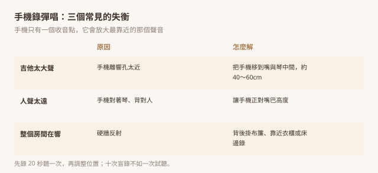
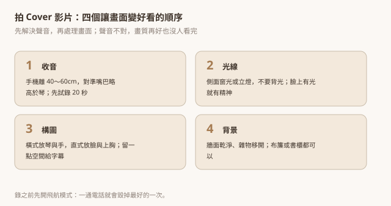

# 第 24 章｜用手機就能錄出好聲音：居家彈唱錄音與拍片技巧

> **本課學習目標**
> 1. 不用買錄音室器材，只用一支手機就能錄出**人聲與吉他音量平衡**的好音質。
> 2. 掌握手機單點收音的**「黃金擺位距離與角度測試」**。
> 3. 學會改善居家房間迴音（Room Reverb）的零成本小妙招。
> 4. 掌握拍攝彈唱 Cover 影片的環境打光與構圖建議，大方分享你的音樂作品。

---

## 24-1 為什麼用手機直接錄彈唱，總是「吉他超大聲、人聲聽不見」？

許多新手第一次用手機錄下自己的彈唱時，常常大受打擊：「明明現場唱得很有感情，怎麼錄出來吉他的刷弦聲像打雷一樣吵，歌聲卻像躲在遠方？」

這是因為民謠吉他響孔直接朝向前方噴射聲波，而手機麥克風具有全向收音特性。只要學會調整手機的**「距離」**與**「垂直高度角度」**，不用花一毛錢買麥克風就能立刻平衡兩者音量！

### 手機單點收音黃金擺位測試表（錄製前先試錄 15 秒檢查！）

| 收音問題現象 | 錯誤擺位方式 | 正確黃金擺位調整對策 |
| :--- | :--- | :--- |
| **吉他刷弦聲太大，蓋過歌聲** | 手機放在大腿高度，正對著吉他響孔。 | **拉高手機高度至「與下巴或肩膀齊平」**，並將手機稍微往**左手琴頭方向（左側）**偏移約 15 度，避開響孔直射聲波！ |
| **人聲乾扁、房間空蕩迴音太重** | 在空曠無窗簾的磁磚房間中央錄音。 | 面對**打開的衣櫃（掛滿衣服）**或厚重窗簾方向彈唱，衣物能天然吸收多餘反射音，錄出如錄音室般溫暖紮實的人聲！ |
| **聲音破音（爆音失真）** | 手機距離身體太近（小於 40 公分）。 | 將手機架設在距離身體約 **`70 ～ 100 公分`** 處，留給副歌大力刷奏充足的動態空間。 |

---

## 24-2 居家彈唱 Cover 影片拍攝與畫面質感建議

當你準備把練習成果錄成影片上傳 Instagram、YouTube 或傳給親友欣賞時，只要注意以下三個視覺小細節，影片質感就會立刻脫穎而出：

1. **光源永遠在「臉部前方（順光或 45 度側順光）」**：
   千萬不要背對著亮晃晃的窗戶拍片（那會讓你的臉變成黑影！）。將書桌檯燈或窗戶自然光放在手機鏡頭後方照亮臉部與吉他面板木紋，畫面會顯得溫暖又清晰。

2. **橫式（16:9）與直式（9:16）構圖秘訣**：
   * 拍攝直式短影音（Reels / Shorts）時，將鏡頭稍微拉遠一點，確保**「頭頂上方留白」**且**「左手琴頭與右手刷弦動作都完整入鏡」**，不要把琴頭切掉一半。

3. **錄製前「關閉手機通知與飛航模式」**：
   好不容易錄到副歌最高潮，突然響起一聲 LINE 訊息提示音，整段就得重來。按下錄影鍵前，請務必開啟「勿擾模式」。

---

## 24-3 本章過關檢核表

- [ ] **音質平衡測試**：完成一次 `70～100cm`、下巴高度的手機試錄，確認人聲清晰且吉他低音不會轟鳴蓋過歌聲。
- [ ] **第一支作品誕生**：成功錄製並保存了一首屬於自己的完整彈唱影片或錄音檔！
