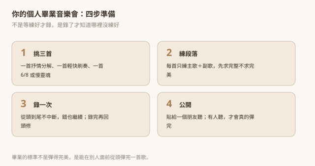
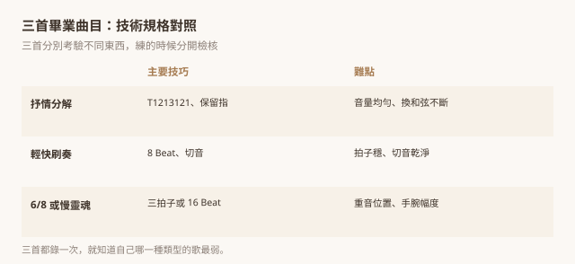
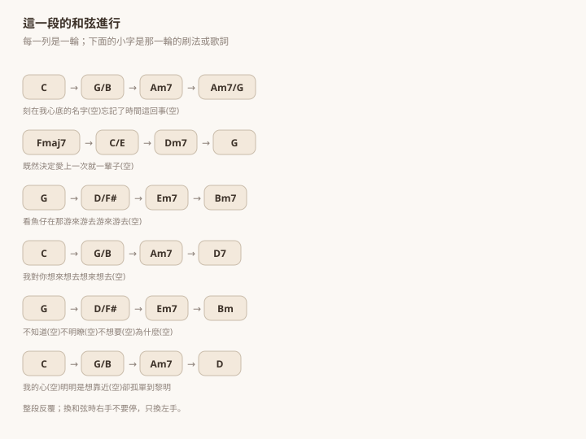

# 第 25 章｜【畢業總驗收】三首不同曲風的完整彈唱公演

> **本課學習目標**
> 1. 整合前 24 章所學的所有核心技巧，進行三種截然不同曲風的完整舞台演練。
> 2. 驗收**「細膩低音線條指法」**、**「6/8 拍輕快搖曳律動」**與**「主歌留白到副歌爆發張力」**三大彈唱維度。
> 3. 正式宣告從「完全零基礎」晉升為能獨立看譜、編排層次並自彈自唱的流行吉他玩家！

---

## 25-1 你的個人畢業音樂會

還記得翻開這本書的第一天，你連「第 1 弦與第 6 弦哪一根比較粗」都要低頭確認、按第一個和弦時指尖微微發疼的模樣嗎？現在，你已經掌握了開放和弦、分散指法、切音刷奏、移調夾運用、大橫按、色彩和弦，甚至具備了簡易編曲與手機錄音的能力。

為了替這趟學習旅程畫下最精彩的里程碑，我為你精選了三首風格迥異的畢業公演曲目（未來也可對應替換為「隔壁織音人」同曲風原創作品），請為自己泡一杯喜歡的飲料，架好手機，完成這場屬於你的居家公演！

---

## 25-2 三大畢業公演曲目技術規格總表

| 公演曲目順序 | 暫定曲目（演唱者） | 曲風與節拍 | 核心驗收技巧組合 | 舞台表現重點提示 |
| :--- | :--- | :--- | :--- | :--- |
| **第一首：深情獨白** | **〈刻在我心底的名字〉**（盧廣仲） | 4/4 拍現代抒情慢歌 | 分散指法 `T1213121` ＋ 色彩和弦（`Maj7`、`m7`）＋ 下行低音線條 | 著重右手手指觸弦的溫柔控制，主歌留白讓歌聲情緒自然流露。 |
| **第二首：陽光微風** | **〈魚仔〉**（盧廣仲，改編成 6/8 拍） | **6/8 拍改編版** 輕快搖曳 | 6/8 拍「強弱弱、次強弱弱」搖曳指法與刷奏切換（原曲是 4/4，這裡換一種律動重新編） | 掌握六八拍如海浪般的擺盪感，咬字輕鬆自然，微笑演唱。 |
| **第三首：搖滾張力** | **〈溫柔〉**（五月天） | 4/4 拍抒情搖滾史詩 | 大橫按轉換 ＋ 主歌極靜爬音到副歌全刷爆發 | 考驗動態層次極限！副歌全力刷奏時保持手腕放鬆不緊繃。 |

---

## 25-3 畢業公演實戰重點片段提示

### 曲目一：〈刻在我心底的名字〉——細膩低音線條與色彩和弦
> **演繹重點**：善用 `C - G/B - Am7 - Am7/G - Fmaj7 - C/E - Dm7 - G` 的下行低音（Bass Line）連接，讓每一顆根音像大提琴一樣溫柔托住歌聲。

| 和弦進行 | 歌詞 |
| :--- | :--- |
| `C` → `G/B` → `Am7` → `Am7/G` | 刻在我心底的名字(空)忘記了時間這回事(空) |
| `Fmaj7` → `C/E` → `Dm7` → `G` | 既然決定愛上一次就一輩子(空) |

### 曲目二：〈魚仔〉——改編成 6/8 拍的搖曳版本
> **演繹重點**：數穩 `1 2 3 4 5 6` 的六八拍律動，主歌用指法 `T 1 2 3 2 1`，副歌改為輕快刷奏 `↓(重) ↓ ↓ ↓(次重) ↓ ↑`。

| 和弦進行 | 歌詞 |
| :--- | :--- |
| `G` → `D/F#` → `Em7` → `Bm7` | 看魚仔在那游來游去游來游去(空) |
| `C` → `G/B` → `Am7` → `D7` | 我對你想來想去想來想去(空) |

### 曲目三：〈溫柔〉——從靜謐獨白到副歌爆發
> **演繹重點**：開頭「走在風中，今天陽光，突然好溫柔」用近乎清唱的單次爬音營造畫面；進入副歌「不知道、不明瞭、不想要」瞬間切換為飽滿 8 Beat / 16 Beat 全刷奏！

| 和弦進行 | 歌詞 |
| :--- | :--- |
| `G` → `D/F#` → `Em7` → `Bm` | 不知道(空)不明瞭(空)不想要(空)為什麼(空) |
| `C` → `G/B` → `Am7` → `D` | 我的心(空)明明是想靠近(空)卻孤單到黎明 |

---

## 25-4 結語：帶著吉他，走進你的下一段音樂旅程

恭喜你，親愛的朋友！當你彈完這三首畢業曲目的最後一個音符，看著琴弦在空氣中微微震動直到歸於平靜時，你已經不再是當初那個對著五線譜與和弦圖感到徬徨的門外漢了。

請記住，這本書的結束，並不是你吉他學習的終點，而是你用音樂記錄生活的真正起點。未來無論你遇到開心、孤單、迷惘或充滿希望的時刻，只要抱起手邊這把木吉他，撥動琴弦，你永遠都有一個最忠實、最溫暖的夥伴，陪你把每一個平凡的日子，唱成一首動人的歌。

願音樂永遠陪伴你，我們舞台上見！
