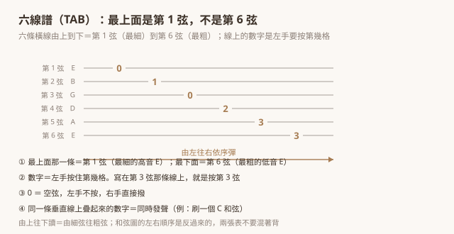
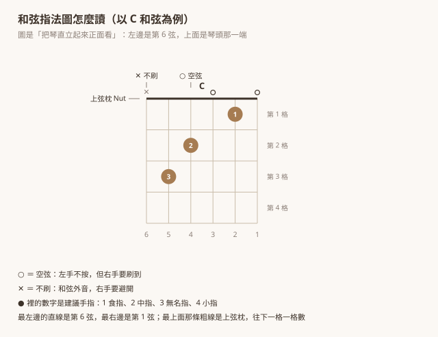
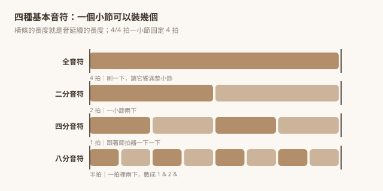
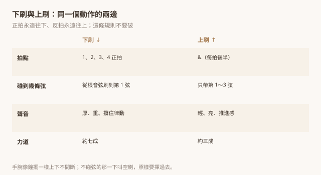
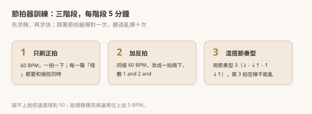

# 第 3 章｜看懂吉他的專屬語言

> **本課學習目標**
> 1. 徹底看懂吉他界最通用的**六線譜（TAB）**，5 分鐘內學會辨識「哪一條弦、按哪一格」。
> 2. 學會判讀**和弦指法圖（Chord Diagram）**中的 `○`、`✕` 與手指編號。
> 3. 建立基礎節奏觀念：認識 **4/4 拍**、小節線，以及全音符、二分音符、四分音符與八分音符的時值長度。
> 4. 學會使用**節拍器（Metronome）**對拍，為開口彈唱打下穩固的節奏地基。

---

## 3-1 忘掉五線譜！認識吉他的 GPS 地圖：六線譜（TAB）

很多想學吉他的人一聽到「看譜」就頭痛，腦中立刻浮現小時候音樂課本上那些長得像蝌蚪、高高低低的五線譜。好消息是：**流行吉他彈唱幾乎完全不需要看五線譜！**

吉他手擁有自己專屬的「圖像化樂譜」，叫做 **六線譜（Tablature，簡稱 TAB 譜）**。它就像一張極度直覺的 GPS 導航地圖，直接告訴你「手指要放在吉他的哪一根弦、第幾格」。

### 六線譜的視覺邏輯（這一點千萬別看反！）

六線譜由六條平行的橫線組成，分別代表吉他的六根琴弦。請特別注意它的上下排列順序：

*   **最上面那一條線**：代表**最細的第 1 弦**（高音 E 弦）。
*   **最下面那一條線**：代表**最粗的第 6 弦**（低音 E 弦）。

為什麼「最細的 1 弦」反而在最上面？你可以想像：**你現在正低頭俯視著抱在懷裡的吉他指板**——離你視線最遠（在螢幕／紙張最上方）的是第 1 弦，離你胸口最近（在紙張最下方）的是第 6 弦！

### 六線譜核心符號速查表

| 譜面符號 | 意義解釋 | 實際動作示範 |
| :--- | :--- | :--- |
| **橫線上的數字（如 `1`、`3`、`5`）** | 該琴弦需要按壓的**琴格數（Fret）**。 | 第 3 弦上寫 `2` ＝ 左手按住第 3 弦的第 2 格，右手撥響第 3 弦。 |
| **橫線上的數字 `0`** | **空弦音（Open String）**。 | 第 1 弦上寫 `0` ＝ 左手完全不按任何格子，右手直接撥響第 1 弦。 |
| **垂直對齊的一排數字** | **同時發聲（和弦或雙音）**。 | 如果從第 5 弦到第 1 弦同一垂直線上都有數字，代表左手同時按好這些位置，右手一次向下刷過這五根弦。 |
| **線上的 `✕` 符號** | **悶音 / 切音（Mute）**。 | 左手輕觸琴弦不按實，右手撥弦或刷弦時發出「咚、咔」的打擊節奏聲。 |

---

## 3-2 看懂「和弦指法圖」：一張圖按出和諧伴奏

當我們在彈唱流行歌時，如果每個音都用六線譜一格一格標示，整張譜會變得非常冗長。因此，流行歌曲吉他譜最常在歌詞上方放上一個個小小的方格圖，這就是**「和弦指法圖（Chord Diagram）」**。

和弦指法圖就像是把吉他琴頭**「直立起來」**正面看著它：

### 和弦指法圖判讀三步驟

1.  **看左右方向**：最左邊的直線永遠是**最粗的第 6 弦**，最右邊的直線永遠是**最細的第 1 弦**。
2.  **看黑點位置（●）**：黑點落在哪一條直線、第幾格，就用左手手指垂直按住那裡。黑點裡面的數字（`1`、`2`、`3`、`4`）代表建議使用的左手手指編號。
3.  **看最上方琴頭的 `○` 與 `✕` 記號**：
    *   **`○`（空心圓圈）**：代表這根弦雖然左手沒按黑點，但**右手刷弦時必須一起彈響**（空弦音）。
    *   **`✕`（叉叉記號）**：代表**右手刷弦時不彈這根弦**。最常見的原因是不要讓它當最低音：例如 C 和弦的第 6 弦空弦是 `E`（本身是和弦音），但刷下去低音就變成 E，聽起來像 `C/E` 轉位、低音不夠穩；另一種情況是那根弦按下去會和其他音打架。

---

## 3-3 流行歌的節奏心臟：拍子、小節與音符時值

音樂是時間的藝術。如果和弦是歌曲的「色彩」，那麼**節奏（Rhythm）**就是歌曲的「心跳」。絕大多數流行歌曲都是**「4/4 拍（四四拍）」**。

### 什麼是「4/4 拍」？
*   分母的 `4`：代表以「四分音符」當作 1 拍。
*   分子的 `4`：代表「每一個小節裡面總共有 4 拍」。
你可以把它想像成走路的步伐：**「1、2、3、4｜1、2、3、4｜」**，每數滿 4 拍就畫一條垂直線，這兩條線之間的格子就叫做一個**「小節（Bar / Measure）」**。

### 四種最基礎的音符與時值對照表（以 4/4 拍為基準）

在吉他六線譜下方，你會看到許多垂直的「符桿」與橫向的「符尾（連結線）」，它們負責告訴你「這個音要持續多久」：

| 音符名稱 | 六線譜下方寫法特徵 | 佔用拍數 | 嘴巴數拍子口訣（1 小節＝4 拍） | 吉他實際彈奏感受 |
| :--- | :--- | :--- | :--- | :--- |
| **全音符** | 只有單獨數字，沒有符桿 | **4 拍** | **`1`** - 2 - 3 - 4 | 撥響或刷一下後，讓聲音自然延長滿整整 4 拍。 |
| **二分音符** | 數字下方有一條垂直短符桿 | **2 拍** | **`1`** - 2 - **`3`** - 4 | 每個音持續 2 拍，1 個小節剛好彈 2 下。 |
| **四分音符** | 數字下方有一條完整垂直符桿 | **1 拍** | **`1` - `2` - `3` - `4`** | 跟著節拍器「噠、噠、噠、噠」每響一聲就彈一下。 |
| **八分音符** | 兩條符桿底部用「一條橫線」連在一起 | **0.5 拍（半拍）** | **`1` & `2` & `3` & `4` &** | 1 拍裡面平均彈 2 下！唸成「1-and, 2-and, 3-and, 4-and」。 |

> **🎯 超重要觀念：八分音符的「&（and）」是什麼？**
> 當我們在練吉他數八分音符時，千萬不要數成「1、2、3、4、5、6、7、8」，因為那樣你會忘記第 1 拍、第 2 拍的重音在哪裡！
> 請務必唸成：**「1 - and - 2 - and - 3 - and - 4 - and」**（中文可唸成「一、二、三、四」的字尾拖長，或是腳踩下去唸數字、腳抬起來唸 and）。數字永遠代表「正拍」，`and` 永遠代表「反拍」。

---

## 3-4 右手刷奏方向符號：下刷（Down）與上刷（Up）

在吉他刷奏譜中，除了音符時值外，譜面上方還會標示右手刷弦的方向符號，讓你一目了然這一下該往下刷還是往上刷：

| 譜面符號 | 英文名稱 | 中文念法 | 右手實際動作方向 |
| :--- | :--- | :--- | :--- |
| **`↓`** 或 **`Π`** | Downstroke | **下刷** | 右手從上往下刷（從粗弦第 6/5 弦方向，順勢刷向細弦第 1 弦方向）。 |
| **`↑`** 或 **`V`** | Upstroke | **上刷** | 右手從下往上刷（從細弦第 1 弦方向，輕巧地往上勾刷回第 3/4 弦方向）。 |

### 刷弦方向黃金定律：「正拍下刷、反拍上刷」
這條定律將貫穿你未來所有的流行吉他伴奏生涯，請務必記在心裡：

*   **所有正拍（`1`、`2`、`3`、`4`）**：右手永遠是**往下刷（`↓`）**。
*   **所有反拍（`and`）**：右手永遠是**往上刷（`↑`）**。
你的右手就像鐘擺一樣，隨著拍子「下、上、下、上」規律地上下擺動，絕對不會出現正拍往上刷的怪異動作！

---

## 3-5 你的第一堂節拍器訓練課

許多自學者彈唱時會出現「越彈越快」或「遇到難按的和弦就自動放慢」的毛病，這會讓聽眾覺得音樂很不穩定。從今天開始，請把手機裡的免費節拍器 App（或實體節拍器）打開，設定為 **`4/4 拍`、`速度 60 BPM`**（BPM ＝ Beats Per Minute，每分鐘 60 拍，剛好等於時鐘秒針「滴答」一秒一下的速度）。

### 零基礎三階段節奏跟拍練習

請左手輕輕扶住吉他琴頸（先不按和弦，讓琴弦保持悶音狀態），右手拿好 Pick，跟著 `60 BPM` 的節拍器完成以下三個練習：

1.  **練習一：四分音符下刷（每拍 1 下）**
    *   口訣：`1` (下) — `2` (下) — `3` (下) — `4` (下)
    *   重點：每次聽到節拍器「滴」一聲的瞬間，Pick 剛好刷過琴弦，感受手臂與拍點完全重合的快感。

2.  **練習二：八分音符下上刷（每拍 2 下）**
    *   口訣：`1` (下) `and` (上) — `2` (下) `and` (上) — `3` (下) `and` (上) — `4` (下) `and` (上)
    *   重點：往下刷時可以 brush 過全部六根弦（飽滿厚實）；往上刷時只需輕輕帶過最下面的 **3～4 根細弦** 即可，聲音會更清脆好聽，右手也比較不會卡住！

3.  **練習三：混搭基礎節奏型（流行歌最常用節奏雛形）**
    *   口訣：`1` (下) — `2` (下) `and` (上) — `3` (下) — `4` (下) `and` (上)
    *   重點：注意第 1 拍與第 3 拍是「四分音符（1 拍）」，往下刷完之後，手腕要在空中輕輕往上抬起準備（這個動作稱為**「空揮」**，不碰到弦），等到第 2 拍再往下刷！

---

## 3-6 本章過關檢核表

在進入第四章正式用手指彈出單音旋律之前，請確認你已經掌握了這些看譜與節奏語言：

- [ ] **六線譜方位**：看到六線譜最上面那一條線時，能立刻反應出那是「最細的第 1 弦」。
- [ ] **和弦圖解讀**：能看懂和弦圖上的 `○`（要彈空弦）與 `✕`（避開不彈），並正確對應左手 `1、2、3、4` 指。
- [ ] **音符時值分辨**：能一眼區分四分音符（1 拍）與八分音符（0.5 拍，兩音相連）的譜面寫法。
- [ ] **節拍器對拍**：能跟著 `60 BPM` 的節拍器，穩定地用嘴巴唸出 `1 and 2 and 3 and 4 and` 並同步完成下上刷。