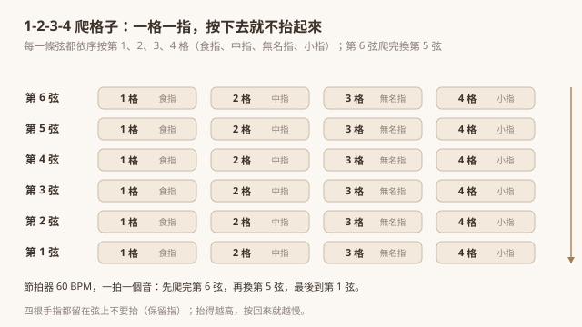
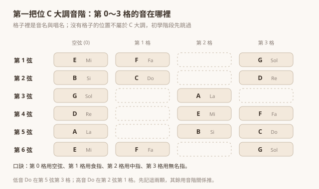
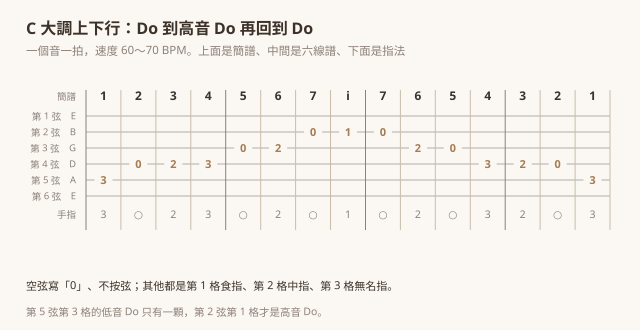
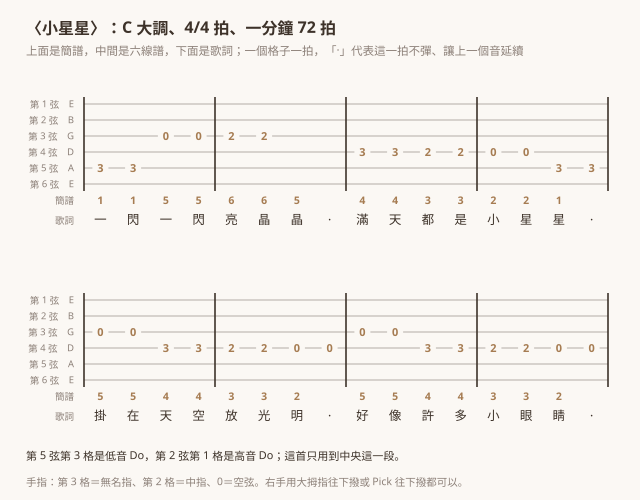
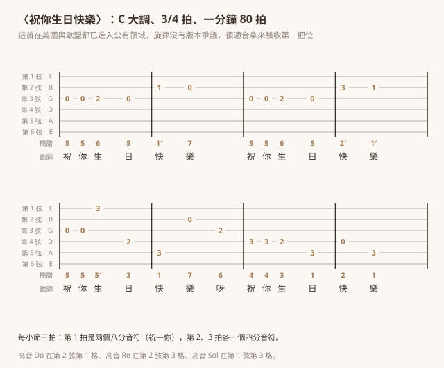
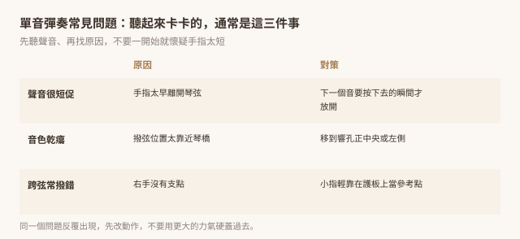

# 第 4 章｜手指暖身操與單音旋律

> **本課學習目標**
> 1. 學會每日必練的**「1-2-3-4 爬格子」手指暖身操**，喚醒無名指與小指的獨立控制力。
> 2. 認識吉他指板上**第一把位（第 0～3 格）的 C 大調自然音階**位置。
> 3. 訓練左右手協調性：做到「左手先按穩、右手再撥響」的零雜音單音彈奏。
> 4. 實際彈奏兩首耳熟能詳的單音旋律：**〈小星星〉**與**〈祝你生日快樂〉**，同時練到四分音符與八分音符。

---

## 4-1 為什麼吉他手每天都要「爬格子」？

在運動之前，我們會做伸展熱身避免抽筋；在彈吉他之前，我們同樣需要一套專屬手指的熱身操——這就是吉他界最經典的**「爬格子訓練（Spider Walk / Chromatic Exercise）」**。

在日常生活中，我們的大腦最習慣控制食指與中指（拿筷子、滑手機、寫字），而**無名指（3 指）與小指（4 指）**幾乎是「連體嬰」，你叫無名指動，小指往往會跟著抽動。爬格子的目的，就是透過規律的四指輪流按弦，在大腦與四根手指之間建立獨立的神經連結，同時鍛鍊指尖肌肉的耐力與跨度。

### 「1-2-3-4 爬格子」標準訓練步驟

請將左手放在吉他前四格（食指管第 1 格、中指管第 2 格、無名指管第 3 格、小指管第 4 格），打開節拍器設定 **`60 BPM`**，一拍彈一個音：

### 爬格子時必須遵守的三個「保留指黃金規則」

很多新手爬格子雖然爬完了，但姿勢卻是錯的，導致手指越練越飛。請務必注意以下三個細節：

1.  **「按下去就別急著抬起來！」（保留指原則）**
    當你用食指（1）按住第 6 弦第 1 格並撥響後，接下來要用中指（2）按第 2 格時，**食指請繼續留在第 1 格不要抬起來**！接著無名指（3）按第 3 格、小指（4）按第 4 格，直到四根手指都整齊地排列在第 6 弦上。準備換到第 5 弦時，再一隻一隻依序移動。這樣能防止手指像「彈簧」一樣亂翹，大幅提升未來的換和弦速度。

2.  **手指盡量貼近指板，不要飛得太高**
    手指抬離琴弦的高度控制在 **1 公分以內** 即可。飛得越遠，按回來的時間就越長。

3.  **寧可慢、不可斷**
    如果小指按第 4 格時按不緊、聲音悶悶的，請檢查兩件事：第一，小指有沒有靠近第 4 格右側銅條？第二，左手掌心有沒有留出空間讓小指立起來？

---

## 4-2 認識吉他指板上的「Do Re Mi」：C 大調音階

在開始用單音彈奏流行歌曲之前，我們先來認識流行音樂最基礎的音階——**C 大調自然音階（`Do - Re - Mi - Fa - Sol - La - Si - Do`）**，在簡譜中寫作 **`1 - 2 - 3 - 4 - 5 - 6 - 7 - i`**。

只要掌握了吉他前 3 格（稱為**「第一把位」**）的音階位置，你就能彈出無數首經典歌謠的主旋律了！

### C 大調第一把位音階位置圖解

### C 大調音階「一格一指」分工口訣表

為了讓左手不混亂，在第一把位彈奏音階時，請嚴格執行**「哪一格就用哪一根手指按」**的紀律：

| 所在琴格 | 負責手指 | 該格包含的 C 大調音符 |
| :--- | :--- | :--- |
| **第 0 格（空弦）** | 不需按弦 | 6弦(低Mi)、5弦(低La)、4弦(Re)、3弦(Sol)、2弦(Si)、1弦(高Mi) |
| **第 1 格** | **食指（1 指）** | 6弦(低Fa)、4弦(Fa)、2弦(高Do)、1弦(高Fa) |
| **第 2 格** | **中指（2 指）** | 5弦(低Si)、4弦(Mi)、3弦(La) |
| **第 3 格** | **無名指（3 指）** | 6弦(低Sol)、5弦(Do)、2弦(高Re)、1弦(高Sol) |

### 基礎 C 大調音階上下行練習譜（建議速度：60～70 BPM）

---

## 4-3 單音旋律實戰（一）：〈小星星〉

熟悉了 `Do` 到 `高音 Do` 的位置後，我們馬上用這八個音來彈奏人生第一首完整旋律——〈小星星〉！這首歌全部都是規律的四分音符與二分音符，非常適合用來訓練**「眼睛看六線譜、嘴巴唱出旋律、手指準確落點」**的同步能力。

### 練習要訣
*   **左手手指紀律**：凡是看到 `1` 格一律用**食指**；看到 `2` 格一律用**中指**；看到 `3` 格一律用**無名指**。
*   **右手撥弦方式**：你可以用右手大拇指（`P`）由上往下撥，或者用 Pick 往下撥（`↓`），每彈一個音，嘴巴就跟著唱出對應的唱名或歌詞。

*(註：歌曲最後兩小節旋律與開頭完全相同，可自行反覆一次作結！)*

---

## 4-4 單音旋律實戰（二）：〈祝你生日快樂〉

〈小星星〉只有四分音符，接下來換一首有八分音符的曲子。這裡選〈祝你生日快樂〉：它在美國與歐盟都已進入公有領域（2016 年版權主張被裁定無效），旋律沒有版本爭議，每個人一聽就知道你有沒有彈對——拿來驗收第一把位最合適。

它是 3/4 拍，第 1 拍是兩個八分音符（「祝—你」），第 2、3 拍各一個四分音符。也就是說，你會在**同一小節裡同時用到八分音符與四分音符**，右手要能在一拍內撥兩下、下一拍只撥一下。

### 練習要訣

- **右手**：第 1 拍用「下、下」兩次撥弦（或大拇指連續兩下），第 2、3 拍各一下。拍與拍之間手腕不要停，只是不碰弦。
- **左手**：第 1 格食指、第 2 格中指、第 3 格無名指；第 1 弦第 3 格若覺得無名指彆扭，也可以換小指。
- **唱**：先把歌詞唱順，再抱著琴彈。唱得順，手就會自動對到拍子上。

*(註：旋律是這首歌的傳統版本；本書的譜與歌詞對齊是自己排的，不是任何出版品的採譜。)*

---

## 4-5 新手單音彈奏常見問題排查表

在練習這兩首單音曲目時，如果覺得聲音聽起來卡卡的，請對照下表做自我健檢：

| 遇到的狀況 | 背後真正原因 | 立即修正對策 |
| :--- | :--- | :--- |
| **撥響後聲音立刻斷掉，變得很短促** | 左手手指太早離開琴弦，或是右手撥下一根弦時不小心碰到正在震動的弦。 | 務必等到**下一個音準備按下去的瞬間**，前一根手指才放開，音符之間才會有歌唱般的連貫感。 |
| **撥出來的音色乾癟、像在刮鐵絲** | 撥弦位置太靠近下弦枕（琴橋），那裡琴弦張力最硬。 | 將右手撥弦位置移到**響孔正中央**或響孔左側邊緣上方，音色會立刻變得圓潤溫暖。 |
| **從第 3 弦跨到第 4 弦時容易撥錯弦** | 右手手腕懸空漂浮，沒有一個穩定的參考支點。 | 可將右手小指輕輕靠在護板（響孔下方面板）上作為支撐點，右手對每根弦的距離感會精準許多。 |

---

## 4-6 本章過關檢核表

- [ ] **每日暖身**：能配合 `60 BPM` 節拍器，運用「保留指原則」從第 6 弦爬格子到第 1 弦。
- [ ] **音階記憶**：不看音階地圖，也能憑記憶彈出 `Do - Re - Mi - Fa - Sol - La - Si - Do` 上下行。
- [ ] **旋律演奏**：能流暢、不中斷地單音彈完〈小星星〉，並在 3/4 拍裡把八分音符與四分音符分清楚。

恭喜你！現在你的手指已經喚醒、也能看懂六線譜了。下一章，我們將正式解鎖流行吉他彈唱最迷人的魔法——**「和弦（Chords）」**，讓你用一隻手就能撐起整首歌的豐富和聲！