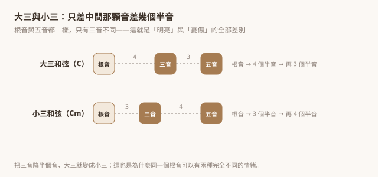
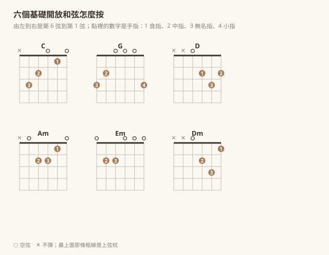
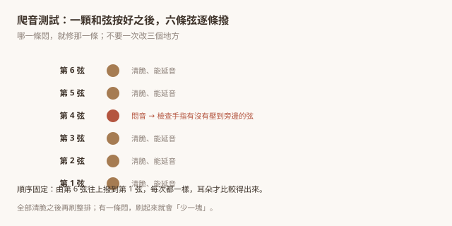
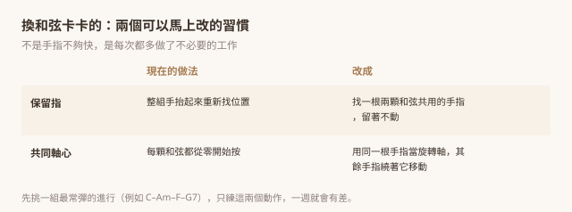
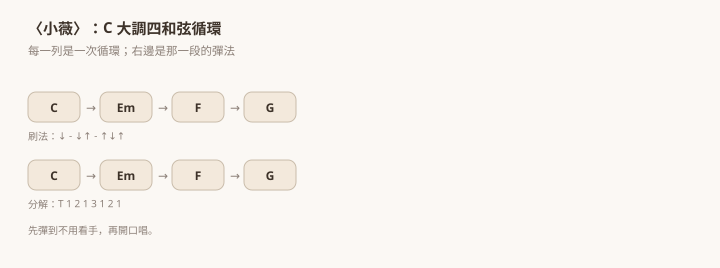

# 第 5 章｜你的第一組和弦：避開魔王的省力按法

> **本課學習目標**
>
> 1. 理解什麼是「和弦（Chord）」，以及大三和弦（明亮）與小三和弦（憂傷）的聽覺差異。
>
> 2. 學會流行歌使用率最高的 C 大調基礎和弦：**`C`、`Am`、`G`、`Em`、`Dm`**。
>
> 3. 掌握新手避坑神技：用好按又好聽的「省力版 `Fmaj7`」代替還按不響的「大橫按 `F` 和弦」。
>
> 4. 學會和弦轉換的兩大核心秘訣（**保留指**與**共同軸心**），並完成經典歌曲〈小薇〉的完整和弦伴奏！

## 5-1 什麼是和弦？用最白話的方式理解「伴奏的色彩」

如果說上一章彈的「單音旋律」就像一個人清唱，那麼「和弦（Chord）」就是背景裡幫你伴奏的鋼琴與弦樂團。在樂理上，**只要有「三個或三個以上不同音高的音」同時發聲，就構成了一個和弦**。

對於零基礎的流行彈唱學習者來說，你不需要背誦複雜的音程推算公式，只需要先用耳朵記住和弦帶給你的「情緒色彩」：

| 和弦種類 | 英文代號特徵 | 聽覺情緒與色彩感受 | 常見代表和弦（C 大調家族） | 
| ----- | ----- | ----- | ----- | 
| **大三和弦 (Major)** | 單獨一個大寫英文字母（如 `C`、`G`） | 明亮、開朗、陽光、穩定、充滿希望。 | **`C`**、**`F`**、**`G`** | 
| **小三和弦 (Minor)** | 大寫字母後面加一個小寫 **`m`**（如 `Am`） | 溫柔、感性、微帶憂傷、細膩、內斂。 | **`Dm`**、**`Em`**、**`Am`** | 
| **大七和弦 (Major 7)** | 字母後面加 **`maj7`**（如 `Fmaj7`） | 夢幻、文青、日系清新、比純大三和弦更豐富浪漫。 | **`Fmaj7`**（新手救星！） | 



## 5-2 打開流行歌的萬用鑰匙：C 大調核心開放和弦

只要學會以下六個「開放和弦（Open Chords，指包含空弦音、位於前三個琴格的好按和弦）」，你就能彈奏華語流行樂壇超過一半以上的抒情與民謠歌曲了！

請特別留意每個和弦最上方的 **`○`（要刷響）** 與 **`✕`（避開不刷）** 記號，這決定了你的和弦聽起來乾不乾淨：



圖上由左到右是第 6 弦到第 1 弦，點裡的數字是手指（1 食指、2 中指、3 無名指、4 小指）；弦上方的 `○` 要刷響、`✕` 不要刷。下面逐顆說明按法口訣與刷弦範圍。


### 1. `C` 和弦（明亮的起點）

* **按法口訣**：「1 指按 2 弦 1 格、2 指按 4 弦 2 格、3 指按 5 弦 3 格」。

* **刷弦範圍**：從**第 5 弦**往下刷到第 1 弦（避開最粗的第 6 弦 `✕`）。


### 2. `Am` 和弦（溫柔抒情的心臟）

* **按法口訣**：「1 指按 2 弦 1 格、2 指按 4 弦 2 格、3 指按 3 弦 2 格」。

* **超級發現**：你發現了嗎？**`C` 和 `Am` 的食指（1）與中指（2）位置完全一模一樣！** 轉換時只需要把無名指（3）從 5 弦 3 格移到 3 弦 2 格即可。

* **刷弦範圍**：從**第 5 弦**往下刷到第 1 弦（避開第 6 弦 `✕`）。


### 3. `Fmaj7` 和弦（避開大橫按的新手救星！）

傳統的 `F` 和弦需要用食指一次橫跨壓住六根弦（大橫按），是很多新手卡關的地方。在前期，我們一律用這顆「小 F / Fmaj7」代替它——不只手指不痛，音色也比大橫按的 F 更柔和。

* **按法口訣**：想像把 `C` 和弦的無名指與中指「整體往下搬一條弦」！「1 指按 2 弦 1 格、2 指按 3 弦 2 格、3 指按 4 弦 3 格」。

* **刷弦範圍**：從**第 4 弦**往下刷到第 1 弦（避開第 6、5 弦 `✕`）。


### 4. `G` 和弦（寬廣大氣的張力）

* **按法口訣**：「2 指按 6 弦 3 格、1 指按 5 弦 2 格、3 指（或小指 4 指）按 1 弦 3 格」。

* **刷弦範圍**：**六根弦全部刷響！** 這是少數六根弦全刷的和弦，聲音非常宏亮飽滿。


### 5. `Em` 和弦（全吉他最好按的兩指和弦）

* **按法口訣**：「1 指按 5 弦 2 格、2 指按 4 弦 2 格」。把中指與無名指留給別的用處時，也可以改成 2、3 指；但**下一節從 G 換過來時，用 1、2 指最順**（食指不用離開 5 弦）。

* **刷弦範圍**：**六根弦全部刷響！** 只需要兩根手指，就能發出深沉而充滿故事感的小調共鳴。


### 6. `Dm` 和弦（細膩哀愁的橋樑）

* **按法口訣**：「1 指按 1 弦 1 格、2 指按 3 弦 2 格、3 指按 2 弦 3 格」。

* **刷弦範圍**：從**第 4 弦**往下刷到第 1 弦（避開第 6、5 弦 `✕`）。


## 5-3 單顆和弦音色檢查法：「爬音測試」

新手按好和弦後，如果直接「刷」下去，往往很難聽出是哪一根弦沒有按好。請養成一個專業習慣——**每次學新和弦時，先用「一根一根單獨撥響」的方式做音色檢查**：

1. 左手按好 `C` 和弦，保持指尖垂直站立。

2. 右手從第 5 弦開始，依序撥響 `5 弦 → 4 弦 → 3 弦 → 2 弦 → 1 弦`，每一根弦都要像鐘聲一樣清脆響亮。

3. **如果某一根弦發出「悶悶的噗噗聲」**：

   * **狀況 A（該弦本身有按手指）**：代表手指力氣不夠，或按得離右側銅條太遠。請將手指往右側銅條靠攏並稍微加壓。

   * **狀況 B（該弦是空弦，例如 `C` 和弦的第 3 弦或第 1 弦不響）**：代表**上面那一根手指（中指或食指）太趴下了**，指腹肉墊不小心碰到了下方的空弦！請將左手手腕稍微往前推一點，讓指尖更垂直地立起來，空出下方琴弦震動的空間。



## 5-4 破解和弦轉換卡頓：兩大流暢秘訣

新手最常問：「我單獨按每個和弦都很響，但是一換和弦就要停下來想 3 秒鐘，拍子全亂了怎麼辦？」那是因為你每次換和弦時，都把所有手指「全部抬起來歸零重按」。高手換和弦之所以快如閃電，靠的是以下兩個秘密武器：

### 關鍵和弦轉換路徑與省力秘訣對照表

| 轉換組合 | 運用的省力秘訣 | 具體手指移動操作步驟 | 
| ----- | ----- | ----- | 
| **`C` ⇄ `Am`** | **雙指保留指（Anchor Fingers）** | **食指（1）與中指（2）完全不動黏在原位！** 只有無名指（3）在「5 弦 3 格」與「3 弦 2 格」之間輕輕上下擺動。 | 
| **`C` ⇄ `Fmaj7`** | **單指保留＋雙指平行平移** | **食指（1）留在 2 弦 1 格不動！** 中指與無名指保持「斜對角相對位置」，一起往下平移一條弦即可。 | 
| **`Am` ⇄ `Fmaj7`** | **雙指保留指** | **食指（1）與中指（2）完全不動！** 無名指（3）從 3 弦 2 格移到 4 弦 3 格（可先練三指版 Fmaj7，或將中指下移一格、無名指放 4 弦 3 格）。 | 
| **`Fmaj7` ⇄ `G`** | **提前預備低音根音** | 抬起手指往 `G` 移動時，大腦優先指揮**中指（2）精準落在 6 弦 3 格**（因為刷弦是由上往下，最粗的根音先按好，其他手指在刷弦過程中順勢補上，拍子就不會斷！）。 | 
| **`G` ⇄ `Em`** | **食指軸心保留指** | **食指（1）留在 5 弦 2 格不要放開！** 放開中指與無名指後，將中指（2）直接放進 4 弦 2 格（變成用 1、2 指按 Em），幾乎零延遲！ | 



## 5-5 第一首流行歌曲和弦實戰：〈小薇〉

現在，我們把剛學會的 `C`、`Am`、`Dm`（或 `Fmaj7`）、`G` 串聯起來，彈奏華語歌壇傳唱度極高的經典情歌——黃品源的〈小薇〉！

這首歌的速度溫柔舒緩（約 `68 BPM`），全曲由極度規律的「四和弦循環」貫穿，是建立左手和弦轉換肌肉記憶的最佳神曲。在這一章，我們先專注練習「每個和弦佔 4 拍（一小節），在每小節第 1 拍往下刷一下（全音符）」，讓你有整整 4 拍的充裕時間從容換好下一個和弦！

### 〈小薇〉和弦進行循環練習譜（主歌與副歌）

> **練習設定**：拍號 `4/4 拍` ｜ 速度 `68 BPM` ｜ 刷法：每小節第 1 拍往下刷一下（`↓`），讓聲音自然延長滿 4 拍，並利用第 3、4 拍提前準備下一個和弦。

```
【主歌段落：C → Am → Dm (或 Fmaj7) → G 循環】

| C           | Am          | Dm  (或Fmaj7) | G           |
  ↓  -  -  -    ↓  -  -  -    ↓   -   -   -     ↓  -  -  -
  1  2  3  4    1  2  3  4    1   2   3   4     1  2  3  4
  有 一 個 美   麗 的 小 女   孩                她 的 名 字

| C           | Am          | Dm  (或Fmaj7) | G           |
  ↓  -  -  -    ↓  -  -  -    ↓   -   -   -     ↓  -  -  -
  1  2  3  4    1  2  3  4    1   2   3   4     1  2  3  4
  叫 作 小      薇            她  有  雙  溫    柔 的 眼

| C           | Am          | Dm  (或Fmaj7) | G           | C           |
  ↓  -  -  -    ↓  -  -  -    ↓   -   -   -     ↓  -  -  -    ↓  -  -  -
  1  2  3  4    1  2  3  4    1   2   3   4     1  2  3  4    1  2  3  4
  睛            她 悄 悄 偷   走  我  的        心            (預備進副歌)

```

```
【副歌段落：感受情緒推高的和弦張力】

| C           | Am          | Fmaj7       | G           |
  ↓  -  -  -    ↓  -  -  -    ↓   -   -   -     ↓  -  -  -
  1  2  3  4    1  2  3  4    1   2   3   4     1  2  3  4
  小 薇 啊      你 可 知 道   我  多  愛        你

| C           | Am          | Fmaj7       | G           |
  ↓  -  -  -    ↓  -  -  -    ↓   -   -   -     ↓  -  -  -
  1  2  3  4    1  2  3  4    1   2   3   4     1  2  3  4
  我 要 帶 你   飛 到 天 上   去                看 看 那 顆

| C           | Am          | Fmaj7       | G           | C           |
  ↓  -  -  -    ↓  -  -  -    ↓   -   -   -     ↓  -  -  -    ↓  -  -  -
  1  2  3  4    1  2  3  4    1   2   3   4     1  2  3  4    1  2  3  4
  星            摘 下 一 顆   送  給          你

```

### 💪 進階挑戰：一分鐘和弦轉換計時賽

每天練琴結束前，花 2 分鐘做這個小遊戲：設定手機倒數計時器 **60 秒**，測試自己在 1 分鐘內能在以下兩組和弦之間乾淨地來回切換幾次（每次轉換都要撥響確認沒有悶音才算一次）：

* **第一組（入門級）**：`C` ⇄ `Am`（目標：1 分鐘 **35 次** 以上）

* **第二組（進階級）**：`Fmaj7` ⇄ `G`（目標：1 分鐘 **25 次** 以上）



## 5-6 本章過關檢核表

恭喜你順利完成了第一篇「安心起步」的所有課程！在進入第二篇學習右手豐富撥弦與刷奏律動之前，請確認你已經達成以下目標：

* \[ \] **六大和弦記憶**：看到和弦代號 `C`、`Am`、`Fmaj7`、`G`、`Em`、`Dm` 時，不看指法圖也能在 2 秒內按出正確位置。

* \[ \] **單弦爬音檢驗**：按住這六個和弦時，逐弦撥響都能聽到清晰明亮的琴音，沒有嚴重的悶音。

* \[ \] **保留指應用**：在轉換 `C` 與 `Am` 時，能做到食指與中指不離弦的無縫切換。

* \[ \] **第一首和弦伴奏**：能跟著 `68 BPM` 節拍器，穩穩地用每小節刷一下的方式，完整彈完〈小薇〉的主歌與副歌和弦進行。

下一章（第二篇開端），我們將解放你的右手，學習如何用手指撥出如流水般溫柔的「分散和弦指法」，讓你的伴奏瞬間充滿民謠詩意！