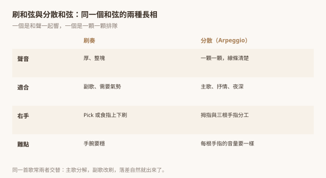
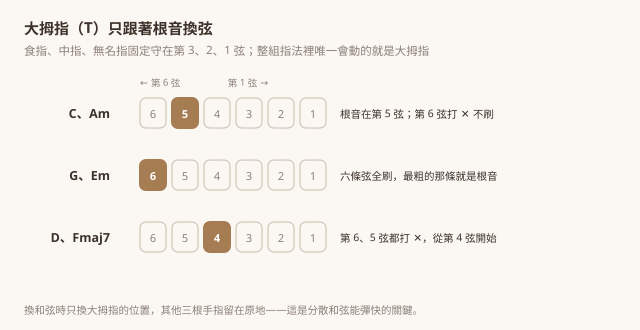
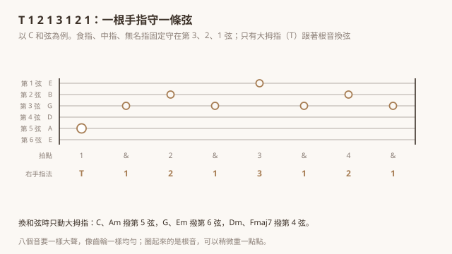
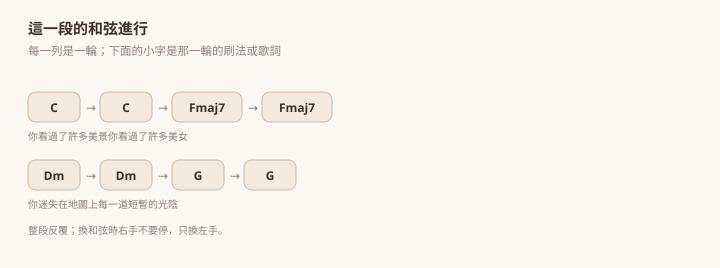

# 第 6 章｜右手撥弦入門：溫柔的分散和弦

> **本課學習目標**
> 1. 掌握右手撥弦的手指代號（`T`、`1`、`2`、`3`）與各弦負責分工。
> 2. 學會分辨每個和弦的**「根音（Bass Note）」**，建立低音穩定感。
> 3. 熟練華語抒情歌出鏡率最高的萬用分散指法 **`T 1 2 1 3 1 2 1`**。
> 4. 完成民謠經典〈旅行的意義〉主歌分散和弦伴奏。

---

## 6-1 解放右手手指：認識分散和弦（Arpeggio）

在第五章，我們用「一次刷下所有弦」的方式體驗了和弦的飽滿和聲；而在這一章，我們要把和弦裡的音符「拆開來、一顆一顆依序撥響」，這種彈法稱為**「分散和弦（Arpeggio / Fingerpicking）」**。它聽起來就像鋼琴左手彈低音、右手彈分解和弦一樣溫柔細膩，是深夜情歌與民謠彈唱的靈魂。

### 右手手指代號與責任分工表（民謠彈唱通用標記）

在華語吉他教學系統中，為了方便與左手數字區分，右手撥弦手指通常標記為 **`T、1、2、3`**（古典吉他系統則標記為 `P、i、m、a`）：

| 右手手指 | 民謠指法代號 | 古典系統代號 | 負責撥動的琴弦範圍 | 撥弦動作要領 |
| :--- | :--- | :--- | :--- | :--- |
| **大拇指** | **`T`** (Thumb) | `P` | **第 6、5、4 弦**（低音根音區） | 指腹側面**由上往下**輕撥，撥完自然靠向下方的弦或微幅停頓。 |
| **食指** | **`1`** | `i` | **第 3 弦**（中音區） | 指尖關節自然微彎，**由下往上**往掌心方向輕勾。 |
| **中指** | **`2`** | `m` | **第 2 弦**（中高音區） | 同食指，保持自然放鬆勾起，避免整隻手往上跳動。 |
| **無名指** | **`3`** | `a` | **第 1 弦**（高音區） | 負責最細的第 1 弦，力道可稍微集中，讓高音旋律線更清晰。 |

> **💡 姿勢黃金法則：「大拇指在前，食中無名指在後」**
> 觀察你的右手側面：大拇指（`T`）應該稍微伸向琴頭方向，食指（`1`）位於大拇指右側後方一點點的位置。這樣大拇指往下撥、食指往上勾時，兩根手指才不會在半空中「打架」！

---

## 6-2 找對「根音（Bass Note）」：大拇指（T）該撥哪一條弦？

練習分散和弦時，食指、中指、無名指永遠固定守在「第 3、2、1 弦」，**唯一會隨著和弦改變位置的，只有大拇指（`T`）**！大拇指撥響的那個最低音叫做**「低音（Bass）」**。當這個低音正好是和弦命名的那個音（例如 C 和弦的低音是 C）時，它同時也是**根音（Root）**；斜線和弦（如 `G/B`）就是要你把低音換成另一個音，根音仍然是 G。

### 基礎開放和弦「根音位置」速查表

| 和弦名稱 | 根音音名 | 大拇指（`T`）負責撥動的弦號 | 記憶小撇步（看和弦圖最左邊的黑點！） |
| :--- | :--- | :--- | :--- |
| **`C`**、**`Am`** | `C` (Do) / `A` (La) | **第 5 弦** | 這兩個和弦第 6 弦都打 `✕`，最粗有彈響的就是第 5 弦。 |
| **`G`**、**`Em`** | `G` (Sol) / `E` (Mi) | **第 6 弦** | 這兩個和弦六根弦全彈，最粗的就是第 6 弦。 |
| **`Dm`**、**`Fmaj7`** | `D` (Re) / `F` (Fa) | **第 4 弦** | 這兩個和弦第 6、5 弦都打 `✕`，從第 4 弦開始彈。 |

---

## 6-3 華語抒情歌萬用指法：`T 1 2 1 3 1 2 1`

學會下面這組八分音符指法之後，大部分 4/4 拍的華語抒情慢歌都能直接套用。

### 練習步驟（先空弦、再按和弦）
1. **左手完全放開（空弦練習）**：打開節拍器 **`65 BPM`**，大拇指固定撥第 5 弦，右手反覆循環 `T - 1 - 2 - 1 - 3 - 1 - 2 - 1`，直到四根手指像齒輪一樣均勻轉動，沒有任何一拍忽快忽慢。
2. **加入和弦循環**：依序按住 `C`（T撥5弦）→ `Am`（T撥5弦）→ `Fmaj7`（T撥4弦）→ `G`（T撥6弦），每個和弦彈滿一整組 `T1213121`（4 拍）。

---

## 6-4 分散和弦實戰：〈旅行的意義〉主歌段落

陳綺貞的〈旅行的意義〉是台灣民謠吉他指法伴奏的指標經典。原曲為 E 大調（吉他夾第 4 格彈 C 調指法），這裡我們先用不夾移調夾的 C 調原把位練習，專注感受右手溫柔如流水的顆粒感。

> **練習設定**：拍號 `4/4 拍` ｜ 速度 `72 BPM` ｜ 指法：每小節彈一次 `T 1 2 1 3 1 2 1`

| 和弦進行 | 歌詞 |
| :--- | :--- |
| `C` → `C` → `Fmaj7` → `Fmaj7` | 你看過了許多美景你看過了許多美女 |
| `Dm` → `Dm` → `G` → `G` | 你迷失在地圖上每一道短暫的光陰 |

---

## 6-5 本章過關檢核表

- [ ] **根音直覺**：看到 `C`、`G`、`Dm` 和弦時，右手大拇指能不假思索地撥對 `5`、`6`、`4` 弦。
- [ ] **音色均勻**：彈奏 `T 1 2 1 3 1 2 1` 時，每一個音音量平均，且無名指（`3`）撥第 1 弦時不會鉤得太大聲或太小聲。
- [ ] **流暢伴奏**：能跟著 `72 BPM` 節拍器完整彈完〈旅行的意義〉主歌和弦循環。
