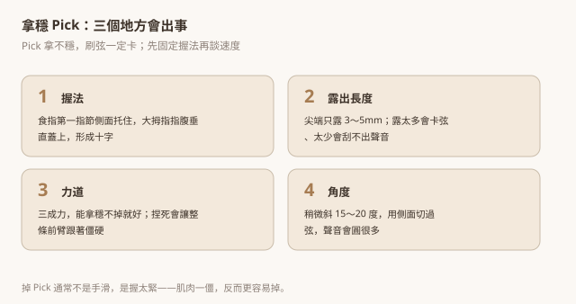
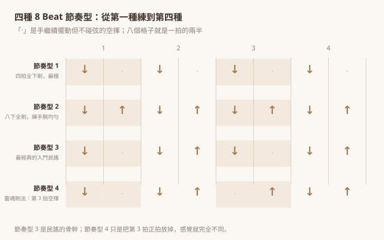
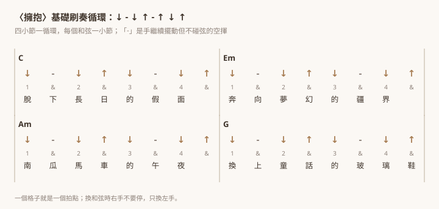

# 第 7 章｜右手刷奏入門：拿穩 Pick 與基礎節奏

> **本課學習目標**
> 1. 學會正確且放鬆的 **Pick（彈片）握法**，解決刷弦「卡住」或「彈片飛走」的困擾。
> 2. 掌握手腕「甩水珠」的自然擺動發力方式，而非用整隻手臂僵硬上下揮動。
> 3. 熟練流行音樂最基礎的四種 **8 Beat 刷奏節奏型**。
> 4. 完成五月天〈擁抱〉前段基礎刷奏練習。

---

## 7-1 拿穩 Pick 的藝術：三分配力與「甩水珠」秘訣

許多新手拿起 Pick 刷弦時，聲音聽起來像「拿塑膠尺用力刮鐵絲」，而且刷不到兩小節 Pick 就歪掉甚至掉進響孔裡。問題通常出在**「握得太死」**以及**「用手肘發力而非手腕發力」**。

### Pick 正確握法與角度調整表

| 檢查項目 | 新手常見錯誤 | 正確調整方式 |
| :--- | :--- | :--- |
| **手指姿勢** | 用大拇指、食指、中指「三指捏筆式」握 Pick。 | 食指自然彎曲成勾狀，Pick 放在食指第一指節側面，大拇指指腹垂直蓋住（**二指十字交叉法**）。 |
| **露出長度** | 尖端露出一大半，刷弦時阻力過大容易卡住。 | Pick 尖端僅露出約 **`3 ～ 5 mm`**，其餘部分包覆在拇指與食指之間。 |
| **握持力道** | 死命捏緊，導致整隻前臂肌肉僵硬。 | 保持約 **3 分力**（能拿穩不掉落即可），讓 Pick 接觸琴弦時能產生微幅的自然彈性緩衝。 |
| **接觸角度** | Pick 平面與琴弦完全垂直（90 度硬碰硬）。 | 將 Pick 稍微向琴頭方向傾斜約 **15～20 度**（用側面斜切過琴弦），音色會立刻變得圓潤滑順！ |

> **💧 體會「甩水珠」發力感**
> 想像你剛洗完手、身邊沒有擦手紙，你會怎麼把手指上的水珠甩乾？你一定是**手腕自然放鬆、像扇子一樣輕快地上下甩動**，而不是整隻手臂像機器人一樣上下舉動！刷吉他正是這個動作。

---

## 7-2 四大基礎民謠刷奏節奏型（8 Beat 入門）

在 4/4 拍中，將每一拍細分為兩個八分音符（`1 & 2 & 3 & 4 &`），這類節奏統稱為 **8 Beat**。以下四種節奏型是學習流行刷奏的必備階梯，請從第一種練到第四種：

| 節奏編號 | 節奏型態（下刷 `↓` / 上刷 `↑`） | 拍點口訣（括號為空揮不碰弦） | 聽覺特質與適用曲風 |
| :--- | :--- | :--- | :--- |
| **節奏型 1** | `↓` — `↓` — `↓` — `↓` — | **`1`** (and) **`2`** (and) **`3`** (and) **`4`** (and) | 穩定有力，適合歌曲前奏鋪陳或情緒穩重的慢歌。 |
| **節奏型 2** | `↓` `↑` `↓` `↑` `↓` `↑` `↓` `↑` | **`1 & 2 & 3 & 4 &`** | 綿密連續，訓練手腕均勻的上下擺動控制力。 |
| **節奏型 3** | `↓` — `↓` `↑` `↓` — `↓` `↑` | **`1`** (and) **`2 & 3`** (and) **`4 &`** | 最經典的入門民謠刷法，輕快且富有前進推進感。 |
| **節奏型 4** | `↓` — `↓` `↑` — `↑` `↓` `↑` | **`1`** (and) **`2 &`** (3) **`& 4 &`** | **大名鼎鼎的「靈魂刷法」**，第 3 拍正拍空揮製造切分律動！ |

### 刷弦音色層次小秘訣：「下刷重低音、上刷輕高音」
*   **下刷（`↓`）**：從該和弦的根音弦（第 6、5 或 4 弦）順勢刷到第 1 弦，聲音飽滿厚實，用來強調正拍重音。
*   **上刷（`↑`）**：只需輕輕往上帶過最下面的 **第 1、2、3 弦** 即可！千萬不要每次上刷都硬扯回第 6 弦，那會讓節奏變得拖泥帶水。

---

## 7-3 基礎刷奏實戰：五月天〈擁抱〉前段循環

五月天的〈擁抱〉全曲幾乎由 `C - Em - Am - G` 四個和弦無限循環，速度約 `78 BPM`，是華語吉他手最常拿來練刷奏律動的曲子之一。請先套用上面的**「節奏型 3（`↓ - ↓↑ ↓ - ↓↑`）」**來熟練左手換和弦與右手刷奏的配合：

---

## 7-4 本章過關檢核表

- [ ] **握法檢查**：Pick 尖端僅露出 `3～5mm`，刷弦時手腕放鬆不僵硬，不會刮出刺耳塑膠摩擦聲。
- [ ] **音色層次**：能做到下刷飽滿、上刷輕巧帶過高音三根弦。
- [ ] **節奏切換**：能跟著 `78 BPM` 節拍器，流暢完成〈擁抱〉四個和弦的 `↓ - ↓↑ ↓ - ↓↑` 循環刷奏。