*從弦組、調弦、結構到手感：讀懂一件樂器的四個入口*

## 本章重點

- 曼陀林有 **八根弦**，但演奏者真正面對的是 **四個弦組（course）**，每組通常兩根同音弦。
- 標準調弦是 **G3–D4–A4–E5**，相鄰空弦相距 **完全五度**，和小提琴的四條空弦相同。
- **音準（intonation）** 不是調音器調好就好。浮動琴橋一移位，整把琴的有效弦長就會跟著改變。
- 聲音走的是 **琴弦→琴橋→面板→琴體與琴腔空氣** 這條路，不是只有木材在決定音色。
- 選琴要「先量、再判斷、最後才動手」。弦長、上弦枕高度、琴橋餘量、琴格狀態，比外觀更影響你能不能好好學。

> **怎麼讀這本書**
>
> 這份文件是把原始的《曼陀林專業知識全書》改寫成比較好讀的版本。
> 你不需要從第一頁讀到最後一頁——可以照自己的目的選路線。

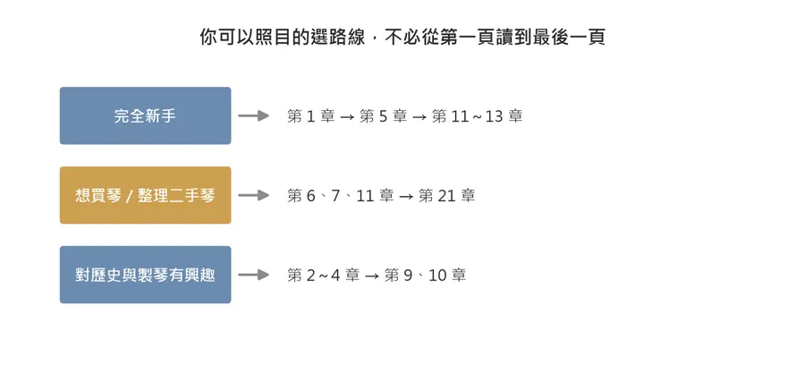

*圖　你可以照目的選路線，不必從第一頁讀到最後一頁。*

## 先建立一個正確的畫面

曼陀林很容易讓人誤會。

琴身不大，指板上有琴格，用撥片彈，看起來就像一把比較小的吉他。

另一方面，它的調弦和小提琴一樣，都是 G–D–A–E。於是也有人直覺把它想成「可以刷和弦的小提琴」。

這兩種說法都抓到一部分表象，卻都解釋不了真正的曼陀林。

要讀懂這件樂器，得同時看四件事：

1. **四組複弦** 怎麼一起工作。
2. **五度調弦** 怎麼安排整片指板。
3. **撥片** 怎麼把力量送進琴弦。
4. **琴橋與琴體** 怎麼把細小的振動放大成我們聽到的聲音。

本章建立全書共用的基本概念。

當你知道「八根弦」其實是四個 course，情況就開始不一樣。

當你知道 scale length（有效弦長）不只是規格表上的一個數字，情況又更清楚了。

你也會知道，浮動琴橋的位置會影響音準。很多問題就會突然接上線。

例如：撥片為什麼容易卡弦？低把位和弦為什麼偏尖？某把琴為什麼比較難按？某種型制為什麼起音更直接？這些看起來互不相關的現象，其實放進同一套結構與演奏邏輯裡就說得通。

## 先看一眼：現代標準曼陀林的核心資料

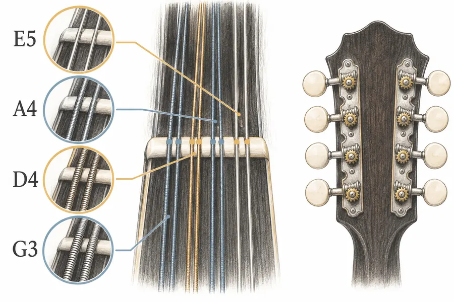

| **項目** | **常見內容** |
|---|---|
| **弦組** | 4 courses（四個弦組）；通常每組 2 弦，共 8 弦 |
| **調弦** | G3–D4–A4–E5（低至高） |
| **音程關係** | 相鄰 course 為完全五度 |
| **主要發聲** | 撥片撥弦；長線條常以 tremolo（顫音）延續 |
| **常見琴橋** | 浮動式 bridge（琴橋），位置會影響 intonation（音準） |
| **常見型制** | bowlback（圓背）、flatback（平背）、carved-top（雕刻拱面）、solid/electric（實心／電琴） |

圖解 先看一眼：現代標準曼陀林的核心資料（示意）

## 1.1　四組複弦的基本概念

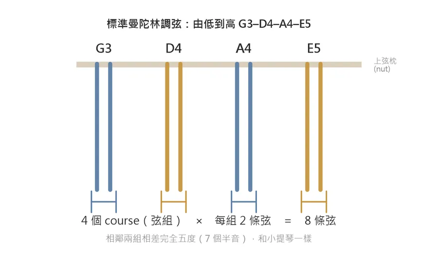

*圖 A　8 條弦＝4 個弦組。每組兩條靠得很近，撥片一次掃過一組。*

現代標準曼陀林通常有八根實體琴弦，但演奏者面對的其實是四個 course。

每個 course 多半由兩根非常靠近、調成同音高的弦組成。

這件事看起來只是「一根變兩根」，實際上卻同時改變了四件事：

- 右手感受到的阻力。
- 撥片通過弦組所需的時間。
- 調音的方式。
- 起音（attack）的質感。

> **常見誤解**
>
> 吉他手第一次彈曼陀林，常覺得撥片「卡在弦裡」，以為是撥片太厚或自己手太笨。
>
> **其實**：問題通常出在動作。原本只要穿過一根弦，現在必須在同一次行程裡乾淨穿過兩根靠得很近的弦。這是複弦結構直接要求出來的動作控制。

### 兩根同音弦，為什麼聲音會變厚？

兩根同音弦也會同時改變音量、起音與泛音的組合。

即使兩根弦都用調音器校到同一個音高，差異仍然存在。

它們的直徑、張力、老化程度、撥擊時間與按弦壓力，不可能在每一瞬間完全一致。

這些極小的差異會改變瞬態（transient）與泛音結構，讓複弦比單弦有更高的聲音密度。

| **兩根弦的差異程度** | **聽起來怎樣** |
|---|---|
| 差得太多 | 出現明顯的 **拍頻（beating）**，聽起來像調音不準 |
| 只有微小差異 | 融進曼陀林特有的「活性」裡，聲音顯得有生命 |

因此專業調音的目標並沒有改變：仍然要讓兩根弦盡可能一致，讓和弦與旋律保持清楚。

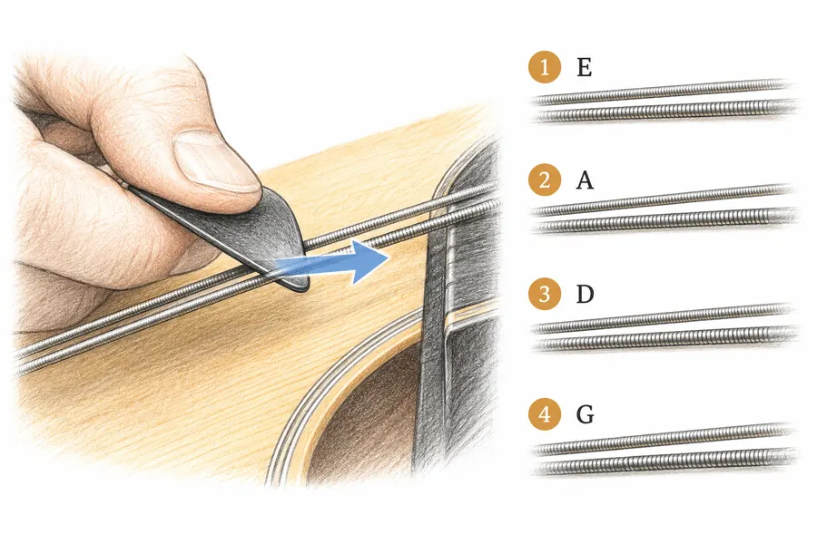

圖解 1.1　四組複弦的基本概念（示意）

### 家族裡也有例外

美國古典曼陀林協會（CMSA, Classical Mandolin Society of America）的記譜文件，把標準曼陀林寫成四個雙弦 course。

文件也明確指出，家族樂器有時會出現第五個 course，或特殊的 scordatura（變格調弦）。〔F13〕

這提醒我們：辨認曼陀林家族時，不能只看「有幾根弦」。要一起確認三件事——course 怎麼組織、怎麼調弦、音域到哪裡。

後面談到 Liuto Cantabile（抒情魯特琴）或十弦 Mandoloncello（曼陀林大提琴）時，就會看到同一個原理怎麼被延伸成五組複弦。〔F13〕

### 從演奏動作看：容錯變小了

course 還會改變「同一個音」的觸弦容錯。

- 撥片若只擦到其中一根弦，音色會突然變薄。
- 撥片若進弦太深，又容易在第二根弦上產生額外阻力。

這就是為什麼曼陀林右手訓練很早就強調兩件事：**固定的撥片露出量**，和 **一致的穿弦深度**。這不是老師愛挑剔，而是複弦結構直接要求出來的動作控制。

### 八度配弦：例外反而說明了常態

course 也可能採用八度配弦（octave stringing）等配置。CMSA 特別列出 scordatura，以及大型家族中可能出現的 octave stringing 例外。〔F13〕

這些例外反而能幫我們理解標準狀態。

現代古典曼陀林以 **同音複弦** 為常態，是因為它讓旋律指法、譜面與整體音色最一致。

當作曲家或民間傳統刻意打破這個慣例時，才會產生新的共鳴與和聲效果。〔F13〕

### 給第一次購琴的人

第一次買琴的讀者，可以先讀 21.1 的用途與預算，再回到本章認識四組複弦。

想先用耳朵建立音色印象，可以從第 22 章選一張專輯，帶著自己喜歡的聲音開始學。

## 1.2　五度調弦與指板關係

*圖 D　「高八度」就是頻率變兩倍。這是全書所有音高關係的基礎。*

標準曼陀林由低到高調成 G3–D4–A4–E5，相鄰空弦相隔一個 **完全五度**。

這和小提琴四根空弦的音高相同。它讓曼陀林指板具有高度規律性：

同一個音階形狀、琶音位置和雙音關係，常常可以沿著指板、用相似的「幾何圖形」重新找到。

對旋律樂器來說，五度調弦可以用四個 course 覆蓋很大的音域。代價是某些和弦必須跨越較大的左手距離。

### 同調弦 ≠ 同技法

五度調弦也解釋了為什麼很多小提琴旋律可以直接搬到曼陀林。但「同調弦」不代表「同技法」。

| **比較項目** | **小提琴** | **曼陀林** |
|---|---|---|
| 琴格 | 沒有琴格 | 有琴格 |
| 音高控制 | 手指位置要連續控制 | 半音位置較固定 |
| 能量輸入 | 弓可以在一個音上持續加能量 | 撥片把能量切成一個個短促起音 |
| 共通點 | 音高與指板地圖 | 音高與指板地圖 |

兩者共享音高地圖，發聲方法則各有特點。

真正把小提琴曲移植到曼陀林時，最需要重新安排的往往是 **長音、換弦與樂句呼吸**。音名通常可以沿用。

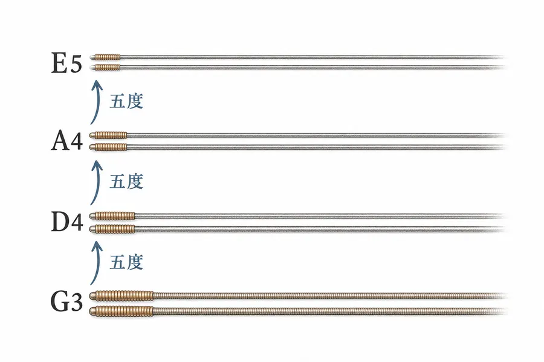

圖解 1.2　五度調弦與指板關係（示意）

### 1781 年的實物證據

1781 年 Antonius Vinaccia 製作的那不勒斯曼陀林，提供了非常重要的實物證據。

它具有八根弦、四組複弦，館藏也明確記載它採用與小提琴相同的音高配置。〔F04〕

這**並不等於**它是「第一把」這樣調弦的曼陀林。

但它至少證明：在十八世紀晚期，今天熟悉的四組五度系統，已經出現在成熟的那不勒斯型制裡。〔F04〕

### 初學者很快會遇到的兩個效果

**效果一：左手要伸得更遠。**

在同一個把位內，曼陀林左手常需要比吉他更大的橫向伸展。

| **樂器** | **相鄰弦的音程** | **和弦按法** |
|---|---|---|
| 吉他 | 高音弦之間多為四度 | 許多和弦能在相鄰格位完成 |
| 曼陀林 | 五度 | 想同時抓住根音、三度、五度，某些封閉和弦必須跨更遠的琴格 |

這就是為什麼古典、bluegrass（藍草音樂）與民謠系統，會發展出不同的和弦 voicing（聲部排列）。這些指型都是為了符合五度調弦的需要。

**效果二：旋律與移調很方便。**

反過來說，五度調弦對旋律與移調非常友善。

某個音階片段如果在這一組弦與下一組弦之間形成穩定的指型，移到別的調時，常常只需要整組平移。

對讀總譜或轉寫小提琴旋律的人來說，這種規律性非常有價值。

但在實務上仍要重新處理撥片方向、長音與複弦的反應。

## 1.3　聲音傳遞的路徑

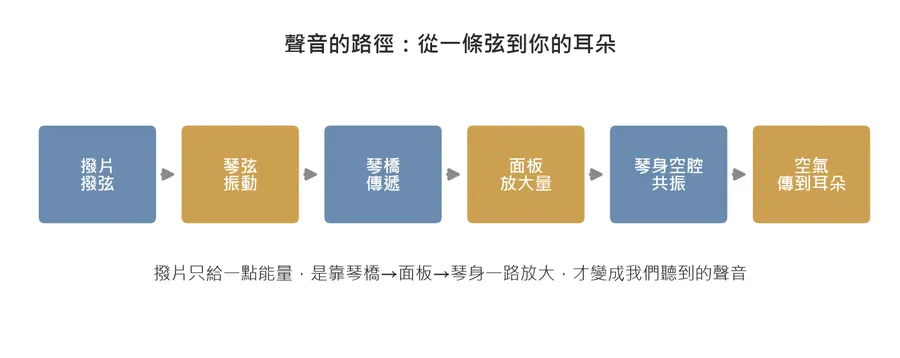

*圖 B　聲音的傳遞路徑：撥片只給一點能量，靠琴身一路放大。*

撥片把琴弦推離平衡位置後放開，琴弦開始振動。

但如果只讓一根細弦在空氣中振動，聲音會非常小，因為它能推動的空氣量有限。

曼陀林真正的聲音效率，來自「把弦的能量送進更大的結構」。

### 能量是這樣走的

> **比喻**：這就像用小指去推一扇門，門幾乎不會動；但如果透過門把和門軸，同樣的力就能推動整扇門。琴橋就是那個門把。

| **順序** | **發生什麼事** |
|---|---|
| 1 | 撥片推開琴弦，然後放開 |
| 2 | 琴弦振動 |
| 3 | 琴弦透過 **琴橋** 把力傳給 **面板** |
| 4 | 面板與 **琴腔內的空氣** 耦合 |
| 5 | 琴體其他部位一起參與 |
| 6 | 振動變成空氣中的 **聲壓**，也就是我們聽到的聲音 |

這就是為什麼琴橋是整條發聲鏈上的核心界面。

### 浮動琴橋：方便，但也會跑掉

在那不勒斯圓背琴裡，琴橋多半是 **浮動式（floating bridge）**，靠弦的張力壓在面板上。

它**可以移動**，方便修正整體音準。

但也表示：換弦、碰撞或不當清潔，都可能讓琴橋移位。

> **常見誤解**：一把「突然十二格不準」的琴，很多人的第一反應是「琴格做壞了」。
>
> **其實**：如果琴橋向前或向後滑了幾毫米，整把琴的有效弦長就已經改變了。這比琴格出問題更常見。

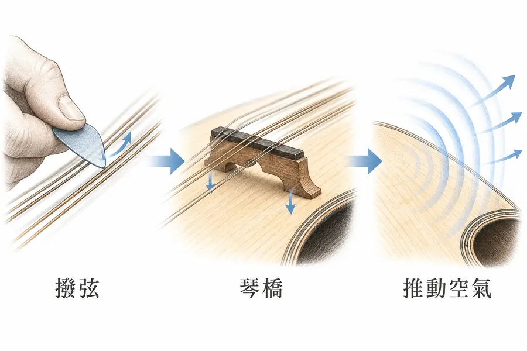

圖解 1.3　聲音傳遞的路徑（示意）

### 聲學研究怎麼看這件事

聲學研究更進一步指出，曼陀林的發聲包含琴弦、琴橋、面板與其他部位 **共同** 振動。

面板、bracing（力木／內部支撐）、圓背與背板、琴頸、音孔與琴腔空氣，都會參與不同頻率的模態（mode）。

2022 年對義大利傳統曼陀林的研究，用 impact hammer（敲擊鎚）、accelerometer（加速度計）與內外麥克風，量測 bridge admittance（琴橋導納）和聲輻射。

結果顯示：這件樂器的響應必須視為一個 **整體耦合系統**，木材、音孔與內部支撐要一起考慮。〔F08〕

### 所以，不要把聲音差異全推給木材

理解這條能量路徑之後，就能避免把所有聲音差異都歸因於木材。

假設兩把琴的面板同樣是 spruce（雲杉）：

| | **A 琴** | **B 琴** |
|---|---|---|
| 面板 | 較厚 | 較薄 |
| bracing | 較強 | 較弱 |
| 琴橋 | 較重 | 較輕 |
| 可能結果 | attack、頻率響應與動態上限都不同 | attack、頻率響應與動態上限都不同 |

木材的作用要放在整個發聲系統中理解。

2022 年的研究也正是同時量測木材機械性質與整琴的 bridge admittance，把結構與材料一併比較。〔F08〕

### 維修時，這條路徑就是排查順序

對維修而言，能量路徑也提供很實用的排查順序。

當一把琴突然出現異音，可以照這個順序檢查：

1. 弦是否鬆脫。
2. 琴橋是否貼合。
3. 尾弦板是否共振。
4. 面板與內部接合。

依檢查結果逐步縮小原因範圍。

很多惱人的 buzzing（雜音、打弦聲），實際上來自很小的硬體或接觸問題。

## 1.4　弦長、弦高與琴橋

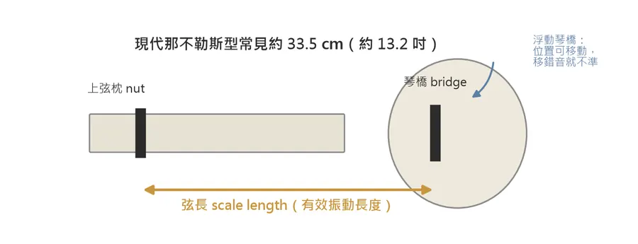

*圖 C　弦長怎麼量：從上弦枕到琴橋。琴橋是可移動的，位置錯了音就不準。*

選第一把曼陀林時，外觀很容易搶走注意力。

F-style（F 型）的捲角、華麗鑲嵌或深色木紋都很直觀。但對「能不能好好學」而言，下面這些事通常更重要：

- 弦長
- 琴頸幾何
- 上弦枕（nut）高度
- 琴橋餘量
- 琴格狀態

### 三個關鍵名詞

| **名詞** | **白話解釋** | **出問題會怎樣** |
|---|---|---|
| **scale length**（有效弦長） | 上弦枕到琴橋的距離 | 影響手感與弦規選擇 |
| **nut action**（上弦枕高度） | 上弦枕上弦槽的高度 | 太高會讓第一、二格難按，按弦音還會偏尖 |
| **bridge height**（琴橋高度） | 琴橋撐起弦的高度 | 太低可能已經沒有空間再修正 action（弦距） |

在相同音高和類似弦材的條件下，弦長改變會影響手感與弦規選擇。

### 怎麼判斷一把琴適不適合初學？

比「這把木頭看起來是不是比較高級」更直接的做法，是照順序動手試：

1. 先調準空弦。
2. 逐格彈奏，確認有沒有明顯打弦或死音。
3. 檢查十二格按弦音和泛音是否大致一致。
4. 觀察琴橋是否立直、是否還有高度調整空間。
5. 看琴頸有沒有明顯扭曲。

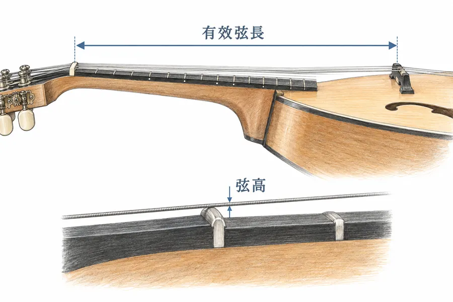

圖解 1.4　弦長 弦高與琴橋（示意）

### 歷史上從來沒有「唯一標準弦長」

歷史館藏也提醒我們，**沒有唯一的標準弦長**：

| **實物** | **有效弦長（vibrating length）** |
|---|---|
| Met 館藏一件十九世紀歐洲曼陀林 | 32.0 cm |
| 現代 Calace 那不勒斯型曼陀林 | 33.5 cm |

兩者都屬於曼陀林的範圍。

但不能因為某一個數字常見，就把所有年代和流派都塞進同一規格。〔F14〕

### 33.5 cm 只適用「圓背琴」

這裡有個容易誤會的地方：**33.5 cm 不是所有曼陀林的標準。**

| 琴型 | 常見弦長 |
|---|---|
| 那不勒斯式圓背琴（bowlback） | 約 33–34 cm |
| 美式雕削拱面琴（carved-top，Gibson、Collings 等） | 約 35.2–35.6 cm（13 7/8 吋～14 吋） |
| 平背琴（flatback） | 依製琴師，多在兩者之間 |

同樣叫「曼陀林」，美式琴的弦長比義大利圓背琴**長了約 2 公分**。這會直接影響左手跨度和弦的選擇，也影響弦的規格。

所以看到「曼陀林弦長 33.5 cm」時，要先問：**這是哪一種琴？**

### 弦長不能單獨決定張力

弦長本身也不能單獨決定張力。音高與琴弦的線密度同樣重要。

不過，在比較同一類弦材、同一音高時，scale length 的確是非常直觀的手感座標。

| **型號／來源** | **弦長** |
|---|---|
| Calace 現行標準 mandolin | 33.5 cm |
| Suzuki 2017 型錄 M-30 | 336 mm |

兩者非常接近。這顯示 **約 33.5–33.6 cm** 是現代多種傳統常見的區間。

但仍不應該把它寫成「所有歷史曼陀林的唯一標準」。〔F14〕〔F26〕

### 中古琴特別容易搞混的一件事

對中古琴，尤其要分清「弦長」與「琴橋現在放在哪裡」。

浮動琴橋如果被前一位使用者移錯位置，量出來的有效弦長就會偏離設計值。

若只量上弦枕到琴橋，再拿這個數字判定型號，可能把 **setup（樂器設定）錯誤** 誤認成 **製造規格**。

因此型號鑑定最好搭配三件事一起看：fret position（琴格位置）、官方資料，以及琴橋的補償（compensation）狀態。

## 1.5　三件歷史樂器的比較

如果只看名稱，下面三件樂器都可以被中文寫成「曼陀林」：

- 羅馬約 1710 年的 mandolino
- 1781 年 Vinaccia 那不勒斯曼陀林
- 1898 年 Orville Gibson 曼陀林

但把三件實物並排，會立刻看出：名稱背後其實是三套不同的技術世界。

### 約 1710 年的羅馬 mandolino

這件樂器使用多組腸弦（gut strings）與鐮刀形琴頭。

Met 甚至記錄它的指板曾因弦組增加而被加寬。

這種舊式 mandolino 與後來的八弦金屬弦那不勒斯系統，**不能直接等同**。〔F03〕

### 1781 年 Vinaccia 那不勒斯曼陀林

這件已經呈現那不勒斯學派的核心特徵：

- 八弦
- 四組複弦
- 與小提琴相同的音高
- 圓背琴肚
- 琴橋附近的面板折角

這些結構重點，都和較高的弦張力、撥片發聲與投射（projection）需求有關。〔F04〕

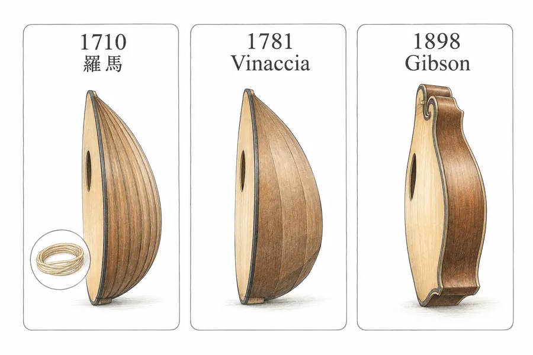

圖解 1.5　三件歷史樂器的比較（示意）

### 1898 年 Orville Gibson

到了 1898 年，美國製琴又把問題重新定義了一次。

Met 的實物與美國專利都顯示，Gibson 採用：

- 雕刻拱面（carved top）與拱背（carved back）
- 浮動琴橋
- 尾弦板
- 嘗試減少傳統拼接與內部支撐
- 琴頸甚至設計成與琴體空腔相通

換句話說，美國的雕刻拱面，更準確地說，是 **另一套結構哲學**。〔F10〕〔F11〕

### 三件放在一起看

| **實物** | **可觀察結構** | **判讀重點** |
|---|---|---|
| 約 1710 羅馬 mandolino | 多組腸弦、鐮刀形琴頭 | 核對原有弦組與後期改造〔F03〕 |
| 1781 Vinaccia | 四組複弦、圓背、折面面板 | 認識那不勒斯系統〔F04〕 |
| 1898 Orville Gibson | 雕刻拱面與拱背、浮動琴橋 | 比較美式結構與原始專利〔F10〕〔F11〕 |

這三件琴放在一起，可以建立本書最重要的閱讀習慣：

> 看到「mandolin」，先確認 **年代、地區、弦組、弦材、面板和琴體** 如何構成。
>
> 名稱只是入口，結構才是證據。

### 換成演奏者的感受來看

三件實物的差異，也能用「演奏者會感受到什麼」來理解。

| **樂器** | **演奏世界的特徵** |
|---|---|
| 早期 gut-course（腸弦弦組）mandolino | 右手與張力世界和金屬八弦琴不同 |
| 那不勒斯琴 | 短促的 attack、較高張力 |
| 美國 carved-top | 又是另一種反應與動態 |

即使都彈同一段旋律，最佳撥片、音量控制與長音策略也不會完全一樣。

歷史型制不是博物館裡的分類標籤，而是**會進入手感與句法的技術條件**。

### 讀老樂譜時要注意什麼

閱讀老樂譜時，應同時確認音域與原本的發聲條件。

音域可以相同，但原本樂器的延音、共鳴和 course 數，可能讓同一句伴奏呈現完全不同的密度。

歷史演奏研究的價值，正是在音符之外恢復這些物理條件。〔F01〕

## 1.6　案例：手感與樂器設定

### 案例一：低把位偏尖、十二格又略高

假設一把中古曼陀林外觀完整、沒有大裂痕、空弦也能調準。

但第一把位的和弦總是偏尖，十二格又略高。

如果只從「調音」處理，演奏者可能一直轉弦鈕卻得不到穩定結果。

比較合理的診斷順序是：

| **順序** | **檢查什麼** | **原因** |
|---|---|---|
| 1 | 上弦枕 | 若弦槽太高，低把位按弦會把琴弦額外拉長 |
| 2 | 琴橋位置 | 若整體 scale 被縮短，十二格按弦會一起偏尖 |

這兩個問題**可能同時存在**。

所以不能用「移琴橋」去補償「過高的 nut action」——那只會讓另一個問題更難查。

### 案例二：琴橋削得很低了，action 還是偏高

另一種常見情況是：琴橋已經被削得很低，但 action 仍偏高。

這時真正的問題，可能在 **neck angle（琴頸角度）** 或 **面板長期變形**。

若繼續削琴橋，最後只會：

- 降低 break angle（琴弦越過琴橋的折角）
- 犧牲調整餘量

卻沒有處理根本的幾何問題。

這種案例也說明為什麼第一章就要談結構：**演奏手感從來不是單一零件的效果。**

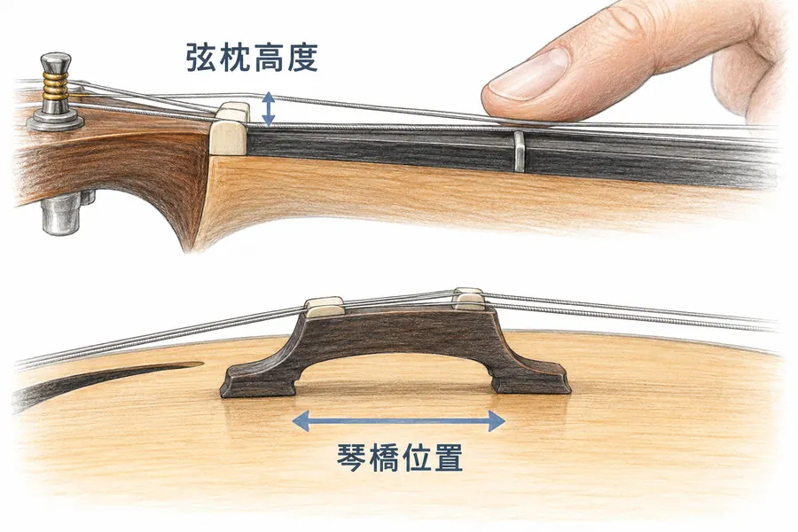

圖解 1.6　案例 手感與樂器設定（示意）

### 「很硬、很累」的琴也一樣

同樣的診斷思路，也適用於「很硬、很累」的琴。

演奏者可能先怪弦規，但下面任何一項都可能讓左手負擔增加：

- 上弦枕太高
- neck relief（琴頸前彎量）過大
- 琴橋太高
- scale 太長

最有效的做法是先建立基準。要記錄的有：

1. 目前的弦規
2. 空弦音準
3. 第一格高度
4. 十二格 action
5. relief
6. 琴橋位置

有了這六個數字，再逐項處理，才不會像在黑暗中亂轉螺絲。

### 先量、再判斷、最後才動手

所以，本書後面遇到每一個 setup、木材或型制問題，都會回到同樣的方法：

1. 先描述 **可觀察現象**。
2. 再找可能的 **結構原因**。
3. 最後才談 **調整或偏好**。

對曼陀林而言，這比背一組「標準數值」更可靠。

> **重要提醒**
>
> 涉及 neck reset（琴頸重做角度）、面板變形或大幅度琴橋重做時，本書後面會明確劃出 DIY 與專業維修的分界。
>
> 對歷史琴尤其如此：削掉原件往往不可逆，短期的改善手感，可能換來長期的收藏與結構損失。

第一章先建立「先量、再判斷、最後才動手」的習慣。後面所有選琴與維修章都會沿用。

## 自我學習題庫

學習檢查：作答、核對、複習

先自己作答，再看答案。答錯時回到本章相關小節重新讀一次。

**1. 標準曼陀林通常有幾組複弦？**

- A. 2 組
- B. 4 組
- C. 6 組
- D. 8 組

**2. 標準曼陀林由低到高常見調弦是？**

- A. E–A–D–G
- B. G–D–A–E
- C. C–G–D–A
- D. G–C–E–A

**3. 浮動琴橋位置改變，最直接可能影響什麼？**

- A. 琴漆顏色
- B. 有效弦長與音準
- C. 琴頭重量
- D. 木材學名

**答案：1.B　2.B　3.B**

## 本章主要查證來源

查證來源：找原文、核條件、留紀錄

| **編號** | **來源與用途** |
|---|---|
| 〔F01〕 | James Tyler & Paul Sparks，*The Early Mandolin*，Oxford University Press, 1992。早期 mandolino 與 Neapolitan mandoline 的結構、曲目與歷史演奏研究。 |
| 〔F03〕 | The Metropolitan Museum of Art，*Mandolino, Rome, ca. 1710*，Met 2008.2a, b。典型早期羅馬 mandolino；六組腸弦、鐮刀形琴頭與歷史改造痕跡。 |
| 〔F04〕 | The Metropolitan Museum of Art，*Mandolin, Antonius Vinaccia, Naples, 1781*，Met 89.4.2140。八弦、四組複弦、與小提琴同音高及那不勒斯式折面面板等實物資料。 |
| 〔F08〕 | Quintavalla et al.，*The Acoustics of Traditional Italian Mandolins and Their Relation with Soundboard Wood Properties*，International Journal of Wood Culture 2, 2022。1906 那不勒斯、1908 米蘭與羅馬式等現代義大利曼陀林聲學比較。 |
| 〔F10〕 | United States Patent Office / Google Patents，*US598245A – Mandolin, Orville H. Gibson*，Patented 1898-02-01。Orville Gibson 一體式 rim/neck/head、carved top/back 與 hollow neck 的原始專利。 |
| 〔F11〕 | The Metropolitan Museum of Art，*Mandolin, Orville Gibson, 1898*，Met 2015.643a–c。與 1898 專利設計一致的現存實物。 |
| 〔F13〕 | Robert A. Margo / Classical Mandolin Society of America，*Music Notation for Mandolin Family Instruments*，v3, 2019。家族調弦、記譜與 Mandola／Octave Mandolin 等地域名稱差異。 |
| 〔F14〕 | Liuteria Calace，*Mandolini – official specifications*，accessed 2026-10-06。33.5 cm 弦長、圓背 ribs、雲杉面板等現行曼陀林規格。 |
| 〔F26〕 | 鈴木バイオリン製造 / Suzuki Music，*2017 string-instrument catalog*，2017。M-30、M-100、MD-4、MD-10、MC-836 等日本家族規格與弦長。 |

連結：

- 〔F01〕https://academic.oup.com/book/49300
- 〔F03〕https://www.metmuseum.org/art/collection/search/505783
- 〔F04〕https://www.metmuseum.org/art/collection/search/504543
- 〔F08〕https://www.sciencedirect.com/org/science/article/pii/S2772318622000017
- 〔F10〕https://patents.google.com/patent/US598245A/en
- 〔F11〕https://www.metmuseum.org/art/collection/search/700485
- 〔F13〕https://classicalmandolinsociety.org/wp-content/uploads/Music_Notation_for_Mandolin_Family_Instruments_v3.pdf
- 〔F14〕https://www.calace.it/en/mandolini
- 〔F26〕https://www.suzuki-music.co.jp/app/uploads/2017catalog14.pdf

從早期樂器讀到世界傳播，再以調弦、音域與結構辨認各種曼陀林。

閱讀範圍　第 2 章至第 6 章
