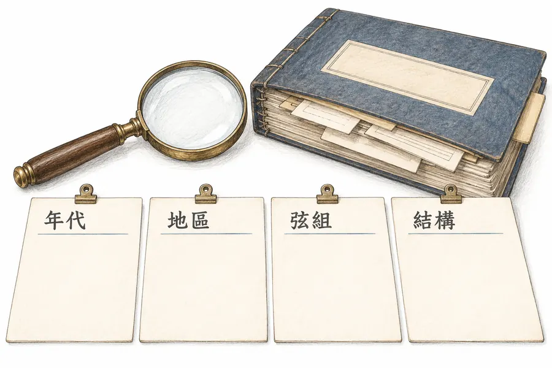
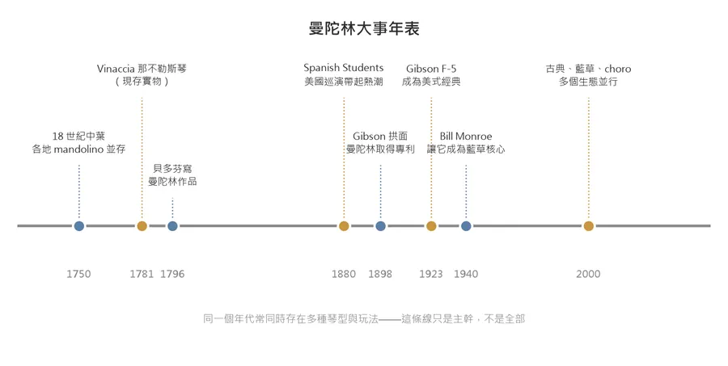
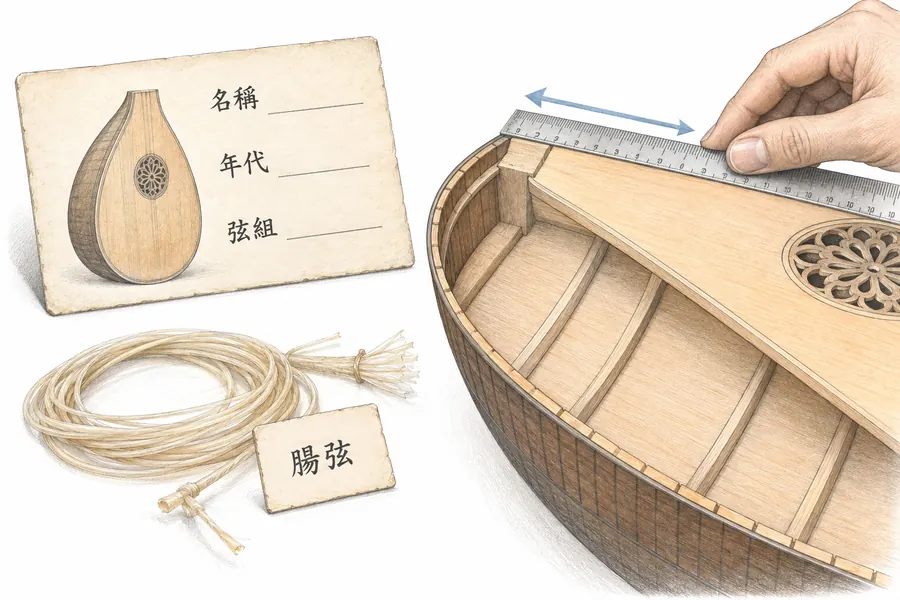
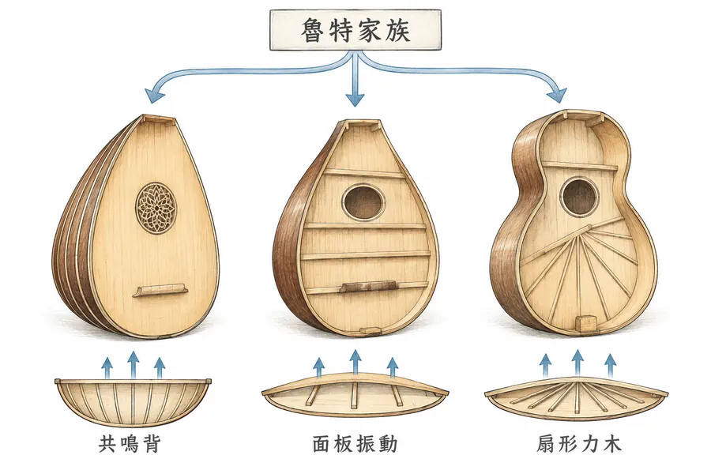
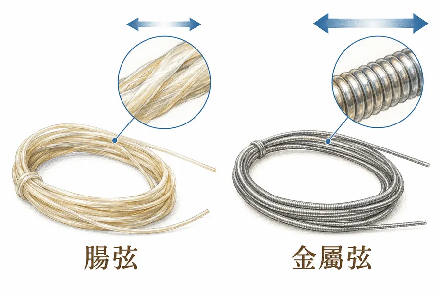
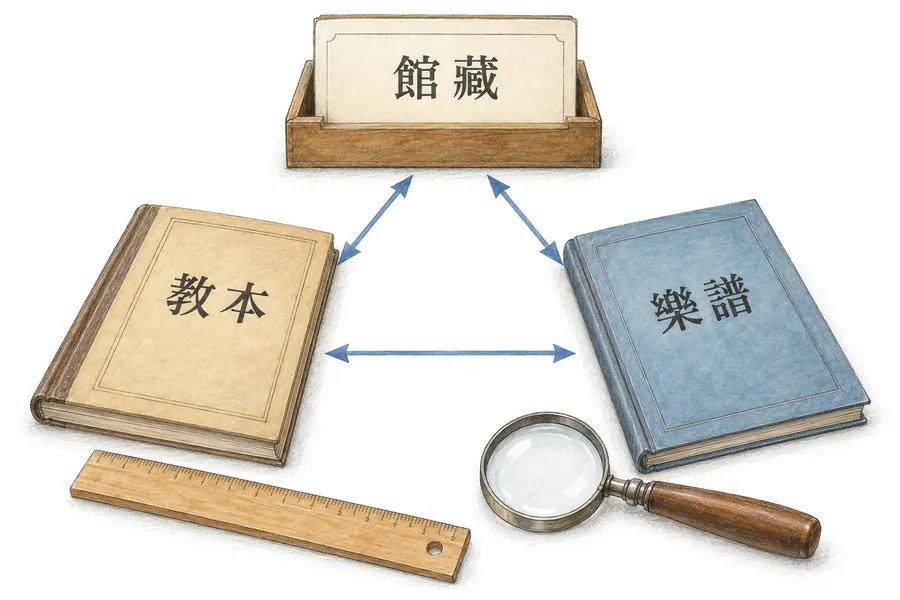
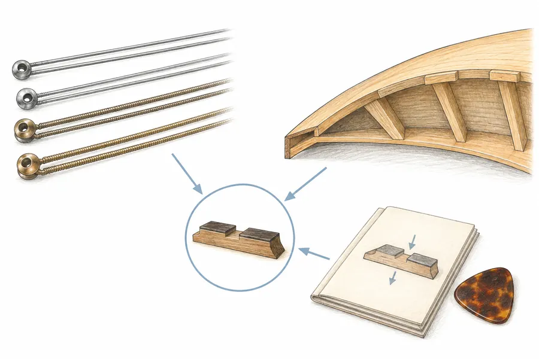

*現代曼陀林之前：名稱、腸弦、弦組與歷史證據*

## 本章重點

- 十七、十八世紀的 **mandola（曼陀拉）、mandolino（小曼陀林）、mandore（曼多爾）** 等名稱，在不同城市、語言與文獻裡並沒有現代商品目錄那麼固定。
- 同名樂器可能有不同的 course 數；同類結構也可能使用不同名稱。**看名稱不如看結構。**
- 早期 mandolino 常使用 **腸弦（gut strings）**，和後來全面金屬弦的那不勒斯琴是兩套不同條件。
- 義大利早期曼陀林文化是 **多個系統同時存在**（羅馬、米蘭、熱那亞、那不勒斯），不是一條單線演化。
- 「誰發明了曼陀林」通常不是好問題。比較有用的是問：**哪些結構在什麼時間開始同時出現？**
- 歷史資料互相衝突時，本書的做法是 **保留差異、說明證據**，而不是挑一個順眼的。

## 一條太整齊的演化線，通常不可靠

曼陀林歷史最容易出錯的地方，是太快找到一條看起來很整齊的演化線：

某件中世紀梨形撥弦樂器 → mandore → mandolino → 今天的曼陀林。

這種故事很適合畫成一張漂亮的家族樹。但它往往犧牲了真實歷史的複雜度。

十七、十八世紀的 mandola、mandolino、mandore 等名稱，在不同城市、語言和文獻裡，並沒有像現代商品目錄那樣固定。

- 同一個名稱，可能指到不同 course 數的樂器。
- 同一類結構，也可能在不同地方使用不同名稱。

所以本章用 **實物、樂譜與文字紀錄** 來說明早期曼陀林的發展。

## 歷史名稱不要直接套現代規格：四件實物速覽

| **案例** | **年代／地區** | **Course／弦材** | **關鍵特徵** | **來源** |
|---|---|---|---|---|
| **Roman mandolino**（羅馬式） | ca. 1710 羅馬 | 現況 6 course／gut（腸弦） | 概述與技術欄對單／雙弦細節記錄不同；曾擴增 course | F03/F27 |
| **Genovese**（熱那亞式） | 18 世紀 熱那亞 | 6 對 gut | 吉他式 peg block（弦軸座）；特殊調弦 | F05 |
| **Milanese Presbler**（米蘭式） | 1796 米蘭 | 6 對 | 與低八度 mandola 配套 | F06 |
| **Neapolitan Vinaccia**（那不勒斯式） | 1781 那不勒斯 | 4 對／金屬 | G–D–A–E；折面 top（面板） | F04 |

圖解 歷史名稱不要直接套現代規格：四件實物速覽（示意）

## 2.1　Mandolino 的歷史規格

*圖 E　曼陀林大事年表。同一個年代常同時存在多種琴型，這條線只是主幹。*

今天在義大利語裡，mandolino 可以很自然地指現代曼陀林。

但研究十七、十八世紀時，這個字**不能直接套用**今日八弦 G–D–A–E 的定義。

《The Early Mandolin》把早期 mandolino（古曼陀林）與那不勒斯 mandoline（那不勒斯曼陀林）分成不同部分討論。

原因就在於：兩者在弦材、course、調弦和演奏方式上有明顯差異。〔F01〕

### 一個「館藏資料自己打架」的案例

Met 約 1710 年的羅馬 mandolino 是一個很好的案例，也提醒我們：館藏資料要**逐欄閱讀**。

| **同一頁面的不同欄位** | **說了什麼** |
|---|---|
| 概述欄 | 稱它為 six double courses（六組雙弦） |
| 技術描述欄 | 記錄為 **五組雙弦加一組高音單弦** |
| 技術描述欄（續） | 指出指板在十八世紀曾被加寬，使原本五個 course 增為現況六個 course |

遇到這種欄位不完全一致的情況，本書會保留兩種記錄，再把可以確定的部分分開說明：

- 這件樂器 **曾經改造**。
- 現況有 **六個 course**。
- 規格和現代八弦 G–D–A–E 系統 **不同**。〔F03〕

圖解 2.1　Mandolino 的歷史規格（示意）

### 另一個名稱：mandolino del vecchio tipo

Met 的另一份出版資料，把這類小型、鐮刀形琴頭、四至六組腸弦的樂器稱為 **mandolino del vecchio tipo**（舊型曼陀林）。

資料並指出，它們常以 **手指撥奏**，而不是現代那不勒斯式的撥片邏輯。〔F27〕

這個例子正好提醒：如果只看到「mandolino」三個音節就直接翻成「八弦曼陀林」，會把整個早期演奏實務改寫掉。

### 權威機構也會有需要校勘的地方

這個 Roman mandolino 的資料衝突，還有方法論上的意義。

博物館網頁也可能同時包含不同年代、不同作者整理的概述與技術欄。

研究者不能因為來源是權威機構，就停止比對。

更好的做法是：

1. 記錄「**哪一欄** 說了什麼」。
2. 必要時回到照片、館藏論文與後續研究。

> 權威來源降低錯誤機率，卻不代表每個欄位永遠不需要校勘。

### 那讀者該怎麼判斷？

最實用的方式是先抓住 **不矛盾的核心**：

| **可以確定的** | **內容** |
|---|---|
| 年代 | ca. 1710 |
| 類型 | Roman type（羅馬式） |
| 弦材 | gut strings（腸弦） |
| 琴頭 | sickle-shaped pegbox（鐮刀形弦軸箱） |
| 改造 | 曾從原本五 course 改為現況六 course |

至於第六 course 在現況究竟是成對或單弦，則應該把館藏的兩種表述並列，清楚標示 **尚待確認** 的部分。

## 2.2　魯特家族與樂器分類

樂器學上把曼陀林放進 **lute（魯特琴）** 類的弦鳴樂器，是因為它具備共同結構：

- 有琴頸
- 琴弦大致平行於面板
- 以撥奏發聲

這種分類有助於比較。

但「同屬 lute family（魯特家族）」不代表它們之間，一定有一條直接、連續、只往一個方向發展的血緣線。

中世紀到近世的歐洲撥弦樂器，彼此借用琴體形狀、course、琴頭和調弦思維。

名稱也會在義大利文、法文等不同語境裡漂移。

### Oud 不是直接變成曼陀林

Tyler 與 Sparks 在談 origins（起源）時，確實把較早的梨形、圓背小型撥弦樂器，放進一個大背景裡。

這個背景是西方伊斯蘭文化、oud（烏德琴）與歐洲 lute 之間長時段的交流。

但這**不等於**「oud 直接變成現代曼陀林」。

更精確的說法是：

> 如果沒有中世紀以來在地中海世界流動的撥弦樂器結構與演奏文化，就不會有後來義大利 mandola／mandolino 的技術土壤。

真正能被追到現代曼陀林的具體結構，則需要靠近十七、十八世紀的實物與文獻再判斷。〔F01〕

圖解 2.2　魯特家族與樂器分類（示意）

### 保守的寫法，其實更有解釋力

這種寫法看似比較保守，其實更有解釋力。

它允許我們承認不同地區同時存在平行發展，也能避免「只要梨形圓背就是曼陀林祖先」的錯誤。

對收藏者來說尤其重要：**一把古老梨形樂器的價值與身份，不能靠視覺相似度決定。**

廣義 lute 類分類的另一個好處，是讓我們能比較「功能相似的部位」，而不必假設直接血緣。

| **可以比較的** | **不能假設的** |
|---|---|
| bowlback 都用曲面 shell（琴背殼體）取得剛性，但 ribs（琴背木條）數、材料與 soundboard（面板）受力可以完全不同 | 不代表這些琴有同一條血緣線 |
| 長頸或短頸會改變可用弦長與左手空間 | 不代表長頸一定比短頸早出現 |

這套分類用來比較 **結構與功能**；親緣關係仍需另外查證。

### 所以，本書會把問題拆成幾層

後面遇到「某樂器是曼陀林祖先嗎」時，會把問題拆成四層：

1. **名稱** 是否有連續證據？
2. **結構** 是否有連續證據？
3. **調弦與演奏法** 是否相近？
4. 是否能找到 **中間年代** 的實物或文獻？

只有多個層次都支持，才適合使用較強的演化語氣。〔F01〕

## 2.3　腸弦與金屬弦的差異

早期 mandolino 常使用腸弦（gut strings）。

Tyler 與 Sparks 對演奏者與製作者的實務說明指出：

- 早期 mandolino 的弦材以 gut 為基本。
- 粗細依 course 改變。
- 即使十七世紀後半開始出現 **纏弦（wound strings）**，也主要用於 **低音 course**。〔F01〕

這種材料條件意味著：弦張力、觸感、起音與延音，都和後來全面金屬弦的那不勒斯曼陀林不同。

### 換弦材，等於換掉整套系統

弦材同時影響音色、張力與結構負荷。

當張力和單位長度質量改變，製琴師必須重新思考：

- 面板剛性
- 琴橋壓力
- 琴頸負荷
- 支撐方式

2024 年對 1784 Joseph Filano 那不勒斯曼陀林的研究，把它視為晚期巴洛克轉型的重要例子。

這把樂器已經具有折面 soundboard 與八弦配置。研究團隊把它放在 **從 gut／mixed strings 走向金屬弦的過渡脈絡** 裡。〔F07〕

圖解 2.3　腸弦與金屬弦的差異（示意）

### 為什麼 tremolo 會變得重要

腸弦轉向金屬弦的過程，同時牽動結構與演奏法。

| **層面** | **發生什麼變化** |
|---|---|
| 結構 | 更高張力，需要更強的結構 |
| 發聲 | 撥片能帶來更清楚的 attack |
| 技巧 | 演奏者逐步發展出適合短促、明確起音的方法 |
| 結果 | 顫音成為歌唱性長線條的重要工具 |

後來 tremolo（顫音）之所以能成為歌唱性長線條的重要工具，也和這種發聲條件密切相關。

### 腸弦的老問題：怕濕、怕不勻

腸弦還受到溫濕度與製造均一性的限制。

這使歷史調音穩定度與現代鋼弦不能直接相比。

演奏者在理解早期曲目時，如果用現代鋼弦琴的反應去想像原曲，往往會 **高估** 兩件事：

- 起音的銳利度
- 延音的一致性

> 這不表示古樂一定「柔」。而是材料條件會改變可行的 articulation（運音方式）。〔F01〕

### 1784 Filano：一個「資料本身有層次」的案例

Filano 1784 的研究特別值得注意，因為文章在不同段落對弦的現況與歷史脈絡，採用了不同的描述：

| **文章的不同部分** | **描述** |
|---|---|
| 樂器說明 | 記錄 **八根金屬弦** |
| 研究目的段落 | 把它視為 **mixed gut–metal 向金屬弦過渡** 的重要案例 |

本書因此**不把它簡化成**「1784 已全面完成鋼弦革命」，而把它當成 **轉型期的實物證據**。〔F07〕

## 2.4　羅馬、米蘭與熱那亞傳統

早期義大利曼陀林文化，最值得記住的重點是 **「同時存在多個系統」**。

| **傳統** | **代表實物** | **弦組** | **特徵** |
|---|---|---|---|
| **羅馬（Roman）** | 約 1710 年 mandolino | 多組腸弦 | 鐮刀形琴頭 |
| **米蘭（Milanese）** | 1796 Presbler mandolin | 六對弦 | 與一把低八度 mandola 成套製作 |
| **熱那亞（Genovese）** | 18 世紀 Nonnemacker 樂器 | 六對腸弦 | 調弦比現代吉他高一個八度；使用類似吉他的 peg block |

〔F03〕〔F05〕〔F06〕

圖解 2.4　羅馬 米蘭與熱那亞傳統（示意）

這些差異的重點在於：各自擁有不同的 **弦數與調弦邏輯**。

例如 Presbler 的 Milanese mandolin 有六組複弦，與後來四組 G–D–A–E 的那不勒斯系統完全不同。

它配套的 mandola 則低一個八度。這顯示「家族化」的思考在不同地區很早就存在，只是名稱和規格未必和現代相同。〔F06〕

### 談 Vivaldi、Handel 時要注意什麼

也因為如此，談 Vivaldi（韋瓦第）、Handel（韓德爾）或早期 mandolino 曲目時，不能把現代那不勒斯琴當成唯一的歷史樂器。

現代琴當然可以演奏改編版。

但如果要研究 **原始演奏法**，就必須把作品年代、音域與當時可用的 mandolino 型制一起考慮。

### 十八世紀就已經有「家族」概念

Presbler 的成對 mandolin／mandola 也透露一個常被忽略的觀念：

十八世紀製琴師已經會用「同一套結構語彙、不同音域」來思考家族樂器。

這和後來完整的 mandolin orchestra（曼陀林樂團）家族不是同一制度。

但它說明：把高音樂器向低八度延伸，**並非十九世紀末才突然出現** 的想法。〔F06〕

> **常見誤解**：今天說「mandola」，就以為歷史上所有低音親族都可以自動翻成現代的 C 調 mandola。
>
> **其實**：名稱相似只是第一層。真正決定能不能原音重現的，是 **tuning（調弦）、course 與音域**。

## 2.5　歷史樂器的證據判讀

保存下來的實物最直觀，但它不是唯一證據。

老樂器可能改造、換弦、換琴橋，甚至重做指板。標籤也可能被移植。

因此研究者會把實物和下面這些資料互相比對：

- 樂譜
- 教本
- 廣告
- 圖像
- 製琴師標籤
- 尺寸紀錄

如果某批樂譜要求低於某種調弦能演奏的音域，就表示「名稱看起來對」還不夠。

### 樂譜也是樂器史料

作品中的這些細節，都會透露原本的弦組結構：

- 和弦排列
- 最低音
- 雙音
- 換弦可能性
- scordatura（變格調弦）

《The Early Mandolin》之所以花大量篇幅整理 primary music sources（第一手樂譜史料），就是因為曲目能幫助還原樂器的實際能力。

實物與音樂資料，因此可以互相補充。〔F01〕

圖解 2.5　歷史樂器的證據判讀（示意）

### 圖像要更小心

圖像則需要更小心。

畫家可能為了美觀而改變比例。肖像中的樂器也可能是象徵，而不是精確記錄。

最可靠的方法，是讓 **不同類型的證據彼此支持**。

這套方法後面也會用在品牌型號研究：實物、型錄與官方規格互相核對，缺一不可。

### 尺寸是很重要的交叉證據

如果標籤聲稱某琴屬於特定型制，但下列項目和已知館藏群體相差極大，就需要提高警覺：

- 弦長
- 琴體比例
- course 數

這不一定代表偽造。也可能是：

- 地方變體
- 後期改造
- 錯誤標示

研究者會依證據強弱排列可能原因，並標示仍待確認的部分。

### 二手市場照片：有用，但不能當規格書

同樣地，二手市場照片可以非常有價值，因為它可能保存少見的標籤與結構。

但市場描述不適合直接當作製造規格。

後面第 20 章的型號資料庫沿用的原則，就是把 **「型號存在」「木材」「年代」「價格」** 分開評估可信度。

這樣一來，每個欄位都有對應的證據。

## 2.6　現代曼陀林形成的條件

當我們從十七世紀一路看到十八世紀，就會發現：現代那不勒斯曼陀林不是從某一天突然誕生。

在那之前，已經存在：

- 圓背琴體
- course 的觀念
- 腸弦
- 不同的調弦
- 小型撥弦樂器傳統

那不勒斯製琴師真正做到的，是把其中部分元素 **重新組合**。

他們逐步把這些元素穩定成一套新系統：適合較高張力、適合撥片、採用四組五度調弦。

### 「誰發明了曼陀林」不是好問題

所以，「誰發明了曼陀林」通常不是一個好的歷史問題。

比較有用的問題是：

1. 哪些 **結構** 在什麼時間開始 **同時出現**？
2. 哪些 **工坊** 留下足夠的實物？
3. 哪些 **演奏法** 隨之成長？

等到這些條件交會，我們才比較有資格說某個型制已經接近後來的現代標準。

圖解 2.6　現代曼陀林形成的條件（示意）

### Vinaccia 家族為什麼重要

下一章轉入那不勒斯時，會看到 Vinaccia 家族的重要性正是如此。

它之所以重要，**主要原因是有多件可研究的實物**，能把下列元素串成一條可查證的發展線：

- 四組複弦
- 折面面板
- 金屬弦
- 當地製琴文化

一句「發明者」傳說並非主要因素。〔F04〕〔F07〕

### 為什麼不同研究會給出不同年代？

把焦點從「第一把」移到「系統何時穩定」，還能解釋為什麼不同研究可能給出不同年代。

| **研究者重視的標準** | **可能得到的年代** |
|---|---|
| 以最早八弦實物為界 | 較早 |
| 以金屬弦與折面面板同時出現為界 | 中間 |
| 重視十九世紀教本與市場標準化 | 較晚 |

這些答案不一定互相矛盾。它們可能只是在回答不同的「形成」定義。

本書以 **「十八世紀中後期逐漸形成」** 描述這段發展，讓時間範圍符合現有證據。

> 歷史的精確，不等於數字越細越好。
>
> 精確，是讓 **語氣和證據強度相配**。〔F01〕〔F04〕〔F07〕

## 自我學習題庫

學習檢查：作答、核對、複習

先自己作答，再看答案。答錯時回到本章相關小節重新讀一次。

**1. 研究早期 mandolino 時，最安全的做法是？**

- A. 看到名稱就套現代規格
- B. 同時看年代、地區、弦組與實物
- C. 只看外觀
- D. 只看網路賣場

**2. 早期 mandolino 常見的弦材之一是？**

- A. 尼龍
- B. 腸弦
- C. 碳纖維
- D. 鋁線

**3. 歷史資料互相衝突時，本書建議？**

- A. 選最順眼的一個
- B. 保留差異並說明證據
- C. 全部刪掉
- D. 以價格最高的為準

**答案：1.B　2.B　3.B**

## 本章主要查證來源

查證來源：找原文、核條件、留紀錄

| **編號** | **來源與用途** |
|---|---|
| 〔F01〕 | James Tyler & Paul Sparks，*The Early Mandolin*，Oxford University Press, 1992。早期 mandolino 與 Neapolitan mandoline 的結構、曲目與歷史演奏研究。 |
| 〔F03〕 | The Metropolitan Museum of Art，*Mandolino, Rome, ca. 1710*，Met 2008.2a, b。典型早期羅馬 mandolino；六組腸弦、鐮刀形琴頭與歷史改造痕跡。 |
| 〔F04〕 | The Metropolitan Museum of Art，*Mandolin, Antonius Vinaccia, Naples, 1781*，Met 89.4.2140。八弦、四組複弦、與小提琴同音高及那不勒斯式折面面板等實物資料。 |
| 〔F05〕 | The Metropolitan Museum of Art，*Mandola o mandolino alla Genovese, Christian Nonnemacker, 18th c.*，Met 89.4.1069。六組成對腸弦、吉他式琴頭與熱那亞式調弦案例。 |
| 〔F06〕 | The Metropolitan Museum of Art，*Giuseppe Presbler Mandolin and Mandola, 1796/1797*，Met 1989.344.1–2。米蘭式六組複弦曼陀林與低八度 mandola 的配套實物。 |
| 〔F07〕 | Quintavalla et al.，*Acoustical Survey and Finite Element Analyses of Late Baroque Mandolin*，International Journal of Wood Culture, 2024。1784 Joseph Filano 那不勒斯曼陀林；混合／金屬弦轉型、折面、材料與聲學調查。 |
| 〔F27〕 | The Metropolitan Museum of Art，*Recent Acquisitions 2007–2008: Roman mandolino ca. 1710–20*，Met Bulletin 66(2)。mandolino del vecchio tipo：小型、鐮刀形琴頭、四至六組腸弦、以手指撥奏。 |

連結：

- 〔F01〕https://academic.oup.com/book/49300
- 〔F03〕https://www.metmuseum.org/art/collection/search/505783
- 〔F04〕https://www.metmuseum.org/art/collection/search/504543
- 〔F05〕https://www.metmuseum.org/art/collection/search/501651
- 〔F06〕https://blog.metmuseum.org/guitarheroes/mandola-1797/
- 〔F07〕https://www.sciencedirect.com/org/science/article/pii/S2772318624000018
- 〔F27〕https://resources.metmuseum.org/resources/metpublications/pdf/Recent_Acquisitions_A_Selection_2007_2008_The_Metropolitan_Museum_of_Art_Bulletin_v_66_no_2_Fall_2008.pdf
