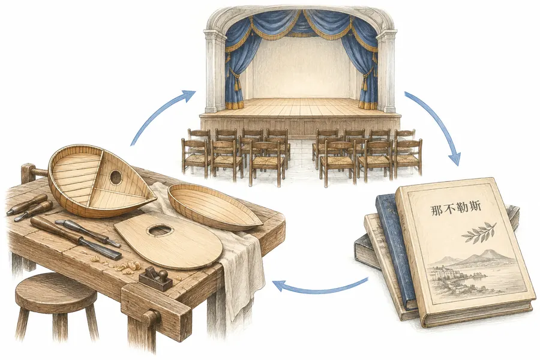
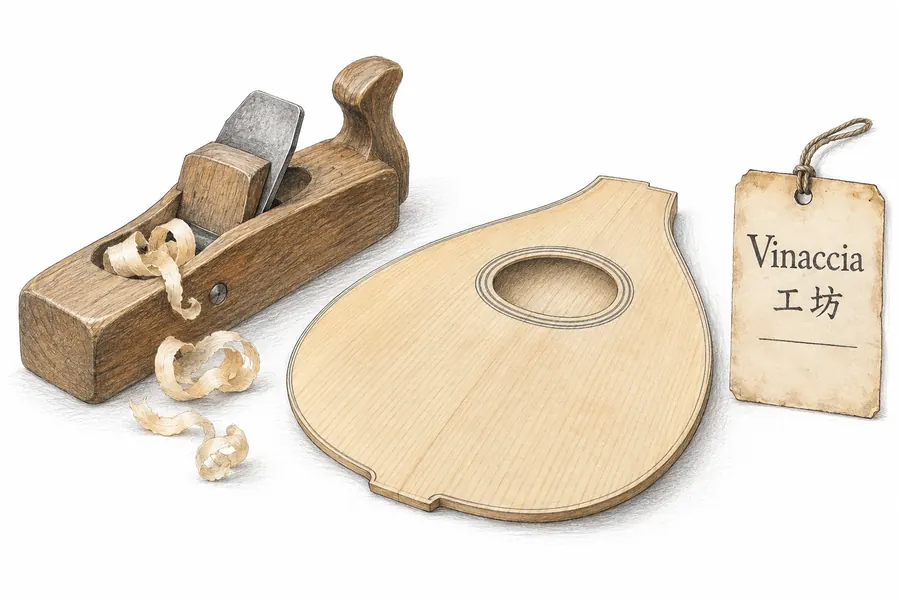
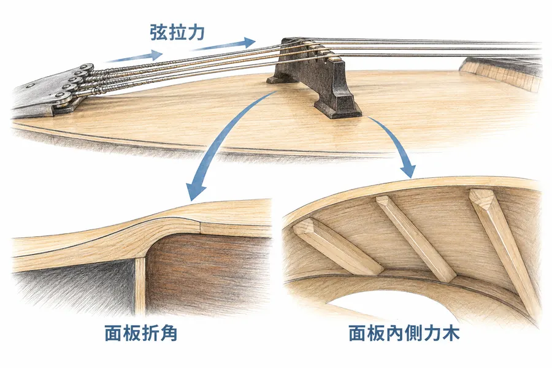
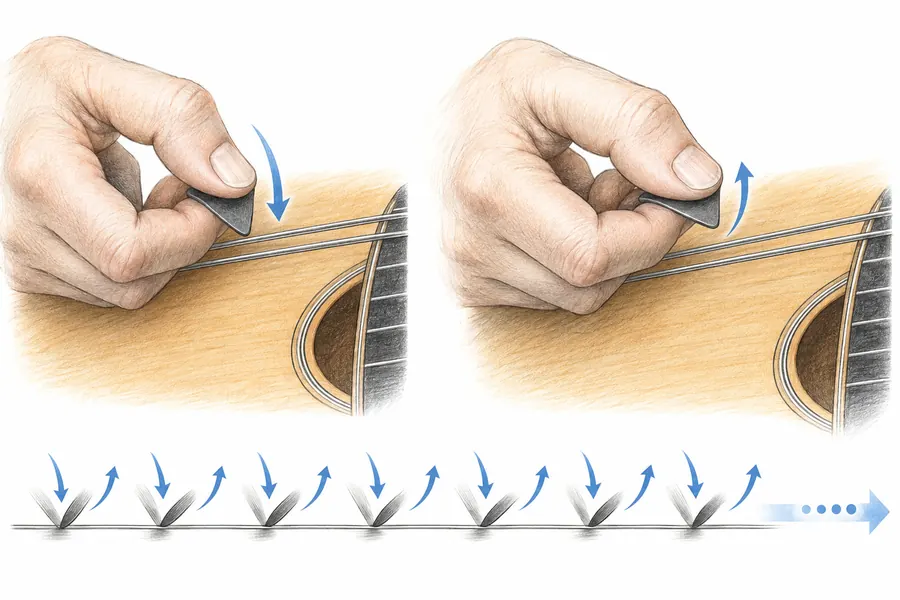
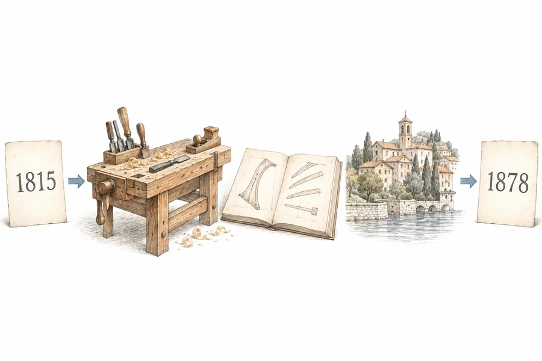
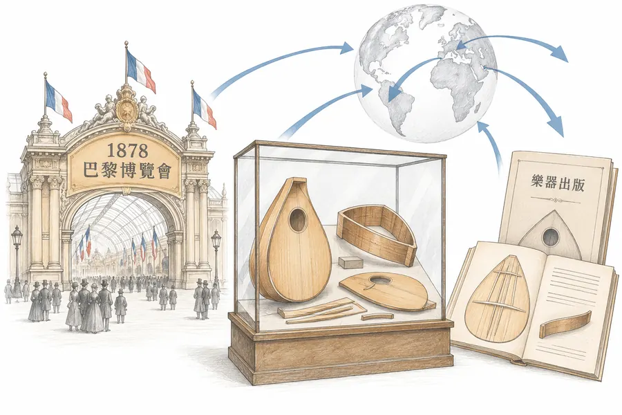
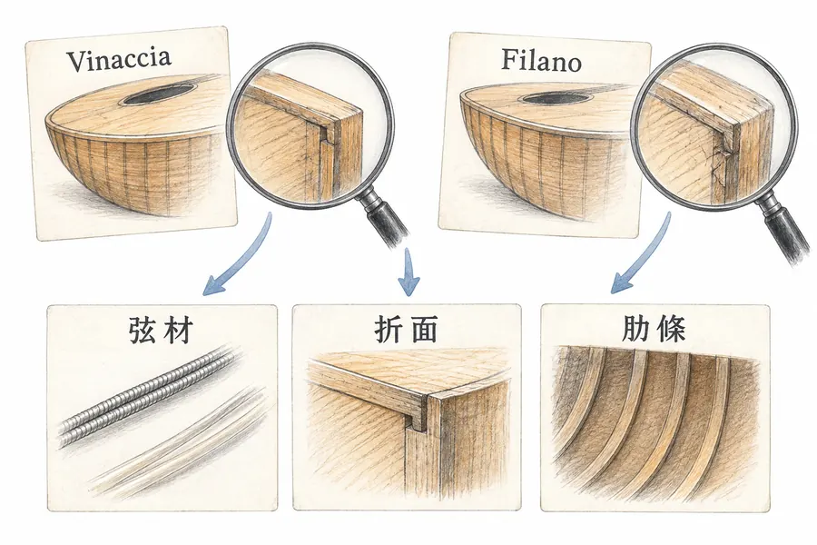

*那不勒斯、Vinaccia 家族、金屬弦與十九世紀的曼陀林*

## 本章重點

- 十八世紀的那不勒斯是歐洲重要的大城市與音樂中心，歌劇、街頭音樂、家庭娛樂、教學與製琴業同時存在。
- 一種琴型要長期穩定，需要 **足夠多人製作、購買、演奏與教學**，不只是好設計。
- **Vinaccia 家族「重要」，不等於「單一發明」**。博物館用的是「probably designed by a member of the Vinaccia family」這種保留語氣。
- **金屬弦** 帶來更直接的 attack 和更高張力，也把負荷送進面板。製琴師因此增加支撐，並在琴橋附近做出 **折面（bend）**。
- **tremolo（顫音）** 不是裝飾性炫技，而是為了解決撥弦樂器「撥片離弦後能量就衰減」的物理限制。
- 1815–1878 這段「不像黃金時代」的時期，反而可能是型制標準化真正發生的時候。

## 為什麼是那不勒斯？

那不勒斯在曼陀林史中的重要性，不只是因為一種琴用這座城市命名。

十八世紀的那不勒斯是歐洲重要的大城市與音樂中心。當時同時存在：

- 歌劇
- 街頭音樂
- 家庭娛樂
- 教學
- 製琴業

製琴師有足夠的市場可以反覆改良樂器，演奏者也有足夠的場合可以發展技巧。

Met 的研究指出，Vinaccia 與 Fabricatore 等家族在當地撥弦樂器製作上具有關鍵地位。

而那不勒斯到了十八世紀末，已成為義大利半島最重要的弦樂器生產中心之一。〔F09〕

本章要回答的重點是：**它為什麼能成為後來全球最有影響力的型制？**

答案同時涉及五件事：弦材、面板受力、製琴工坊、城市娛樂文化，以及十九世紀的出版市場。

只有把這些因素放在一起，才能理解八弦、四組複弦和 tremolo 為什麼最後變成多數人心中「曼陀林」的典型形象。

## 3.1　城市音樂與製琴文化

樂器型制要長期穩定，需要的不只是好設計。

它還需要足夠多的人 **製作、購買、演奏與教學**。

十八世紀的那不勒斯具備這種生態。

Met 的 Guitar Heroes 研究把當地放在更大的製琴史裡。

城市已有成熟的提琴與鍵盤樂器製作傳統。Gagliano、Vinaccia、Fabricatore 等家族，也在不同弦樂器上累積工藝。

到了十八世紀末，那不勒斯已是義大利重要的弦樂器製造中心。〔F09〕

圖解 3.1　城市音樂與製琴文化（示意）

### 從「好設計」到「一套系統」

這種城市環境讓樂器能持續改良。

- 製琴師可以根據演奏者的需要，逐步調整面板、bracing、琴橋與琴肚。
- 演奏者則會把更有投射力的新琴，帶進歌唱伴奏、室內娛樂與舞台。

當某種結構能被工坊 **穩定重複製作**，又有 **教學和曲目支持**，它才真正成為一套「系統」。

### 工坊不只做曼陀林

那不勒斯的製琴生態還有一個重要特點：**工坊並不只服務單一樂器**。

Met 對 Fabricatore 等家族的資料顯示，當地製琴師同時參與吉他與其他撥弦樂器的改良與量產。

這種跨樂器的工藝環境，會讓琴橋、裝飾、琴頸和弦材的技術互相流動。

因此，曼陀林的成熟不宜和整個城市的撥弦樂器產業切開來看。〔F09〕

### 經濟條件也是音樂條件

從經濟角度看，一個型制能長期留下來，也表示工坊能：

- 重複取得材料
- 訓練工人
- 找到買家

這些看似「音樂以外」的條件，其實決定了某種樂器能不能從少數精品變成可持續的文化。

### 十九世紀的 canzone napoletana

那不勒斯式的歷史，包含工藝與音樂文化兩個面向。

十九世紀的 **canzone napoletana（那不勒斯歌曲）**、家庭娛樂與城市形象，後來反過來強化了曼陀林的文化辨識度。

這讓這件樂器不只是一種技術方案，也成為地方聲音的象徵。

## 3.2　Vinaccia 家族的貢獻

Vinaccia 家族在那不勒斯曼陀林史上的地位很高。

原因是：**有多件可研究的實物**，能把十八世紀中後期的結構特徵具體化。

### 1781 年 Antonius Vinaccia 曼陀林

這把琴具有：

| **特徵** | **內容** |
|---|---|
| 圓背 | 二十三條狹窄的 ribs（琴背木條） |
| 面板 | spruce（雲杉） |
| 弦 | 八根弦、四組複弦 |
| 面板 | 琴橋附近有折面 |

Met 直接把這些描述為 **Neapolitan school（那不勒斯學派）的典型特徵**。〔F04〕

圖解 3.2　Vinaccia 家族的貢獻（示意）

### 「重要」不等於「單一發明」

但歷史上「重要」不等於「單一發明」。

Met 的展覽文章以 Vinaccia 家族作為經典那不勒斯型制形成的重要工坊，卻也把它放在更廣的城市製琴傳統裡。

這種說法比「某位 Vinaccia 某年發明曼陀林」更可靠，因為我們知道：

- 十八世紀各地本來就存在多種 mandolino。
- 那不勒斯系統本身也經歷弦材和支撐結構的演變。〔F09〕

### 注意那個 "probably"

Met 的 Guitar Heroes 文章用 **「probably designed by a member of the Vinaccia family」** 來描述那不勒斯式的重要設計來源。

這個 **probably（大概、可能）** 很重要。

它反映博物館願意承認 Vinaccia 家族的核心角色，同時避免把現有證據推成一個確定的單一發明者。〔F04〕

> **常見誤解**：以為博物館已經「證明」Vinaccia 發明了現代曼陀林。
>
> **其實**：博物館用的字是 probably。這是刻意保留的。

### 專業書該怎麼寫？

對專業書來說，這種措辭值得模仿。

| **不建議的寫法** | **較好的寫法** |
|---|---|
| Vinaccia 發明了現代曼陀林。 | Vinaccia 家族保存下來的實物，是追蹤那不勒斯型制成熟最重要的一組證據。 |

後者資訊更多，也更不容易被新發現推翻。

### 研究製琴家族的正確方法

研究製琴家族時，最好用三個「可確認」來描述貢獻：

1. **可確認的實物**
2. **可確認的年代**
3. **可確認的結構**

如此一來，新史料出現時可以修正細節，便能逐項更新研究結論。

這也是本書後面處理 Gibson、Calace 與 Suzuki 歷史時採用的原則。

## 3.3　金屬弦、折面面板與力木

金屬弦讓曼陀林得到更直接的 attack 和更高的張力。

但它同時也把負荷送進面板。

2022 與 2024 年的研究都指出，那不勒斯現代型制的發展和提高弦張力有關。

為了承受這股靜態的力，製琴師做了兩件事：

1. **增加支撐**（bracing，力木）。
2. 在琴橋附近形成 **折面／bend**，讓面板在受力區獲得不同的幾何剛性。〔F07〕〔F08〕

### 1784 Joseph Filano：很有價值的過渡案例

研究團隊在米蘭的 **Museo degli Strumenti Musicali del Castello Sforzesco**（斯福爾扎城堡樂器博物館），對它進行 in-situ（現地）的聲學與結構調查。

這把琴的條件是：

| **項目** | **內容** |
|---|---|
| 弦 | 八根金屬弦 |
| 面板 | 雲杉 |
| 折面角 | 約八度 |
| 琴肚 | maple（楓木）ribs 構成 |

它**不是**「現代琴的完成版」。

但它清楚顯示：晚十八世紀的那不勒斯製琴，已經朝高張力系統前進。〔F07〕

圖解 3.3　金屬弦 折面面板與力木（示意）

### 「傳統」不是靜態複製

更重要的是，研究指出十九世紀以後的曼陀林 soundboard 出現了 **額外的 brace（力木）**，用來應付更高的弦張力。

這個細節讓我們理解：「傳統」並不是靜態複製。

看起來仍然是圓背和圓音孔，**內部支撐卻可能已經因材料與演奏需求而改變**。〔F08〕

### 高張力還會改變什麼？

高張力除了增加面板負荷，也會改變兩件事：

- 琴橋的接觸
- 琴頸的長期穩定需求

比較古琴時，要把 **折面、弦材與內部支撐** 一起觀察。

同樣的外觀特徵，如果搭配不同的弦材、bracing 與 top thickness（面板厚度），實際受力可能差很多。

聲學與結構研究的價值，就在於把視覺特徵放回 **力學系統** 裡。

### 對保存修復的關鍵提醒

對保存修復而言，這一點尤其關鍵。

> 老琴如果換上比歷史設計更高張力的現代弦，短期可能得到更大音量，長期卻可能增加 **面板、琴橋與琴頸** 的負荷。

能不能使用某一套弦，應該由 **樂器狀況與設計共同判斷**，確認琴弦張力符合該琴的承重能力。

## 3.4　顫音與歌唱性旋律

撥弦樂器有一個物理限制：

**能量在撥片離弦後就開始衰減。**

演奏者不像小提琴手那樣，能用弓在同一個音上持續輸入能量。

當曼陀林被要求演奏歌唱性旋律時，這個限制就變成一個音樂問題。

tremolo 的核心功能，就是用 **規律的重複起音**，讓聽覺把一連串脈衝整合成比較連續的聲線。

> **比喻**：這就像電影。一格一格的靜態畫面，放映得夠快、夠穩，眼睛就會把它看成連續的動作。tremolo 做的就是讓耳朵做同樣的事。

### 好的 tremolo 和壞的 tremolo

成熟的顫音，把每一次起音連成 **均勻、有方向** 的旋律。

| **狀況** | **聽起來怎樣** |
|---|---|
| 重音、間距和撥片角度太明顯 | 聲音變成密集的機關槍 |
| 速度均勻、動態有方向 | 聽者能清楚聽見連續的旋律線 |

這也解釋了為什麼古典曼陀林教學會把 tremolo 和 **phrase（樂句）、crescendo（漸強）、換弦** 放在一起教。

速度練習與音樂表現，本來就該連在一起。

圖解 3.4　顫音與歌唱性旋律（示意）

### 教本代表技術的系統化

十九世紀末與二十世紀初的專業教本，像 **Carlo Munier** 與 **Raffaele Calace** 的方法，顯示曼陀林技術已經改變。

它從單純的「會彈曲子」，進入 **系統化訓練** 的時代。

這些教本比十八世紀晚得多，卻反映了同一件事。

那不勒斯型制成熟後，演奏語言如何被整理成可傳授的學派。

### 兩個層次：重複率與樂句形狀

好的 tremolo 還牽涉「重複率」和「樂句形狀」兩個層次。

| **問題** | **結果** |
|---|---|
| 重複率太慢 | 聽者會明顯聽到一顆一顆音 |
| 太快，但每一下力度不均 | 出現顆粒抖動 |
| 快慢適中、力度均勻 | 重複動作退到背景，由漸強、diminuendo（漸弱）與樂句方向成為前景 |

### 所以，不要只用「每分鐘幾下」來評分

因此教學上不宜只用「每分鐘多少下」來衡量 tremolo。

更好的練習順序是：

1. 先在 **慢速** 維持完全均勻。
2. 再用 **固定拍內密度** 做動態變化。
3. 最後把它 **放進旋律**。

這一點會在右手技法章再展開。

在歷史章先理解它的功能，就不會把 tremolo 誤解成 **裝飾性的炫技**。

## 3.5　1815 至 1878 年的發展

曼陀林的流行程度曾多次起伏。

Sparks 對 1815–1878 的研究指出：

- 早期 mandoline 與 mandolino 作為 **concert instruments（音樂會樂器）** 一度衰退。
- 這段時間，樂器在義大利以外幾乎不為大眾熟知。
- 但在義大利 **內部**，現代曼陀林的型制和使用方式仍在形成。〔F02〕

圖解 3.5　1815 至 1878 年的發展（示意）

### 「不像黃金時代」的時期，反而重要

這段時期反而很重要。

它讓我們看到：**標準化常常發生在市場相對局部的環境裡。**

製琴師與演奏家可以在地方傳統裡，慢慢把下面這些事固定下來：

- 弦組
- 琴橋
- 面板
- 曲目
- 教學

等到十九世紀後半樂器重新進入國際舞台時，它已經比十八世紀「多型並存」的 mandolino 世界 **統一得多**。

### 低潮與高標準化，可以同時發生

1815–1878 的「低潮」也提醒我們：不要把樂器史寫成流行度排行榜。

Sparks 一方面描述 mandoline／mandolino 作為 concert instruments 的衰退；另一方面，又把同一時期列為 **Italy and the Creation of the Modern Mandolin**（義大利與現代曼陀林的創造）。

換句話說：**舞台能見度下降的同時，內部的型制標準化反而可能正在發生。**〔F02〕

這種情況在樂器史並不少見：**公開熱潮和技術成熟不一定同步。**

工坊、教本和地方社群可以在國際市場不注意時繼續累積。

等到新的博覽會、巡演或移民網路出現，成熟的產品才突然被外界「發現」。

### 對中古琴鑑定的意義

現代那不勒斯曼陀林，是在十八世紀 Vinaccia 等工坊的基礎上持續發展的。

它是一條連續傳統中，不斷吸收 **高張力、bracing、指板與演奏需求** 的結果。

這點對中古琴鑑定也很重要：

> 兩把都叫 Neapolitan 的琴，如果相差一百年，內部與尺寸仍可能有相當差異。

## 3.6　巴黎博覽會與國際熱潮

Sparks 把 **1878 年巴黎博覽會** 視為曼陀林重新進入國際視野的重要節點。

義大利演奏者在展覽期間成功吸引法國觀眾。

之後，**circoli mandolinisti（曼陀林社團）**、教學與獨奏家活動逐漸增長。

同時，西班牙 **bandurria（班杜里亞琴）** 的演奏也影響了曲目和公眾想像。〔F18〕

圖解 3.6　巴黎博覽會與國際熱潮（示意）

### 「重新被看見」和十八世紀不一樣

「重新被看見」和十八世紀在宮廷／沙龍裡的流通，是兩件不同的事。

十九世紀後半已經有更成熟的：

- 樂譜出版
- 市民社團
- 工業生產
- 跨國巡演網路

一件樂器可以透過教本、俱樂部和商品市場快速複製。

這為 **1892–1918 的全球 virtuoso era（演奏家時代）** 奠定了條件。

### 黃金時代不是「忽然很多人喜歡」

所以，所謂曼陀林黃金時代，不應只理解成「忽然很多人喜歡」。

它是 **製琴、演奏、出版與社群組織同時擴張** 的結果。

下一章從全球傳播來看，就會更清楚看到每個地區如何把這套義大利系統改造成自己的文化。〔F19〕

### 博覽會讓不同撥弦傳統同場比較

巴黎博覽會的重要性，還在於它讓不同的撥弦傳統在同一個場合被比較。

Sparks 特別提到西班牙 bandurria players 對 repertoire（曲目）的影響。

這說明曼陀林的再流行，是在國際展覽與城市娛樂中，**和其他撥弦樂器互相模仿、競爭** 的結果。〔F18〕

### 教本的角色也變了

當一件樂器開始被大量業餘者學習，教本的作用也會改變。

| **學習者** | **怎麼解決手法問題** |
|---|---|
| 專業 virtuoso（演奏家） | 靠師徒與口傳細節 |
| 大量新手 | 需要標準化指法、記譜與練習曲 |

十九世紀末曼陀林教育出版的成長，和社團化是同一個市場現象的兩面。

## 3.7　案例：Vinaccia 與 Filano 的結構比較

1781 Vinaccia 和 1784 Filano 年代接近，卻分別由不同種類的證據來呈現：

| **樂器** | **主要證據類型** | **能看到什麼** |
|---|---|---|
| 1781 Vinaccia | 博物館館藏描述 | 高度裝飾、23 ribs、八弦四 course、那不勒斯折面 |
| 1784 Filano | 現代聲學調查 | 材料辨識、面板裂縫、聲學量測、有限元素分析 |

後者讓我們看到：一把晚巴洛克曼陀林實際上是 **如何振動** 的。〔F04〕〔F07〕

圖解 3.7　案例 Vinaccia 與 Filano 的結構比較（示意）

### 「形式相似」不等於「完全相同」

兩者放在一起最有價值的地方，是避免把「形式相似」等同「完全相同」。

同一時期不同工坊的 ribs 數、材料與細節可以不同。

即使都是那不勒斯琴，也不應反推每一件都使用同樣木材或同樣 bracing。

> 館藏告訴我們 **個體是什麼**；研究則幫我們理解 **系統如何工作**。

### 這也是全書查證原則的縮影

| **你手上有的證據** | **你可以寫到多確定** |
|---|---|
| 只有外觀照片 | 只描述外觀 |
| 有原廠／博物館資料 | 才把材料和尺寸寫得更確定 |
| 有聲學研究 | 再討論結構如何影響振動 |

### 館藏照片不是結論

這兩件實物還能用來理解「館藏照片不是結論」。

| **證據類型** | **看得出** | **看不出** |
|---|---|---|
| 照片 | 外形、裝飾、部分材料 | 面板厚度、局部 stiffness（剛性）、模態 |
| 有限元素模型 | 幫忙解釋振動 | 必須建立在可靠幾何與材料參數上 |

不同證據各有盲點，互補才有力量。〔F07〕

### 案例研究其實是研究流程示範

因此，案例研究除了把名琴拿來講故事，也包含在示範一套研究流程：

1. 先做 **文獻與尺寸調查**。
2. 再做 **材料與聲學量測**。
3. 最後才建立 **模型或複製琴**。

這種方法也可以縮小到收藏者的日常：**先確認實物，再談推論。**

## 自我學習題庫

學習檢查：作答、核對、複習

先自己作答，再看答案。答錯時回到本章相關小節重新讀一次。

**1. 那不勒斯式曼陀林的重要特徵包含？**

- A. 四組複弦與金屬弦
- B. 六根單弦
- C. 無琴格
- D. 固定琴橋

**2. 顫音在曼陀林上常用來解決什麼問題？**

- A. 換弦太慢
- B. 單次撥弦延音有限
- C. 琴頭太重
- D. 音孔太小

**3. Vinaccia 家族的重要性主要來自？**

- A. 只因為傳說
- B. 有可研究的實物與製琴脈絡
- C. 只生產吉他
- D. 發明電子拾音器

**答案：1.A　2.B　3.B**

## 本章主要查證來源

查證來源：找原文、核條件、留紀錄

| **編號** | **來源與用途** |
|---|---|
| 〔F02〕 | Paul Sparks，*The Classical Mandolin*，Oxford University Press, 2005。1815 年以後至現代的曼陀林史；1878、1892–1918、兩戰之間與戰後發展。 |
| 〔F04〕 | The Metropolitan Museum of Art，*Mandolin, Antonius Vinaccia, Naples, 1781*，Met 89.4.2140。八弦、四組複弦、與小提琴同音高及那不勒斯式折面面板等實物資料。 |
| 〔F07〕 | Quintavalla et al.，*Acoustical Survey and Finite Element Analyses of Late Baroque Mandolin*，International Journal of Wood Culture, 2024。1784 Joseph Filano 那不勒斯曼陀林；混合／金屬弦轉型、折面、材料與聲學調查。 |
| 〔F08〕 | Quintavalla et al.，*The Acoustics of Traditional Italian Mandolins and Their Relation with Soundboard Wood Properties*，International Journal of Wood Culture 2, 2022。1906 那不勒斯、1908 米蘭與羅馬式等現代義大利曼陀林聲學比較。 |
| 〔F09〕 | The Metropolitan Museum of Art，*From Naples to New York*，Guitar Heroes exhibition essay。那不勒斯製琴環境、美國移民、Spanish Students 與美國 mandolin craze。 |
| 〔F18〕 | Paul Sparks，*1878–1892, The Classical Mandolin*，Oxford University Press, 2005。1878 巴黎博覽會、義大利 circoli mandolinisti 與再流行。 |
| 〔F19〕 | Paul Sparks，*1892–1918, The Classical Mandolin*，Oxford University Press, 2005。歐洲、美國、日本、南美的 virtuoso era 與全球流行。 |

連結：

- 〔F02〕https://academic.oup.com/book/10241
- 〔F04〕https://www.metmuseum.org/art/collection/search/504543
- 〔F07〕https://www.sciencedirect.com/org/science/article/pii/S2772318624000018
- 〔F08〕https://www.sciencedirect.com/org/science/article/pii/S2772318622000017
- 〔F09〕https://blog.metmuseum.org/guitarheroes/from-naples-to-new-york-mobile/
- 〔F18〕https://academic.oup.com/book/10241/chapter-abstract/157932074
- 〔F19〕https://academic.oup.com/book/10241/chapter-abstract/157933927
