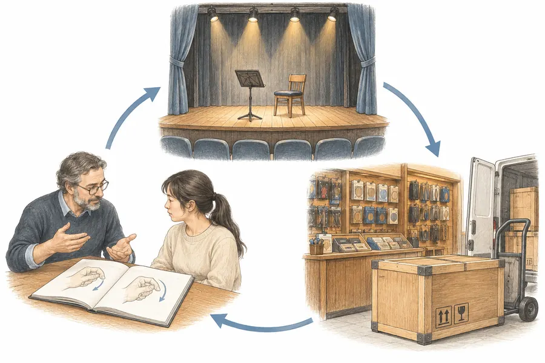
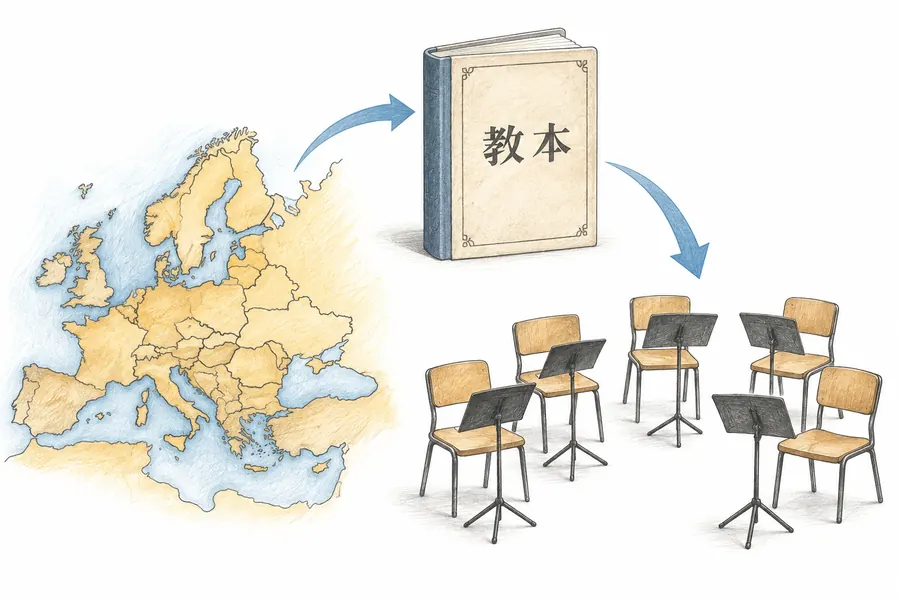
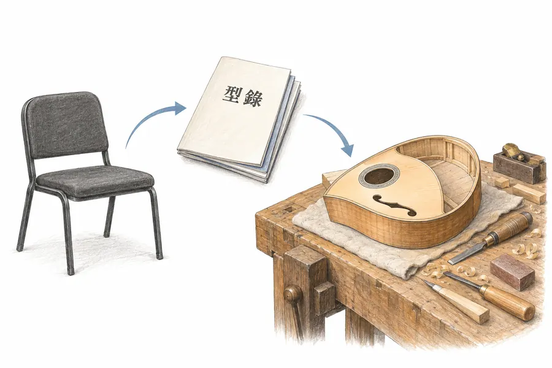
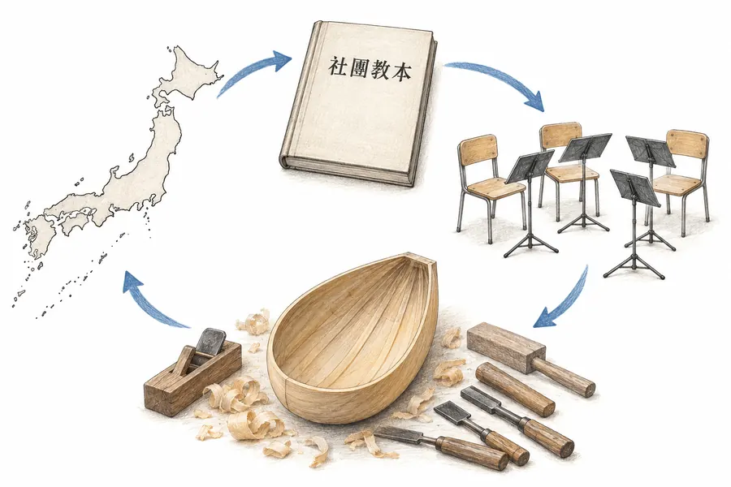
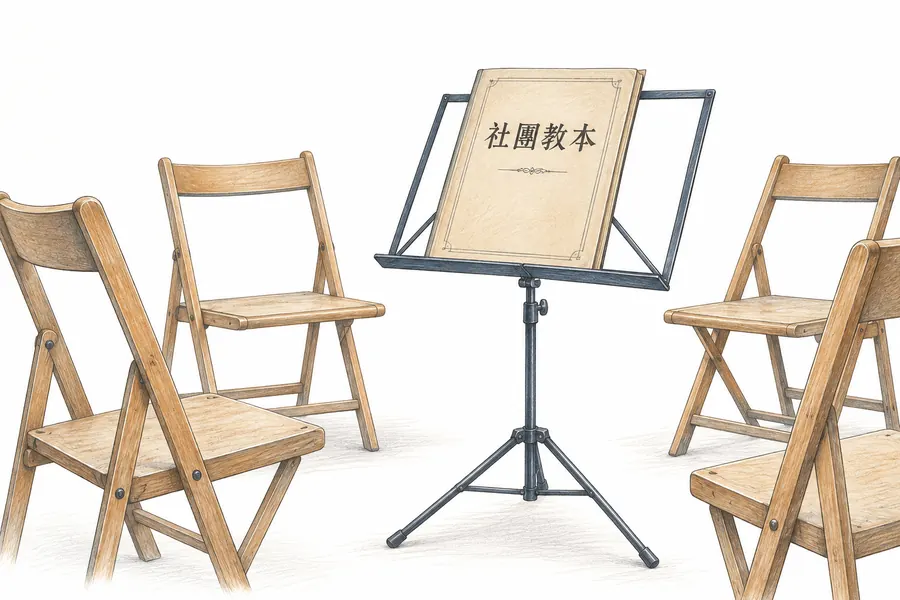
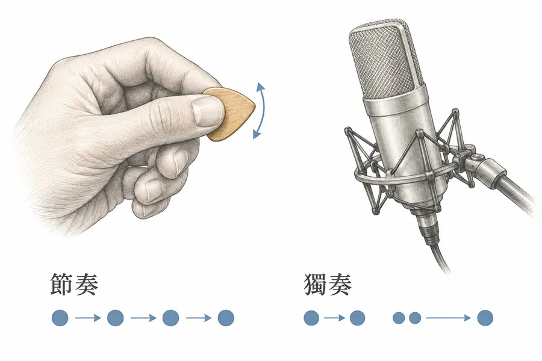
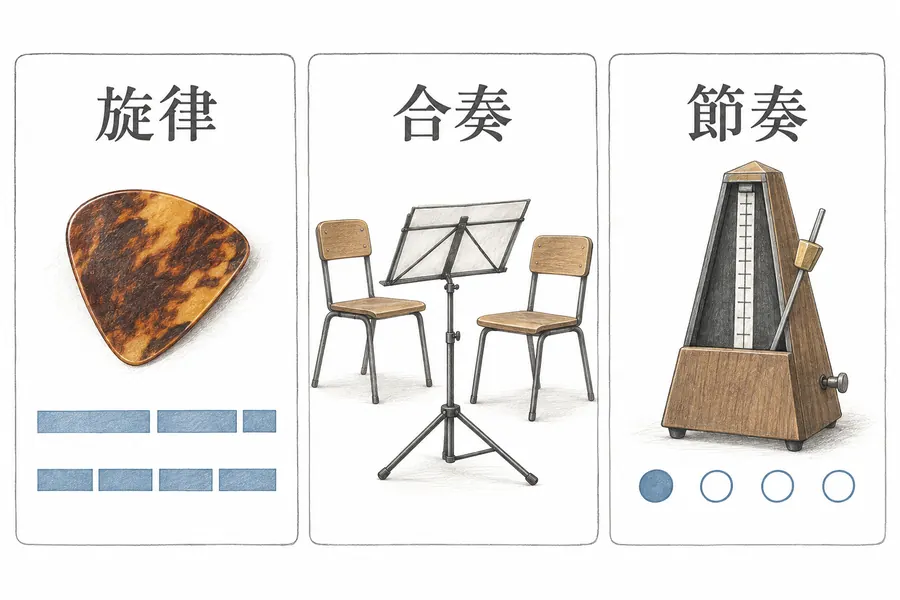

*全球流動：演奏家文化、社團、移民、工業與復興*

## 本章重點

- 十九世紀末以後，曼陀林的歷史不再只是義大利製琴史，而是透過 **博覽會、巡演、移民、學校、俱樂部和樂器工業** 走向世界。
- 跨國流行需要三個條件同時成立：**看得到、學得到、買得到**。
- 1880 年美國那場「西班牙學生樂團」巡演，演奏的其實是 bandurria，卻被大眾誤稱 mandolin。**商品名稱有時比樂器學分類更快塑造印象。**
- 曼陀林每到一個地方，就被分配不同的工作。工作一變，**技術和器材就會跟著變**。
- 日本把曼陀林做成 **學校社團與樂團的長期制度**；美國則讓它在 bluegrass 裡長出新生命。
- 沒有一種「最正統的曼陀林」。每一種成熟傳統，都在回答不同的問題。

## 從義大利製琴史，變成全球文化史

十九世紀末以後，曼陀林的歷史不再只是義大利的製琴史。

它透過博覽會、巡演、移民、學校、俱樂部和樂器工業，進入歐洲、美國、日本與南美。

每到一個地方，又被分配不同的工作：

- 某些地區把它當成 **古典合奏家族** 的一部分。
- 某些地區把它變成 **節奏樂器**。
- 某些地方則發展出 **大學社團** 與大型 mandolin orchestra（曼陀林樂團）。

這些差異的重點，就在於全球化之後的 **在地化**。

Sparks 的《The Classical Mandolin》把 1878–1892、1892–1918、1918–1945 分成獨立階段，正因為曼陀林的全球擴張**並不是單一浪潮**。

| **時期** | **發生什麼** |
|---|---|
| 1878 | 巴黎博覽會提供可見度 |
| 1890 年代到第一次世界大戰前 | 形成國際熱潮 |
| 兩戰之間 | 德奧出現新風格、工人組織、各國制度化 |

〔F18〕〔F19〕〔F20〕

## 4.1　跨國傳播的條件

跨國流行需要 **演奏、教學、出版與製造** 共同支持。

一件樂器若要從「異國新奇物」變成「大眾活動」，至少需要三種條件：

| **條件** | **怎麼達成** |
|---|---|
| **看得到** | 觀眾先在博覽會或巡演中看見它 |
| **學得到** | 教本、老師與樂譜讓人能學 |
| **買得到** | 製琴工廠、進口商與經銷網路讓人能買 |

十九世紀末的曼陀林，恰好同時具備這三點。

圖解 4.1　跨國傳播的條件（示意）

### 從「義大利人的樂器」變成「大家的樂器」

1878 巴黎博覽會提供了第一波強烈可見度。

之後，歐洲各地的 **circoli（社團）** 和 clubs（俱樂部）把個人興趣變成社群活動。

1892–1918 的研究顯示，英國、法國、比利時、德奧、美國、日本與南美都出現大量演奏。

許多地區的團體雖由歐洲人帶領，成員卻已經是 **當地人**。

這代表曼陀林很快從「義大利人的樂器」，變成可被本地社會吸收的音樂工具。〔F19〕

### 為什麼學生社團特別重要

這套機制也解釋了為什麼學生社團如此重要。

| **曼陀林的優勢** | **為什麼適合社團** |
|---|---|
| 價格相對大型弦樂器低 | 學生買得起 |
| 演奏門檻比弓弦樂器容易 | 短期內就能產生整齊合奏 |

這特別適合學校、俱樂部和業餘社群。

當社團需要完整音域，mandola（中音曼陀林）、mandocello（低音曼陀林）和低音家族的需求也隨之增加。

### 「買得到」還牽涉價格層級

當需求從少數貴族或 virtuoso（演奏家），擴大到學生與業餘社團，市場自然會需要不同等級的琴：

| **等級** | **產品樣子** |
|---|---|
| 高階 | 高度裝飾的手工琴 |
| 中低階 | 較標準化、可大量供應的型號 |

這正是後來 **美國工廠** 與 **日本量產體系** 能快速成長的背景。

### 還有一個容易忽略的條件：可攜性

曼陀林比鋼琴、豎琴或大型低音樂器，更容易帶上火車、船與巡演舞台。

移民也能把它帶進新城市。

> 樂器的尺寸不是單純的設計問題。它會實際影響 **文化傳播的速度**。

## 4.2　英國與歐洲的發展

早期研究曾低估十八世紀英國的曼陀林活動。

Sparks 2018 年的新研究找到更多倫敦、Bath（巴斯）、Edinburgh（愛丁堡）的演出與教學證據。

研究顯示，1750 年後已有 Gervasio、Leoné、Merchi 等國際演奏者活躍於劇院、音樂會，甚至娛樂場合。〔F17〕

換句話說，英國更準確地說，是 **早期曾有一波較上層、較專業化的流通**。

### 十九世紀末的差別：規模與制度

十九世紀末的差異，在於 **規模和制度**。

1892–1918 的歐洲曼陀林文化不只靠 virtuoso，而是有：

- 社團
- 出版社
- 工廠
- 樂團

法國、比利時、德國、奧地利都形成自己的教學和合奏傳統，並逐漸產生與義大利 tremolo 美學不同的 **技法偏好**。〔F19〕

圖解 4.2　英國與歐洲的發展（示意）

### 所以，「傳入」最好不要講單一年份

因此談「傳入」最好避免單一年份。

多數國家可能早已有零星的樂器和表演。真正值得分期的是：**何時開始形成持續的社會網路？**

這個觀念同樣適用日本與美國。

### 兩波全球化的差別

十八世紀英國的案例，讓我們看見「第一波全球化」和十九世紀末的差別：

| | **第一波（十八世紀）** | **第二波（十九世紀末）** |
|---|---|---|
| 主要靠 | 巡演 virtuosi（演奏名家）、城市上層娛樂、專業教學 | 印刷、俱樂部、製造業、移民社群共同放大 |
| 規模 | 有限 | 大得多 |

相同國家，可以在不同世紀經歷 **完全不同型態** 的曼陀林流通。〔F17〕

> **常見誤解**：找到某國最早的文獻紀錄，就以為找到了「該國曼陀林史的起點」。
>
> **其實**：「最早出現」和「形成持續傳統」是兩個不同的問題。
>
> 真正影響今天演奏文化的，往往是 **後者**。

## 4.3　美國曼陀林熱潮

Met 對美國歷史的敘述非常有戲劇性。

1880 年，一群 **Spanish Students（西班牙學生樂團）** 在美國巡演。

他們演奏的其實是 **bandurria（班杜里亞琴）**，但公眾與媒體常把它誤稱為 mandolin。

義大利音樂家很快利用這股熱度，以 **真正的曼陀林** 組成類似團體巡演，進一步推高市場。

這個「誤認」的重點在於說明：**商品名稱有時比樂器學分類更快塑造大眾印象。**〔F09〕

圖解 4.3　美國曼陀林熱潮（示意）

### 移民把技術帶進城市製造業

1880–1920 之間，美國大量進口義大利曼陀林，也吸引南義製琴師移民紐約。

**Angelo Mannello** 是典型例子。

Met 一件 1900 年的作品顯示，他在紐約建立了高度裝飾的圓背曼陀林生產。

館方記錄其工廠在二十世紀初曾雇用多達 **七十五名** 製作者與裝飾工。〔F21〕

Mannello 的工廠資料，也讓「移民文化」有了具體的產業尺度。

當工廠能雇用數十名製作者與裝飾工時，產品的 **一致性、分工與銷售方式** 都和單人工坊不同。

美國 mandolin craze（曼陀林狂熱）因此不只創造樂團，也創造了 **職業與供應鏈**。〔F21〕

### 另一條路：Gibson 的重新設計

同時，美國本土也開始質疑「為什麼曼陀林一定要做成圓背」。

Orville Gibson 的 1898 專利與實物，代表另一條路：

- 雕刻拱面
- 尾弦板
- 浮動琴橋
- 一體式結構
- hollow neck（中空琴頸）

美國市場因此同時存在兩股力量：

| **路線** | **內容** |
|---|---|
| 移植 | 那不勒斯傳統的圓背琴 |
| 重新設計 | Gibson 的 carved-top |

最後才長出 A-style（A 型）、F-style（F 型）與 bluegrass 的連結。〔F10〕〔F11〕

> **注意**：後來哪一種和特定音樂風格連結，是 **市場、演奏者和品牌共同選擇** 的結果。
>
> 不是技術上必然的勝負。

## 4.4　日本的教學、社團與製琴

日本曼陀林史同樣不宜只靠一個「傳入年」概括。

日本曼陀林連盟的歷史資料顯示，1994 年曾以 **「本邦渡来100年」**（傳入日本一百年）舉辦紀念活動。

這反映日本曼陀林圈長期把 **1894 前後** 視為一個象徵性起點。

另一方面，二十世紀初的教學、社團和本土製造，才真正讓樂器進入穩定發展。〔F23〕

圖解 4.4　日本的教學 社團與製琴（示意）

### 製造端：證據很清楚

Suzuki Violin（鈴木小提琴製造）的官方年表記錄：**1906 年開始製造販售曼陀林**。

這代表日本在很早期就不只進口樂器，而是建立了 **本土供應**。

後來產品線不只標準 mandolin，也包括 mandola 和 mandocello。

2017 型錄仍可看到 M-30、M-100、MD-4、MD-10 和 MC-836，呈現日本合奏文化對 **完整家族** 的需求。〔F25〕〔F26〕

### 社團文化：把樂器變成長期教育制度

| **組織／事件** | **時間** | **意義** |
|---|---|---|
| 明治大學曼陀林倶樂部的創立 | 1923 | 之後持續以定期演奏會方式活動 |
| 日本曼陀林連盟成立 | 1968 | 把獨奏比賽、資料蒐集、研究會和國際交流制度化 |

〔F22〕〔F24〕

日本的特色因此不只是「很喜歡圓背曼陀林」，也包含 **把合奏與學校社團建立成持續一世紀的文化**。

### 供給與曲目互相促進

日本案例還顯示：「完整家族」與「大型合奏」會互相強化。

> 當學校與社會團體長期演奏 orchestra repertoire（樂團曲目），製造商便有理由提供不同音域。
>
> 反過來，能穩定買到 mandola、mandocello，又讓編曲者敢寫更完整的聲部。

這是一個供給和曲目互相促進的循環。〔F22〕〔F26〕

### 1894 這個數字要怎麼理解

同時，1894 作為「本邦渡来100年」的象徵性起點，應該理解為 **日本曼陀林圈自身的紀念框架**。

更早的相關樂器紀錄仍可另行研究。

> 歷史紀念日和最早實物證據，是不同類型的主張。本書會分開表述。〔F23〕

## 4.5　兩次世界大戰之間

第一次世界大戰後，十九世紀末那種「國際時髦樂器」的光環開始退去。

但這不等於曼陀林消失。

Sparks 對 1918–1945 的研究顯示：

- 德國與奧地利出現新的演奏風格。
- 曼陀林也被工人與社會主義組織採用。
- DMGB、DAMB 等團體（原文只給縮寫，未展開全名）把撥弦樂團變成 **集體文化活動** 的一部分。〔F20〕

圖解 4.5　兩次世界大戰之間（示意）

### 同一件樂器，四種身份

法國則走向另一種制度化：巴黎 **Conservatoire National（國立音樂院）** 一度設有 mandolin class（曼陀林班）。

義大利的政治環境又有不同影響。

換句話說，同一件樂器在不同國家，可能同時是：

| **身份** | **例子** |
|---|---|
| 工人合奏 | 德奧的 DMGB、DAMB |
| 專業教育 | 法國國立音樂院 |
| 家庭娛樂 | 各國的家庭與業餘社群 |
| 民族文化 | 與地方形象結合 |

這也是全球史最值得保留的複雜性。

### 低潮替戰後分流埋下伏筆

從長期看，這段低潮替戰後的分流埋下了伏筆：

| **地區** | **戰後走向** |
|---|---|
| 德國、日本等地 | 古典 mandolin orchestra 繼續發展 |
| 美國 | 曼陀林在 string bands（弦樂團）與 bluegrass 中取得新生命 |

它的重點不是「樂器消失了」，而是 **原本的大眾熱潮分裂成多種較專門的生態**。〔F12〕

### 為什麼工人組織值得注意

戰間期的德奧工人組織特別值得注意，因為它把曼陀林從「時髦休閒」轉成 **群體身份工具**。

DMGB、DAMB 的存在顯示，樂團可以承擔：

- 教育
- 社交
- 階級文化

而不只是演奏會。

這種社會功能，往往比某一位明星演奏家更能讓樂器 **跨世代存活**。〔F20〕

### 兩種合法化，方向其實一樣

同一時期，法國 Conservatoire National 設 mandolin class，則是另一種 **合法化**：樂器進入專業教育框架。

兩者看似方向相反——一個是工人團體，一個是國家音樂院。

其實它們都說明同一件事：**曼陀林已能被制度吸收，而不再只靠短期流行。**〔F20〕

## 4.6　美國戰後音樂的轉變

Smithsonian 收錄 Walter Carter 的《The Mandolin in America》時，把美國史概括成五個階段：

1. golden age（黃金時代）
2. 衰退
3. bluegrass roots（藍草根源）
4. Monroe
5. modern revival（現代復興）

這個分類很有啟發性：曼陀林並沒有因為 1920 年代的大眾熱潮退去而消失，而是 **換了工作**。〔F12〕

圖解 4.6　美國戰後音樂的轉變（示意）

### Bluegrass 改變了曼陀林的「身份」

在 bluegrass 裡，曼陀林不再以古典式長 tremolo 為主要身份。

Bill Monroe 建立的語言強調：

- 強烈的 **chop**（短促有力的切分和弦）
- 清楚的切分
- 穿透力高的 solo（獨奏）

樂器在樂團裡同時扮演兩個角色：

| **角色** | **怎麼做** |
|---|---|
| 節奏 | 像 snare drum（小鼓）一樣補反拍 |
| 主奏 | 和 fiddle（小提琴）、banjo（斑鳩琴）競爭旋律 |

這種角色改變，也反過來影響美式 F-style、f-hole（f 型音孔）與 setup 的偏好。

### 1980 年代以後：邊界又打開了

1980 年代以後的復興，又把邊界打開。

Carter 的歷史涵蓋：

- jazz（爵士）
- klezmer（克萊茲梅爾）
- Irish（愛爾蘭）
- choro（簫羅）
- classical connection（與古典的連結）
- 各種 bluegrass 分支

> **常見誤解**：今天談「美式曼陀林」，以為就等於 Monroe-style（孟羅風格）。
>
> **其實**：這同樣是過度簡化。真正的特色是美國市場長期容許 **不同設計與風格並存**。〔F12〕

### Bluegrass 如何反向影響器材

Bluegrass 對器材的反向影響尤其明顯。

當演奏者要在 banjo、fiddle、guitar（吉他）和人聲之間取得清楚的節奏位置，下面這些條件會變得重要：

- 快速起音
- 強烈中頻
- 可立即停止的和弦

這種需求和古典式長 tremolo 的優先順序不同。

因此，同一把曼陀林在 **setup、撥片與右手阻尼（damping）** 上，會出現不同偏好。

### 現代跨界：再一次鬆動邊界

現代跨界則再次讓這些邊界鬆動。

同一位演奏者可能：

- 用 carved-top 彈 Bach（巴哈）
- 也用 octave mandolin（八度曼陀林）彈 Celtic（塞爾特音樂）
- 再以 pickup（拾音器）進效果器

這重點在於：二十一世紀的市場，讓演奏者能 **自由重新組合傳統**。〔F12〕

## 4.7　各地傳播模式的比較

理解全球曼陀林最有效的方法，是問一個問題：

> **每個地方把曼陀林放在哪個音樂位置？**

| **地區／傳統** | **曼陀林的工作** |
|---|---|
| 義大利那不勒斯傳統 | 歌唱旋律、圓背工藝 |
| 德奧與日本的大型撥弦樂團 | 完整聲部家族的一員 |
| 美國 bluegrass | 節奏與獨奏的雙重角色 |
| 大學社團 | 群體音樂教育的工具 |

圖解 4.7　各地傳播模式的比較（示意）

### 工作一變，技術和器材就會變

| **需求** | **變得重要的能力／規格** |
|---|---|
| 需要長旋律 | tremolo 與 sustain（延音）控制 |
| 需要反拍 | chop 與快速 damping |
| 需要樂團中音 | mandola 的 tuning、notation（記譜）與弦長 |
| 需要大量學生 | 穩定量產與維修性，比華麗手工裝飾更實際 |

### 所以，本書不會選出「最正統的一種曼陀林」

這也解釋了為什麼本書不會選出「最正統的一種曼陀林」。

歷史上每一種成熟傳統，都在回答不同的問題。

專業比較的工作，重點在於 **先把問題說清楚**。

### 該比較哪些欄位？

如果把不同地區放在同一張表裡，比較欄位應該是：

| **比較欄位** | **為什麼重要** |
|---|---|
| 主要社會場景 | 決定樂器被賦予什麼任務 |
| 典型編制 | 獨奏、社團或樂團 |
| 常見型制 | 圓背、carved-top、flatback 等 |
| 核心右手語法 | tremolo、chop、damping 等 |
| 教育方式 | 師徒、學校社團或音樂院 |

而且要 **配合年代** 一起比較。

這樣才看得出一些細微的差別。

例如日本和德國同樣重視 orchestra，卻有不同組織史。美國和義大利都重視 solo，卻形成不同伴奏與琴體偏好。

### 這也能防止文化刻板印象

這種比較方式，也能防止文化刻板印象。

> 不是所有義大利演奏都只用 tremolo，也不是所有美國人都只彈 bluegrass。

地區傳統是理解脈絡的 **起點**，不是限制個別演奏者的 **標籤**。

## 自我學習題庫

學習檢查：作答、核對、複習

先自己作答，再看答案。答錯時回到本章相關小節重新讀一次。

**1. 十九世紀末美國曼陀林熱潮的重要背景之一是？**

- A. Spanish Students 巡演與媒體誤稱
- B. 電吉他發明
- C. 錄音串流
- D. 爵士鼓出現

**2. 樂器傳到不同國家後常會？**

- A. 完全保持原用途
- B. 依當地音樂重新分配角色
- C. 失去所有傳統
- D. 變成同一種尺寸

**3. 日本曼陀林文化的重要場域之一是？**

- A. 大學社團與樂團
- B. 只有街頭演奏
- C. 只有歌劇院
- D. 只有教會

**答案：1.A　2.B　3.A**

## 本章主要查證來源

查證來源：找原文、核條件、留紀錄

| **編號** | **來源與用途** |
|---|---|
| 〔F09〕 | The Metropolitan Museum of Art，*From Naples to New York*，Guitar Heroes exhibition essay。那不勒斯製琴環境、美國移民、Spanish Students 與美國 mandolin craze。 |
| 〔F10〕 | United States Patent Office / Google Patents，*US598245A – Mandolin, Orville H. Gibson*，Patented 1898-02-01。Orville Gibson 一體式 rim/neck/head、carved top/back 與 hollow neck 的原始專利。 |
| 〔F11〕 | The Metropolitan Museum of Art，*Mandolin, Orville Gibson, 1898*，Met 2015.643a–c。與 1898 專利設計一致的現存實物。 |
| 〔F12〕 | Smithsonian Libraries and Archives，Walter Carter，*The Mandolin in America*，2017 catalog record。美國曼陀林熱潮、衰退、bluegrass 與現代復興的歷史脈絡。 |
| 〔F17〕 | Paul Sparks，*The mandolin in Britain, 1750–1800*，Early Music 46(1), 2018。18 世紀英國曼陀林演奏、教學與社會文化的新研究。 |
| 〔F18〕 | Paul Sparks，*1878–1892, The Classical Mandolin*，Oxford University Press, 2005。1878 巴黎博覽會、義大利 circoli mandolinisti 與再流行。 |
| 〔F19〕 | Paul Sparks，*1892–1918, The Classical Mandolin*，Oxford University Press, 2005。歐洲、美國、日本、南美的 virtuoso era 與全球流行。 |
| 〔F20〕 | Paul Sparks，*1918–1945, The Classical Mandolin*，Oxford University Press, 2005。德奧新演奏風格、工人組織、法國教育與戰間期變化。 |
| 〔F21〕 | The Metropolitan Museum of Art，*Mandolin, Angelo Mannello, New York, 1900*，Met 1972.111.2a,b。義大利移民在紐約建立圓背曼陀林工廠與美國量產案例。 |
| 〔F22〕 | 一般社団法人 日本マンドリン連盟，*日本マンドリン連盟 official site*，accessed 2026-10-06。1968 成立、研究／比賽／國際交流等日本制度化發展。 |
| 〔F23〕 | 日本マンドリン連盟 関西支部，*日本マンドリン連盟について／沿革*，historical page。1994 年「マンドリン本邦渡来100年」紀念活動等組織歷史。 |
| 〔F24〕 | 明治大学マンドリン倶楽部紫紺会，*明治大学マンドリン倶楽部の歴史*，accessed 2026-10-06。1923 創立與日本大學曼陀林文化案例。 |
| 〔F25〕 | 鈴木バイオリン製造，*年表*，accessed 2026-10-06。1906 年開始製造販售曼陀林等日本製造史料。 |
| 〔F26〕 | 鈴木バイオリン製造 / Suzuki Music，*2017 string-instrument catalog*，2017。M-30、M-100、MD-4、MD-10、MC-836 等日本家族規格與弦長。 |

連結：

- 〔F09〕https://blog.metmuseum.org/guitarheroes/from-naples-to-new-york-mobile/
- 〔F10〕https://patents.google.com/patent/US598245A/en
- 〔F11〕https://www.metmuseum.org/art/collection/search/700485
- 〔F12〕https://www.si.edu/object/mandolin-america-full-story-orchestras-bluegrass-modern-revival-walter-carter:siris_sil_1091895
- 〔F17〕https://academic.oup.com/em/article-abstract/46/1/55/4907922
- 〔F18〕https://academic.oup.com/book/10241/chapter-abstract/157932074
- 〔F19〕https://academic.oup.com/book/10241/chapter-abstract/157933927
- 〔F20〕https://academic.oup.com/book/10241/chapter-abstract/157939527
- 〔F21〕https://www.metmuseum.org/art/collection/search/504480
- 〔F22〕https://www.japanmandolinunion.com/
- 〔F23〕https://jmu.xii.jp/kansai/renmei.htm
- 〔F24〕https://www.mumc-ob.jp/history/
- 〔F25〕https://www.suzukiviolin.co.jp/about/factory/
- 〔F26〕https://www.suzuki-music.co.jp/app/uploads/2017catalog14.pdf

---
