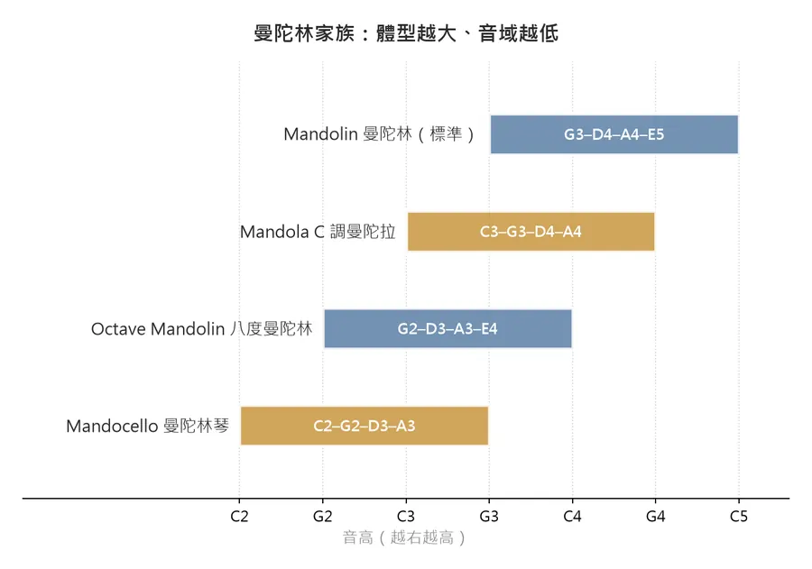
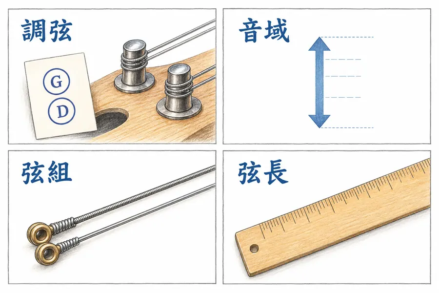
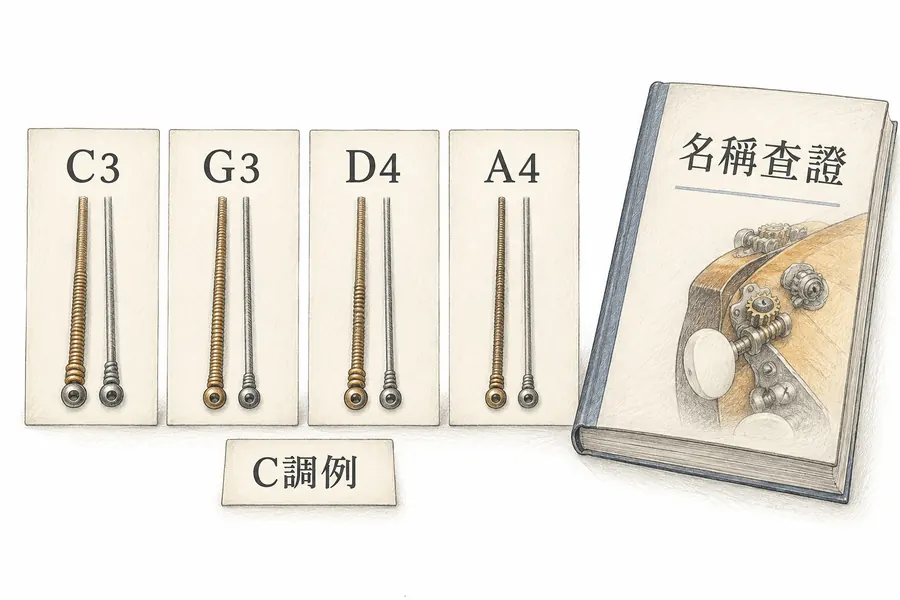
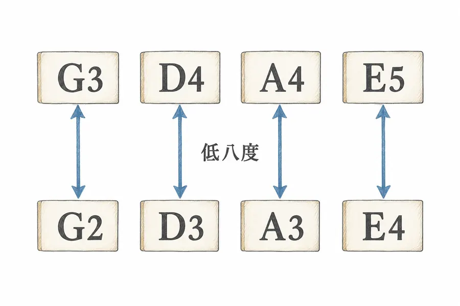
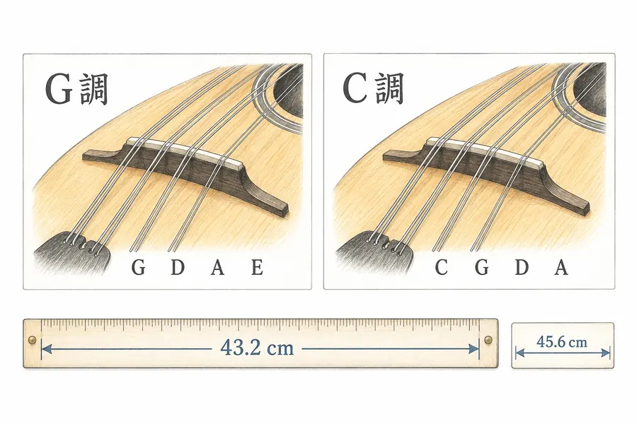
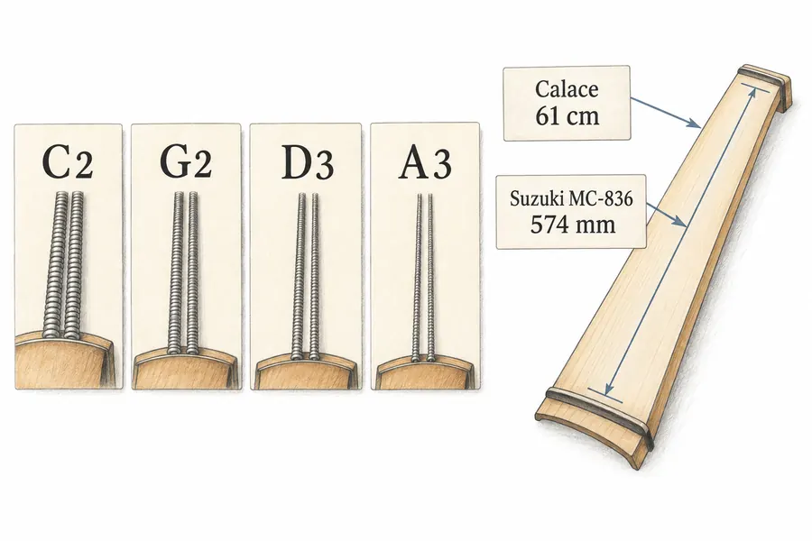
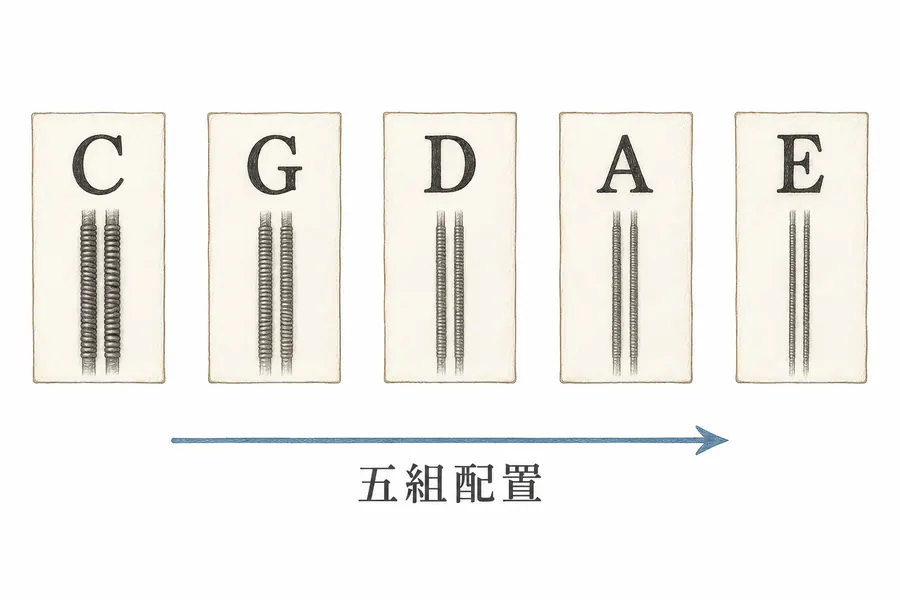
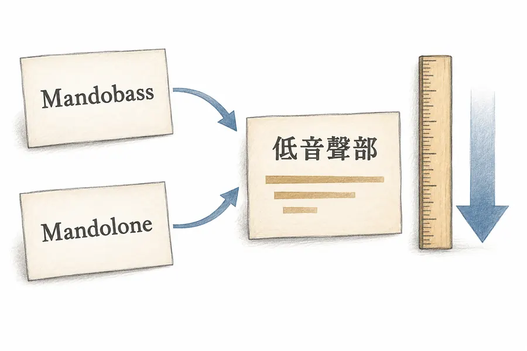
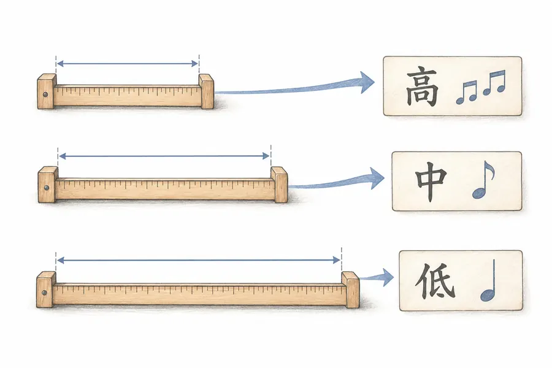
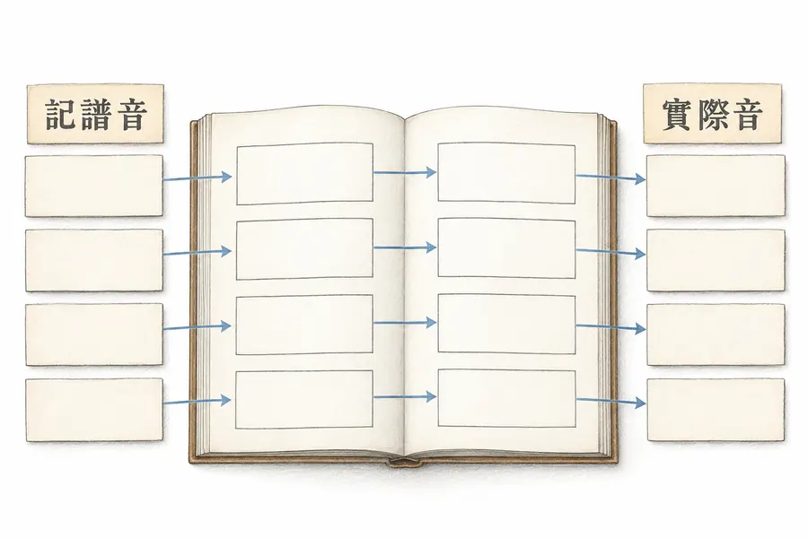

## 本章重點

- 曼陀林家族由高音排到低音，大致是 **mandolin、mandola、mandocello、mandobass**。
- 判斷一件樂器屬於哪個家族成員，順序是：**調弦 → 音域 → course 數 → 弦長**。名字放最後。
- **mandola** 這個字在美加多指 C 調（C3–G3–D4–A4），在其他地區卻可能指 G 調低八度。同一個字，兩種琴。
- 同調弦不代表同尺寸。**弦長（scale length）** 比琴身大小更能決定手感。
- 家族越往低音走，弦長通常越長；但古琴稀少不等於高級。

---

樂器從高音一路往中音、男中音、低音擴張時，最自然的做法，是像小提琴家族那樣排成一列：mandolin、mandola、mandocello、mandobass。

但曼陀林家族比這麻煩得多。

同一個名字，在不同國家可能指向不同的**調弦（tuning）**。反過來說，同樣是 G–D–A–E 的低八度，也可能被叫成 octave mandolin、mandola in G 或 tenor mandola。

打個比方：這就像「老王」在村裡指三個人。你如果只記住「老王」兩個字，去找人一定找錯。

所以本章把「名稱」放到第二順位。先確認四個事實：

1. **空弦調弦**（四組弦分別調成什麼音）
2. **實際音域**（最低到最高能發出哪些音）
3. **course 數**（幾組弦）
4. **弦長**（scale length，有效弦長）

再看它在樂團裡扮演什麼角色。最後，才把各國名稱疊上去。

本章有兩組互補的證據。一是 **CMSA**（Classical Mandolin Society of America，美國古典曼陀林協會）的記譜指引，它整理了地域命名與記譜。二是 **Calace**（義大利製琴工坊）的現行產品，它讓我們看到：同一種 mandola 琴體，可以同時提供 G 調與 C 調。〔F13〕〔F15〕

## 家族分類先看調弦，不先看名稱

*圖 F　曼陀林家族：琴越大、音越低。橫軸是音高，越右邊越高。*

先看這張總表。它的欄位順序，就是本章建議的閱讀順序。

*圖解　家族分類先看調弦，不先看名稱（示意）*

| **家族／常見名** | **調弦（低→高）** | **典型角色** | **名稱風險** | **例證** |
|---|---|---|---|---|
| **Mandolin**（曼陀林） | G3–D4–A4–E5 | 高音／主奏 | 相對穩定 | F13／F14 |
| **C Mandola**（C 調曼陀拉） | C3–G3–D4–A4 | 中音 | 也叫 tenor／contralto／alto mandola | F13／F15 |
| **Octave / G Mandola**（八度／G 調曼陀拉） | G2–D3–A3–E4 | 中低音 | 跨地域名稱重疊 | F13／F15 |
| **Mandocello**（曼陀大提琴） | C2–G2–D3–A3 | 低中音 | 也叫 Mandoloncello | F13／F16 |
| **Liuto／10-string**（魯特琴型／十弦） | C2–G2–D3–A3–E4 | 延伸第五 course | 產品名與家族名重疊 | F16 |

看這張表有個小技巧：**先讀中間那一欄**。音名是不會騙人的，名字會。

另外注意，音名後面的數字是「第幾個八度」的標記。G3 比 G2 高一個八度，數字越大越高音。

## 5.1　Mandola 的名稱與調弦

在美國與加拿大，**mandola** 常指 C3–G3–D4–A4 的四 course 樂器。

它的調弦和 **viola**（中提琴）完全相同。所以用「曼陀林家族的中提琴」來幫初學者理解，這句話並沒有錯。

但 CMSA 特別提醒：在世界其他地區，**同一個調弦**可能被叫做 tenor mandola、alto／contralto mandola，或 mandola in C。

更麻煩的是，「mandola」這個字本身，在其他傳統裡也可能指 G–D–A–E 的低八度類型。〔F13〕

這就是地域翻譯最容易出問題的地方。

如果中文只寫「曼陀拉」，不加調弦，讀者很可能以為全世界都在說同一件樂器。實際上不是。

專業寫法最好在第一次出現時，就直接寫成：

- 「**C 調 Mandola（C3–G3–D4–A4）**」
- 或「**G 調 Mandola／Octave-type（G2–D3–A3–E4）**」

讓音高先於名稱。

*圖解 5.1　Mandola 的名稱與調弦（示意）*

### 同一個字，兩個音域：一張表看清楚

這是本章最重要的一張表。看完它，你就不會再被「mandola」三個字騙。

| **你看到的寫法** | **最常出現的地方** | **它指的是什麼調弦** |
|---|---|---|
| **Mandola** | 美國、加拿大的古典圈 | C3–G3–D4–A4（四 course，像中提琴） |
| **Tenor mandola／Alto mandola／Contralto mandola／Mandola in C** | 美加以外的地區 | 同樣是 C3–G3–D4–A4 |
| **Octave mandolin** | 英國、美國的 folk／Celtic 市場 | G2–D3–A3–E4（低一個八度） |
| **Mandola in G／G 調 mandola** | 義大利與部分歐洲傳統 | 同樣是 G2–D3–A3–E4 |
| **Mandola（其他傳統的用法）** | 其他地區的文獻 | 可能指 G–D–A–E 的低八度型 |

再看一個更簡化的版本：

| **情境** | **「mandola」可能指** |
|---|---|
| 美加古典圈的資料 | C 調，C3–G3–D4–A4 |
| 義大利／部分歐洲、或寫明「in G」 | G 調，G2–D3–A3–E4 |

> **【常見誤解】**
> **誤解**：「Mandola 就是曼陀林家族的中提琴，全世界都一樣。」
> **事實**：在美國與加拿大，mandola **常**指 C 調。但「常」不等於「一定」，而且這個用法到了其他地區就未必成立。「中提琴」這個比喻也只適用於**調弦與音域**，不能延伸到音色。

換句話說：**只寫「曼陀拉」三個字，資訊量等於零。** 一定要配上調弦。

### 「像中提琴」只能用在調弦上

功能上，C 調 mandola 確實常填補中音與內聲部。

但它的音色、撥弦的 **attack**（起音，撥下去那一瞬間的聲音特性）與 **sustain**（延音，聲音撐多久），跟中提琴完全不同。

所以配器時，不能把中提琴的寫法原封不動搬過來。要依撥弦樂器的起音與延音，重新安排聲部。

曼陀林樂團還要多考慮三件事：

1. **複弦起音**：一次撥兩條弦，起音比單弦更厚更密。
2. **tremolo 密度**（顫音，快速來回撥）：內聲部如果全是顫音，會糊成一片。
3. **吉他伴奏的遮蔽**：中音區很容易被吉他蓋住。

> **【常見誤解】**
> **誤解**：「Mandola 聽起來就像中提琴。」
> **事實**：「像中提琴」最好只用來說明調弦與音域。
> mandola 的撥片起音很清楚；複弦在中音區的泛音，以及**消音**（**damping**，讓弦停止振動）的做法，也都和弓弦樂器不同。
> 整份中提琴分譜直接搬過去，長音與內聲部可能需要重新分配**tremolo**（顫音）或和弦。

另外還有一層：同一個 C3–G3–D4–A4 系統，在不同地區可能使用不同的**譜號（clef）** 與記譜方式。

CMSA 特別整理了 **universal notation**（實音記譜）與 **transposed notation**（移調記譜）兩種做法。這正好說明：調弦相同，不代表樂譜閱讀習慣全球統一。〔F13〕

## 5.2　Octave Mandolin 與 G 調 Mandola

G2–D3–A3–E4，也就是標準曼陀林**低一個八度**，是現代最常見的中低音系統之一。

在英美 **folk／Celtic**（民謠／凱爾特音樂）市場，它很常被叫做 **octave mandolin**（八度曼陀林）。

在義大利與部分歐洲傳統，同樣的音域可能叫 **mandola in G**（G 調曼陀拉）。

CMSA 把「rest of the world mandola／octave mandolin」獨立列成一項，就是因為這個名稱差異已經深入實務。〔F13〕

這裡可以借用合唱團的概念。合唱團有女高音、女低音、男高音、男低音四個聲部。曼陀林家族也在做同一件事，只是用撥弦樂器排出一條音域階梯。

### 同調弦不代表同尺寸

不同製琴師可以選用不同的 **scale length**（弦長，決定按弦距離的那段有效長度）。這是在兩件事之間取捨：

| **弦長選擇** | **好處** | **代價** |
|---|---|---|
| **較長** | 在低音高下仍能維持較緊的手感 | 左手伸展變大，快速換把較吃力 |
| **較短** | 左手容易按、移動快 | 弦可能太鬆，需要更粗或不同結構的弦 |

*圖解 5.2　Octave Mandolin 與 G 調 Mandola（示意）*

想像一條橡皮筋：同一條橡皮筋，拉得越長，要調到同一個音，就得拉得越緊。弦也是一樣。

所以比較 octave mandolin 時，「琴身總長」的價值反而不如弦長。

琴身大可以增加**腔體容積**（琴肚裡裝空氣的空間），但真正決定**按弦距離**的是有效弦長。

這也是家族樂器規格表一定要單獨列出 scale 的原因。

### 名稱差異背後，常是用途差異

Octave mandolin 在 Celtic／folk 世界，常用**單音**、**drone**（持續低音，像風笛一直響著的那個音）與**空弦共鳴**。

這種使用情境，和古典樂團裡的 G mandola 並不完全一樣。

即使調弦一樣，琴體深度、弦長與弦規的選擇，也可能朝不同手感設計。

所以買琴時，應該先問自己一個問題：「**我要的這個 G2，是拿來做什麼的？**」

| **你的用途** | **比較適合的方向** |
|---|---|
| 重視快速旋律 | 較短的弦長，按起來比較舒服 |
| 需要低音清楚、弦感較緊 | 較長的弦長，可能更合適 |

這個問題比品牌名稱有用得多。它是比較的起點。

## 5.3　Calace Mandola 的命名與規格

Calace 現行的 Mandola 24、26、13、15，都列出 **43.2 cm** 的弦長，並可選 **45.6 cm**。

同一個型號，可以設定成 G 調或 C 調：

| **設定** | **原廠列法（高→低）** | **換算成本書列法（低→高）** |
|---|---|---|
| **G 調** | E–A–D–G | G–D–A–E |
| **C 調** | A–D–G–C | C–G–D–A |

〔F15〕

這個例子非常重要。

因為它證明：「Mandola」在**一間義大利現役工坊內部**，就已經不是單一調弦的名稱。

所以判讀二手 Calace 時，要核對三件事：**型號、年代、實際調弦**。最好再確認實際弦長、弦規，以及賣家目前把它調成什麼。

*圖解 5.3　Calace Mandola 的命名與規格（示意）*

### ribs 多不等於等級高

Calace 也提供不同的 **ribs**（琴肚肋片）與指板等級。例如 25 條 rosewood（玫瑰木）ribs，或 concert 級的 33 條 maple（楓木）**fluted ribs**（帶溝槽的肋片）。

這些是同一音域家族內的**製琴差異**。

但它不該被誤解成一條普遍規則：「ribs 越多，等級一定越高」。它們只代表某個特定品牌的產品配置。〔F15〕

> **【常見誤解】**
> **誤解**：「琴肚的肋片越多，琴就越高級。」
> **事實**：肋片數要和曲率、單片寬度、工藝與設計系列一起判讀。25 條或 33 條是 Calace 自己的配置選項，不是全球通用的等級表。

### 排列方向也是陷阱

Calace 官方頁面是由**高到低**列 tuning：E–A–D–G／A–D–G–C。

本書全書統一採**低到高**：G–D–A–E／C–G–D–A。

閱讀原廠資料時，一定要先確認列弦方向。否則同一組音名，很容易被誤判成不同的 tuning。〔F15〕

這也是資料庫欄位必須有「**排列方向規範**」的原因。

如果不同品牌有的由高到低、有的由低到高，而整理者只把字串複製進表格，讀者就會看到看似矛盾的資訊。

標準化展示時可以重排，但必須保留原始來源供核對。

## 5.4　Mandocello 與 Mandoloncello

**Mandocello**（曼陀大提琴）或 **Mandoloncello**，常以 C2–G2–D3–A3 為四個 course。

這個音高對應 **cello**（大提琴）式的五度排列。

它把曼陀林家族帶到真正的低中音範圍。所以在樂團裡，它可以承擔低旋律、對位，以及厚實的和聲。

CMSA 對 mandocello 的記譜處理也顯示：不同作品可能遇到不同譜號與轉寫習慣。〔F13〕

### 大樂器最直接的難題：張力

音高越低，如果弦長仍然很短，弦就必須更重，才能保持可控的手感。

如果拉長弦長，又會增加左手的距離。

所以 mandocello 的設計，通常比標準曼陀林更明顯地呈現一個折衷：**人體工學 vs. 低頻效率**。

這有點像挑鞋子。鞋底越厚越能吸震，但你的腳就越不容易感覺到地面。

*圖解 5.4　Mandocello 與 Mandoloncello（示意）*

Calace 現行的 Mandoloncello 是 **8 弦、61 cm 弦長**，C–G–D–A 四 course。

十弦版本則在這個基礎上增加高 E，形成 C–G–D–A–E 五 course。

這也說明：「Mandoloncello」與「Liuto／10-string 延伸型」之間可能有重疊。分類時，應該以**弦組數與調弦**確認範圍，不要只看名字。〔F16〕

### 左手與右手都變重

Mandocello 的左手負擔，不只來自 **fret spacing**（琴格間距）。

粗弦與 course 阻力也是來源。大型琴若仍使用雙弦 course，按弦時要同時讓兩根弦都穩定接觸琴格。

右手也要穿過更厚的弦組。

所以它的演奏技術雖然屬於同一家族，卻不能把標準曼陀林的細小動作直接按比例放大。

| **兩個現代案例** | **弦長** | **怎麼讀這個數字** |
|---|---|---|
| **Calace Mandoloncello** | 61 cm | 義大利現役工坊的做法 |
| **Suzuki MC-836** | 574 mm（＝57.4 cm） | 較短弦長的另一種實例 |

兩者不應直接用長短判定優劣，而應連同琴體、弦組與用途一起比較。〔F16〕〔F26〕

## 5.5　Liuto Cantabile 的五組複弦

**Liuto Cantabile**（抒情魯特琴）在名稱上最容易誤導中文讀者。

這裡的 **liuto** 並不表示它等同**文藝復興時期的 lute**（魯特琴，一種更早的撥弦樂器）。

在 Calace 的傳統裡，它是一件和 mandoloncello 系統密切相關的**五 course** 撥弦樂器，常見調弦是 C–G–D–A–E。

多出來的高 E，讓大型琴體在保留低音範圍的同時，也能延伸到更高的旋律位置。〔F16〕

打個比方：四 course 的琴像一棟四層樓，五 course 等於加蓋了一層頂樓。地基（低音）沒變，但可用的空間變多了。

### 多一組弦，多哪些事？

| **面向** | **變化** |
|---|---|
| **音域** | 擴大，多一個高 E |
| **指法** | 選擇變多，旋律可以少換把 |
| **消音** | 變得更重要、更難 |
| **右手** | 跨弦範圍更大 |
| **和弦** | **voicing**（聲部排列）多了新的上方音 |
| **結構** | 琴橋、上弦枕、琴頭都要容納十根弦，總張力上升 |

這就是為什麼家族資料庫必須同時列出 **course 數、弦數與 tuning**。三個欄位少一個，就會說不清楚。

*圖解 5.5　Liuto Cantabile 的五組複弦（示意）*

### 五 course 改變的是和聲思維

標準四 course 已經能完整形成大量四音和弦。

但第五 course 讓低音與高音之間的跨度變大。某些 **chord melody**（和弦旋律，把旋律藏在和弦最上層的彈法）可以把 melody 留在高 E，同時保留低 C／G 的基礎。

這是「結構直接擴張編曲可能性」的例子。

不過多一個 course，也讓**消音（muting）** 變得更重要。

沒有被使用的弦組，可能產生 **sympathetic ring**（交感共振，別條弦跟著震動發出聲音）。在大型共鳴琴體上，這種現象更明顯。

演奏者需要用左右手一起控制殘響。這些「多出來的工作」，往往不會出現在單純的規格表裡。

> **【常見誤解】**
> **誤解**：「Liuto Cantabile 是每個曼陀林樂團的標準編制。」
> **事實**：它可以在編曲上連接 mandocello 的低音與 mandolin 的高音，但**不是**每個樂團的標準成員。用不用，取決於地區、曲目與樂團傳統。

## 5.6　Mandobass 與 Mandolone

十九世紀末與二十世紀初，大型 mandolin orchestra 追求完整音域時，低音家族的出現非常合理。

理由是音色的一致性：如果高、中、低聲部都由相近的撥弦起音構成，整個樂團會有一致的音色輪廓。

CMSA 的文件至今仍列出 **mando-bass**，證明這個家族角色不是後人想像出來的。〔F13〕

但大型低音撥弦樂器面臨很現實的成本：

- 琴體大，運輸困難
- 弦與硬體昂貴
- **double bass**（低音提琴）、吉他，或後來的電聲系統，都能更方便地提供低頻

當樂團編制改變，專用 mandobass 的需求自然縮小。

*圖解 5.6　Mandobass 與 Mandolone（示意）*

### 罕見，不代表失敗

歷史型號少見，不代表設計失敗。

它們只是服務於一種曾經非常活躍的 **orchestra ecology**（樂團生態）。收藏與研究時，應該先問：「當時的樂團是怎麼編制的？」

依當時的編制，去理解低音家族的用途。

Mandobass 的歷史也提醒我們：家族樂器能不能存續，和**替代方案**有關。

當 double bass 已經有成熟的演奏者與曲目，樂團要新增一件專用低音曼陀林，就必須證明它值得那個成本。

它得在音色一致性或移動性上，拿出足夠的理由。

不同時代，對這個問題的答案會不同。

> **【常見誤解】**
> **誤解**：「低音家族在收藏市場很稀有，所以音樂上比較高級。」
> **事實**：稀少可能來自產量低、用途專門、存放困難，或需求下降。
> 估價要另看製作者、原裝性、歷史來源與保存狀況。稀有度和音樂價值是兩件事。

## 5.7　弦長與家族分工

把幾個實際數字排在一起，方向就很清楚了：

| **樂器** | **弦長** | **來源** |
|---|---|---|
| **Calace mandolin** | 33.5 cm | 〔F14〕 |
| **Calace mandola** | 43.2 cm（可選 45.6 cm） | 〔F15〕 |
| **Calace mandoloncello** | 61 cm | 〔F16〕 |

從 33.5 cm 到 61 cm，可以看到家族向低音延伸時，弦長逐步增加。

這個做法的重點，是讓較低的音高在合理弦規下，仍能維持足夠的張力與反應。〔F14〕〔F15〕〔F16〕

### 張力、弦長、頻率、線密度

弦的張力，和三個東西**互相牽動**：

| **變數** | **白話** |
|---|---|
| **弦長**（scale length） | 弦的有效振動長度 |
| **頻率**（frequency） | 你要調到的那個音 |
| **線密度**（linear density） | 弦每單位長度的質量，和粗細、材質有關 |

實際製琴不需要演奏者每天計算公式，但比較不同家族時，理解這個關係很有用。

| **如果弦長…** | **會發生什麼** |
|---|---|
| **太短（低音琴）** | 弦必須更粗，可能增加 **stiffness**（勁度，弦本身的硬度）與不和諧泛音 |
| **太長** | 左手可能無法舒適完成快速位置轉移 |

*圖解 5.7　家族的常見聲部分工；實際音高依調弦與琴弦配置（示意）*

### 日本 Suzuki 的例子

日本 Suzuki（鈴木小提琴製造）2017 年的型錄，提供了另一組很直觀的家族數字：

| **型號** | **振動弦長** |
|---|---|
| **M-30** | 336 mm（＝33.6 cm） |
| **MD-4** | 426 mm（＝42.6 cm） |
| **MC-836** | 574 mm（＝57.4 cm） |

即使品牌、琴體材料與結構都不同，這組數字仍清楚呈現同一個方向：家族音域降低時，弦長增長。〔F26〕

把 Suzuki 與 Calace 的數字並列，可以看到「**家族越低，弦長通常越長**」的共同方向。

但兩個品牌的各級距並不完全相同。

這正是跨品牌比較時，應該先確認弦長、調弦與音域的原因。

MD、MC 這些字母本身，只在特定品牌內部有意義。〔F14〕〔F15〕〔F16〕〔F26〕

### 弦長也改變「撥片的位置感」

對演奏者而言，弦長變化還會影響持琴時的撥片位置感。

弦越長，琴橋與右手的相對位置越遠，手臂與手腕的落點可能不同。

大型家族常需要重新調整 **strap**（背帶）與坐姿，讓持琴方式配合尺寸和重量。

## 5.8　記譜音與實際音高

樂器名稱之所以會變得混亂，有一部分原因來自**記譜習慣**。

某些家族以**實音記譜**（紙上寫的音，就是實際聽到的音）。

有些歷史或地區資料，則採**移調記譜**（紙上寫的音和實際音差一段），方便演奏者沿用相同的指法。

CMSA 的文件整理了 mandolin、mandola、octave mandolin、mandocello、Liuto Cantabile 與 mando-bass 可能遇到的譜號與轉調方式。這是實務演奏者非常重要的參考。〔F13〕

打個比方：移調記譜像是「用同一張地圖，但地圖比例不同」。你手指的位置很好用，可是你必須記得換算實際距離。

*圖解 5.8　記譜音與實際音高（示意）*

### 編曲時要同時確認三件事

1. **記譜音**：紙上寫什麼
2. **實際音高**：真正響出來什麼
3. **演奏範圍**：這件樂器能到的極限在哪

兩件樂器若實音重疊，但 attack、弦長與共鳴不同，在樂團裡的穿透力也不同。

實際配器時會遇到這些狀況：

| **狀況** | **會發生什麼** |
|---|---|
| 第一、第二 mandolin 疊在一起 | 產生很強的起音密度 |
| mandola 的中音 | 可能被吉他與低 mandolin 的 tremolo 遮蔽 |
| mandocello | 要在「唱旋律」與「撐低音」之間選擇 |

所以真正完整的家族表，不應該只有「中文名／英文名」。

至少要同時列出：**tuning、course、scale、實音範圍、常見譜號、樂團功能**。

這也是第 20 章的型號資料庫採多欄位、一起確認家族與結構的原因。

### 移調記譜的代價

移調記譜的目的，往往是讓演奏者沿用熟悉的指法。

但代價是：讀總譜的人必須清楚實音。

編曲者如果只依紙上音符判斷音域，可能把 mandola 寫到不理想的 **register**（音區）。

這也是專業總譜應該在樂器名稱旁清楚標註 tuning 的理由。〔F13〕

家族分類因此同時是**製琴問題、演奏問題與記譜問題**。

單獨從任何一邊出發，都容易失真：

| **你是誰** | **你先看什麼** |
|---|---|
| 製琴師 | scale |
| 演奏者 | 手感 |
| 編曲者 | 音域 |
| 收藏者 | 標籤 |

完整的資料表，必須把這些視角接起來。

## 自我學習題庫

*學習檢查：作答、核對、複習*

先自己作答，再看答案。答錯時回到本章相關小節重新讀一次。

**1. 判斷 Mandola 類樂器時，最重要的資料是？**

- A. 漆色
- B. 調弦、音域、弦長與用途
- C. 品牌 Logo 大小
- D. 琴盒顏色

**2. Octave Mandolin 常見的 G 調系統，通常比標準曼陀林？**

- A. 高一個八度
- B. 低一個八度
- C. 完全同音
- D. 沒有固定音高

**3. Liuto Cantabile 常見特色之一是？**

- A. 五個 course
- B. 只有一根弦
- C. 無指板
- D. 使用琴弓

**答案：1.B　2.B　3.A**

## 本章主要查證來源

*查證來源：找原文、核條件、留紀錄*

**〔F13〕Robert A. Margo / Classical Mandolin Society of America，Music Notation for Mandolin Family Instruments，v3, 2019。** 家族調弦、記譜與 Mandola／Octave Mandolin 等地域名稱差異。

> https://classicalmandolinsociety.org/wp-content/uploads/Music_Notation_for_Mandolin_Family_Instruments_v3.pdf

**〔F14〕Liuteria Calace，Mandolini – official specifications，accessed 2026-10-06。** 33.5 cm 弦長、圓背 ribs、雲杉面板等現行曼陀林規格。

> https://www.calace.it/en/mandolini

**〔F15〕Liuteria Calace，Mandole – official specifications，accessed 2026-10-06。** 43.2 cm／45.6 cm 弦長、G 調與 C 調 mandola 並存等案例。

> https://calace.it/en/mandole

**〔F16〕Liuteria Calace，Mandoloncelli & Liuti – official specifications，accessed 2026-10-06。** 61 cm 八弦 Mandoloncello 與十弦 C–G–D–A–E 延伸型案例。

> https://calace.it/en-mandoloncelli-liuti

**〔F26〕鈴木バイオリン製造 / Suzuki Music，2017 string-instrument catalog，2017。** M-30、M-100、MD-4、MD-10、MC-836 等日本家族規格與弦長。

> https://www.suzuki-music.co.jp/app/uploads/2017catalog14.pdf
