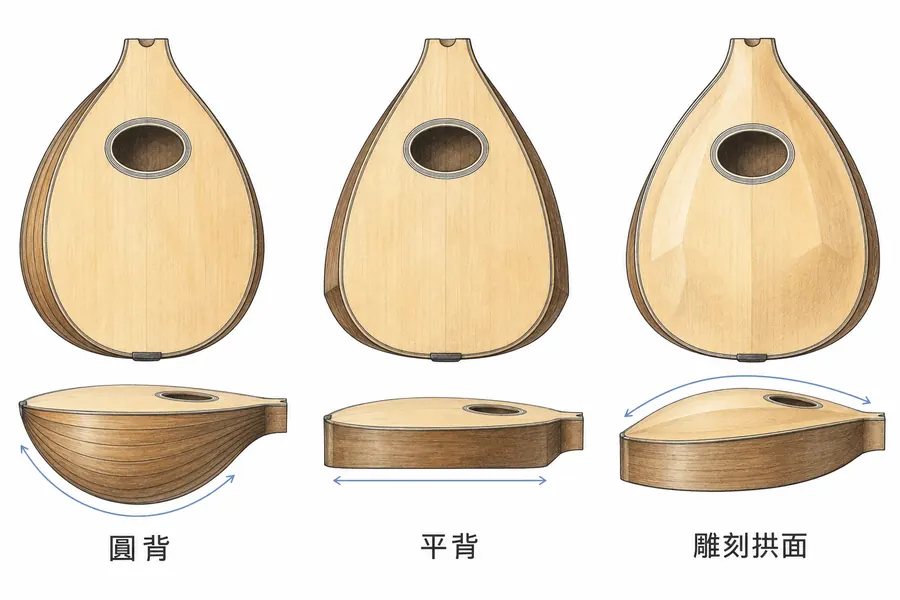
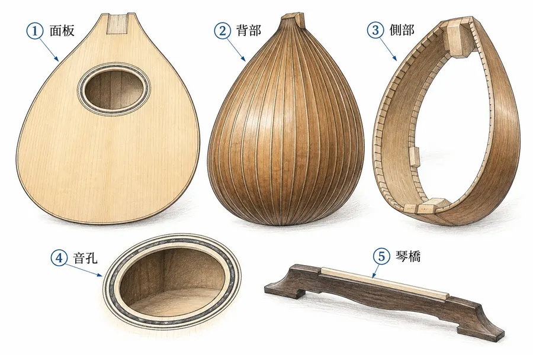
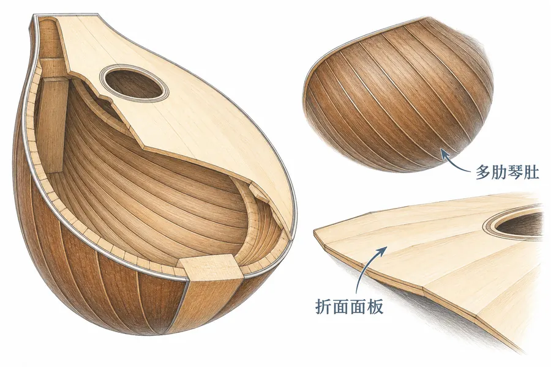
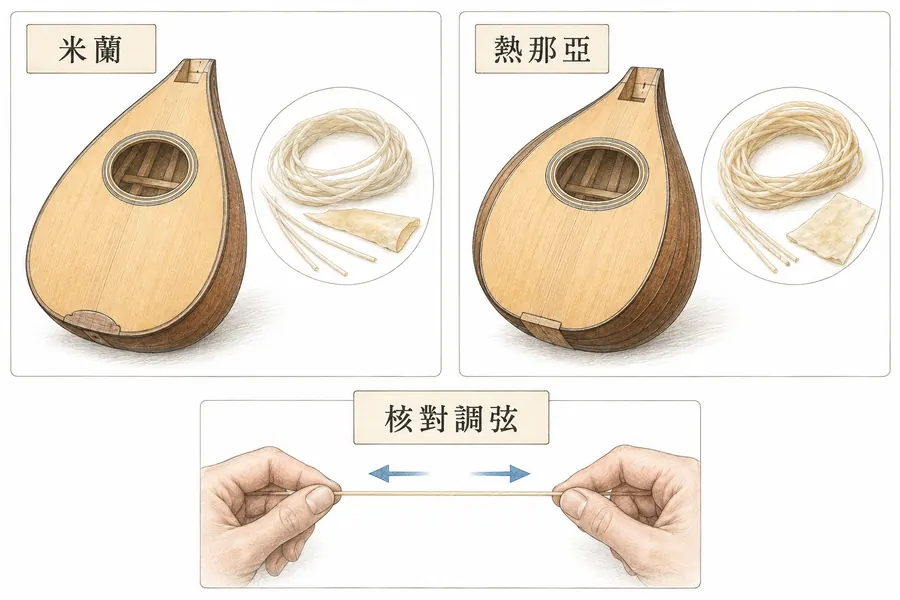
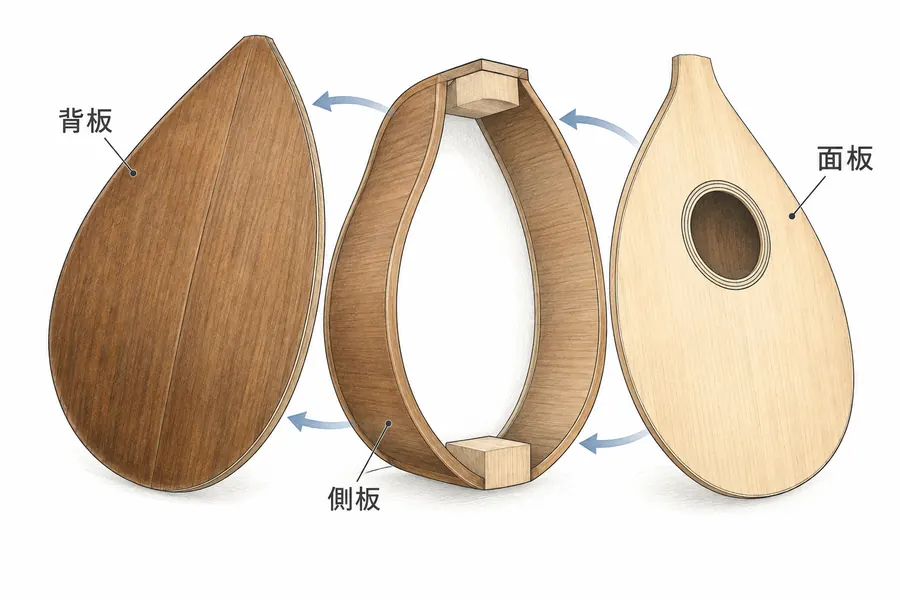
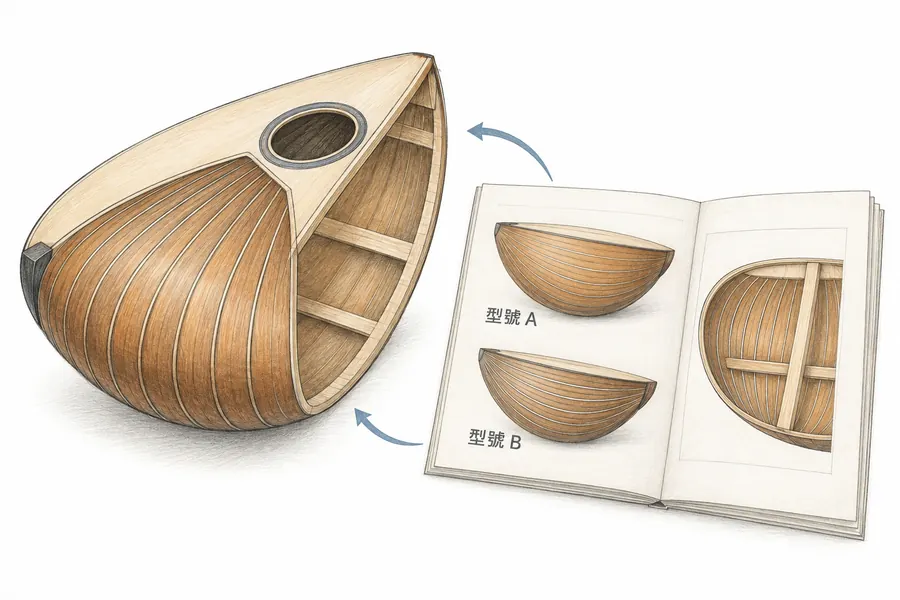
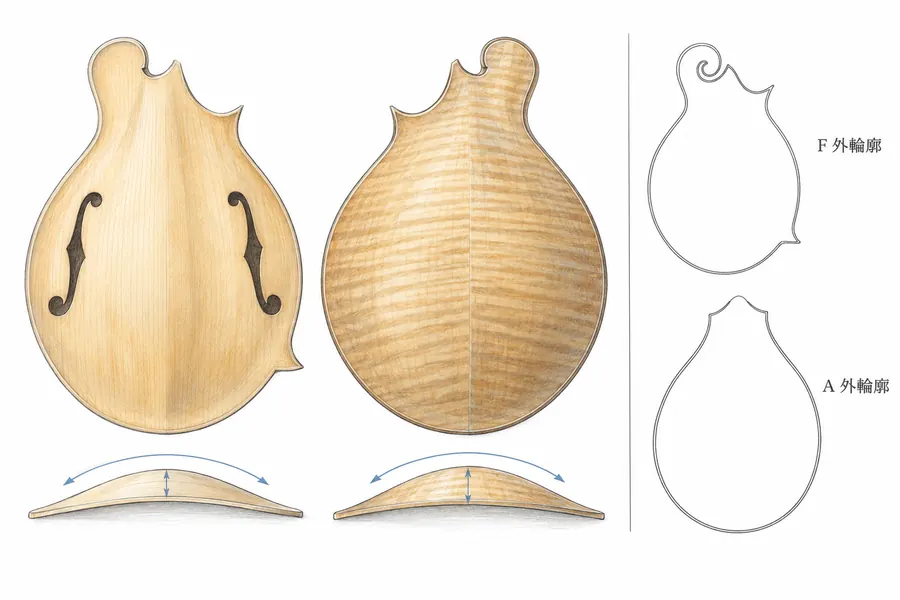
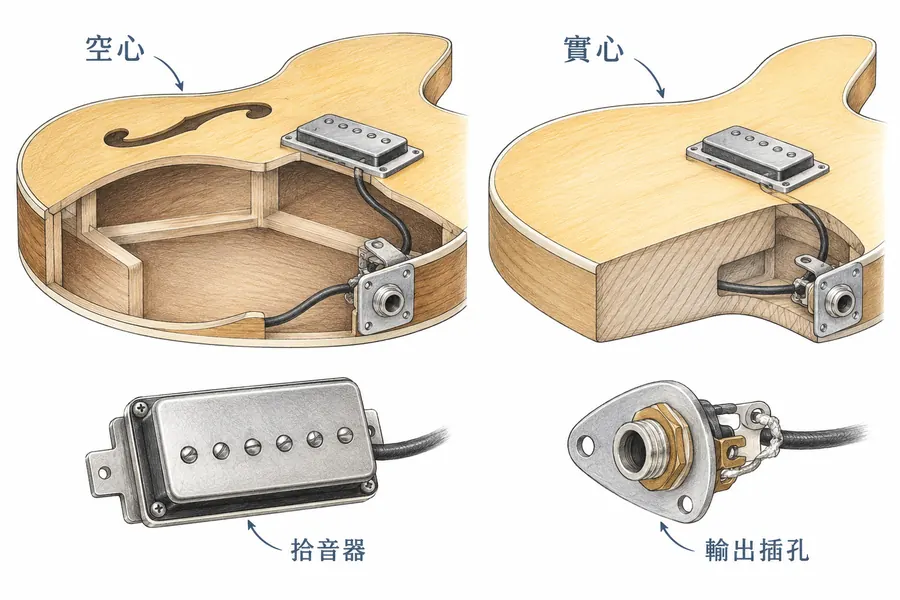
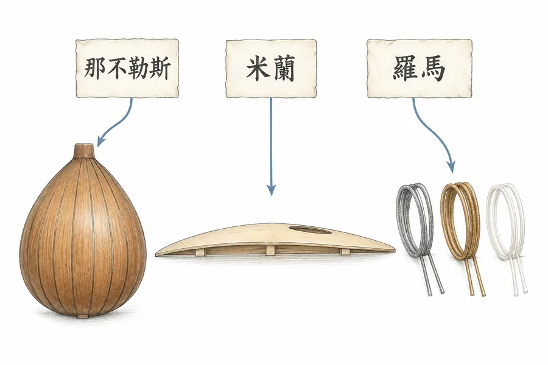

## 本章重點

- **家族**回答「音域與調弦」；**型制**回答「用什麼結構做出這個音域」。這是兩個不同的問題。
- 判斷型制要看五件事：**面板、背部、側部、音孔、琴橋**。正面輪廓只是第一步。
- 「圓背＝古典」「F-style＝bluegrass」「平背＝民謠」是歷史印象，不是結構描述。
- 「**Roman**（羅馬式）」這個詞最容易**跨時代混用**，所以**一定要加年代**。
- A-style／F-style 是**外形分類**，不是「初階／高階」的等級表。

---

兩把琴可以有一樣的 G–D–A–E 調弦，卻在琴體剖面、面板受力、音孔、琴橋與內部支撐上完全不同。

這就是「家族」和「型制」必須分開談的原因：

| **問題** | **由哪個概念回答** |
|---|---|
| 這件樂器屬於哪個音域？調什麼音？ | **家族**（family） |
| 這個音域是用什麼結構做出來的？ | **型制**（form／style） |

打個比方：家族是「這台車是轎車還是貨車」，型制是「它的引擎怎麼做的」。同一種車，可以有好幾種引擎做法。

最常見的錯誤，是把型制寫成**風格標籤**：

- 圓背＝古典
- F-style＝bluegrass
- 平背＝民謠

這些連結**有歷史根據**，但不能取代結構描述。

本章先看琴體怎麼承受弦力、面板怎麼工作，再談各地音樂文化如何選擇這些設計。

## 琴型與結構比較

*圖解　琴型與結構比較（示意）*

| **型制** | **背部／琴體** | **面板** | **典型弦系統** | **研究重點** |
|---|---|---|---|---|
| **Neapolitan bowlback**（那不勒斯圓背） | 多 ribs 深碗 | 折面＋ladder bracing | 8 弦／4 course | 高張力與 stiff bowl（剛硬碗狀背） |
| **Early Roman mandolino**（早期羅馬曼陀利諾） | 小型 roundback（圓背） | 早期 lute（魯特琴）式 | gut、多 course | 不可等同現代 Roman style |
| **Milanese／Genovese**（米蘭式／熱那亞式） | roundback | 依學派 | 常見 6 course gut | 調弦與命名不同 |
| **American carved-top**（美式雕刻拱面） | carved back＋sides | carved spruce top | 8 弦 GDAE | Gibson 專利系譜 |
| **Japanese family**（日本家族） | 圓背為主；低音可 flat | 依型號 | 完整家族 | 合奏需求與量產 |

表中幾個名詞先解釋：

- **ribs**：琴肚上拼成碗狀的狹長木條。
- **bowlback**（圓背）：琴背像碗一樣凸起的構造。
- **flatback**（平背）：琴背是平的。
- **bracing**（力木）：黏在面板內側的支撐木條。
- **ladder bracing**（梯式力木）：像梯子橫桿一樣橫向排列的力木。
- **carved**（雕刻成形的）：用整塊木料削出弧度，不是彎薄板。
- **gut**（腸弦）：用動物腸製成的弦，是鋼弦之前的材料。

## 6.1　琴型比較的五項要素

判讀一把曼陀林的型制，正面輪廓其實只是第一步。

真正有結構意義的問題，至少有五個：

| **#** | **要問的問題** | **可能的答案** |
|---|---|---|
| 1 | 面板是平的、折面的，還是雕刻拱面？ | flat／cant／carved |
| 2 | 背部是多 ribs 深碗、平背，還是 carved back？ | bowlback／flatback／carved |
| 3 | 側部是獨立 side ribs，還是 bowl shell 的一部分？ | 分開的／一體的 |
| 4 | 音孔是圓／橢圓、**f-hole**（f 形音孔），還是側孔？ | round／oval／f-hole／side port |
| 5 | 琴橋是浮動式還是固定式？ | floating／fixed |

只要把這五件事記錄清楚，即使遇到現代的 **hybrid**（混合結構琴），也能先描述可確認的結構，再討論它「像哪一派」。

相反地，如果只寫 A-style、F-style、Roman、Neapolitan，讀者很容易以為每個名稱都有全球完全固定的規格。

*圖解 6.1　琴型比較的五項要素（示意）*

### 2022 年研究的做法

2022 年的義大利曼陀林聲學研究，特別選擇了三件樂器來比較：

- 1906 年 Naples（那不勒斯）琴
- 1908 年 Milan（米蘭）琴
- 一件二十世紀初的 Roman-style（羅馬式）樂器

之所以選這三件，正是因為這些學派的幾何與支撐方式不同。

研究並沒有把差異化成「誰比較好聽」。它量測的是 **bridge admittance**（琴橋導納）、**sound radiation**（聲音輻射）與 **modal shapes**（模態形狀）。

這正是專業型制比較應有的做法。〔F08〕

### 還有一個常被忽略的維度

再加上一個維度：**neck/body joint**（琴頸與琴身的接合）與 **neck projection**（琴頸伸出琴體的程度）。

兩把正面輪廓相近的琴，如果琴頸伸出琴體的長度不同，**高把位可及性**與**琴橋高度**就會改變。

美式 carved-top 後來特別強調 neck projection，而某些圓背傳統則保留較貼近琴體的幾何。

所以「型制」最終是多個**幾何關係**的集合，不是一個 **silhouette**（外型剪影）。

做研究圖鑑時，正面、側面與內部 bracing 三種視圖的資訊價值，遠高於只拍一張漂亮的正面照。

## 6.2　那不勒斯圓背琴

那不勒斯式最醒目的特徵，是 **bowlback**（碗狀圓背）。

許多狹長的 ribs 沿著模具組成深碗。曲面本身形成很高的**幾何剛性**（形狀帶來的硬度）。

聲學研究也指出，圓背 shell 的 **back modes**（背板模態）往往比面板高得多。

因此它不像某些吉他那樣，形成明顯的 **live back**（會主動參與振動的背板）耦合。

換句話說，那不勒斯琴主要可動的聲學表面，更集中在 **soundboard**（面板）。〔F08〕

### 面板的折面是另一個核心

面板在琴橋附近的 **bend／cant**（折面），是另一個核心特徵。

它同時做兩件事：

1. 改變弦力進入面板的**幾何角度**。
2. 增加局部**剛性**。

配合橫向的 ladder bracing，形成與 **flat-top guitar**（平頂吉他）很不一樣的模態排序。

2022 年的研究指出：這種 bracing 讓現代義大利圓背曼陀林，在低頻的 **signature modes**（特徵模態）上，呈現與 lute 類樂器較相近的特徵。〔F08〕

*圖解 6.2　那不勒斯圓背琴（示意）*

打個比方：折面面板像一張對折過的紙。同樣的紙，折過之後就**硬很多**，不容易塌。這是形狀本身帶來的強度，不是靠厚度。

### 這是一整套結構答案

所以圓背不應該只被描述成「比較有義大利味」。

它是**高張力八弦系統的一整套結構答案**：

- stiff bowl（剛硬的碗狀背）
- bent top（折面面板）
- bracing（力木）
- floating bridge（浮動琴橋）
- tailpiece（尾弦板）

這五件事一起工作。改其中一項，往往就會牽動其他部分。

深碗 shell 的剛性，也解釋了為什麼 bowlback 不能用 flat-back guitar 的直覺去理解。

吉他的背板常會在低頻與面板明顯耦合。

但研究中的傳統義大利 bowlback，因為曲率高、結構硬，背部的低頻活動相對小。

這**不等於**「背板完全不發聲」，而是它在整體模態中的**角色不同**。〔F08〕

> **【常見誤解】**
> **誤解**：「圓背琴的背板很硬，所以背板完全不參與發聲。」
> **事實**：不是完全不發聲，是它在整體模態裡的角色和吉他不同。背部低頻活動相對小，不等於零。

對製琴師而言，這種結構會把更多調整重點放回 soundboard：**top thickness**（面板厚度）、bend、bracing 與 **bridge coupling**（琴橋耦合）。

對演奏者而言，則會感受到快速的 attack 與清楚的**音頭**。

但具體結果仍要看**個別那把琴**，不能把研究群體的平均值，當成每一把琴的音色保證。

## 6.3　早期羅馬琴與現代羅馬琴

「羅馬式」這個詞，最容易跨時代混用。

### 兩個完全不同的「Roman」

| **名稱** | **年代** | **它是什麼** |
|---|---|---|
| **Roman mandolino**（羅馬曼陀利諾） | 約 1710 年（Met 藏品） | 較早的 **mandolino del vecchio tipo**（舊型曼陀利諾）：多組腸弦、鐮刀形琴頭、較小琴身 |
| **Roman style**（現代羅馬式） | 十九、二十世紀 | 現代八弦型制，屬於 modern Italian mandolin（現代義大利曼陀林）的一員 |

紐約大都會博物館（Met）約 1710 年的 Roman mandolino，屬於上表第一列。〔F03〕〔F27〕

到了十九、二十世紀的 modern Italian mandolin 世界，又出現被稱為 Roman style 的**現代八弦型制**。

2022 年聲學研究中的那把匿名 Roman-style mandolin，已經是現代曼陀林架構的一員，可以和 1906 Naples、1908 Milan 進行 bridge admittance 比較。

這和 1710 年的 early Roman mandolino **不是同一種規格**。〔F08〕

*圖解 6.3　早期羅馬琴與現代羅馬琴（示意）*

這就像「手機」這個詞：1995 年的手機和 2025 年的手機都叫手機，但沒人會認為它們是同一種東西。

所以本書遇到「Roman」時，會**加年代**。如果沒有年代，就至少描述 course 數、弦材與 tuning。

這個例子非常適合說明：為什麼地域名稱本身不能取代技術規格。

### 對收藏者的提醒

Roman 這個案例也提醒收藏者：看標籤時要問「**誰在何時使用這個名稱**」。

十八世紀的 regional mandolino 和二十世紀的 modern Roman-style，在拍賣頁上都可能只寫 Roman mandolin。

如果不加年代，搜尋結果本身就會混在一起。

本書的資料庫因此把 **region/style** 和 **family/tuning** 分成兩欄：

| **欄位** | **記錄什麼** | **例子** |
|---|---|---|
| region／style | 型制與地域描述 | Roman |
| family／tuning | 調弦描述 | G–D–A–E |

兩欄分開，才不會把歷史上的同名，誤當成同一種規格。

## 6.4　米蘭式與熱那亞式

### 米蘭式：Presbler 1796

1796 年 Presbler（普雷斯布勒）的 **Milanese-style mandolin**（米蘭式曼陀林）使用**六對琴弦**，圓背由**十七條 rosewood ribs** 構成。

它的配對 mandola，音域低一個八度。

這套系統證明：十八世紀末即使那不勒斯四 course 已經相當成熟，米蘭仍保有自己的**六 course 傳統**。〔F06〕

### 熱那亞式：Nonnemacker

**Genovese**（熱那亞式）的 Nonnemacker 琴，同樣有六對 **gut strings**（腸弦）。

但館藏記錄顯示它的特徵不太一樣：

- 調弦類似現代吉他的**音程架構**
- 整體**高一個八度**
- 琴頭呈 **guitar-like peg block**（吉他式弦軸座）

這些特徵讓它和 Roman old type、Milanese，以及 Neapolitan 都有差異。〔F05〕

*圖解 6.4　米蘭式與熱那亞式（示意）*

### 三句話總結

| **學派** | **弦數** | **最特別的地方** |
|---|---|---|
| **Milanese** | 六對 | 十七條 rosewood ribs；有低八度的配對 mandola |
| **Genovese** | 六對腸弦 | 調弦類似現代吉他、整體高一個八度、吉他式琴頭 |
| **Neapolitan** | 四 course（八弦） | 後來成為主流，也是現代曼陀林的基礎 |

> **【常見誤解】**
> **誤解**：「看到 Milanese 或 Genovese，就把現代的 G–D–A–E 指法直接套上去。」
> **事實**：這些是六 course 系統，調弦和現代曼陀林不同。演奏前，先找實物或文獻確認 tuning。

對演奏者而言，最實際的結論就是上面那一句。

對研究者而言，則要避免因為今日那不勒斯系統占主流，就把其他義大利傳統寫成「旁支」。

### 六 course 牽動的不只是音

六 course 系統還會改變**琴橋與上弦枕的弦槽安排**。

course 數越多，在同樣的指板寬度下，弦距就必須更密，或者琴頸必須變寬。

這也是 Met 的 Roman mandolino **指板後來被加寬**很值得注意的原因。

結構上的改造，往往能從人體工學的需求反推回去。〔F03〕

Presbler 的**配套琴**（matched pair）又顯示：相同的外觀語彙，可以向不同音域延伸。

研究這些琴時，把 mandolin 與 mandola 一起看，比單獨看其中一把，更容易理解製琴師如何安排比例與 tuning。〔F06〕

## 6.5　德國與中歐平背琴

德國與中歐的 **flatback**（平背）傳統，常和 **Zupforchester**（德語「撥弦樂團」）文化連在一起。

平背、較扁的琴體，能提供不同的製造與持琴條件，也方便向 mandola、低音家族延伸。

但如果只說「平背聲音比較柔」，就過度簡化了。

因為音色仍取決於面板、bracing、弦長、弦，以及整體設計。

### 更有歷史意義的是社會用途

Sparks 對 1918–1945 年的研究指出：德國與奧地利在兩次世界大戰之間，發展出新的演奏風格，mandolin orchestra 也和**工人文化組織**發生了關係。

當大型團體需要「穩定、可大量取得、容易編制」的家族樂器時，型制就會受到**制度需求**的影響。〔F20〕

*圖解 6.5　德國與中歐平背琴（示意）*

所以型制不是製琴師單方面「發明一個聲音」。

教育、社團、價格、運輸與演奏姿勢，都會反過來選擇「什麼結構適合長期使用」。

這和日本後來完整的 mandolin／mandola／mandocello 生產線，有相似的邏輯。

打個比方：這就像學校採購樂器。學校不會挑最特別的那把，而是挑「壞了能修、能買到二十把、音準都差不多」的那一款。

> **【常見誤解】**
> **誤解**：「平背琴做起來比較便宜，音量也比較小。」
> **事實**：平背的實際優勢之一，是製作與收納的邏輯和深碗不同。但不能因此推論它一定更便宜或音量更小。高階手工 flatback 同樣可能非常複雜。真正的差異，仍要回到面板、bracing、弦長與整體工藝。

德奧兩戰之間的發展，更能說明「制度會挑選型制」。

大量 **ensemble**（合奏團）需要可預測、可維修、不同聲部能配套的樂器，製琴設計自然會重視**一致性**。

這個需求，和 **solo luthier**（獨立製琴師）追求單把琴極致個性的目標，並不相同。〔F20〕

## 6.6　日本圓背琴

日本製琴很早就進入曼陀林市場。

Suzuki 官方年表記錄：**1906 年**開始製造販售 mandolin。

後來型錄中的配置是這樣的：

| **型號** | **結構** | **音域** |
|---|---|---|
| **M-30** | 圓背、多片構成 | 標準 mandolin |
| **M-100** | 圓背、多片構成 | 標準 mandolin |
| **MD-4／MD-10** | MD-4 延續家族圓背語彙 | 延伸到 mandola |
| **MC-836** | rosewood flat-body | mandocello |

這本身就是「**不同音域可以採用不同背部結構**」的實例。〔F25〕〔F26〕

標準 mandolin 與 mandola 保留多片圓背，與日本古典 mandolin orchestra 的義大利系傳統相容。

低音 mandocello 則採 flat body，**可能**在尺寸、重量與低頻效率上提供更實際的折衷。

這裡應該避免把原因說得過度確定：型錄能證明**結構與材料**，卻不能單靠型錄就斷言製琴師所有的**設計動機**。

*圖解 6.6　日本圓背琴（示意）*

日本型制的真正特色，因此除了一張外觀照片，也包含「**家族化量產 ＋ 大學／社會人合奏**」。

當某種音樂文化長期需要第一、第二 mandolin、mandola、mandocello 與吉他，製琴業就會自然發展成完整的規格系統。

Suzuki 2017 年型錄可以看到一個很具體的分工：M-30 的 body 是 maple 多片圓背，MD-4 仍延續家族圓背語彙，MC-836 則使用 rosewood flat body。

這些型號顯示：**同一間製造商，會依音域採用不同結構**。〔F26〕

> **【常見誤解】**
> **誤解**：「Suzuki 就是圓背琴的品牌。」
> **事實**：「品牌＝型制」的寫法很危險。Suzuki、Calace、Gibson 等品牌，都可能橫跨多種結構與年代。真正可比較的單位，應該是**具體型號與年份**。

## 6.7　美式雕刻拱面琴

**Orville Gibson**（奧維爾・吉普森）的 1898 年專利，重點在從根本改變製作的思路。

他批評傳統樂器由太多「彎曲、拼接、膠合」的零件構成。

他提出的構想是：

- 把 **rim**（側框）、**neck**（琴頸）、**head**（琴頭）由**一塊木材整體雕成**。
- top 與 back 也各自由實木雕刻。
- 甚至讓 **hollow neck**（空心琴頸）和琴體內腔相通。

〔F10〕

Met 收藏的 1898 年實物與專利相符：

- spruce carved top（雲杉雕刻面板）
- walnut carved back（胡桃木雕刻背板）
- floating bridge（浮動琴橋）
- tailpiece（尾弦板）
- 大橢圓音孔
- 後來被稱為 **Model A** 的淚滴輪廓

這些特徵建立了美式 **archtop mandolin**（拱面曼陀林）的出發點。〔F11〕

*圖解 6.7　美式雕刻拱面琴（示意）*

### A-style 與 F-style 不是等級表

後來 Gibson **F-style** 與 **Loar 時期**又進一步發展出：

- **捲角**（scroll，琴身上的螺旋狀裝飾）
- **f-holes**（f 形音孔）
- 較長的 **neck projection**

但理解這段歷史，最重要的是這一句：

**A-style／F-style 首先是美國 carved-top 家族的「外形分類」，不是「初階／高階」的通用等級。**

現代高級 A-style 完全可能在材料與工藝上超過大量 F-style。

> **【常見誤解】**
> **誤解**：「F-style 有捲角，所以比 A-style 高級。」
> **事實**：A 與 F 是外形分類。捲角與裝飾不代表品質等級。現代高級 A-style 在材料與工藝上超過大量 F-style，是完全可能的事。

### 專利要從「製造觀點」讀

Gibson 的專利還值得從製造觀點來讀。

他強調減少「由彎曲薄板與大量膠合件」構成的傳統方式，提出 **carved solid pieces**（實木雕刻件）的結構理想。

這既是**聲學主張**，也是**製造哲學**。

專利文字本身代表的是「發明者想解決的問題」，不等於所有後續的 Gibson 琴都完全照原方案製作。〔F10〕

所以研究品牌史時，要區分三個層次：

| **層次** | **是什麼** | **證據** |
|---|---|---|
| 1. patent concept | 專利裡的構想 | 1898 年專利文件〔F10〕 |
| 2. production instrument | 實際做出來的琴 | Met 1898 實物〔F11〕 |
| 3. 後續演化 | F-style／Loar 時期 | 1910–20 年代的型號 |

把三層分開，能避免把 1898 年的專利，直接當成 1920 年代 **F-5** 的規格表。

## 6.8　混合結構與電曼陀林

今天的曼陀林可以是：

- **flat-top**（平頂）
- **carved-top**（雕刻拱面）
- **solid-body**（實心琴體）

也可能使用**側音孔**、**磁性拾音器**、**piezo**（壓電拾音器），或其他混合配置。

遇到這些樂器時，硬把它歸成「義大利式」或「美式」，未必有幫助。

### 比較可靠的記錄方式：分層描述

依序記錄這幾層，再說它的歷史風格來源：

1. 弦數與 course
2. tuning
3. scale length
4. top／back 結構
5. bridge
6. soundholes（音孔）
7. pickup（拾音器）

例如一把 solid-body **electric mandolin**（電曼陀林），可能仍採 G–D–A–E 五度調弦，但它的聲音已經不依靠 acoustic soundboard radiation（面板的聲學輻射）。

這時，傳統的圓背／平背聲學分類就不是重點了。

*圖解 6.8　混合結構與電曼陀林（示意）*

這也是資料庫的思維：**先記錄可查證的結構，再補上風格名稱。**

只要這個原則穩定，未來出現新的 hybrid，也不需要一直發明新的「家族」。

### 電聲化改變了「共鳴箱」的地位

電聲化讓「共鳴箱」的角色從**必需**變成**可選**。

| **拾音方式** | **怎麼取得訊號** |
|---|---|
| **磁性拾音器**（magnetic pickup） | 主要感應金屬弦的振動 |
| **piezo**（壓電拾音器） | 從琴橋／結構取得振動訊號 |

solid-body 因此可以大幅降低 acoustic body radiation（琴體的聲學輻射）。

這時評價標準會轉向：

- **pickup balance**（各弦拾音是否均衡）
- **feedback resistance**（抗回授能力）
- **效果器相容性**
- **舞台監聽**

依舞台用途，評估整套系統。

### 但它仍然是曼陀林

不過 electric mandolin 仍可能保留 mandolin 的**身分**：五度調弦、短弦長、撥片語法與典型音域，都能延續。

這再次說明：**家族分類**和**琴體型制**是兩層不同的問題。

## 6.9　案例　那不勒斯、米蘭與羅馬琴的比較

2022 年的研究選了三件歷史上的「現代型」曼陀林：

| **樂器** | **年份** | **製作者／地點** |
|---|---|---|
| 1 | 1906 | E. De Cristofaro（Naples） |
| 2 | 1908 | A. Monzino（Milan） |
| 3 | 二十世紀初 | Roman style（作者匿名） |

另外還加了研究團隊自己製作的現代實驗琴。

研究使用 **impact hammer**（衝擊錘）、**accelerometer**（加速度計）、內外**麥克風**，量測 bridge admittance 與 sound radiation。〔F08〕

*圖解 6.9　案例　那不勒斯、米蘭與羅馬琴的比較（示意）*

### 結果最值得注意的地方

結果最值得注意的重點，是**不同琴仍然共享某些 modern Italian mandolin 的特徵行為**：

- 低頻可以辨識出 **air／soundboard**（空氣／面板）相關的模態。
- 高頻模態逐漸密集。
- 圓背因為高曲率形成很高的剛性，背板振動不像吉他那樣強烈參與低頻耦合。

這個案例對一般讀者的價值，是把「型制差異」從**印象語言**拉回**可量測的問題**。

當有人說某種琴「比較開」「比較亮」「比較直」，接著應該核對：

- 他說的是 **attack**（起音）？
- 是 **SPL**（sound pressure level，音壓級）？
- 是某個**頻段共振**？
- 還是演奏者與和弦的差異？

專業的比較，從這裡開始。

### 為什麼要用儀器

這類聲學研究的另一個價值，是提供**可重複**的比較方法。

- impact hammer 給樂器一個**可控制的輸入**。
- accelerometer 記錄**結構運動**。
- 麥克風記錄**聲輻射**。

研究者就能把「演奏者今天手比較重」這種變因，降到比較低。〔F08〕

當然，實驗室量測也不能完全替代演奏。

**musical response**（音樂性的反應）還包含非線性、不同的撥擊位置，以及演奏者的控制。

最合理的態度是：

| **層次** | **用什麼補** |
|---|---|
| 客觀層 | 量測，用來描述結構 |
| 主觀層 | 盲聽與實際演奏 |

把量測與聽感放在一起判讀。

## 自我學習題庫

*學習檢查：作答、核對、複習*

先自己作答，再看答案。答錯時回到本章相關小節重新讀一次。

**1. Bowl-back 的「bowl」主要指？**

- A. 琴頭
- B. 圓背琴肚
- C. 琴橋
- D. 撥片

**2. Orville Gibson 的 carved-top 系統代表什麼？**

- A. 把圓背壓扁
- B. 另一套雕刻拱面結構思路
- C. 只改裝飾
- D. 取消琴橋

**3. 比較不同型制時，除了外觀還應看？**

- A. 面板、背部、音孔與琴橋
- B. 只看價錢
- C. 只看年份
- D. 只看顏色

**答案：1.B　2.B　3.A**

## 本章主要查證來源

*查證來源：找原文、核條件、留紀錄*

**〔F03〕The Metropolitan Museum of Art，Mandolino, Rome, ca. 1710，Met 2008.2a, b。** 典型早期羅馬 mandolino；六組腸弦、鐮刀形琴頭與歷史改造痕跡。

> https://www.metmuseum.org/art/collection/search/505783

**〔F05〕The Metropolitan Museum of Art，Mandola o mandolino alla Genovese, Christian Nonnemacker, 18th c.，Met 89.4.1069。** 六組成對腸弦、吉他式琴頭與熱那亞式調弦案例。

> https://www.metmuseum.org/art/collection/search/501651

**〔F06〕The Metropolitan Museum of Art，Giuseppe Presbler Mandolin and Mandola, 1796/1797，Met 1989.344.1–2。** 米蘭式六組複弦曼陀林與低八度 mandola 的配套實物。

> https://blog.metmuseum.org/guitarheroes/mandola-1797/

**〔F08〕Quintavalla et al.，The Acoustics of Traditional Italian Mandolins and Their Relation with Soundboard Wood Properties，International Journal of Wood Culture 2, 2022。** 1906 那不勒斯、1908 米蘭與羅馬式等現代義大利曼陀林聲學比較。

> https://www.sciencedirect.com/org/science/article/pii/S2772318622000017

**〔F10〕United States Patent Office / Google Patents，US598245A – Mandolin, Orville H. Gibson，Patented 1898-02-01。** Orville Gibson 一體式 rim/neck/head、carved top/back 與 hollow neck 的原始專利。

> https://patents.google.com/patent/US598245A/en

**〔F11〕The Metropolitan Museum of Art，Mandolin, Orville Gibson, 1898，Met 2015.643a–c。** 與 1898 專利設計一致的 surviving instrument。

> https://www.metmuseum.org/art/collection/search/700485

**〔F20〕Paul Sparks，1918–1945, The Classical Mandolin，Oxford University Press, 2005。** 德奧新演奏風格、工人組織、法國教育與戰間期變化。

> https://academic.oup.com/book/10241/chapter-abstract/157939527

**〔F25〕鈴木バイオリン製造，年表，accessed 2026-10-06。** 1906 年開始製造販售曼陀林等日本製造史料。

> https://www.suzukiviolin.co.jp/about/factory/

**〔F26〕鈴木バイオリン製造 / Suzuki Music，2017 string-instrument catalog，2017。** M-30、M-100、MD-4、MD-10、MC-836 等日本家族規格與弦長。

> https://www.suzuki-music.co.jp/app/uploads/2017catalog14.pdf

**〔F27〕The Metropolitan Museum of Art，Recent Acquisitions 2007–2008: Roman mandolino ca. 1710–20，Met Bulletin 66(2)。** mandolino del vecchio tipo：小型、鐮刀形琴頭、四至六組腸弦、以手指撥奏。

> https://resources.metmuseum.org/resources/metpublications/pdf/Recent_Acquisitions_A_Selection_2007_2008_The_Metropolitan_Museum_of_Art_Bulletin_v_66_no_2_Fall_2008.pdf

---

沿著受力與發聲路徑認識零件，理解材料、工藝與演奏設定的關係。

**閱讀範圍**　第 7 章至第 11 章

---
