## 本章重點

- 曼陀林不是一堆零件的目錄，而是**一條連續的受力與振動路徑**：弦鈕 → 上弦枕 → 指板 → 琴橋 → 尾弦板。
- **改一個零件，其他地方會跟著變。** 例如上弦枕太高，除了難按，還會讓低把位音偏尖。
- 琴格不會「自動保證準」。按弦時的**伸長量**與琴橋的**補償**，都會影響實際音準。
- 面板同時要「輕」和「強」，這是所有弦樂器面板設計的核心矛盾。
- 歷史上的曼陀林**沒有單一標準構造**。Vinaccia 1781 與 Gibson 1898，就是兩套成熟的結構哲學。

---

把曼陀林拆成琴頭、琴頸、指板、面板、琴橋、琴肚，看起來像是在做零件目錄。

但真正理解樂器結構，關鍵不在「記住零件名字」，而在**這些零件如何形成一條連續的受力與振動路徑**。

### 這條路徑長什麼樣子？

想像弦是一條被拉緊的繩子，沿著這條路線走：

| **順序** | **零件** | **它做什麼** |
|---|---|---|
| 1 | **弦鈕**（tuning peg） | 把弦拉緊 |
| 2 | **上弦枕**（nut） | 弦的第一個支點，決定空弦起點 |
| 3 | **指板／琴格**（fingerboard／fret） | 讓左手把弦按到不同音高 |
| 4 | **琴橋**（bridge） | 把弦的振動傳給面板 |
| 5 | **尾弦板**（tailpiece） | 固定弦的另一端 |

這條路徑上，任何**幾毫米**的變化，都可能影響手感、音準、起音，甚至結構壽命。

打個比方：這就像腳踏車的煞車線。中間任何一段稍微卡住，你按把手的手感就會不一樣。

### 歷史上的曼陀林沒有「標準解剖」

| **琴** | **年份** | **構造特色** |
|---|---|---|
| **Vinaccia 那不勒斯曼陀林** | 1781 | 深碗圓背、折面 spruce soundboard、八根弦、**木製弦軸** |
| **Orville Gibson 美式琴** | 1898 | spruce 雕刻拱面、背側大量採 walnut、浮動琴橋、尾弦板、空心琴頸 |

把這兩把琴放在一起，比死背「標準構造」，更能看出曼陀林為什麼會有那麼多流派。〔S701〕〔S702〕

本章的主線是三段：**受力 → 演奏幾何 → 振動傳遞**。

每個零件都會回答三個問題：

1. 它**承受什麼力**？
2. 它**怎麼影響演奏者**？
3. 它和其他零件之間**有什麼連鎖關係**？

這樣到了後面的聲學、製琴與 **Setup**（設定調整）章節，就能沿著同一個結構邏輯繼續深入。

## 7.1　琴弦張力與受力路徑

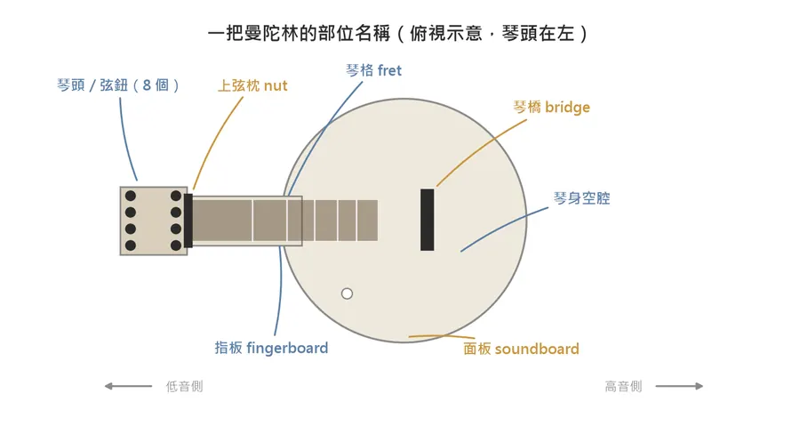

*圖 G　一把曼陀林的部位名稱（俯視示意，琴頭在左）。*

曼陀林的八根琴弦在調音後，會持續拉扯樂器。

這股力沿著琴頭、琴頸、琴身、琴橋與尾弦板，形成一個**封閉的力學迴路**。

| **零件** | **承受什麼** |
|---|---|
| **琴頸** | 要抵抗向前彎曲 |
| **面板** | 要承受琴橋傳入的壓力與剪力 |
| **尾弦板及其固定處** | 承擔琴弦另一端的拉力 |

結構設計的第一個任務，就是確保琴在合理張力下，**不會逐漸失去幾何**。

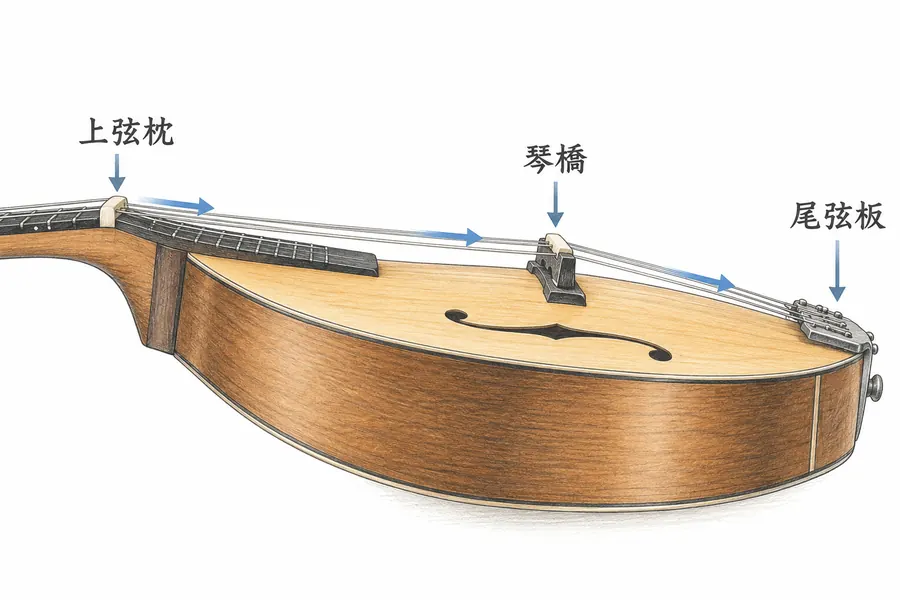

*圖解 7.1　琴弦張力與受力路徑（示意）*

### 為什麼不能單獨看某個零件

假設琴橋高度增加，會發生什麼事？

1. **action**（弦距，弦離指板的高度）可能升高。
2. 琴弦越過琴橋的**折角**（break angle）也會改變。
3. 折角改變，琴橋對面板的**載荷分量**也跟著改變。

再看另一個例子：上弦枕過高。

表面上看，只是左手比較難按。但實際上，它還會讓第一把位按弦時產生**額外的拉伸**，使音高偏尖。

真正專業的結構閱讀，永遠是在看「**改一處，其他地方跟著怎麼變**」。

> **【常見誤解】**
> **誤解**：「上弦枕太高，只是比較難按而已。」
> **事實**：它會讓低把位按弦時弦被額外拉長，音高偏尖。這是幾何造成的，不是你的耳朵有問題。

### 中古琴更要這樣看

對中古琴尤其如此。

一把琴的琴橋可能不是原配，指板可能曾經重整，琴頸角度可能因為多年張力與濕度變化而改變。

只把零件名稱認出來，還不足以判斷狀態。

要觀察的是：**它們彼此的相對位置是否仍在合理範圍內。**

這也是本章最後的案例分析會反覆練習的能力。

## 7.2　琴頭與調音機構

早期曼陀林常使用類似小提琴的**木製弦軸**。

1781 年 Vinaccia 的實物上，可以看到八個由琴頭後方插入的 **fiddle-style pegs**（小提琴式弦軸）。

這種機構**沒有齒輪減速**，調音靠弦軸與孔壁的**摩擦力**。

操作手感、穩定性，和現代機械弦鈕完全不同。

後來金屬弦、較高張力與更頻繁的合奏使用成為常態，**齒輪式弦鈕**提供了更細緻的調整能力，也降低了日常調音的門檻。〔S701〕

### 三種常見配置

| **類型** | **常見於** | **特點** |
|---|---|---|
| 木製摩擦式弦軸 | 早期曼陀林 | 無齒輪減速，靠摩擦力 |
| 成組機械式弦鈕（內藏式或側置） | 現代圓背琴，如 Calace | 調整細緻，較穩定 |
| 四對弦鈕沿琴頭兩側排列 | 美式 A／F-style | 排列方式不同 |

這些差異不只是美觀。

琴弦離開上弦枕後**前往弦鈕的方向**，會影響弦在 **nut slot**（上弦枕弦槽）內的側向摩擦。

**琴頭角度**則會影響上弦枕處的**下壓分量**。

設計得不理想或加工粗糙時，調音容易出現一種討厭的**黏滑現象**：「轉了半圈沒反應，突然一下跳過頭」。

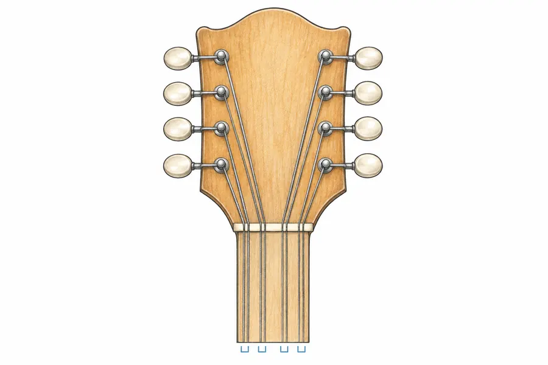

*圖解 7.2　琴頭與調音機構（示意）*

### 調音不穩，先別急著換弦鈕

調音不穩時，很多人的第一反應是換高級弦鈕。

但真正的問題，可能在上弦枕。

如果弦槽寬度與弦徑不匹配、槽底粗糙，或琴弦路徑急轉，弦就會在上弦枕處**卡住**。

這時弦鈕本身即使沒有回程間隙，也可能呈現不穩定。

診斷時，應該區分三種不同來源：

| **症狀** | **可能來源** |
|---|---|
| 轉一點點沒反應，再轉就跳過頭 | **gear backlash**（齒輪回程間隙） |
| 弦鈕轉起來鬆鬆的，撐不住 | **弦軸摩擦不足** |
| 轉了有反應，但弦在某處卡卡的 | **nut binding**（上弦枕卡弦） |

依症狀逐項排查，而不是一次換掉所有東西。

## 7.3　上弦枕與低把位手感

**上弦枕（nut）** 通常很小，但它同時決定四件事：

1. 空弦的起點
2. 弦距
3. 弦槽高度
4. 琴弦進入琴頭的路徑

對有琴格的樂器而言，**弦槽太高**的後果特別明顯。

演奏者按下第一、二格時，必須把琴弦向下拉更遠。除了手感變硬，琴弦還會被**額外拉長**，導致低把位按弦音偏尖。

這種偏尖是**幾何**造成的。

### 弦槽太低也不行

弦槽太低，會造成另一組問題：空弦可能撞到第一格，出現 **buzz**（打弦雜音）。

如果只有**一組**弦異常，還要進一步判斷原因：

- 槽深？
- 槽角？
- 弦徑？
- 琴格高度？

理想的弦槽，要讓琴弦在上弦枕**靠指板的一側有清楚的有效接觸點**，之後平順下降到琴頭。

如果接觸位置模糊，空弦的**有效弦長**就會變得不穩定。

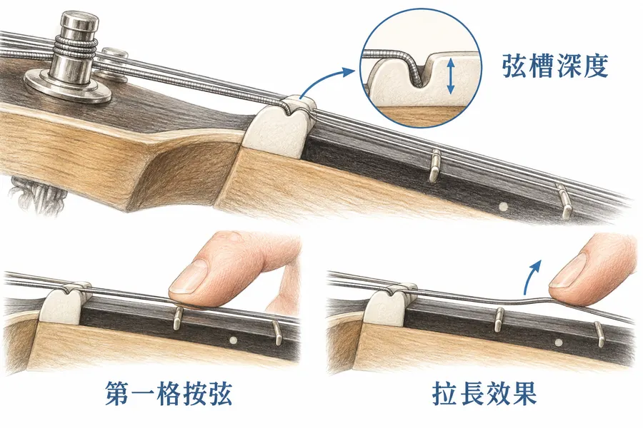

*圖解 7.3　上弦枕與低把位手感（示意）*

打個比方：上弦枕就像跑道上的起跑線。起跑線模糊，每一趟的距離就不一樣。

### 複弦樂器多一個問題

同一 course 的兩根弦，如果槽距不均、深度不同：

- 右手撥擊時的**阻力**會不一致。
- 左手**按弦感**也會不一致。

對標準曼陀林而言，八個弦槽更準確地說，是**四組需要成對工作的幾何**。

這也是為什麼換到明顯不同 **gauge**（弦徑規格）的弦組時，不一定只是「裝上去就好」。

如果弦徑和槽寬差異太大，Setup 可能必須跟著調整。

## 7.4　琴頸角度與指板

琴頸是左手握住的部位。但從結構上看，它更像**一支把弦張力和琴身連接起來的樑**。

琴頸的厚度、材料、截面形狀與接合方式，都會影響**剛性**。

更關鍵的是 **neck angle**（琴頸角度），也就是指板平面相對於琴身與琴橋的幾何關係。

neck angle 若逐年變小，演奏者可能會發現：action 越來越高，卻已經無法再把琴橋降下去。

這時問題的根源，在**整套幾何**，不在琴橋。

### 不同傳統的琴頸差很多

Orville Gibson 的 1898 年設計，甚至把琴身側部、琴頸與琴頭視為**可以整體雕出的結構**，並讓琴頸內部中空、與琴腔連通。

Met 保存的 1898 年實物，正具有這種特徵。

這**不是**今日所有 Gibson 曼陀林都沿用的做法。但它很好地說明了：「琴頸」並非只是一塊握把，而可以被納入整體的聲學與結構設計。〔S702〕〔S703〕

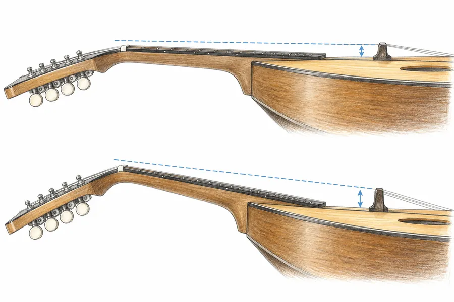

*圖解 7.4　琴頸角度與指板（示意）*

### 指板與琴格數

指板提供琴格的**安裝基準**。

材料需要**耐磨**、**尺寸相對穩定**，也要能承受反覆按弦與 **fretwork**（琴格施工）。

琴格數的演變，可以看成一條時間軸：

| **琴** | **年份** | **琴格數** |
|---|---|---|
| **Vinaccia** | 1781 | 13 個**金屬**琴格 |
| **Orville Gibson** | 1898 | 18 格 |
| **Calace 標準型號** | 現代 | 24 格 |
| **Calace concert 系列** | 現代 | 可到 29 格 |

格數變多，不只代表最高音域提高。

它也反映 **repertoire**（曲目）、把位技巧與舞台需求的擴張。〔S701〕〔S702〕〔S711〕

## 7.5　琴格與音高控制

琴格把連續的指板切成**離散的半音位置**，讓按弦音高更容易重複。

對曼陀林這種快速撥弦樂器而言，這大幅降低了旋律音準的負擔，也讓和弦與**雙音**更容易穩定。

但琴格**不會「自動保證準」**。

實際音準會受四個因素共同影響：

| **因素** | **影響** |
|---|---|
| 琴格位置 | 決定理論音高 |
| **fret crown** 的接觸點 | 弦實際接觸的位置 |
| 琴弦按下時的**伸長量** | 張力上升，音會變高 |
| 琴橋**補償** | 修正整體與分弦音準 |

### 真實的弦不是理想弦

**十二平均律**（把八度平均分成十二個半音的調律法）的理論位置可以精確計算。

但真實琴弦不是「沒有剛性的理想弦」。

尤其是：

- 粗的 **wound string**（纏繞弦，外層繞線的弦）
- 較高的 action
- 較強的按弦力量

這些都可能讓按下去的音，比理論位置**略尖**。

所以浮動琴橋常需要**整體或分弦補償**。

這也是為什麼「把琴橋放在剛好兩倍十二格距離」只能當**初始位置**，不能當**最終設定**。

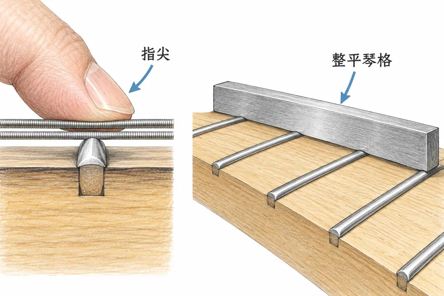

*圖解 7.5　琴格與音高控制（示意）*

### 琴格磨耗

琴格磨耗也會改變**有效接觸點**。

某幾格出現凹槽時，弦可能更容易碰到下一格。

如果只把單一高格磨低，又可能破壞整體的 **fret plane**（琴格平面）。

專業的 **fretwork**，重點是建立一條與**琴頸 relief**（琴頸的微彎量）、目標 action **相容的整體平面**，讓各琴格與整體弦路相配合。

> **【常見誤解】**
> **誤解**：「某一格打弦，就把那一格磨低就好。」
> **事實**：只磨單一格，可能破壞整體琴格平面。專業做法是建立一條與琴頸 relief、目標 action 相容的整體平面。

## 7.6　面板的振動與承重

**面板（soundboard／top）** 同時扮演兩個看似矛盾的角色：

| **角色** | **要求** |
|---|---|
| 發聲 | 要夠**輕**、夠容易被琴橋驅動 |
| 承重 | 要夠**穩定**，承受長期弦力與琴橋載荷而不失去幾何 |

這個「**輕與強**」的拉扯，是所有弦樂器面板設計的核心。

義大利 bowlback 曼陀林傳統大量使用 **spruce**（雲杉）。現代 Calace 仍延續這個做法。

2022 年義大利曼陀林聲學研究，也把 **soundboard wood**（面板木材）的機械性質列為關鍵研究變數。〔S705〕〔S711〕

打個比方：面板就像彈簧床的床面。床面要夠軟，人才彈得起來；但要夠韌，才不會被踩破。

### 那不勒斯式的折面

那不勒斯式面板的一大特徵，是琴橋附近具有**折面或 cant**。

Met 對 1781 Vinaccia 的說明，以及 Guitar Heroes 專文，都指出這個 bend 是那不勒斯學派的**重要結構特徵**，與**增加結構強度**有關。

它讓面板不再是單純的平板，而形成一個**帶幾何剛性的折面系統**。〔S701〕〔S722〕

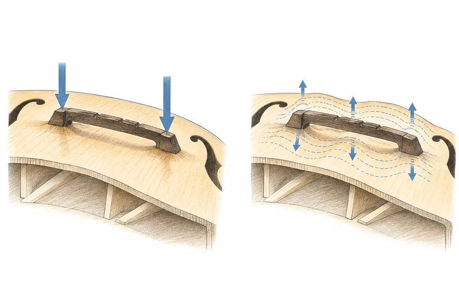

*圖解 7.6　面板的振動與承重（示意）*

### 美式 carved-top 走另一條路

美式 carved-top 則採另一條路。

Orville Gibson 把 spruce 面板**雕成凸拱**，讓**厚度與拱度共同提供剛性**。

這種設計和 violin family（小提琴家族）在外觀與受力思維上有相似之處。

但**不能直接說成**「把小提琴面板縮小」。

真正的工作方式，仍取決於**琴橋位置、bracing、音孔與整體尺寸**。〔S702〕〔S720〕

> **【常見誤解】**
> **誤解**：「Gibson 的拱面曼陀林就是縮小版的小提琴面板。」
> **事實**：外觀與受力思維有相似處，但不能直接畫等號。實際工作方式仍取決於琴橋位置、bracing、音孔與整體尺寸。

## 7.7　力木與內部支撐

**力木（bracing）** 的位置和尺寸，會改變面板的**局部剛性**與**振動模態**。

它們不是單純的「防塌木條」，也不是「越輕越好」。

| **力木狀態** | **後果** |
|---|---|
| 太弱 | 可能無法長期承受載荷 |
| 太重 | 提高局部質量與剛性，使某些模態移動 |

真正的設計工作，是在**結構安全**與**振動效率**之間取得平衡。

### 不同型制的 bracing 邏輯不一樣

早期 Orville Gibson 的專利，甚至明確**批評**當時樂器過多的內部 braces、bridges 與 splices（拼接）。

他主張用較一體化的 **carved construction**，減少這些零件。

Met 的 1898 年實物說明也指出：該琴**沒有傳統的內部 brace／strut**。

後來 Gibson 系統又發展出不同的 bracing 方法，顯示「少 brace」本身是**某個設計時期的整體哲學**。

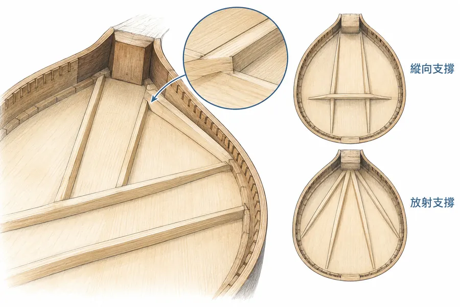

*圖解 7.7　力木與內部支撐（示意）*

所以不能把「Gibson 不用力木」當成通則。不同時期、不同型號，做法不同。〔S703〕〔S720〕

### 對維修的提醒

對維修而言，**力木脫膠**常比外觀裂痕更難察覺。

症狀可能是：

- 特定音出現 buzz
- 面板局部異常振動
- 敲擊檢查時，聲音和別處不同

如果只看外表，很容易把問題誤判成琴橋或琴弦。

這也提醒讀者：曼陀林的「解剖」，有一半**藏在看不到的琴腔裡**。

## 7.8　琴肚、背板與側板

### 圓背：多條 ribs 拼成碗狀

圓背曼陀林的琴肚，由多條狹長 **ribs**（肋片）拼合成碗狀。

1781 Vinaccia 的背部由 **23 條**窄帶構成，材料甚至使用**玳瑁與象牙**隔條。

這顯示當時的高級樂器，同時具有**聲學、結構與裝飾**三種功能。

現代 Calace 則可見 25、31、33，甚至 mandoloncello 的 **41 條 ribs** 的不同設計。材料則常見 **rosewood**（玫瑰木）或 **maple**（楓木）。

琴肚肋片數，應該與**曲率、單片寬度、工藝與設計系列**一起判讀。〔S701〕〔S711〕〔S713〕

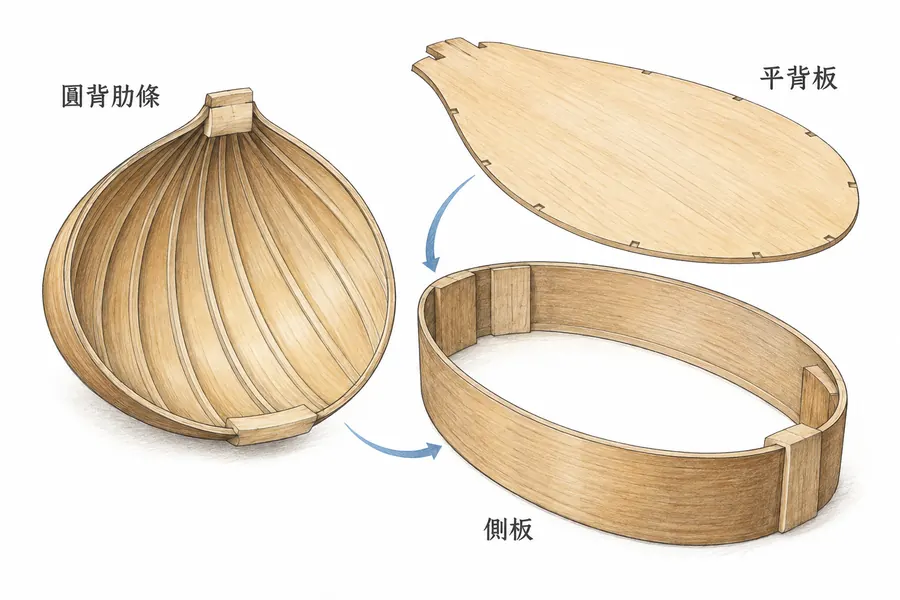

*圖解 7.8　琴肚、背板與側板（示意）*

### 平背或 carved-back：完全不同的邏輯

1898 Gibson 的背部，是**一塊雕成凸面的 walnut**（胡桃木），側部與空心琴頸又採高度一體化的做法。

這使琴身不需要靠多條窄 ribs 形成深碗。

它也改變了**內部容積、板材受力與製造流程**。〔S702〕

### 背板到底發不發聲？

這個問題常被簡化成二分法：

- 有人說：背板只是反射。
- 有人說：背板和面板一樣重要。

實際上，聲學量測顯示**整個琴體都參與模態**。

背部與側部的移動量和頻率分布，會**因設計而異**。

更準確的說法是：

> 背部**不是無關緊要**，但它的貢獻**不能脫離整體結構單獨描述**。

〔S704〕〔S705〕

> **【常見誤解】**
> **誤解**：「背板只是把聲音反射回去，不參與發聲。」
> **事實**：量測顯示整個琴體都參與模態。更準確的說法是：背部不是無關緊要，但它的貢獻不能脫離整體結構單獨描述。

## 7.9　音孔與空氣共鳴

音孔讓琴腔內部空氣和外界**耦合**，也會改變面板的**有效面積**與**局部剛性**。

所以它同時是**聲學開口**，也是**結構切口**。

圓孔、橢圓孔、**f-hole**（f 形音孔）或現代**側孔**，各自改變的重點，都在整個琴體與**空氣模態**的條件。

### 各型制的常見音孔

| **型制** | **常見音孔** |
|---|---|
| 那不勒斯圓背 | 單一圓形或橢圓形中央音孔 |
| 早期 Gibson A／F 系列 | 多使用橢圓孔 |
| 後來 F-5 系譜 | f-hole（成為 bluegrass 文化裡的強烈視覺符號） |

問題在於：音孔形狀往往和**琴體尺寸、bracing、bridge location** 一起改變。

所以不能做「f-hole 一定比較亮」「橢圓孔一定比較暖」這種**單因果比較**。〔S719〕〔S720〕

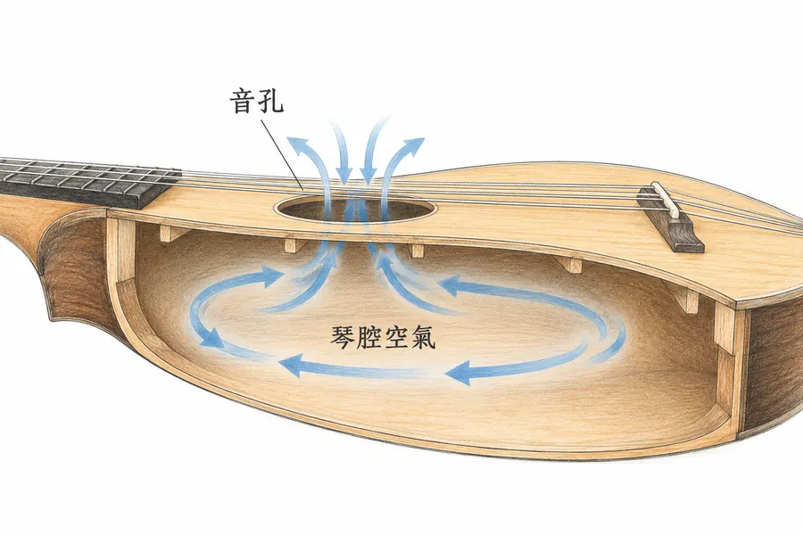

*圖解 7.9　音孔與空氣共鳴（示意）*

研究音孔時，最有用的問題是：

1. 它改變**哪些**空氣與面板模態？
2. **位置和面積**與琴體容積如何配合？

這些問題會在下一章（第 8 章）以聲學量測的語言繼續處理。

## 7.10　琴橋、尾弦板與折弦角

**浮動琴橋（floating bridge）** 靠琴弦下壓維持位置。

它做兩件事：

1. 設定**弦高**與**有效弦長**。
2. 把弦的**振動力**傳到面板。

### 音量不是一個旋鈕

橋越高、尾弦板越低，**不一定**就「聲音更大」。

因為以下幾件事會同時改變：

- **break angle**（折弦角）
- **下壓分量**
- **琴橋質量**
- **接觸面**
- **面板承載**

把單一幾何參數當成「音量旋鈕」，是常見但危險的簡化。

> **【常見誤解】**
> **誤解**：「琴橋墊高一點，聲音就會變大。」
> **事實**：折弦角、下壓分量、琴橋質量、接觸面與面板承載會同時改變。音量不是單一旋鈕。

### 琴橋腳底必須貼合

琴橋腳底必須和面板**充分貼合**。

如果只有兩端或局部接觸，除了能量傳遞不均，還可能在長期載荷下造成**局部壓痕**。

carved-top 曼陀林的曲面更明顯，因此**琴橋 fitting**（琴橋與面板的密合加工）尤其重要。

換一顆「高級橋」，如果沒有重新配合面板曲率，**未必**比原本的琴橋好。

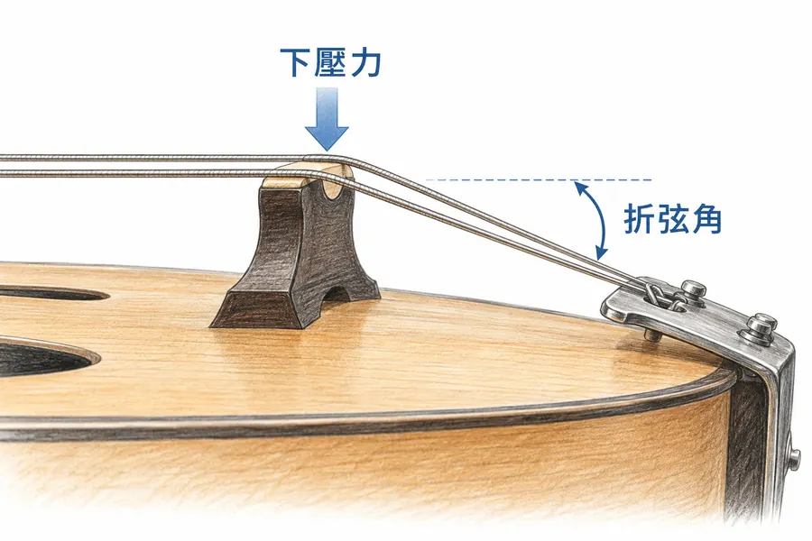

*圖解 7.10　琴橋、尾弦板與折弦角（示意）*

### 尾弦板

尾弦板的任務，是**固定琴弦尾端**，並決定**琴橋後方弦段的幾何**。

它本身的質量、剛性與固定方式，也可能產生**機械共振或雜音**。

診斷神祕的 buzz 時，除了琴格和琴橋，還值得檢查：

- 尾弦板**蓋板**
- **弦尾互碰**
- 鬆動的**螺絲**
- **弦鈎**

## 7.11　案例　三種結構系統

把 1781 Vinaccia、1898 Orville Gibson 和現代 Calace 放在同一張表裡，可以看到「曼陀林」這個名稱底下，**至少有兩套成熟的結構哲學**。

Vinaccia 以深碗 ribs、折面 spruce top、木製弦軸和短指板構成。

Gibson 以 carved spruce top、carved walnut back、浮動琴橋與 tailpiece、空心琴頸構成。

現代 Calace 則在那不勒斯圓背脈絡中，加入精密機械弦鈕、24／29 格指板與不同 ribs 配置。〔S701〕〔S702〕〔S711〕

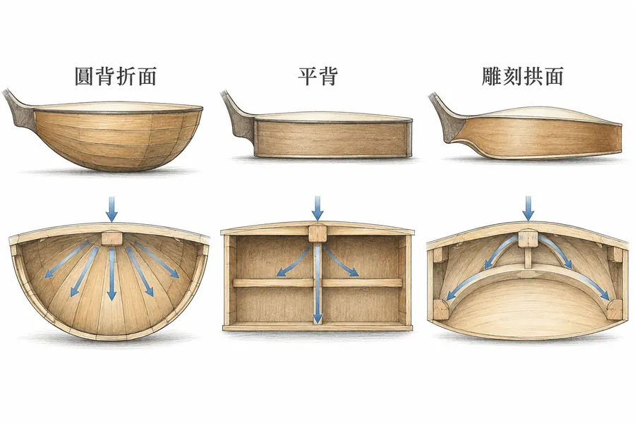

*圖解 7.11　案例　三種結構系統（示意）*

### 表 7-1｜三種結構系統的實物比較

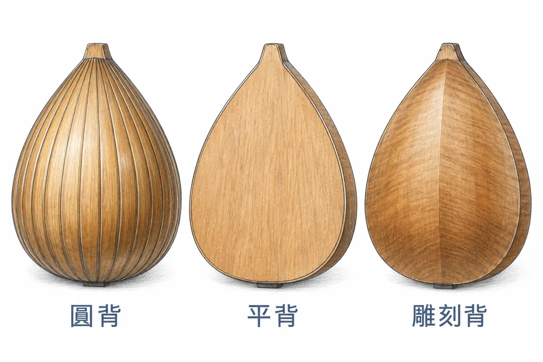

| **案例** | **琴體／背部** | **面板** | **調音／指板** | **讀法** |
|---|---|---|---|---|
| **Vinaccia 1781** | 23 ribs bowlback | spruce；橋附近折面 | 木弦軸；13 格 | 成熟那不勒斯式 |
| **Orville Gibson 1898** | carved walnut back；一體化 sides／neck | carved spruce | 機械系統；18 格 | 美式 carved-body 初期 |
| **Calace 現代** | 25–33 ribs；rosewood／maple | fine spruce | 機械弦鈕；24／29 格 | 現代 concert 圓背 |

*圖解　表 7-1｜三種結構系統的實物比較（示意）*

三者的重點整理：

- **Vinaccia 1781**：23 條圓背 ribs、13 格、木製弦軸。
- **Orville Gibson 1898**：carved spruce top、carved walnut back、18 格、浮動琴橋與 tailpiece。
- **現代 Calace**：33.5 cm 弦長、24 或 29 格、25–33 ribs。

這三者都叫 mandolin，卻代表**不同的結構哲學**。

### 用「結構閱讀」而不是「外觀分類」

如果只用外觀分類，讀者容易把它們分成「圓的」「扁的」。

如果用**結構閱讀**，就會看到它們對**同一組問題**給出不同答案：

| **共同的問題** | **各自怎麼答** |
|---|---|
| 如何承受弦力？ | 三套不同方案 |
| 如何提供面板剛性？ | 折面／拱面／bracing |
| 如何讓演奏者到達高把位？ | 琴頸幾何不同 |
| 如何調音？ | 木軸 vs. 機械弦鈕 |
| 如何維修？ | 結構可及性不同 |

這種比較方式，比記一串品牌史更能理解製琴演化。

### 反向利用：拿結構思路來診斷

實務上，也可以把這套思路反過來診斷問題：

| **症狀** | **先檢查什麼** |
|---|---|
| action 偏高 | **neck angle** 和 **top geometry**（面板幾何） |
| 低把位偏尖 | **nut slot**（上弦枕弦槽） |
| 高把位局部 buzz | **fret plane** 與 **relief**（琴頸彎度） |
| 聲音突然變薄 | 除了換弦，也檢查**琴橋位置**與**腳底接觸** |

結構名稱在這裡，才真正變成**工具**。

> **【常見誤解】**
> **誤解**：「琴橋已經低到不能再降，action 還是很高，那就再把橋削薄。」
> **事實**：更可能是 neck angle、面板變形，或整體幾何已經偏離。需要先判斷**根因**，不要急著削琴橋。

## 自我學習題庫

*學習檢查：作答、核對、複習*

先自己作答，再看答案。答錯時回到本章相關小節重新讀一次。

**1. 上弦枕太高，常見結果是？**

- A. 低把位較難按且可能偏尖
- B. 琴聲一定更大
- C. 指板變短
- D. 尾弦板脫落

**2. 琴橋在發聲鏈中的重要工作是？**

- A. 固定背帶
- B. 把弦的能量傳入琴體
- C. 裝飾琴面
- D. 降低所有泛音

**3. Neck angle 主要關係到？**

- A. 琴漆乾燥
- B. 指板與琴橋的幾何
- C. 品牌名稱
- D. 弦材顏色

**答案：1.A　2.B　3.B**

## 本章主要查證來源

*查證來源：找原文、核條件、留紀錄*

**【S701】The Metropolitan Museum of Art：Mandolin, Antonius Vinaccia, Naples, 1781（Met 89.4.2140）。** 那不勒斯式圓背、23 條琴肚肋條、折面面板、八弦四 course、13 格等實物資料。

https://www.metmuseum.org/art/collection/search/504543

**【S702】The Metropolitan Museum of Art：Mandolin, Orville Gibson, 1898（Met 2015.643a–c）。** carved spruce top、carved walnut back、浮動琴橋、尾弦板、18 格、空心琴頸等實物資料。

https://www.metmuseum.org/art/collection/search/700485

**【S703】United States Patent Office / Google Patents：US598245A – Mandolin, Orville H. Gibson（patented 1898-02-01）。** Gibson 一體式 rim/neck/head、carved top/back 與減少傳統內部支撐的原始專利。

https://patents.google.com/patent/US598245A/en

**【S704】David Cohen & Thomas D. Rossing：The acoustics of mandolins（Acoustical Science and Technology 24(1), 2003）。** 四把曼陀林與一把 mandola 的 normal modes、頻率響應與 TV holography 研究。

https://www.jstage.jst.go.jp/article/ast/24/1/24_1_1/\_article/-char/en

**【S705】Quintavalla et al.：The Acoustics of Traditional Italian Mandolins and Their Relation with Soundboard Wood Properties（International Journal of Wood Culture 2, 2022）。** 義大利歷史與現代曼陀林的 bridge admittance、聲輻射、模態與 soundboard wood 研究。

https://www.sciencedirect.com/org/science/article/pii/S2772318622000017

**【S711】Liuteria Calace：Mandolini – official specifications（accessed 2026-10-06）。** 33.5 cm 弦長、24/29 格、25/31/33 ribs、spruce top、rosewood/maple body 等現行規格。

https://www.calace.it/en/mandolini

**【S713】Liuteria Calace：Mandoloncelli & Liuti – official specifications（accessed 2026-10-06）。** 61 cm scale、8/10 弦、25/41 ribs、不同琴體尺寸與材料配置。

https://calace.it/en-mandoloncelli-liuti

**【S719】The Metropolitan Museum of Art：Gibson F-2, F-4, A-4 and H-2/H-4 instruments（1916–1919 collection records）。** 早期 Gibson A/F/H 系列 carved construction、格數、琴頸／指板材料與浮動琴橋實物比較。

https://www.metmuseum.org/art/collection/search/506859

**【S720】The Metropolitan Museum of Art：Archtop Guitars and Mandolins（Met Heilbrunn Timeline essay）。** Orville Gibson carved archtop 系統與其美國製琴影響。

https://www.metmuseum.org/essays/archtop-guitars-and-mandolins

**【S722】The Metropolitan Museum of Art：Mandolin, 1781 – Guitar Heroes（exhibition essay）。** 那不勒斯式折面提高結構強度、四組複弦、小提琴式調弦與撥片使用背景。

https://blog.metmuseum.org/guitarheroes/mandolin-1781/
