## 本章重點

- 聲音從撥片離開琴弦那一刻就開始，同時受**弦、琴橋、面板、琴體、音孔、內部空氣、演奏方式**影響。
- **相同規格可以有不同聲音**。因為木材、厚度、bracing、接觸與彈奏條件都會變。
- **bridge admittance**（琴橋導納）描述結構「多容易被推動」；它**不等於**音量。
- 「亮」「暖」是好用的溝通詞，但**不是單一物理量**。
- 聲學數據能描述差異，**不會自動告訴你哪一把比較好**。

---

「這把琴比較亮」「那把比較厚」「某種木頭比較有穿透力」，是樂器世界最常見的語言。

但這些形容詞很容易把一個複雜系統，說成單一原因。

曼陀林的聲音，從**撥片離開琴弦那一刻**開始，就同時受到這些東西影響：

1. 琴弦
2. 琴橋
3. 面板
4. 琴體
5. 音孔
6. 內部空氣
7. 演奏方式

如果不先把這條物理鏈拆開，任何音色討論都很容易滑向**印象**和**品牌神話**。

### 三個要先分清楚的名詞

| **名詞** | **白話解釋** |
|---|---|
| **振動模態**（mode） | 哪些部位在什麼頻率下**一起振動**？ |
| **琴橋導納**（bridge admittance） | 施力之後，琴橋與面板**如何回應**？ |
| **聲音輻射**（sound radiation） | 結構振動如何**變成聽得見的聲音**？ |

### 三組重要的研究

曼陀林聲學研究不像小提琴或吉他那麼龐大，但已有幾組重要成果：

| **年份** | **研究者** | **做了什麼** |
|---|---|---|
| **2003** | Cohen 與 Rossing | 用 **electronic TV holography**（電子電視全像術）研究四把 mandolin 與一把 mandola 的振動模態 |
| **2022** | Quintavalla 等人 | 對那不勒斯、米蘭、羅馬與現代義大利曼陀林，量測 bridge admittance、聲輻射與 soundboard wood 性質 |
| **2024** | 同一研究方向 | 把一把 1784 年 Joseph Filano 晚期巴洛克曼陀林，做博物館現場量測與有限元素分析 |

這些研究讓我們可以用**實驗資料**，而不只是耳朵傳說，來討論曼陀林。〔S704〕〔S705〕〔S706〕

本章的目標，是讓你掌握每種資料**能回答什麼問題**：

- 頻率響應能告訴我們什麼？
- bridge admittance 在量什麼？
- 為什麼模態不是單一共鳴點？
- 為什麼兩把外觀幾乎一樣的琴，仍可能有明顯差異？

## 8.1　琴弦的振動

理想弦的**基頻**（fundamental，最低的那個音），可以用一個簡單關係理解：

| **如果…** | **音高會…** |
|---|---|
| 弦越**短** | 越高 |
| **張力**越大 | 越高 |
| 單位長度**質量**越大 | 越低 |

D'Addario（知名弦廠）的張力技術資料，用 **unit weight**（單位重量）、**scale length**（弦長）、**frequency**（頻率）三個變數來計算張力。

本質上，這就是同一套弦振動關係的**工程形式**。〔S715〕〔S721〕

打個比方：弦就像跳繩。繩子越短，甩起來轉得越快；繩子拉得越緊，也轉得越快；繩子越粗，就越難甩快。

### 一個具體的算術例子

這個公式的實務意義非常直接。

假設：一根完全相同的弦，調到完全相同的音高，只把弦長從 **33.5 cm** 增加到 **43.2 cm**。

理論上，張力會按**弦長的平方**增加，大約變成原來的 **1.66 倍**。

當然，真實的 mandola 會換用不同的 **gauge**（弦徑）、不同的 **winding**（纏繞方式）和不同的音高。

所以不會真的把標準曼陀林的弦，直接拉到這種張力。

這個例子只是用來說明：**弦長是張力系統的一部分。**

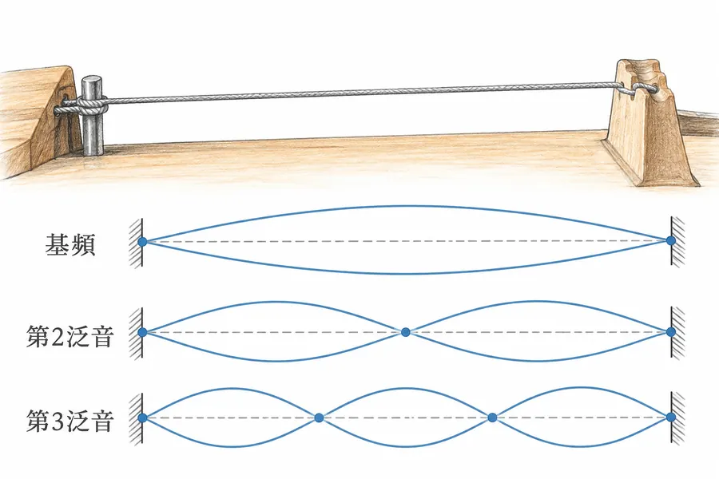

*圖解 8.1　琴弦的振動（示意）*

### 弦不是理想弦

琴弦不是理想的柔軟弦。

以下幾件事，都會讓實際的泛音偏離理想的整數倍：

- 金屬**芯線**
- winding（纏繞層）
- **端點剛性**
- 按弦**接觸**
- 撥擊**位置**

這就是 **string inharmonicity**（弦的非諧性）的來源之一。

對短弦、高音、複弦樂器而言，這些細節會影響 **attack** 與**調音感**。

但不需要因此把每一根弦的物理都量到實驗室等級。**理解趨勢**，已足以解釋大部分的 Setup 現象。

## 8.2　起音與能量輸入

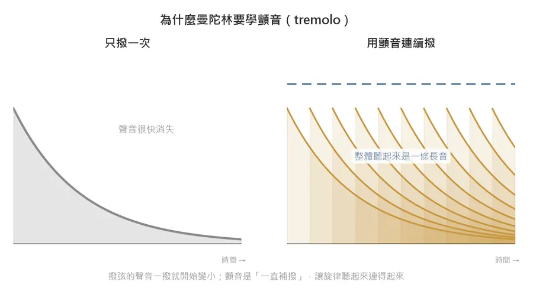

*圖 H　為什麼要學顫音：撥弦的聲音一撥就變小，顫音是「一直補撥」。*

弓弦樂器能在一個長音裡，持續由弓輸入能量。

曼陀林則不同：**撥片把琴弦拉開後迅速釋放**。

能量輸入發生在很短的時間內。所以聲音具有清楚的 attack，之後就進入 **decay**（衰減）。

這種發聲機制，是曼陀林「**顆粒感**」的基礎。

它也是 tremolo（顫音）會成為歷史核心技法的**物理原因**：

> 演奏者用連續快速的撥擊，把一串衰減中的短音，組織成聽覺上的**持續線條**。

打個比方：這就像用一張張靜止畫面，拼成動畫。單張畫面會消失，但快速播放起來，看起來就是連續的動作。

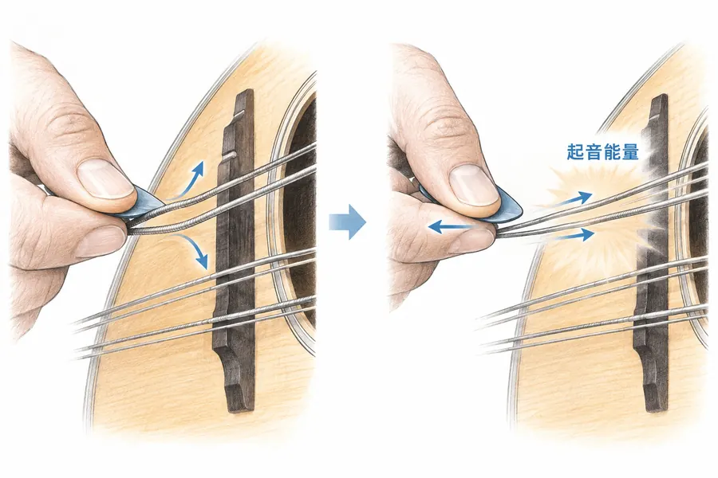

*圖解 8.2　起音與能量輸入（示意）*

### attack 不只是「撥片聲」

真正的 attack，不只是「撥片碰到弦」那個聲音。

以下因素都會改變琴弦初始的**位移形狀**與**高頻成分**：

- 撥片**材質**
- 撥片**厚度**
- 撥片**尖端**
- 撥片**角度**
- 撥擊**位置**

| **撥奏位置** | **常見效果** |
|---|---|
| 靠近**琴橋** | 高頻比例通常增加 |
| 靠近**指板** | 相對柔和 |

但實際效果仍受**琴體響應**影響。

第 13、14 章會從「手」的角度討論。這裡先把它視為一個**輸入訊號**：

> 同一把琴，只要輸入方式不同，**頻譜就已經不同**。

### 所以比較兩把琴很困難

拿兩把琴比較時，如果**撥片、位置、力度、錄音距離**都沒有控制，所謂的「頻譜比較」，很容易其實是在**比較演奏者**。

正式聲學研究之所以用 impact hammer（衝擊錘）或可重複的激勵方式，就是為了盡量把人為變數抽掉。〔S705〕

## 8.3　同音複弦與拍頻

同一 course 的兩根弦，目標是調成同音。

但它們**不會在所有瞬間完全同步**。

可能出現微小差異的原因：

- 弦的**直徑**
- 弦的**老化**
- 按弦**壓力**
- 撥片**先碰到哪一根**
- 弦橋端點**條件**

兩個非常接近的頻率，會產生**拍頻**（beating）。

| **兩弦差距** | **聽起來** |
|---|---|
| 很小 | 像聲音在輕微**呼吸** |
| 太大 | 明顯像**走音** |

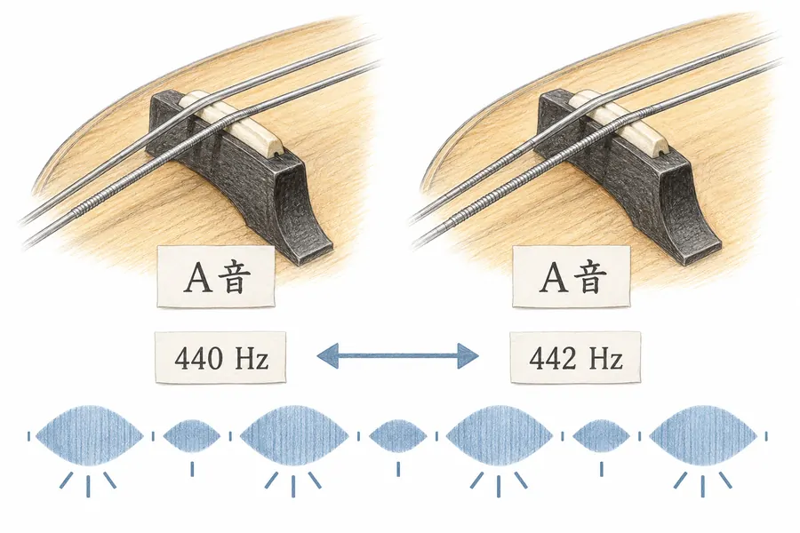

*圖解 8.3　同音複弦與拍頻（示意）*

### 不要故意留下大拍頻

專業調音時，**不應該**故意留下大拍頻來「製造 **chorus**（合唱效果）」。

曼陀林自然的複弦活性，已經來自兩根弦的**非完全同步**與**不同瞬態**。

如果基本音高差太大，和弦與 tremolo 反而會失去清晰度。

這對錄音尤其明顯：**近距離麥克風，比現場耳朵更容易放大兩根弦的差異。**

> **【常見誤解】**
> **誤解**：「同一組的兩條弦故意調得差一點點，聲音會更豐富。」
> **事實**：曼陀林的複弦活性來自自然的非完全同步。刻意留下大拍頻，會讓和弦與 tremolo 失去清晰度。錄音時尤其明顯。

### 撥片讓激勵變得更複雜

複弦也讓右手的激勵變得更複雜。

撥片通常**先接觸一根、再穿過第二根**。

撥片越厚、入弦越深，兩次接觸的**時間差**可能越清楚。

這也是為什麼「同一把琴換撥片就像換聲音」**並不只是心理作用**。

但效果大小，仍然必須和**整體琴體響應**一起看。

## 8.4　琴橋導納與結構響應

**Bridge admittance**（琴橋導納）可以先用直覺理解：

> 在琴橋施加一定大小的力，琴橋會產生**多少速度或位移響應**。

| **admittance** | **意思是** |
|---|---|
| **高** | 琴橋—面板系統在那個頻率**比較容易被驅動** |
| **低** | 相對**不容易**被驅動 |

它描述的是**結構接受能量的方式**。

音量還要一起觀察**聲音輻射的效率**。

打個比方：admittance 像「門好不好推」。門很好推，不代表門後面的房間就一定很熱鬧。

### 2022 年研究怎麼做

2022 年義大利曼陀林研究，使用 **impact hammer**（衝擊錘）激勵琴橋，量測 bridge admittance 與**聲壓**，並比較三把歷史義大利琴與現代研究琴。

這種方法的優點，是能把兩件事**分開觀察**：

1. 「結構有沒有動」
2. 「動了之後輻射多少聲音」

兩者相關，但**不是完全一樣**。

> 結構動得多，**不代表**所有能量都有效轉成遠場聲音。〔S705〕

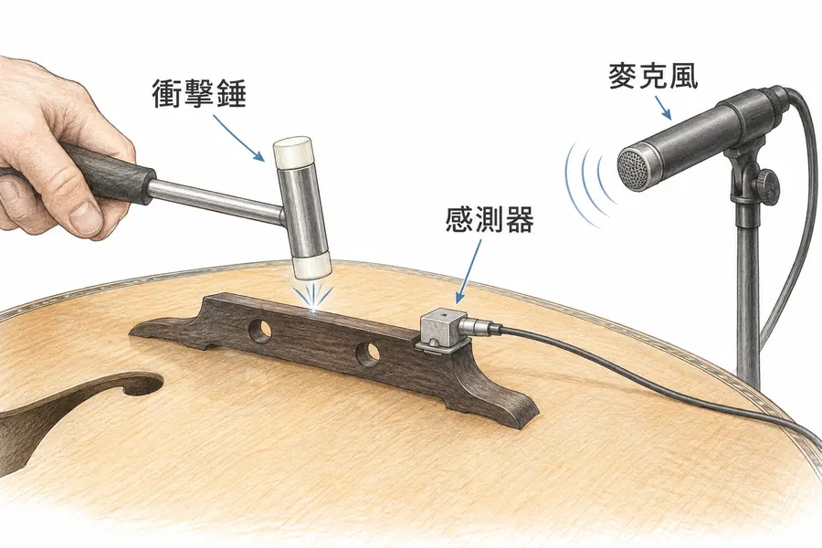

*圖解 8.4　琴橋導納與結構響應（示意）*

### 實務上的意義

琴橋**質量**、**腳底接觸**、**面板剛性**與 **bracing**，都可能改變 admittance。

這也是為什麼任意把琴橋**削薄、挖空**或換**超輕材料**，需要同時評估兩件事：

1. **頻率響應**
2. **結構安全**

某些頻率可能變敏感，其他頻率也可能改變。

結構安全與**音準調整餘量**，還會一起受影響。

## 8.5　琴體的振動模態

真正的面板，在不同頻率會形成**不同的振動形狀**，稱為 **modes**（模態）。

- 某些區域**同方向**動。
- 某些區域**反方向**動。
- 中間可能出現位移很小的 **nodal lines**（節線）。

隨頻率升高，模態通常變得更複雜。

所以「這塊面板的共鳴頻率」如果只指**單一數字**，往往過度簡化。

打個比方：模態就像一塊布被抖動時，會出現好幾種不同的皺褶圖案。頻率不同，圖案就不同。

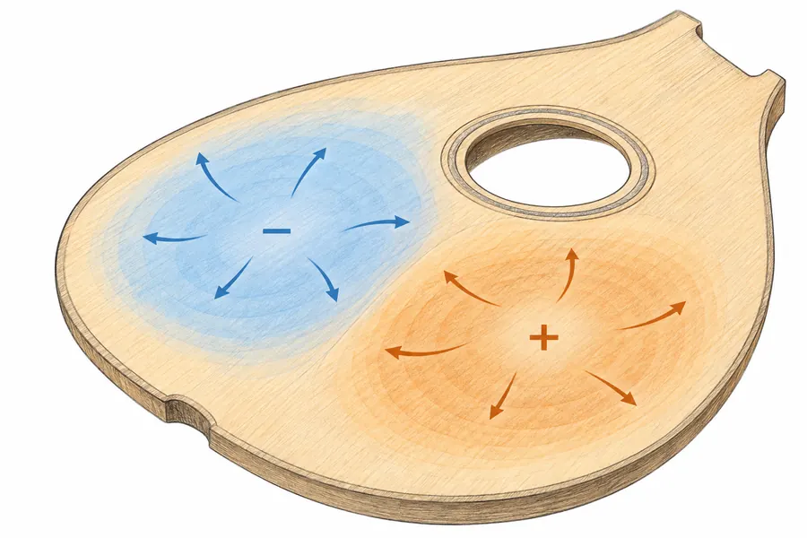

*圖解 8.5　琴體的振動模態（示意）*

### Cohen 與 Rossing 的發現

Cohen 與 Rossing 以 **TV holography**（電視全像術）觀察四把曼陀林與一把 mandola。

他們發現：

- 最低階的 **(0,0)** 類模態，可能呈現 **doublet**（雙峰）或 **triplet**（三峰）。
- **modal frequencies** 和 **frequency response curves** 有明顯關聯。

他們也指出：聲輻射在 **0–5 kHz** 相當廣泛，大約 **2.5 kHz 以上**開始有 **rolloff**（高頻衰減）。

這**不等於**每把曼陀林都會有同一組數字。而是證明：琴體響應可以由多個結構模態共同形成。〔S704〕

### 這個知識有什麼用

| **你是誰** | **模態分析的價值** |
|---|---|
| **製琴師** | 理解厚度、拱度、bracing 與材料剛性改變後，整體模態如何移動 |
| **演奏者** | 知道「某音特別大」不一定是琴弦的問題 |

對演奏者而言，知道這一點就夠了：它可以避免把「某個音特別大」，簡單歸咎於琴弦。

那可能是琴弦、琴體，或**兩者耦合**的結果。

## 8.6　琴腔空氣的共鳴

琴腔裡的空氣也參與振動。

當面板和背部振動，**腔內容積**的變化會推動空氣。

音孔則讓內外空氣交換，並形成**低頻共鳴**。

常被引用的 **Helmholtz resonance**（亥姆霍茲共振），是理解這類現象的第一步。

但真實樂器的面板與背部**不是剛性容器**，所以空氣模態會和**木板模態耦合**。

打個比方：Helmholtz 共振就像對著空瓶口吹氣會發出低音。但真實的琴不是玻璃瓶，它的「瓶身」會跟著一起震動。

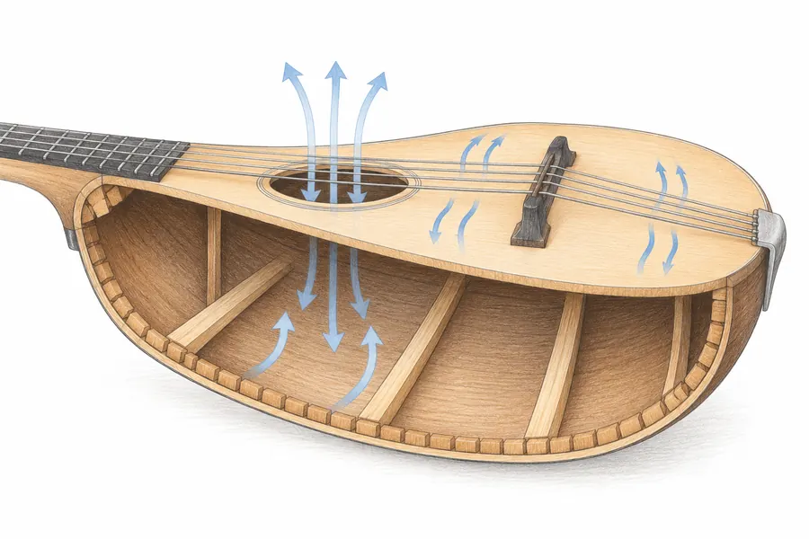

*圖解 8.6　琴腔空氣的共鳴（示意）*

### 為什麼不能只看音孔形狀

改變**音孔面積、位置**或**琴體容積**，都可能移動某些空氣相關共鳴。

但結果同時受到**面板與背部剛性**影響。

這就是為什麼單看 f-hole 或 round hole，很難可靠預測「聲音比較亮還是暖」。

**外形只是聲學條件的一部分。**

### 麥克風位置會改變你聽到的「琴聲」

2022 年研究把**琴腔內外麥克風**都納入量測，以區分 **air cavity response**（空氣腔響應）與**外部輻射**。

這種設計提醒我們：**麥克風放在哪裡，看到的「琴聲」其實不同。**

錄音時如果麥克風正對音孔，很容易放大特定腔體頻率。

那不一定等於**觀眾在一公尺外**聽到的整體聲音。〔S705〕

## 8.7　頻譜與聲音輻射

**頻譜（spectrum）** 把聲音分解成不同頻率成分，可以看出：

- **基頻**（fundamental）
- **泛音**（overtones）
- 某些**共鳴峰**

但同一張頻譜若忽略**時間**，就會遺失 **attack** 與 **decay**。

曼陀林的辨識感，很大一部分來自**短促的瞬態**。

所以只看長時間平均頻譜，可能把最重要的撥片資訊沖淡。

### 「亮」和「暖」到底是什麼

| **用詞** | **通常和什麼有關** | **但不是** |
|---|---|---|
| **亮**（bright） | 較多高頻能量、清楚起音 | 不是固定門檻 |
| **暖**（warm） | 較平滑的高頻、較強中低頻，或較柔和的 attack | 不是固定門檻 |

這些詞在音樂溝通中很好用。

只要**不要把它們假裝成單一物理量**。

本書會把聽感詞當作**結果描述**，不把它們直接等同木材或音孔。

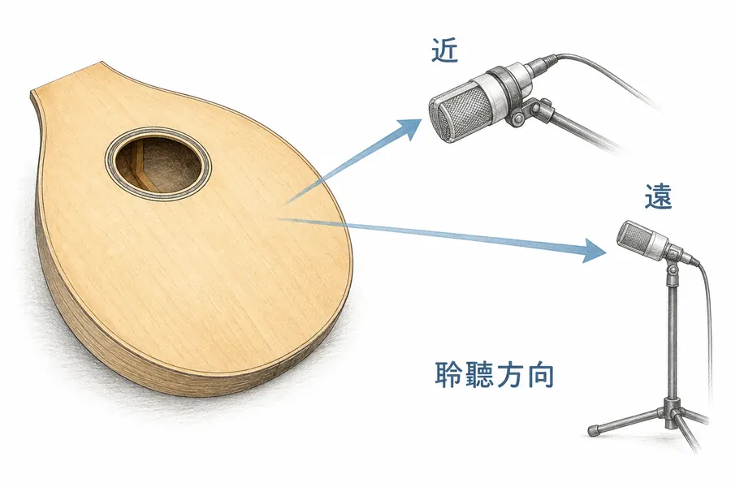

*圖解 8.7　頻譜與聲音輻射（示意）*

### 聲音有方向性

聲輻射還有**方向性**。

高頻波長較短，樂器不同區域可能出現**相位差**。

結果是：觀眾站在不同方向，聽到的**頻率平衡會不一樣**。

舞台擴音與錄音時，麥克風位置因此是在**選擇你要的整體比例**。

> **【常見誤解】**
> **誤解**：「這把琴的聲音就是這樣，走到哪裡聽都一樣。」
> **事實**：聲輻射有方向性。高頻波長短，不同區域可能出現相位差，站在不同方向聽到的頻率平衡會不同。這也是麥克風位置重要的原因。

## 8.8　木材與整琴響應

聲學研究確實證明：**soundboard wood 的密度與彈性性質，會影響板的模態與頻率響應**。

2022 年研究直接量測 **Norway spruce**（挪威雲杉）樣本的機械性質，再用**有限元素模型**連結到 soundboard 行為。

這支持「木材物理性質重要」。

但**不支持**「只知道樹種名稱，就能預測整把琴」。〔S705〕

### 同一樹種內部也有差異

| **變數** | **說明** |
|---|---|
| **密度** | 同一種木頭，密度也會不同 |
| **年輪** | 生長速度不同 |
| **早晚材比例** | 春夏材與秋冬材的比例 |
| **方向性** | 木紋方向 |

做成面板後，又受到**厚度分布、拱度與 bracing** 影響。

換句話說，**樹種只是其中一層資訊**。

真正有意義的參數，是這塊**特定的木料**、這個**特定的幾何**，和這把**特定的整琴**的組合。

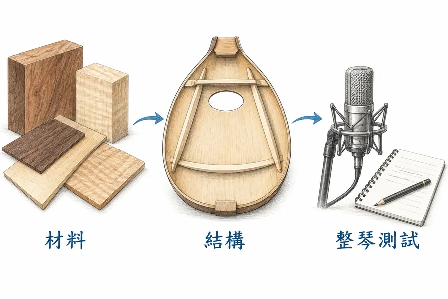

*圖解 8.8　木材與整琴響應（示意）*

> **【常見誤解】**
> **誤解**：「這是雲杉面板，所以聲音一定很亮。」
> **事實**：同樹種內部也有密度、年輪、早晚材與方向性差異。做成面板後又受厚度、拱度與 bracing 影響。樹種只是其中一層資訊。

因此下一章談木材時，會把「**材料性質**」與「**傳統音色描述**」分成兩條線。

| **路線** | **性質** |
|---|---|
| 材料性質 | 可量測 |
| 傳統音色描述 | 有價值，但屬經驗語言 |

兩者不能互相冒充。

## 8.9　1784 年 Filano 琴的研究

2024 年研究選擇了一把 1784 年 **Joseph Filano** 的那不勒斯曼陀林。

研究在博物館內，以可攜式設備做四項調查：

1. **sound spectrum**（聲音頻譜）
2. **admittance**（導納）
3. **mobility**（移動性）
4. **mode shape survey**（模態形狀調查）

再以**有限元素分析**（finite element analysis）輔助。

目的之一，是為**歷史複製琴**提供更完整的聲學基準。

這把琴還處於 **gut–metal 混合弦**的轉換期，是理解**晚期巴洛克曼陀林**的重要案例。〔S706〕

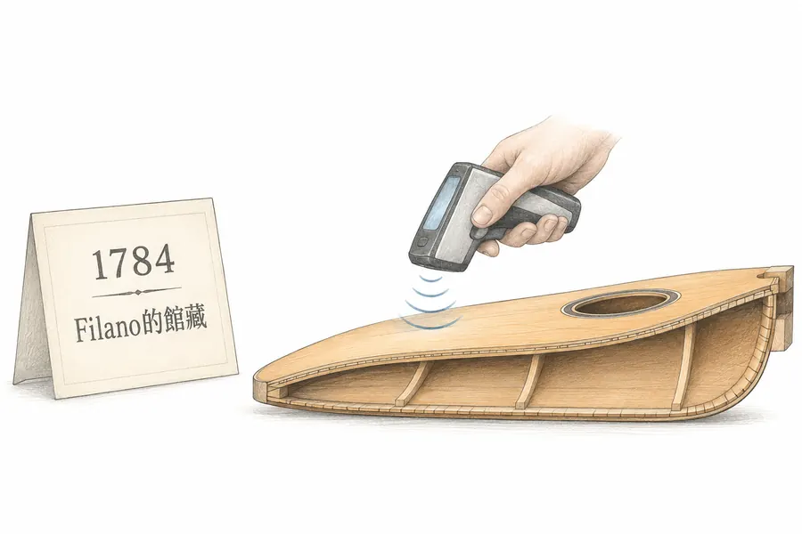

*圖解 8.9　1784 年 Filano 琴的研究（示意）*

### 對「復刻」的重要提醒

研究者特別指出：即使複製琴使用**同樹種、同尺寸、相似工法**，木材本身的**機械性質差異**仍可能造成聲學差異。

這件事對所有「復刻」概念都很重要：

> **外觀一樣、木種一樣，不等於動態響應一樣。**

真正嚴謹的歷史複製，需要把原琴的**材料**與**聲學**一起記錄。

### 反過來給收藏者的提醒

這也提醒收藏者：兩把同型號的量產琴有差異，**並不一定**意味其中一把「做壞了」。

原因包括：

- 木材是**天然材料**
- **膠合**
- **厚度**
- **橋接觸**
- **aging**（老化）

這些都有製造公差。

型號只能描述**設計範圍**，不可能把每一把個體壓成同一種聲音。

> **【常見誤解】**
> **誤解**：「同型號的兩把琴聲音不一樣，其中一把一定有問題。」
> **事實**：木材是天然材料，膠合、厚度、橋接觸與老化都有製造公差。型號只描述設計範圍，不是統一聲音的保證。

## 8.10　案例　相近規格的聲音差異

假設兩把琴都有 spruce top、maple back、相同弦長、相同弦組與類似重量，聲音仍然可能差很多。

可以依序檢查這些問題：

| **#** | **要檢查什麼** |
|---|---|
| 1 | 面板**厚度**和**拱度**是否相同？ |
| 2 | **bracing** 的尺寸和位置是否一致？ |
| 3 | 琴橋**質量**與**腳底接觸**如何？ |
| 4 | 兩塊 spruce 的**密度**和**剛性**是否接近？ |
| 5 | 琴弦**新舊**與**撥片**條件是否一致？ |

任何一個環節，都可能讓**模態**和**瞬態**改變。

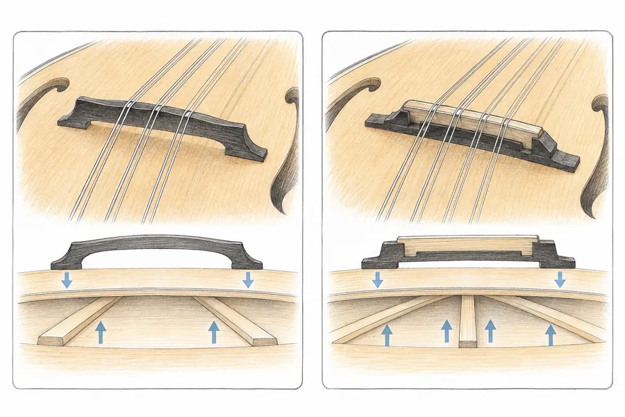

*圖解 8.10　案例　相近規格的聲音差異（示意）*

### 怎麼做公平的比較

如果要做相對公平的比較，應該先**統一**這五件事：

1. 弦
2. 調弦
3. 撥片
4. 演奏位置
5. 錄音幾何

然後再比較四件事：

- **attack**
- **sustain**
- **頻率平衡**
- **動態反應**

比較時，使用**多次重複錄音**，確認差異能不能**穩定重現**。

若要進一步量測，可以用**固定激勵**或 **re-amping**（把錄好的訊號重新送進系統）類的概念，降低人為變數。

### 最重要的一條界線

最後仍要保留一個重要界線：

> **聲學數據可以描述差異，不會自動告訴你「哪一把比較好」。**

| **某把琴的特性** | **可能的好處** | **可能的壞處** |
|---|---|---|
| 高頻多 | 在樂團裡更清楚 | 獨奏近距離可能覺得太硬 |
| decay 長 | 適合歌唱性旋律 | 快速節奏可能變糊 |

**品質判斷，必須把音樂用途放回來。**

### 表 8-1｜常見聲學量測在回答什麼問題

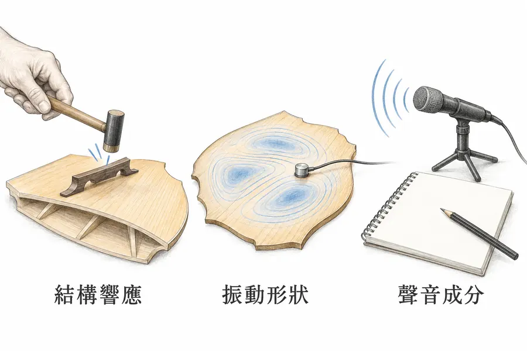

| **量測** | **它告訴我們** | **它不能直接告訴我們** |
|---|---|---|
| **Frequency response**（頻率響應） | 不同頻率輸入下的響應強弱 | 「好不好聽」的唯一答案 |
| **Bridge admittance**（琴橋導納） | 琴橋受力後結構有多容易動 | 遠場聲音全部大小 |
| **Modal analysis**（模態分析） | 不同頻率的振動形狀 | 哪個木種「最好」 |
| **Spectrum**（頻譜） | 聲音含有哪些頻率成分 | 完整 attack／decay 與音樂表情 |

*圖解　表 8-1｜常見聲學量測在回答什麼問題（示意）*

> **【公式不是答案】**
> 弦的基頻關係可以寫成 **f = (1/2L)√(T/μ)**。
> 它能解釋**弦長、張力與線密度**的趨勢，但真實的弦還有**剛性、winding、端點與按弦拉伸**。
> 所以 Setup 不能只靠公式。
> 其中 L 是弦長、T 是張力、μ 是線密度。

> **【查證筆記】**
> Cohen & Rossing 的研究主要是**美式 mandolin／mandola** 的模態。
> Quintavalla 團隊則補上**義大利 bowlback 與歷史琴**。
> 兩類研究對象不同，**不應把其中一組數據，直接當成所有曼陀林的「標準頻率」**。

## 自我學習題庫

*學習檢查：作答、核對、複習*

先自己作答，再看答案。答錯時回到本章相關小節重新讀一次。

**1. Bridge admittance 可以簡單理解成？**

- A. 琴橋對外力的響應程度
- B. 琴橋價格
- C. 木材含水率
- D. 弦鈕齒比

**2. Tremolo 和聲學上的哪個特性關係密切？**

- A. 撥弦音會逐漸衰減
- B. 琴盒大小
- C. 指板顏色
- D. 品牌歷史

**3. 曼陀林的共鳴來自？**

- A. 只有面板
- B. 琴體、空氣與多個結構共同作用
- C. 只有弦
- D. 只有音孔

**答案：1.A　2.A　3.B**

## 本章主要查證來源

*查證來源：找原文、核條件、留紀錄*

**【S704】David Cohen & Thomas D. Rossing：The acoustics of mandolins（Acoustical Science and Technology 24(1), 2003）。** 四把曼陀林與一把 mandola 的 normal modes、頻率響應與 TV holography 研究。

https://www.jstage.jst.go.jp/article/ast/24/1/24_1_1/\_article/-char/en

**【S705】Quintavalla et al.：The Acoustics of Traditional Italian Mandolins and Their Relation with Soundboard Wood Properties（International Journal of Wood Culture 2, 2022）。** 義大利歷史與現代曼陀林的 bridge admittance、聲輻射、模態與 soundboard wood 研究。

https://www.sciencedirect.com/org/science/article/pii/S2772318622000017

**【S706】Quintavalla et al.：Acoustical Survey and Finite Element Analyses of Late Baroque Mandolin（International Journal of Wood Culture 4(1), 2024）。** 1784 Joseph Filano 曼陀林的聲學量測、有限元素分析與複製研究。

https://www.sciencedirect.com/org/science/article/pii/S2772318624000018

**【S715】D'Addario：A Complete Technical Reference for Fretted Instrument String Tensions（technical guide）。** 弦張力與 unit weight、scale length、frequency 的關係與公式。

https://www.daddario.com/globalassets/pdfs/accessories/tension_chart_13934.pdf

**【S721】D'Addario：What Is Guitar String Tension?（current resource）。** unit weight、scale length、frequency 三變數對張力的說明。

https://www.daddario.com/blogs/guitar/all-about-string-tension

---
