*Tonewood and Materials: Mechanics, Moisture, Tradition and Regulation（製琴木材：力學、濕度、傳統與法規）*

## 本章重點

- 木材有**三個方向**，每個方向的硬度與伸縮都不一樣。
- 木材會隨空氣濕度**吸水或失水**，薄板樂器因此會變形。
- **密度、剛性、阻尼**要一起看，只比其中一項沒有意義。
- **樹種名稱不能決定聲音**：同一樹種的兩塊板，也可能差很多。
- 「AAA 級」多半是廠商自己的分級；「玫瑰木」是商業名稱，不是單一樹種。

---

木材是製琴話題裡最容易被「神話化」的一項。

走進樂器行，你會看到一排短短的標籤：「雲杉亮」「玫瑰木溫暖」「楓木投射強」。

這些形容詞不是完全沒根據，它們來自長年的經驗。

但如果把它們當成自然定律，就會漏掉真正重要的資訊。

真正重要的資訊有兩類。第一類是木頭本身的條件：密度、彈性、阻尼、纖維方向、含水率。第二類是人的選擇：板材厚度、拱度，以及**製琴師怎麼使用這塊木頭**。

木材的性質會隨每一塊木頭改變，也會隨方向改變。

美國農業部（United States Department of Agriculture，USDA）的《木材手冊》（Wood Handbook）把木材看成「有明顯方向性的天然工程材料」。

同一個樹種，不同棵樹不一樣；同一塊板，不同方向也不一樣。〔S707〕

對樂器來說，這種變異是挑戰，也是製琴師能「調整板材」的空間。

本章把材料分成三層來看：

1. **可量測的物理與機械性質**。
2. **歷史製琴傳統中常見的材料配置**。
3. **演奏者常用的音色語言**。

順序如果反過來，就會從「我覺得這把很暖」，一路推論成「這個樹種天生就是暖」。

## 9.1　木材的方向性與吸濕性

木材的細胞和纖維大致沿著樹幹方向排列。

所以三個方向的剛性與尺寸變化都不一樣：

| 中文 | 英文 | 方向 |
|---|---|---|
| 縱向 | longitudinal | 順著樹幹、順著纖維 |
| 徑向 | radial | 由樹心往外的方向 |
| 弦向 | tangential | 沿著年輪、與徑向垂直 |

這三個方向表現不同，叫做**異向性（anisotropy）**。

對樂器的意義很直接。

面板希望在弦的方向保持足夠剛性，又要在橫向有適當彈性。

圓背的**肋條（ribs）**要能彎成曲率，同時長期保持尺寸穩定。〔S707〕

木材還有**吸濕性（hygroscopicity）**。

它會隨著周圍空氣的相對濕度與溫度，交換水分。

USDA 的資料指出一件事。在**纖維飽和點（fiber saturation point）**以下，含水率一改變，木材就會收縮或膨脹。而且不同方向的變化量不一樣。〔S708〕

對薄板做成的樂器，這點尺寸變化就足以出事。

它可能造成：面板變形、接縫開膠、**琴格端（fret ends）凸出**、**弦距（action）**改變。

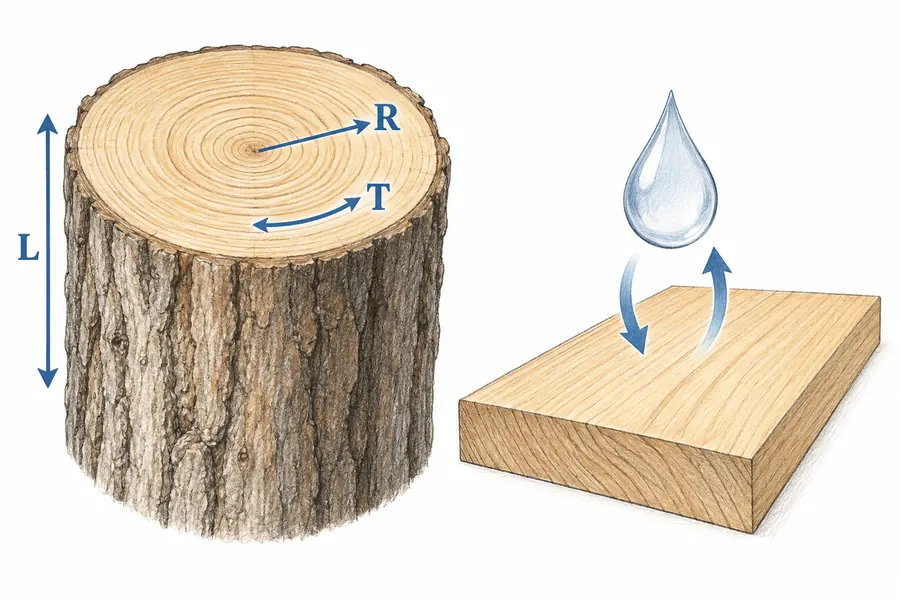

圖解 9.1　木材的方向性與吸濕性（示意）

> **常見誤解：「老木已經不會再動了。」**
> 不對。只要它還是木材，就會回應環境濕度。
> 真正改善的是另一件事。經過充分乾燥、內應力釋放、長期尺寸循環之後，某些材料的狀態**可能比較可預測**。
> 但「比較可預測」不等於「對濕度免疫」。

| **重點與應用** | **內容** |
|----|----|
| 核心概念 | 木材的細胞和纖維大致沿樹幹方向排列，因此 longitudinal、radial、tangential 三個方向的剛性和尺寸變化不一樣。 |
| 關係與條件 | 木材也具有 hygroscopicity，會隨周圍空氣的相對濕度與溫度交換水分。 |
| 應用方向 | 判讀木材與材料資訊。 |

## 9.2　密度、剛性與阻尼

這三個名詞常被混在一起，其實各管一件事。

| 名詞 | 白話解釋 | 製琴時要注意什麼 |
|---|---|---|
| **密度（density）** | 同樣大小的體積有多少質量 | 太重的板，同厚度下需要更多能量才推得動 |
| **彈性模數（modulus of elasticity）** | 材料抵抗彈性變形的程度 | 製琴師最在意「順著纖維方向」的剛性 |
| **阻尼（damping）** | 振動能量多快變成熱、被內部摩擦吃掉 | 低阻尼不是自動等於好 |

密度低，不代表一定優秀。

如果剛性也跟著很低，面板可能必須做得更厚，才能承受結構負荷。

所以真正重要的不是單一數字，而是**密度和剛性怎麼組合**。

彈性模數會影響板材在長跨度下的彎曲行為。

把這個觀念換算成一句白話：「**同樣重量能提供多少剛性**」，這就是**比剛性（specific stiffness）**。

這正是雲杉（spruce）長期成為面板主流材料的重要原因之一。

2022 年有一份曼陀林研究，直接量測挪威雲杉（Norway spruce）的機械性質，並把它放進**有限元素模型（finite element model）**裡。〔S705〕

阻尼管的是另一件事：振動能量多快被消耗掉。

低阻尼不等於自動比較好。

某個特定的共振如果拖得太長，反而可能造成不均衡。

製琴真正要的是：整體的**頻率響應**和**時間響應**符合音樂用途。

所以要依用途，平衡各項材料性質。

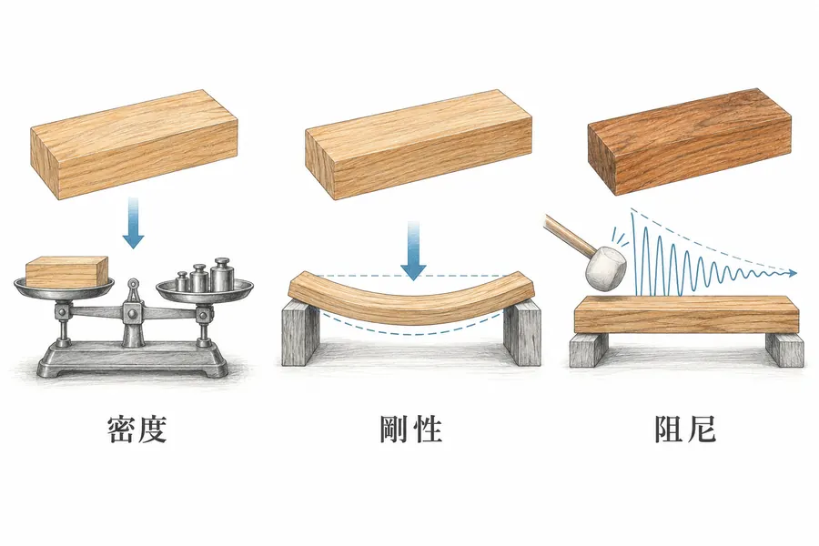

圖解 9.2　密度 剛性與阻尼（示意）

| **重點與應用** | **內容** |
|----|----|
| 核心概念 | 密度（density）告訴我們單位體積有多少質量。 |
| 關係與條件 | 彈性模數（modulus of elasticity）描述材料抵抗彈性變形的程度。 |
| 應用方向 | 判讀木材與材料資訊。 |

## 9.3　木材的三種切法

從原木鋸成板子的時候，年輪相對於板面的方向不同，就會形成不同的切法。

| 切法 | 中文 | 板面看到的年輪 |
|---|---|---|
| quarter-sawn | 徑切 | 通常較直的年輪線 |
| rift-sawn | 裂切 | 介於兩者之間 |
| flat-sawn | 弦切 | 山形紋較明顯 |

徑切板的 radial／tangential 方向配置，較有利於尺寸穩定。

這也是它常被面板與琴頸材料重視的原因。

徑切的板子常被面板與琴頸材料重視，原因就是尺寸穩定。

但「徑切＝高級，弦切＝低級」這種說法仍然太簡化。

有些楓木（maple）背板為了得到特定的**花紋（figure）**，會刻意使用不同的切向。

圓背的肋條本身又很窄，製作需求和大面積的面板完全不同。

所以真正該問的是：**這個部位需要什麼樣的尺寸穩定性、彎曲性和視覺效果？**

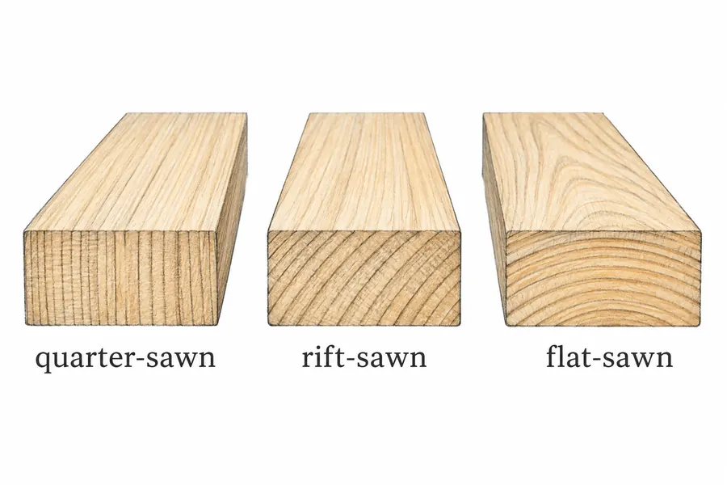

圖解 9.3　木材的三種切法（示意）

USDA 的資料顯示，木材在 tangential 方向的尺寸變化通常大於 radial 方向。

這就是切向為什麼會影響長期變形。

製琴師選板時，往往是在四個條件之間取得平衡：可用的木紋方向、重量、剛性、美觀。然後再依木料和設計選擇切法。〔S707〕〔S708〕

| **重點與應用** | **內容** |
|----|----|
| 核心概念 | 從原木鋸板時，年輪相對板面的方向不同，就會形成 quarter-sawn、rift-sawn、flat-sawn 等不同取向。 |
| 關係與條件 | 但「quarter-sawn = 高級，flat-sawn = 低級」仍然太簡化。 |
| 應用方向 | 判讀木材與材料資訊。 |

## 9.4　雲杉與面板

義大利傳統曼陀林的面板，大量使用歐洲雲杉／挪威雲杉（European / Norway spruce，學名 *Picea abies*）。另一種說法是廣義的細年輪雲杉（fine-grained spruce）。

2022 年的研究指出，歐洲製琴長期偏好雲杉，原因之一就是它「低密度 + 良好機械性質」的組合。

Calace 現行各級圓背曼陀林，也持續使用細年輪／特細年輪雲杉（fine-grained / extra fine spruce）。〔S705〕〔S711〕

不同雲杉之間，確實有平均物性和供應上的差異：

| 名稱 | 中文 | 說明 |
|---|---|---|
| Sitka spruce | 西特卡雲杉 | 北美常見樹種 |
| Engelmann spruce | 恩格曼雲杉 | 北美常見樹種 |
| Red / Adirondack spruce | 紅雲杉／阿迪朗達克雲杉 | 北美常見樹種 |
| European spruce | 歐洲雲杉 | 歐洲傳統常用 |

資料確實顯示它們之間有平均物性和供應差異。

但**樹種名稱不能替代個體選材**。

兩片同樣標成 European spruce 的板子，密度、年輪寬度、纖維偏斜、局部缺陷和剛性都可能不同。

所以製琴師通常會把重量、敲擊感、彎曲感與實際厚度合起來，一片一片評估。

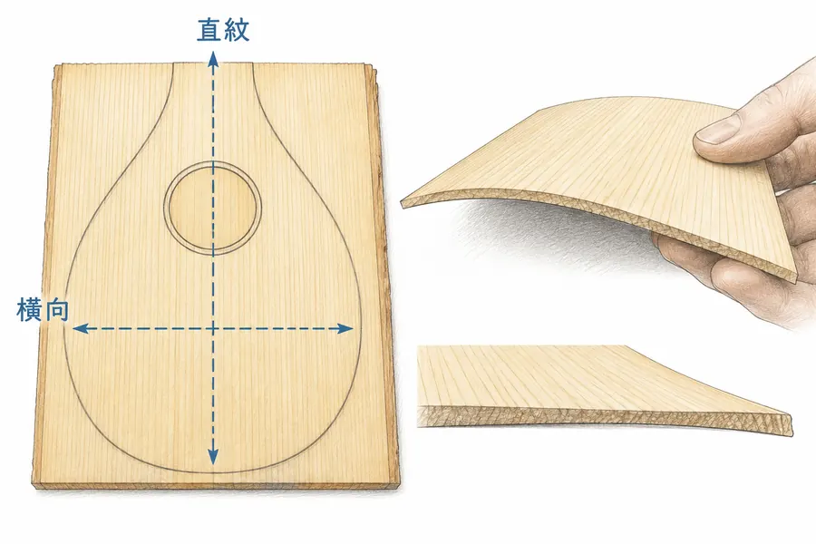

圖解 9.4　雲杉與面板（示意）

> **常見誤解：「年輪越細越好。」**
> 這不是普遍規則。
> 非常均勻、筆直的木紋（grain）確實有利於可預測性和視覺傳統。
> 但年輪寬度只是眾多變數之一。
> 只拿「年輪緊密度（grain tightness）」去排聲音名次，會忽略**晚材比例**和整片板材的機械性質。

| **重點與應用** | **內容** |
|----|----|
| 核心概念 | 義大利傳統曼陀林面板大量使用 European / Norway spruce（Picea abies）或廣義 fine-grained spruce。 |
| 關係與條件 | Sitka、Engelmann、Red/Adirondack、European spruce 之間確實有平均物性和供應差異，但樹種名稱不能替代個體選材。 |
| 應用方向 | 判讀木材與材料資訊。 |

## 9.5　楓木與琴體

楓木（maple）在曼陀林家族裡的用途，比「單一背板木」廣得多。

Suzuki 2017 型錄中的 M-30 使用楓木 **15 片式琴身**（15-piece body）。

M-100 則是楓木 **27 片式琴身**，搭配楓木琴頸。

Calace 的音樂會（concert）型號也有 31 或 33 條肋條的楓木琴身。

這些例子說明：楓木可以被用在完全不同的結構上——窄肋條、琴頸，甚至雕刻背板。〔S714〕〔S711〕

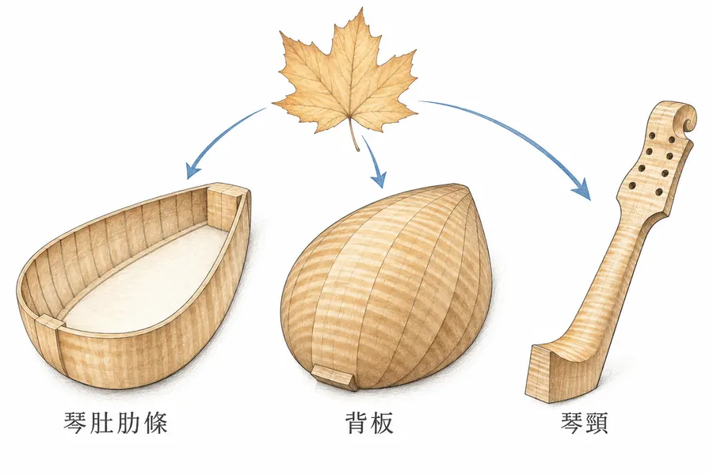

圖解 9.5　楓木與琴體（示意）

美式**雕刻面板（carved-top）**傳統後來常見「雲杉面板 + 楓木背側板」。

但 Orville Gibson 1898 年的實物，其實用的是**雕刻的胡桃木（walnut）背板**，以及整體的胡桃木側板與琴頸。

> **常見誤解：「雲杉＋楓木是曼陀林自古以來的標準組合。」**
> 不對。那是後來形成的品牌常規。
> 把後來的常規倒推成「發明起點的唯一材料組合」，會讀錯歷史。〔S702〕

**火焰紋（flame）、水波紋（quilt）、鳥眼紋（birdseye）**這些 figure，是木纖維生長方向造成的視覺現象。

它們**不等於聲學等級**。

花紋很強烈的楓木，可能增加加工難度，纖維方向也更複雜。

市場常把漂亮的花紋和高階型號綁在一起。

但這更多反映的是**選材、工時與美學價值**，不應該直接換算成「一定更響」。

| **重點與應用** | **內容** |
|----|----|
| 核心概念 | Maple 在曼陀林家族裡的用途比單一「背板木」廣。 |
| 關係與條件 | 美式 carved-top 傳統後來常見 spruce top 配 maple back/sides，但 Orville Gibson 1898 實物其實使用 carved walnut back 和整體 walnut sides/neck。 |
| 應用方向 | 判讀木材與材料資訊。 |

## 9.6　玫瑰木的種類與用途

玫瑰木（rosewood）是一個**商業名稱**，涵蓋很多種木材。

不同 **黃檀屬（Dalbergia）** 的樹種，在密度、顏色、氣味與加工性上差異很大。

| 品牌／型號 | 玫瑰木的用法 |
|---|---|
| 傳統圓背曼陀林 | 常見玫瑰木肋條 |
| Calace（目前不少型號） | 標示特級玫瑰木琴身（extra rosewood body） |
| Suzuki MC-836（2017 型錄） | 記載為玫瑰木平背琴身（rosewood flat body） |

〔S711〕〔S714〕

因為「rosewood」常被行銷當成一個熟悉單字，二手市場很容易把任何深色木材都寫成 rosewood。

> **常見誤解：「照片上看起來深色，就是玫瑰木。」**
> 如果沒有原廠型錄、製琴師紀錄或可靠的木材鑑定，只憑照片很難確認**樹種（species）**。
> 第 20 章的資料庫因此會把「產品頁標示 rosewood」和「學名已確認」分成兩種不同的可信度。

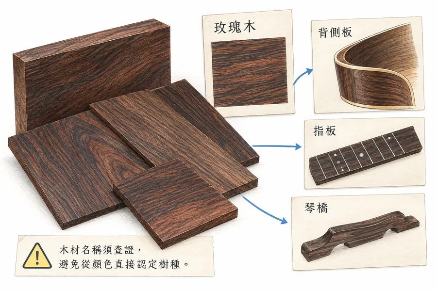

圖解 9.6　玫瑰木的種類與用途（示意）

玫瑰木研究還要確認三件事：**物種、來源文件、跨境規定**。

**瀕危野生動植物國際貿易公約（Convention on International Trade in Endangered Species，CITES）** 的締約國大會第 18 屆會議（CoP18），修訂了 **附註 15（Annotation #15）**。

這次修訂把**製成品樂器（finished musical instruments）**、**製成品零件（finished parts）**和**配件（accessories）**納入豁免範圍。

但**巴西玫瑰木（Dalbergia nigra，Brazilian rosewood）**屬於**附錄一（Appendix I）**，不適用同一套邏輯。

各國的進出口規定，還可能額外要求文件。

對古董樂器與跨境交易來說，法規判讀有兩個依據：**當下規定**和**實際物種**。要確認該物種與該物件是否符合豁免條件。〔S709〕〔S710〕

| **重點與應用** | **內容** |
|----|----|
| 核心概念 | Rosewood 是涵蓋多種木材的商業名稱。 |
| 關係與條件 | 因為「rosewood」常被行銷當成一個熟悉單字，二手市場也容易把任何深色木材寫成 rosewood。 |
| 應用方向 | 判讀木材與材料資訊。 |

## 9.7　黑檀、桃花心木與其他材料

**黑檀（ebony）**密度高、耐磨，因此常見於**指板（fingerboard）**和**琴橋（bridge）**。

1898 年的 Gibson 實物就使用黑檀指板和琴橋。

現代 Calace 高階型號也常用**加彭黑檀（Gabon ebony）**指板。

這些部位選材的第一個理由，通常是**耐磨、尺寸穩定與加工性能**。然後才依所在部位，評估它的聲學作用。〔S702〕〔S711〕

**桃花心木（mahogany）**常見於琴頸。

Suzuki M-30、MD-4 和 MC-836 的 2017 年規格，都列桃花心木琴頸。

琴頸需要足夠剛性、相對低的重量和良好加工性。

這些工程條件，比「桃花心木比楓木暖」這種說法更直接。〔S714〕

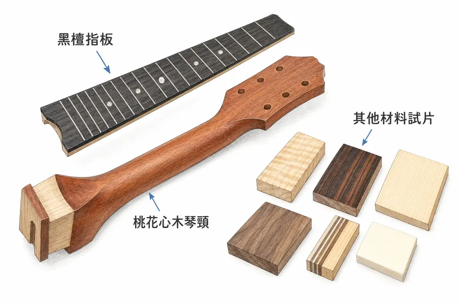

圖解 9.7　黑檀 桃花心木與其他材料（示意）

**胡桃木（walnut）**在 Orville Gibson 1898 的實物裡扮演極重要的角色：背板、側板、琴頸與頭部結構都大量使用胡桃木。

**櫻桃木（cherry）**、**梨木（pear）**及其他**果樹木材（fruitwood）**，在歐洲歷史製琴中也可見到。

這些材料提醒我們一件事：

曼陀林的重點從來不是某一個樹種，而是**一個材料系統**。這個系統受三件事影響：地區供應、工藝傳統與設計目的。〔S702〕

| **重點與應用** | **內容** |
|----|----|
| 核心概念 | Ebony 高密度、耐磨，因此常見於 fingerboard 和 bridge。 |
| 關係與條件 | Mahogany 常見於琴頸。 |
| 應用方向 | 判讀木材與材料資訊。 |

## 9.8　乾燥與含水率

剛砍下來的木材含水率高，不適合直接做精密樂器。

乾燥的目的有三個：

1. 讓重量變輕。
2. 讓木材接近未來使用環境的**平衡含水狀態**。
3. 降低後續尺寸變化與內應力風險。

**自然乾燥（air drying）**、**窯乾（kiln drying）**和長期**熟成（seasoning）**可以是不同流程。

但最後都要面對同一件事：**木材會隨環境再吸濕或失水**。〔S723〕

USDA 指出，木材在纖維飽和點以下，會隨含水率變化而收縮或膨脹，而且 tangential 與 radial 方向的變化不同。

樂器面板很薄，膠合又把不同方向的零件黏在一起。

所以濕度變化不只是讓整把琴「變大變小」，還會產生**內部應力**。〔S708〕

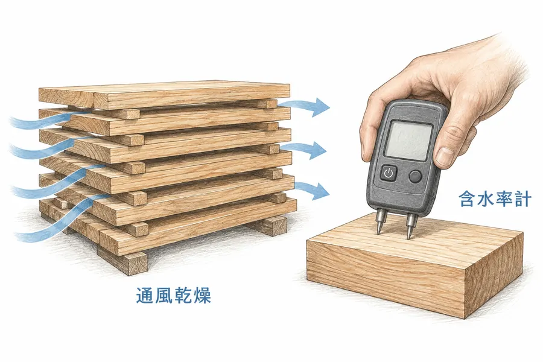

圖解 9.8　乾燥與含水率（示意）

這也解釋了為什麼會出現以下現象：

| 環境 | 常見狀況 |
|---|---|
| 乾燥地區 | 面板裂縫（top crack）、接縫開膠（open seam）、琴格端凸出（fret sprout） |
| 濕度高 | action 上升、面板隆起、琴頸狀態改變 |

保養重點在於：**避免長時間超出合理環境，也避免劇烈變化**。

第 21 章會把這些風險轉成日常操作。

| **重點與應用** | **內容** |
|----|----|
| 核心概念 | 剛砍伐的木材含水率高，不適合直接做精密樂器。 |
| 關係與條件 | USDA 指出，木材在 fiber saturation point 以下會隨含水率變化而收縮或膨潤，而且 tangential 與 radial 方向變化不同。 |
| 應用方向 | 判讀木材與材料資訊。 |

## 9.9　材料與音色的判讀

木材會影響聲音，這是可以量測的。

因為密度、剛性和阻尼會影響板的**模態（mode）**。

但「某樹種必然產生某音色」就說得太滿了。

2022 年的研究直接把**面板木材性質（soundboard wood properties）**和有限元素結果連起來，證明材料參數很重要。

但它同時也顯示：整體設計和板材幾何不能被排除在外。〔S705〕

更精確的說法應該是這樣：

> 在相同或相近的幾何下，材料機械性質的差異會改變結構振動。
> 但實際樂器裡，幾何、厚度、**力木（bracing）**、琴橋和製作公差也一起在改變。

這句話比較長，卻比「雲杉＝明亮」可靠得多。

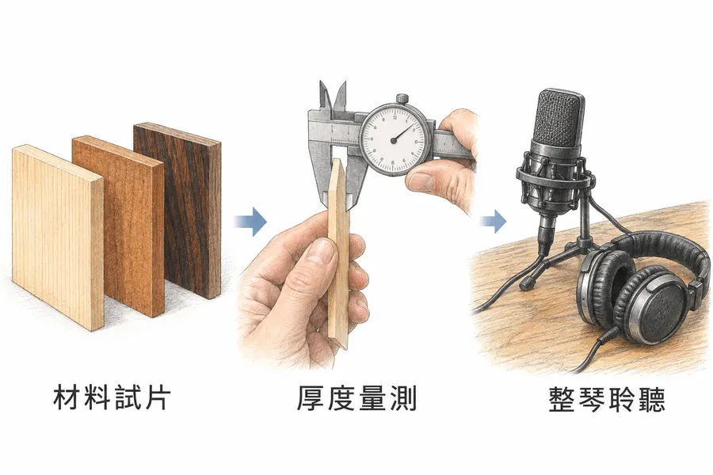

圖解 9.9　材料與音色的判讀（示意）

製琴師的經驗詞彙仍然有價值。

當一位製琴師長期使用某種木料，他對加工、厚度與成品反應的經驗可以非常準確。

只是這種經驗應該標示為**工藝知識**，並且清楚交代材料與設計的適用條件。

| **重點與應用** | **內容** |
|----|----|
| 核心概念 | 木材會影響聲音，因為密度、剛性和阻尼會影響板的模態，這是可以量測的。 |
| 關係與條件 | 更精確的說法應該是：「在相同或相近幾何下，材料機械性質的差異會改變結構振動。」 |
| 應用方向 | 判讀木材與材料資訊。 |

## 9.10　案例：三種品牌的材料配置

Suzuki 2017 型錄提供了一組很適合教學的量產資料：

| 型號 | 面板 | 琴身 | 琴頸 | 指板／琴橋 |
|---|---|---|---|---|
| **M-30** | 雲杉 | 楓木 15 片式 | 桃花心木 | 玫瑰木／黑檀 |
| **M-100** | — | 楓木 27 片式 | 楓木 | 黑檀 |

若只用「木種音色」思考，很容易直接說：「M-100 因為是楓木琴頸，所以聲音如何如何。」

但真正同時變動的還有肋條結構、製作等級與其他細節。

所以不能單獨歸因。〔S714〕

圖解 9.10　三組案例的來源記錄；木材規格見本節正文（示意）

Calace 現行系列的變化更複雜：玫瑰木 25 條肋條、楓木 31／33 條肋條、24 與 29 格、不同琴頭與裝飾等多維變化。

材料配置和產品系列綁在一起。

所以使用者比較的應該是：**材料與結構共同構成的整體設計**。〔S711〕

Orville Gibson 1898 的實物，更直接打破後世的刻板印象：**雕刻雲杉面板配胡桃木背板、側板與琴頸**。

後來常見的配置則是雲杉配楓木。

這把琴在歷史上仍具有重大設計影響，證明經典結構不需要依賴我們今天熟悉的材料口號。〔S702〕

| **重點與應用** | **內容** |
|----|----|
| 核心概念 | Suzuki 2017 型錄提供一組很適合教學的量產資料：M-30 是 spruce top、maple 15-piece body、mahogany neck、rosewood/ebony fingerboard & bridge。 |
| 關係與條件 | 若只用「木種音色」思考，很容易直接說 M-100 因 maple neck 所以聲音如何。 |
| 應用方向 | 判讀木材與材料資訊。 |

## 9.11　案例：木材商業等級的解讀

「AAA」「master grade」「select」這些木材等級，通常重點在**品牌或供應商自己的分級**。

它們可能包含年輪、顏色、缺陷、花紋和供應稀有度。

但不同品牌的 AAA 不能直接橫向比較。

> **常見誤解：「AAA 是全球統一的木材標準。」**
> 不是。若產品頁沒有說明分級規則，讀者應該把它當成**商業描述**，不要當成機械性能證明。

**火焰楓木（flamed maple）**主要描述的是花紋。

漂亮的火焰紋確實有美學與市場價值。

但你不能從照片判斷那塊板的**彈性模數**或**阻尼**。

對演奏者而言，比「木頭等級」更直接的評估，仍然是整把琴：

- 反應是否均衡？
- 音準與**設定（Setup）**是否穩定？
- 動態是否符合用途？

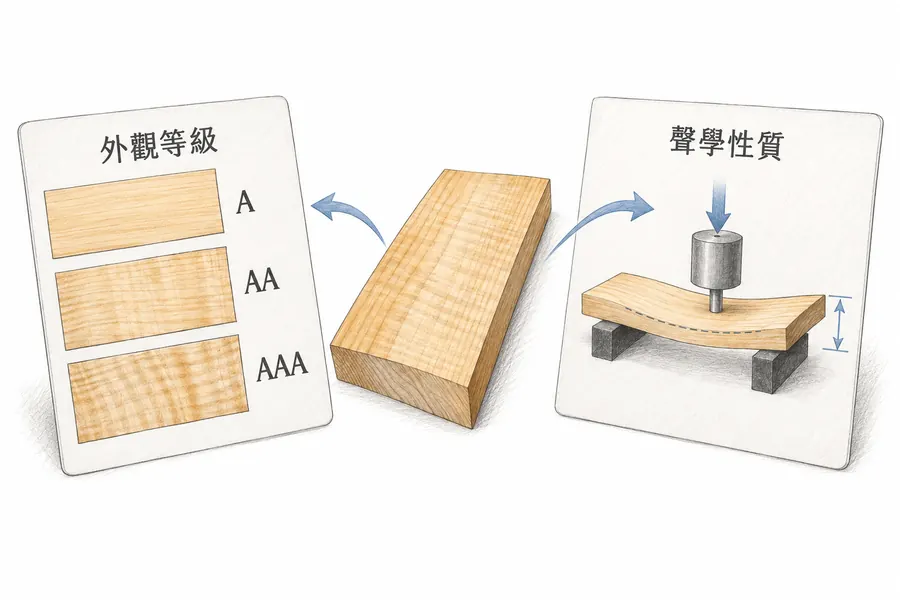

圖解 9.11　案例 木材商業等級的解讀（示意）

真正需要材料證據的場合，通常是這幾種：

- 古琴鑑定
- CITES 跨境
- 修復匹配
- 研究

這時候應該依文件、顯微特徵、專業鑑定，或至少多來源的歷史規格。這些都能提高物種辨認的可靠程度。

## 表 9-1｜常見材料：先看功能，再談音色

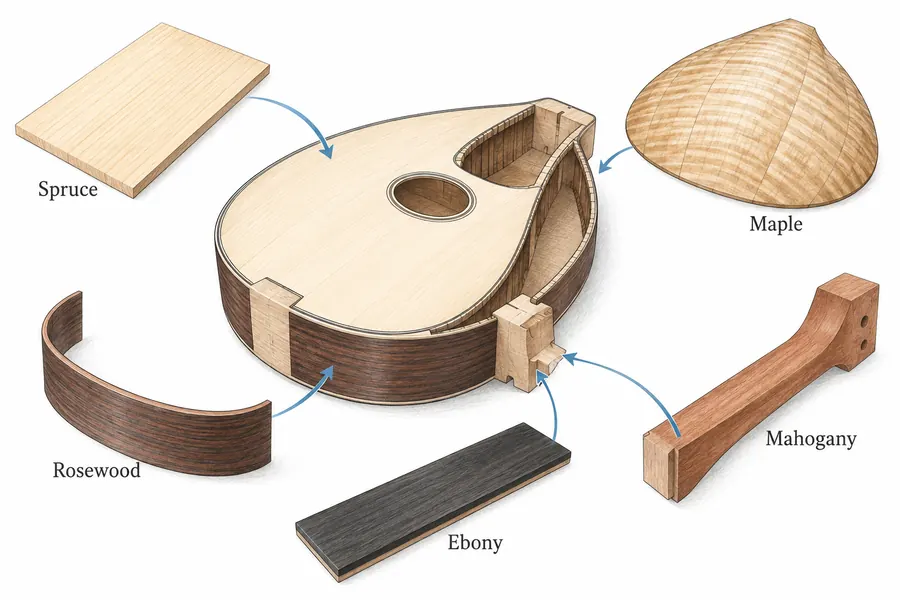

| **材料** | **常見部位** | **首先要看的功能** | **避免的過度簡化** |
|----|----|----|----|
| **Spruce（雲杉）** | soundboard（面板） | 低質量／剛性組合 | 「一定亮」 |
| **Maple（楓木）** | ribs（肋條）、back（背板）、neck（琴頸） | 剛性、加工、外觀 | figure＝聲音等級 |
| **Rosewood（玫瑰木）** | bowl ribs（圓背肋條）、fingerboard（指板） | 密度、耐磨、裝飾 | 所有深色木都是 rosewood |
| **Ebony（黑檀）** | fingerboard（指板）、bridge（琴橋） | 耐磨、尺寸穩定 | 黑色就一定是 ebony |
| **Mahogany（桃花心木）** | neck（琴頸）、body parts（琴身零件） | 重量與加工平衡 | 「一定溫暖」 |

圖解 表 9-1｜常見材料：先看功能，再談音色（示意）

| **【科學證據】 木材的密度、彈性和含水率確實會影響結構；但樹種名稱本身不能唯一預測成品音色。** |
|----|

| **【法規提醒】 finished musical instruments 在 CITES Annotation #15 下有特定豁免，但 Brazilian rosewood（Dalbergia nigra）屬 Appendix I；跨境前應依當時法規、物種和文件確認。** |
|----|

## 自我學習題庫

學習檢查：作答、核對、複習

先自己作答，再看答案。答錯時回到本章相關小節重新讀一次。

**1. 木材密度高就一定聲音比較好嗎？**

- A. 一定

- B. 不一定，還要看設計與厚度等因素

- C. 只對舊琴成立

- D. 只對新琴成立

**2. Quarter-sawn 指的是？**

- A. 木材切法

- B. 調弦法

- C. 撥片法

- D. 和弦轉位

**3. AAA 木材等級通常應怎麼看？**

- A. 全球統一標準

- B. 多半是品牌或供應商自己的分級

- C. 代表一定是某樹種

- D. 代表一定手工製作

**答案：1.B　2.A　3.B**

## 本章主要查證來源

查證來源：找原文、核條件、留紀錄

**【S705】Quintavalla et al.：The Acoustics of Traditional Italian Mandolins and Their Relation with Soundboard Wood Properties（International Journal of Wood Culture 2, 2022）。** 義大利歷史與現代曼陀林的 bridge admittance、聲輻射、模態與 soundboard wood 研究。

https://www.sciencedirect.com/org/science/article/pii/S2772318622000017

**【S707】USDA Forest Products Laboratory：Wood Handbook—Wood as an Engineering Material（FPL-GTR-282, revised 2021）。** 木材結構、物理性質、機械性質、乾燥、膠合與材料工程基礎。

https://research.fs.usda.gov/fpl/wood-handbook

**【S708】Glass & Zelinka, USDA Forest Products Laboratory：Moisture relations and physical properties of wood（Wood Handbook Chapter 4, 2021）。** 木材吸濕、平衡含水率、收縮膨潤與尺寸穩定的官方技術資料。

https://research.fs.usda.gov/treesearch/62243

**【S709】CITES：CoP18 Proposal 52 / Annotation #15 amendment（2019）。** Dalbergia spp. Annotation #15 中 finished musical instruments 等豁免條文；Brazilian rosewood 另屬 Appendix I。

https://cites.org/sites/default/files/eng/cop/18/doc/E-CoP18-105-01-A2.pdf

**【S710】CITES Secretariat：Study / notification on Annotation #15 and musical instruments（2025）。** 對 finished musical instruments、parts、accessories 豁免與 Dalbergia 貿易的後續研究背景。

https://cites.org/sites/default/files/notifications/E-Notif-2025-030.pdf

**【S711】Liuteria Calace：Mandolini – official specifications（accessed 2026-10-06）。** 33.5 cm 弦長、24/29 格、25/31/33 ribs、spruce top、rosewood/maple body 等現行規格。

https://www.calace.it/en/mandolini

**【S714】Suzuki Music / Suzuki Violin：2017 String Instrument Catalog（2017）。** M-30、M-100、MD-4、MD-10、MC-836 的弦長、木材與規格。

https://www.suzuki-music.co.jp/app/uploads/2017catalog14.pdf

**【S723】USDA Forest Products Laboratory：Drying and control of moisture content and dimensional changes（technical report / Wood Handbook）。** 乾燥、平衡含水率與尺寸變化控制。

https://research.fs.usda.gov/treesearch/37419

---
